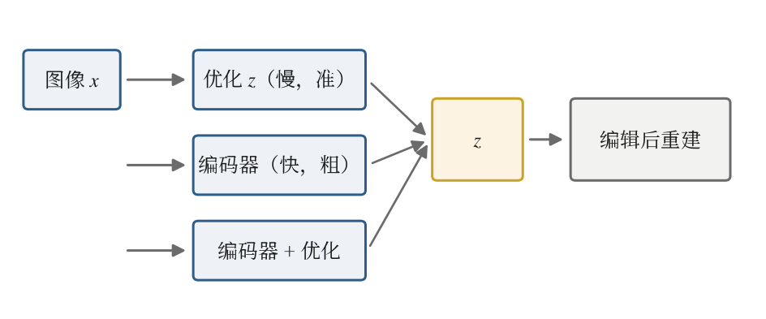
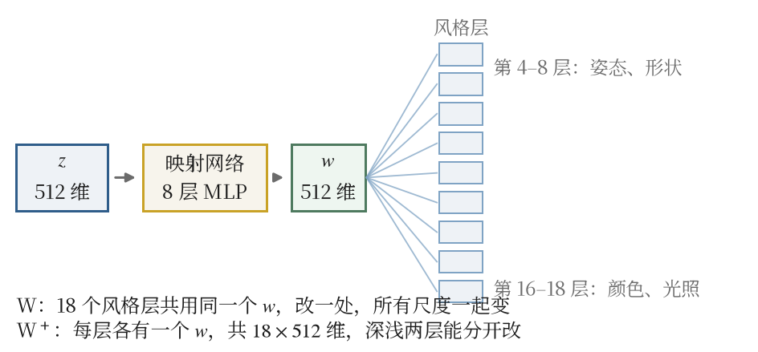
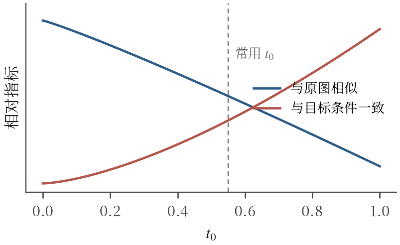
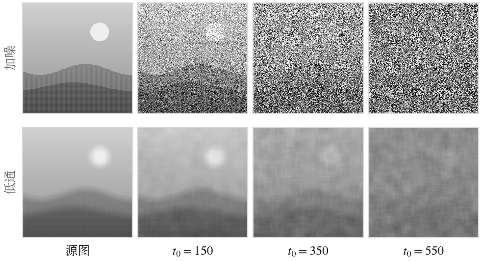

# 在潜空间与噪声里改

最早的编辑方法有两类：一类在 GAN 的潜空间里找方向，另一类在扩散模型上加噪再去噪。前者给了“语义方向”的概念，后者给了“编辑强度”的旋钮。

两类方法出现的年代差了几年。2018 年前后，StyleGAN 把隐空间整理得比较规整，人们发现在里面走一条直线就能改性别、年龄、发色，编辑第一次变成“找一个方向、调一个步长”这么简单的事。2021 年，扩散模型开始出图，SDEdit 提出把源图加噪到一个中间时刻再重新去噪，用噪声水平代替方向，控制“改多少”。两条路线的共同点是没有训练新的编辑器，都在已有模型的坐标系里操作。

它们失败的场合也很清楚：只能整张图一起改，说不清要改哪里。这个缺陷催生了后面所有基于注意力与结构条件的方法。读这一章时，把两个概念记住就够了——方向，和强度。

## GAN 反演

给定一张图 $x$，要找一个 $z$ 使 $G(z)\approx x$。三种做法。

优化式：直接对 $z$ 做梯度下降，最小化重构误差。慢，但准。

编码器式：训练一个网络把图映射成 $z$。快，但对没见过的图泛化差。

混合式：编码器给初值，再优化几十步。

把优化式写出来是

$$z^{*}=\arg\min_{z}\ \mathcal{L}\big(G(z),x\big)+\lambda\|z\|^{2},$$

$\mathcal{L}$ 通常是 LPIPS 加一项逐像素的 L2。只用 L2 会得到一张 PSNR 高但纹理糊的图，因为像素误差对模糊比对结构错误更宽容；加上 LPIPS 之后，优化会去照顾特征层面的相似。正则项 $\|z\|^{2}$ 的作用后面会看到，它决定了落点离潜空间中心有多远。

优化式的每一步要一次前向和一次反向。StyleGAN 在 $1024^{2}$ 上单次前向在 A100 上约几十毫秒，一千步优化下来就是一两分钟一张图（量级估计，随实现与硬件变化）。精度可以做到很高，重建 LPIPS 能压到 0.05 以下，代价是每换一张图都要重跑一遍。

它还有两个可调项：初值与早停。初值取 0 意味着从潜空间中心出发，收敛慢但落点稳；初值取编码器输出则收敛快，落点已经偏中心。早停是在重建误差还在下降时就停下，用一点精度换一点编辑性。曲线上的每一个停点，都是失真与可编辑性权衡上的一个选择。

编码器式把这一步摊到训练里：用几万到几十万张图训练一个编码器 $E$，损失是

$$\mathcal{L}_{E}=\big\|G(E(x))-x\big\|_{2}^{2}+\lambda_{p}\,\mathrm{LPIPS}\big(G(E(x)),x\big)+\lambda_{i}\,\mathcal{L}_{\text{id}}+\lambda_{a}\,\mathcal{L}_{\text{adv}},$$

四项分别管像素、感知、身份保持与真实度。身份项用一张人脸识别网络算特征距离，防止编码器为了重建把脸改掉；对抗项让重建结果落在数据分布内，而不是落在两个样本中间。训练好之后，一次前向约十毫秒（量级估计），比优化式快三个数量级。

代价是精度与泛化。编码器学到的是一个从图像到潜码的平均映射，遇到训练分布之外的图（画、老照片、强逆光的自拍），它会给出一个“最像的平均解”，重建出来的人脸往训练集均值靠。同一个编码器在 FFHQ 这类规整数据上重建得很好，换一个数据集就明显退化，这是编码器式最实在的短板。

混合式取中间：编码器给初值，再优化几十步。时间大约是纯优化式的十分之一，精度接近纯优化式。工业上用得最多的是这一种，因为它在“一张图几百毫秒”这个预算内能给出可接受的重建。

换成网络前向次数（NFE）更好比较：编码器式 $1$ 次，混合式百次上下，优化式两千次上下（一千步，每步一次前向加一次反向，按两次前向折算），而后面 SDEdit 跑 $50$ 步采样就是 $50$ 次。这个数量级差异决定了两类方法能用在什么场景：前者可以做成在线服务，后者只能离线批量跑。

三种做法的差别可以列成一张表。

| 做法 | 单图耗时（量级） | 重建精度 | 域外泛化 | 落点位置 |
|---|---|---|---|---|
| 优化式 | 分钟 | 最高 | 好（只要生成器能表示） | 靠边缘 |
| 编码器式 | 十毫秒 | 中 | 差 | 靠中心 |
| 混合式 | 秒级 | 较高 | 中 | 中间 |

反演还可以选择在哪个空间做。$W$ 只有 512 维，$W^{+}$ 有 9216 维，后者的表达能力强得多，重建 LPIPS 通常能从 0.10 量级降到 0.03 量级（量级估计，随生成器与优化预算变化）。代价是 $W^{+}$ 的解不唯一：18 份 $w$ 可以互相补偿，同一张图有无穷多种拆法，而这些拆法在编辑时的行为完全不同。直接用 $W^{+}$ 反演再加方向，经常出现“这一层改了、那一层又改回去”的现象。常见的做法是逐层优化：先只放开浅层的几份 $w$，收敛后再放开下一层，让修改停在需要它的那几层上。

这三种做法暴露了一个问题：重建好不等于编辑好。优化式能找到精确的 $z$，但这个 $z$ 可能落在潜空间的边缘，沿着语义方向移动时容易跑出合理区域。

这句话值得展开。优化式的目标只有“重建得像”，没有“落点要常见”。生成器要拟合一张具体的图，常常会用到一些不常见的坐标组合，比如某个方向上的系数特别大。潜空间在那里的局部结构是病态的：很小的位移对应很大的图像变化，而且变化的方向不可预测。于是沿着“加胡子”的方向走一步，本来只想改下巴，结果把整张脸的形状也带歪了。

编码器式的落点相反，它被训练成输出“典型”的坐标，天然靠近分布中心。代价是重建差一点，好处是周围的局部映射平缓，走一步就是一步。这个此消彼长有个名字，叫失真与可编辑性的权衡：重建误差小的方法往往编辑起来更野，重建误差大的方法往往编辑起来更稳。正则项 $\lambda\|z\|^{2}$ 就是在优化式里人为地往中心拉，$\lambda$ 越大，落点越靠里，重建越差，编辑越稳。调这个 $\lambda$ 本质上是在这条权衡曲线上选一个点。

编码器泛化差的根源在训练数据。它学的是“图像到潜码”的映射，训练对是真实图与反演出来的潜码，这些潜码又集中在生成器能表示的范围内。它从没见过“一张在生成器能力之外的照片对应什么潜码”，因为这种对应根本不存在。遇到域外输入时，它只能给出一个最接近的分布内解，这个解会把输入的独特之处抹平。这是数据分布的问题，不是网络容量的问题，加深加宽也解决不了。

## 语义方向

StyleGAN 在 $z$ 与生成器之间加了一个映射网络，得到 $w$。$w$ 所在的空间更规整，方向更容易对应到属性，比如性别、年龄、发色。

512 维听起来不大，但人脸的各处高度相关，真正的自由度远小于像素数，这个维度已经能覆盖大部分变化。

映射网络是八层 MLP，输入输出的维度都是 512。生成器有 18 个风格层（$1024^{2}$ 输出时，从 $4^{2}$ 到 $1024^{2}$ 共九个分辨率，每个分辨率两层），每层通过 AdaIN 用一份 $w$ 调制特征图的均值与方差。训练时 18 层共用同一个 $w$，这个共享的 512 维向量所在的集合就是 $W$ 空间；如果把 18 份 $w$ 各自放开，得到 $18\times512=9216$ 维的 $W^{+}$。

$W$ 为什么比 $z$ 规整，直觉是这样的。$z$ 的先验是标准高斯，采样密度在各方向相同，但坐标轴与语义毫无关系——某个坐标变大，可能同时让脸变宽、让头发变浅。映射网络是学出来的，它的任务是把训练数据在 $z$ 中占据的那块弯曲的区域，摊平到 $W$ 里。摊平之后，“有胡子”与“没胡子”两组样本在 $W$ 中大致被一张超平面分开，方向就有了意义。这个过程有点像白化：把相关的坐标去相关，把不均匀的尺度归一。

$W^{+}$ 换来的是分层控制。浅层（第 4 到 8 层）决定姿态、脸型、发型这类大尺度结构，深层（第 16 到 18 层）决定颜色、光照、纹理这类细节。想改发色又不想动脸型，就在深层加方向；想让人转头，就在浅层加。只用 $W$ 的话，所有层共用一个向量，改一处，所有尺度一起变，这就是 $W$ 表达力受限的地方。

找方向的办法很直接：在 $W$ 空间训练一个线性分类器区分“有胡子”与“没胡子”，分类器的法向量就是属性方向。沿着它移动 $w' = w + \alpha n$，就能改属性。

法向量怎么来的，可以写清楚一点。取 $N$ 个采样得到的 $w$，用属性标注（真实的，或者用分类器预测的）训练一个线性 SVM，得到超平面 $n^{\top}w+b=0$。$n$ 垂直于这个超平面，从“没有该属性”的一侧指向“有该属性”的一侧。为了统一不同属性的步长，通常把 $n$ 归一化成单位向量，$\alpha$ 就变成了“沿方向走多远”的物理量。

$\alpha$ 的合适范围有量级可循。$w$ 各维的标准差在 1 上下（不同实现略有差别），把 $n$ 归一化之后，$|\alpha|$ 在 0.5 到 1 之间通常已经能看出明显变化，超过 3 往往开始崩坏——出现重复的纹理、多余的物体、或者整个人脸的结构错位。这个范围是经验量级，不同生成器、不同属性差别不小。逐个属性标定 $\alpha$ 是工程上的常规操作，因为同一个 $\alpha$ 对不同属性、不同 $w$ 的效果完全不一样。

不给标注也能找方向。对大量采样得到的 $w$ 做 PCA，前几个主成分往往对应可解释的变化：第一个常是尺度或者姿态，后面几个可能是光照方向、是否微笑。这个做法的好处是完全无监督，坏处是主成分不保证对应单一属性，第一主成分经常把“脸的大小”和“离镜头远近”混在一起。

有文本监督则可以指定想改什么。取一个“有胡子”的文本描述，在 $W^{+}$ 里优化一个偏移量 $\Delta w$，让生成结果的 CLIP 相似度上升，同时用 $\|\Delta w\|$ 惩罚偏移幅度：

$$\Delta w^{*}=\arg\min_{\Delta w}\ \Big(1-\cos\big(E_{\text{img}}(G(w+\Delta w)),E_{\text{txt}}(c)\big)\Big)+\lambda\|\Delta w\|_{2}^{2}.$$

$\lambda$ 又一次扮演“别走太远”的角色。这种做法能改线性分类器找不到的属性，代价是每个属性都要单独优化一次，而且优化出来的方向不保证只改那一件事。

局限在线性假设。属性之间并不正交，加胡子的方向可能同时改变年龄。后来的工作用多个方向的组合来缓解。

判断一个方向好不好，有两组数可以看。一组是目标属性的命中率：用分类器判断编辑前后的图是不是真的获得了该属性，命中率越高越好。另一组是泄漏：编辑前后其他属性的分数变了多少。把泄漏写成 $|\Delta s_{\text{other}}|/|\Delta s_{\text{target}}|$，值越小越解耦。两组数要一起看：只报命中率的方法可以把 $\alpha$ 调大来刷分，代价是泄漏跟着爆。

方向能不能叠加，是另一个容易被高估的性质。把“加胡子”与“变老”两个方向加起来走一步，效果不等于分别走两步的和。两个方向在 $W$ 中并不正交，叠加后的位移可能偏离它们张成的平面；即使不偏离，生成器的非线性也让 $G(w+\alpha_{1}n_{1}+\alpha_{2}n_{2})$ 不等于依次施加的结果。稳妥的做法是顺序编辑：改一项，以当前结果为起点重新反演，再改下一项，每一步重新校验泄漏。

另一个容易混淆的操作是插值。取两张图的 $w$，在中间线性插值，得到的图看起来像两张图在溶解：五官同时存在两份，边缘发虚。原因是 $W$ 的线性结构只在局部成立，两点之间那条直线大部分落在数据流形之外。编辑要的是沿流形的路径，不是直线。这也是为什么“找方向”比“找两个端点”更实用：方向是局部的切向量，走小步时它一直在流形上。

线性假设到底哪里不成立，可以说得具体些。第一，分类器的超平面只是一个近似，属性在 $W$ 中的真实分布往往是弯曲的，法向量只在样本附近有效，走得越远越偏。第二，属性相关：训练数据里“有胡子”的人平均年龄偏大，分类器就会把“年龄大”的一部分信息编进法向量，于是加胡子顺带加了皱纹。第三，方向的作用依赖起点：同一个 $n$、同一个 $\alpha$，作用在一个年轻女性和一个老年男性身上，效果可以完全不同，因为潜空间在两点处的局部尺度不同。

工程上的应对是把一个大方向拆成若干小方向，每个只在一部分层、一部分区域生效；或者用条件化的方向，让 $\alpha$ 随 $w$ 变化。这些做法都能缓解，但没有把线性假设真正修好。

## SDEdit：用噪声控制强度

SDEdit 不需要反演。给定源图，先加噪到某个时刻 $t_0$

$$x_{t_0} = \sqrt{\bar\alpha_{t_0}}\,x_{\text{src}} + \sqrt{1-\bar\alpha_{t_0}}\,\epsilon,$$

再用新条件从 $t_0$ 去噪回 $t=0$。

$t_0$ 就是编辑强度。$t_0$ 小，加噪少，结果接近原图；$t_0$ 大，原图信息被抹掉，结果由条件主导。

把它写成分布的语言更清楚。加噪之后，$x_{t_0}$ 是从

$$q(x_{t_0}\mid x_{\text{src}})=\mathcal{N}\big(\sqrt{\bar\alpha_{t_0}}\,x_{\text{src}},\ (1-\bar\alpha_{t_0})I\big)$$

里采的一个样本。以它为起点跑反向过程，等于从一个“以源图为中心、方差由 $t_0$ 决定”的分布里，按目标条件采样出一条轨迹。$t_0$ 控制这个初始分布的宽度：宽度小，起点离源图近，采样过程只能做微调；宽度大，起点离源图远，采样过程有充分的自由重新组织画面。

具体数值能帮助建立感觉。用 $T=1000$、$\beta$ 从 $10^{-4}$ 线性增加到 $0.02$ 的日程（扩散模型实际常用 scaled-linear 或 cosine，这里只为了有具体数字）：

| $t_0$ | $\bar\alpha_{t_0}$ | $\sqrt{\bar\alpha_{t_0}}$ | 信噪比 |
|---|---|---|---|
| 100 | 0.895 | 0.946 | 8.5 |
| 200 | 0.656 | 0.810 | 1.9 |
| 300 | 0.394 | 0.628 | 0.65 |
| 400 | 0.194 | 0.440 | 0.24 |
| 500 | 0.078 | 0.279 | 0.084 |

$\sqrt{\bar\alpha_{t_0}}$ 是源图在 $x_{t_0}$ 中占的系数，可以粗略看作“保真的上限”：$t_0=200$ 时它还有 0.81，$t_0=400$ 时只剩 0.44。信噪比那一列是 $\bar\alpha_{t_0}/(1-\bar\alpha_{t_0})$，$t_0\approx260$ 时等于 1，此后噪声成分超过信号成分。实践里常用的 $t_0$ 落在 200 到 500 之间，与这组数据对得上。

为什么能保结构？低噪声阶段，$x_t$ 里保留了布局、颜色分布这些低频信息；去噪只需要重采样高频细节。$t_0$ 越大，保留的低频越少，改动越彻底。

这个说法可以验证。取一张合成图，分别在 $t_0=150,350,550$ 加噪，再把每张加噪图做一个 $20\times20$ 的均值滤波。均值滤波是低通，它把高频的噪声平均掉，留下的就是低频。

$t_0=550$ 那一列最能说明问题：上排看是一张纯噪声，下排的低通结果里，山脊的走向、太阳的位置清清楚楚。原因是噪声是白的，各频率功率相同，而图像的能量绝大部分集中在低频；低通把 $k\times k$ 个独立噪声平均，标准差降到 $1/k$，信号的低频部分却基本保留，信噪比的幅度因此提高约 $k$ 倍，换成 dB 是 $20\log_{10}k$。$20\times20$ 的窗口就是 26 dB 左右。

这个计算解释了两件事。第一，为什么加噪之后结构总是最后才丢：结构在低频，低频的信噪比最高。第二，为什么编辑强度可以用 $t_0$ 调：$t_0$ 越大，低频的信噪比越低，等到它降到 1 以下，布局才开始被重建。

失败模式也由此而来。$t_0$ 太大，低频被淹没，模型会按条件重新安排构图，源图的布局没了；$t_0$ 太小，只有高频被重采样，改动的只是纹理，用户看不到该改的地方变了。中间那段可用区间不宽，而且随条件强度移动：分类器-free 引导的强度调大，条件更强，需要更小的 $t_0$ 才能保住布局，否则画面会被推得过猛。调参时这两个旋钮要一起调。

还有两个容易忽略的点。一是随机性：SDEdit 走的是反向 SDE，每步都注入噪声，同一个 $x_{t_0}$ 采样两次结果不同，$t_0$ 越大差异越大。用确定性的 ODE 采样（比如 $\eta=0$ 的 DDIM）可以减小方差，但结果会更“平”，细节少一些。二是颜色漂移：整图的色调、白平衡由全局统计决定，改一处颜色，全局统计跟着变，生成的图整体偏色。这个问题不是 $t_0$ 能解决的，它需要空间上的局部化，也就是 mask 或者注意力。

$t_0$ 的合适取值还跟编辑类型有关。改颜色、改材质这类浅层属性，$t_0$ 取 200 到 300 就够，再大就开始动结构；换物体、增删元素这类需要新内容的任务，$t_0$ 要到 450 以上，否则新物体长不出来，只是把原物体涂成了另一个颜色。把两个任务放在同一个 $t_0$ 上，必然有一个效果差，这不是调参不到位，是两种任务需要覆盖的深度不同。

SDEdit 可以看成 inpainting 的一个特例：inpainting 在像素空间硬性保留 mask 外的内容，SDEdit 在噪声空间软性保留——加噪时整张图都被扰动，去噪时整张图都被重算，所谓“保留”只是源图在 $x_{t_0}$ 中还占着较大的系数。两者可以组合：先在 $t_0$ 加噪，再在每一步去噪之后把 mask 外的像素按比例拉回源图对应的加噪版本，这就是很多带 mask 的编辑方法的骨架。

## 两类方法的局限

SDEdit 没有定位能力。它改的是整张图，只是改多改少的区别。把猫变成绿色会把整张图的色调带偏。

定位缺失不是实现不够细，是机制决定的。扩散模型的每一步都作用在整张特征图上，U-Net 中间层还有全局的注意力，任何位置的变化都会通过注意力汇聚到其他位置。改了条件里的一个词，所有位置的噪声预测都会变，只是变的幅度不同。所谓“局部编辑”，在这些模型里从来不是真的只算了一个局部。

一个具体的例子：室内照片，白墙、木地板、一只橘猫。把“橘猫”改成“黑猫”，$t_0$ 取 300，结果里猫确实变黑了，但白墙偏冷、地板偏灰，整体曝光低了一点。原因是“黑猫”这个词进入了全局的文本嵌入，模型为了让画面协调，顺手压低了整个场景的亮度。要修，只能让改动只作用于猫所在的区域，这就必须在采样时引入空间约束。

GAN 反演的潜空间表达能力有限。它能改的属性，取决于生成器学到过什么；没见过的组合，怎么调都不对。

这个限制比听起来严重。生成器是一个从 512 维到百万像素的映射，它的像只是所有图像中很薄的一层。真实照片落在这一层之外的部分，反演只能给出最近点，最近点与原图的差就是无法消除的误差。属性方向又是在这一层上学出来的，它只能在生成器能表示的范围内移动。想给一个戴眼镜的人加胡子，如果训练集里戴眼镜的人很少留胡子，方向可能根本不存在，或者存在但与眼镜纠缠在一起。

还有几个具体的失效：分辨率固定，生成器只认一种尺寸，换尺寸要重采样，细节会变；域外图像（插画、显微镜照片、夜景）反演出来往训练分布靠，身份与风格一起丢；三维一致性差，人脸转动超过一定角度，侧脸的纹理是拼出来的，眼睛与牙齿会错位。

这两个局限指向下一步：让模型知道“改哪里”。这就是注意力操作与结构条件要解决的问题。

缺的那个信号，本质上是一个空间上的分配：文字里的每个词，对应画面上的哪一块区域。GAN 的方向没有这个信息，扩散的噪声水平也没有，它们调的都是全局量。注意力层恰好有这个信息，因为它算的本来就是“每个位置该看文本的哪个词”。

两类方法在视频上的失败也出于同一个原因。GAN 的方向逐帧施加，每帧的 $w$ 略有不同，方向的作用强度就不同，颜色会一跳一跳；SDEdit 逐帧加噪，每帧抽到的 $\epsilon$ 独立，去噪之后相邻帧的随机纹理对不上，$t_0$ 越大闪得越厉害。这不是参数没调好，是两种方法都在单帧的坐标系里工作，没有跨帧的约束。

## 留下的两个概念

第一，语义方向。虽然后来的编辑主要用扩散模型，但“在低维空间里找方向”的想法没有消失，只是从 GAN 的 $W$ 换成了扩散模型的噪声空间或文本嵌入。

换过去之后，找方向的手法几乎照搬：在文本嵌入上取“有胡子”与“没胡子”两个提示的词向量之差，得到一个方向，加到目标提示上；或者在噪声空间对一批反演结果做 PCA，取前几个主成分当作可编辑的方向。分类器法向量、PCA、文本监督这三种找法，在两个模型家族里都能用。差别在于扩散模型的“方向”没有 GAN 那么干净，因为文本嵌入对图像的作用是经过 cross-attention 分配的，一个方向可能同时影响多个区域。

第二，噪声水平作为强度旋钮。这个旋钮在后面的方法里反复出现：注意力操作靠“替换的步数”控制，FlowEdit 靠“从哪一步开始”控制，ChordEdit 靠两个时间参数控制。形式不同，本质都是“在多早的阶段介入”。

用一张表对照会更清楚。

| 方法 | 旋钮 | 调大之后 |
|---|---|---|
| SDEdit | $t_0$ | 改动更彻底，布局易丢 |
| 注意力替换 | 替换的步数 | 语义改得更实，纹理跟不上 |
| FlowEdit | 起始时刻 | 偏离源图更远 |
| ChordEdit | 两个时间参数 | 一步内的位移更大 |

这些旋钮之间没有统一的刻度，但它们回答的是同一个问题：源图的信息在多深的层次上被覆盖。理解这一点，比记住每个方法的具体参数有用得多。
