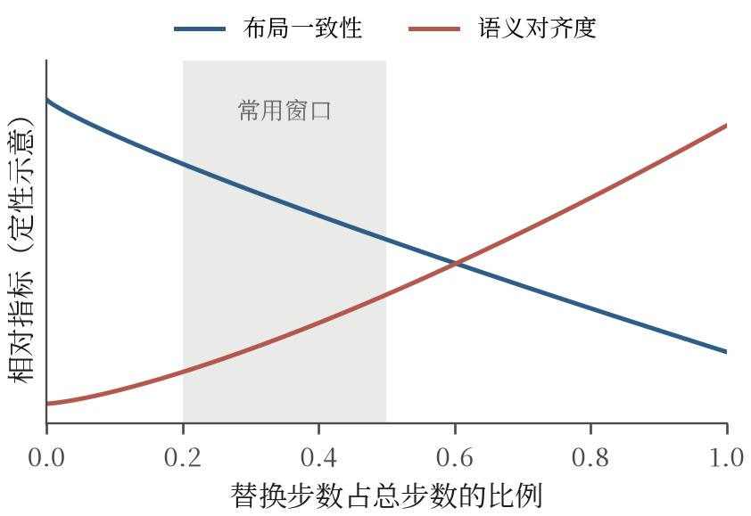
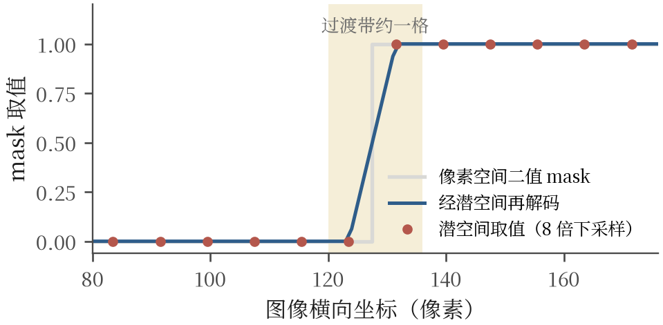

# 文本驱动的编辑

上一章的方法能改，但不知道该改哪里。文本驱动的方法围绕定位展开：利用 cross-attention 的空间含义，控制某个词影响哪些位置。

一个具体的场景：画面里是一只橘猫坐在木窗台上，窗外是傍晚的天。要把它换成柴犬，窗台的木纹、光线的方向、猫的姿势都该留着。

用上一章的 SDEdit，把图加噪到 $t_0=0.5$ 再按新提示词去噪，确实能换掉主体，但整幅图会重画一遍：窗台的花纹变了，窗棂的位置偏了几个像素，光的颜色也跟着换。原因是 SDEdit 的控制手段只有一个标量 $t_0$，它作用在整幅图上，没法说“只改这一块”。

要说出“只改这一块”，需要一条能通到具体位置的路径。交叉注意力提供了这条路：文本里每个 token 在每一层都有一张覆盖全图的分值分布，改这张分布，就改了该 token 影响的范围。

## 注意力图有空间含义

文本通过 cross-attention 进入网络。查询来自图像特征，键和值来自文本，注意力矩阵的每一行对应一个图像位置，每一列对应一个 token。

这个矩阵往往有清晰的空间结构。说“猫”时注意力集中在猫附近，说“天空”时集中在画面顶部。

### 一次交叉注意力的计算

第 $l$ 层交叉注意力的输入是图像侧特征 $z\in\mathbb{R}^{N\times d}$ 与文本侧特征 $\tau(y)\in\mathbb{R}^{L\times d'}$，其中 $N=H\cdot W$ 是潜空间的位置数，$L$ 是 token 数。三个投影矩阵把两边映射到同一个维度 $d_k$：

$$Q=zW_Q,\qquad K=\tau(y)W_K,\qquad V=\tau(y)W_V$$

$$A=\mathrm{softmax}\!\left(\frac{QK^{\top}}{\sqrt{d_k}}\right),\qquad \mathrm{out}=AV$$

$QK^{\top}$ 的形状是 $N\times L$，第 $i$ 行第 $j$ 列是位置 $i$ 的查询与第 $j$ 个 token 的键的内积。softmax 按行做，因此每一行加起来是 1：

$$\sum_{j=1}^{L}A_{ij}=1,\qquad A_{ij}\ge 0$$

取第 $j$ 列，按 $H\times W$ 重排，就得到 token $j$ 的注意力图 $M_j\in\mathbb{R}^{H\times W}$。它是后面所有操作的原料。

### 尺寸与量级

以 512×512 的输入为例：VAE 做 8 倍下采样，潜变量是 64×64，所以 $N=4096$；文本侧最多 77 个 token（含起止符与填充），所以 $L=77$。单个头的注意力矩阵是 $4096\times 77$，约 31.5 万个元素。这类模型有十几层交叉注意力、每层多个头，全部相加是几千万个数。

这个量级决定了实现方式。一步之内缓存所有层的注意力，按 float32 算是 $16\times 4096\times 77\times 4\,\text{B}\approx 20$ MB，可以接受；若要缓存全部 50 步，就是 1 GB 上下，没有必要——编辑只用到当前步的源注意力，让源分支与目标分支同步前向即可。

注意力的分辨率也在这里定死：$M_j$ 只有 64×64 个格子，每格对应原图 8×8 像素。所以注意力能定位到“大概这一块”，定位不到“猫的左耳”。更细的控制要靠 mask 或更细的空间条件。

### 为什么列能对应到位置

这个对应不是人为设计的，是训练出来的。图文配对数据里，“猫”这个词出现的图大多有猫，猫在画面里占据某一区域；为了让重建损失下降，模型必须学会把“猫”的信息写到猫所在的位置上去。softmax 的行归一化提供了一种竞争：同一位置上的 77 个 token 要分完总和 1，谁更能解释这块像素，谁就拿到更大的份额。

于是 $M_j$ 有两层含义。一层是“这块位置有多需要 token $j$”，另一层是“token $j$ 在画面里占多大面积”。单看数值分不开这两件事，工程上一般直接把 $M_j$ 当软 mask 用，接受它的模糊。

多层多头的平均会把这个对应变得更粗。浅层的注意力更贴近边缘与纹理，深层的更贴近物体；同一句话在不同层上的注意力图并不一致，这也是只用一层的注意力做编辑容易偏的原因。


## 三种操作

这一类方法把编辑归成三种操作：替换、细化、重加权。三者都是“截获矩阵、改一列或几列、继续前向”，差别在于改哪一列、按什么规则改。

### 词替换

源提示词是“一只猫”，目标是“一只狗”。设源提示词里“猫”是第 $j$ 个 token，目标里“狗”是第 $j'$ 个 token。替换就是在目标分支的第 $l$ 层把第 $j'$ 列换成源分支的第 $j$ 列：

$$\tilde{A}^{\text{tgt}}_{i,j'}\leftarrow A^{\text{src}}_{i,j}$$

换完之后行和不再是 1，因为 $A^{\text{tgt}}_{i,j'}\neq A^{\text{src}}_{i,j}$。直接送去乘 $V$，输出的尺度会漂。做法是把剩下的列按比例缩放回去：

$$\tilde{A}^{\text{tgt}}_{i,k}=A^{\text{tgt}}_{i,k}\cdot\frac{1-A^{\text{src}}_{i,j}}{1-A^{\text{tgt}}_{i,j'}},\qquad k\neq j'$$

缩放后第 $i$ 行依然归一化：新列加上缩放后的其余列，总和是 $A^{\text{src}}_{i,j}+(1-A^{\text{src}}_{i,j})=1$。分母在 $A^{\text{tgt}}_{i,j'}\to 1$ 时会爆，实现里加一个 $10^{-8}$ 的下限保护。

替换需要两个分支同步前向：源分支用源提示词，缓存 $A^{\text{src}}$；目标分支用目标提示词，读缓存、改矩阵。两边的 $x_t$ 必须相同，否则两个注意力图对应的不是同一张图，换过去的位置会错位。代价是每步两次 U-Net 前向，50 步采样就是 100 次 NFE，比普通生成慢一倍。

### 细化

在提示词里加词时情况反过来：新 token 一开始没有注意力，但 softmax 会给它分一份。展开说：新加的“毛茸茸”占据第 $j_{\text{new}}$ 列，它的 logits 与“猫”的 logits 量级相近，于是把原本属于“猫”的那份概率切走一块，$M_{\text{猫}}$ 立刻变淡，布局跟着松掉。

细化分两步。第一步把新列清零，让目标分支在这一步里与旧提示词完全等价：

$$\tilde{A}_{i,j_{\text{new}}}=0,\qquad \tilde{A}_{i,k}=\frac{A_{i,k}}{\sum_{k\neq j_{\text{new}}}A_{i,k}}$$

第二步按时间步逐步放开。设编辑区间从 $t_{\text{start}}$ 到 $t_{\text{end}}$，比例

$$\lambda_t=\mathrm{clip}\!\left(\frac{t_{\text{start}}-t}{t_{\text{start}}-t_{\text{end}}},0,1\right)$$

再令 $\tilde{A}_{i,j_{\text{new}}}=\lambda_tA_{i,j_{\text{new}}}$，其余列乘 $\dfrac{1-\lambda_tA_{i,j_{\text{new}}}}{1-A_{i,j_{\text{new}}}}$，行和重新回到 1。$\lambda_t$ 从 0 走到 1，新词的影响从无到满。布局先被旧词定住，新词只能往纹理里加东西。

### 重加权

第三个操作最简单：把某一列乘以系数 $c$，再按行归一化。

$$\tilde{A}_{i,j}=c\,A_{i,j},\qquad \tilde{A}_{i,k}=A_{i,k}\ (k\neq j),\qquad \text{再按行归一}$$

由于 softmax 的输入是 $QK^{\top}/\sqrt{d_k}$，乘 $c$ 等价于给这一列的 logits 加一个常数偏移 $\log c$。也就是说，重加权不是调温度（温度会同时缩放所有列），而是给某个词一个固定的加分。

$c>1$ 时这个词抢占更多份额，它的注意力图变大、覆盖范围外扩，其他词相应收缩。$c=1.5$ 在不少实现里是“明显但不至于崩”的量级；$c$ 到 3 以上，画面里其他元素容易被这个词挤掉。$c<1$ 则相反，词的影响缩到最需要它的那一小块，常用于把“背景”这类大范围词压住。

### 落在代码上

三件事要固定：钩子挂在哪、缓存放哪、编辑窗口多长。

```text
对每个 cross-attn 层 l：
    A_tgt = softmax(Q_tgt K_tgt^T / sqrt(d))     # (B, heads, N, L)
    if 处于编辑窗口:
        A_src = 源分支本层注意力                  # 与 A_tgt 同一个 x_t
        A_tgt = edit(A_tgt, A_src, 规则)          # 替换 / 细化 / 重加权
    out = A_tgt @ V_tgt
```

实现上一般用前向钩子拦住 `attn2` 模块，或者在注意力函数里留一个可替换的 `editor` 参数。改的时候要注意三点：

- 只动自己要改的那几列，其余通道原样返回。整矩阵覆盖会让无关词的注意力也变，画面整体风格跟着漂。
- 张量形状是 `(batch, heads, N, L)`，按行归一化要对最后一维的 $L$ 做，不要对 $N$ 做。
- 源缓存的生命周期是一步，下一步要用新的 $x_t$ 重新算，不能复用上一步的矩阵。

不同实现在归一化的时机上略有差异，有的替换后立刻重归一，有的留到与 $V$ 相乘之前统一处理。数值上差别不大，行为上会有可观察的小差别。

### 组合起来用

真实的一次编辑往往三种操作一起上。把“一只橘猫坐在木窗台上”改成“一只毛茸茸的柴犬坐在木窗台上，逆光”，可以这样排：

- 替换：把“柴犬”的列换成源图里“橘猫”的列，位置继承过来。
- 细化：新增的“毛茸茸”与“逆光”两列先清零，在窗口前三分之一里按 $\lambda_t$ 放开；“逆光”这种影响全局光照的词放得更早，“毛茸茸”放得更晚。
- 重加权：源图里“窗台”占的面积本来就大，编辑中容易被“柴犬”挤掉，给“窗台”一个 $c\approx 1.3$ 的加分稳住它。

代价可以数出来：源分支每步一次前向，目标分支每步一次，50 步共 100 次 NFE；如果用双尺度引导的指令模型，单次生成就是 3 次前向、50 步共 150 次，但省掉了反演与双分支。两种路子在同一张 512×512 图上的耗时是同量级的，差别在于可控性：前者能指定 token、指定层、指定窗口，后者只有两个标量。

## 只在前面几步替换

替换不是全程都做。早期步决定布局，后期步只调纹理。常见做法是只在前一半步数里替换。

### 生成有先后顺序

扩散采样从 $t=T$ 走到 $t=0$，同一步里模型预测的是全频段的成分，但各频段的可信度不一样。$t$ 大时 $x_t$ 里噪声占主导，模型给出的 $\hat{x}_0$ 只有大块的颜色与轮廓；$t$ 小时 $x_t$ 已经接近数据，$\hat{x}_0$ 的细节才立得住。

拿 50 步 DDIM 举例：把第 5 步（$t\approx 0.9$）预测的 $\hat{x}_0$ 单独解码出来，得到的基本是一张色块拼图，能看出“上面亮下面暗”“左边有个深色团”，看不出是什么物体；第 40 步（$t\approx 0.2$）的 $\hat{x}_0$ 已经能看出毛发方向。这就是粗到细：低频先定，高频后补。

注意力替换改的是“信息往哪里写”，属于低频决策。放在早期步，它改变的是物体的位置与轮廓；放在后期步，轮廓已经由 $x_t$ 自身携带的结构定住，改注意力只能换掉表面纹路，还可能把已经成形的结构撕开。

### 窗口多长

替换的步数越多，约束越强，布局越稳，但细节越难按新语义生成；替换得少，编辑更自由，也更容易失控。这个参数与 SDEdit 的 $t_0$ 是同一类东西：$t_0$ 决定“从多大的噪声重新开始”，替换窗口决定“从哪一步开始放手”。



图里的形状是示意，交叉点的位置随模型、提示词、步数变。可用的判断是：替换比例在 0.15 以下，画面基本还是原构图，改不动；到 0.6 以上，布局被锁死，新主体只能长成旧主体的形状。0.2 到 0.5 之间通常能兼顾。

### 什么时候该调它

编辑后布局漂了，加长窗口。编辑后新物体形态怪异，比如狗长着猫的耳朵、尾巴走向还是猫的，缩短窗口。后者常被误判成“替换不够”，其实是替换太多，把源物体的几何一并继承了。注意力只搬位置和面积，不搬形状，但位置和面积长时间作用下去，形状会被间接决定。

### 改哪一层

窗口管“改多久”，层选择管“在哪里改”。U-Net 的自注意力与交叉注意力分布在下采样、middle、上采样三个阶段，同一张 512×512 的图在 64×64、32×32、16×16、8×8 四种分辨率上都可能遇到交叉注意力层。

分辨率越高，格子越小，定位越细，但语义越弱：64×64 层的注意力图能贴住物体轮廓，可它同时对纹理和局部颜色负责，改它容易带来斑块；16×16 层的注意力图只有 256 个格子，一个格子对应 32×32 像素，位置很粗，但语义强、改动作干净。

常见的分工是：布局层面的替换（换主体、挪位置）放在 16×16 或 8×8 的层上，纹理层面的细化放在 32×32 与 64×64 的层上。只改全部分辨率会过度约束，改完的结果往往“形是新的、质感还是旧的”；只改最低分辨率则相反，位置换了，材质照旧。

## 反演为什么必要

真实图像没有对应的噪声。要把它送进这套流程，得先反演。

最直接用 DDIM 反演：把采样公式反过来，从 $x_0$ 推到 $x_T$。问题是它不精确：每一步用的噪声预测取自当前点，而真实的前向过程应该取下一步的点，误差累积之后，重建就偏了。

### 一维里的数字

拿一个能算的例子体会偏差有多大。考虑一维线性过程 $\mathrm{d}x/\mathrm{d}t=-x$，从 $t=0$ 的 $x=1$ 走到 $t=1$，精确解是 $x(1)=e^{-1}=0.36788$。反演就是从这个终点倒着积分回 $x=1$。用显式欧拉、步长 $h=1/N$：

$$x_{k+1}=x_k+hx_k=(1+h)x_k\;\Longrightarrow\;x_N=\left(1+\frac{1}{N}\right)^{N}$$

$N=10$ 时 $1.1^{10}=2.5937$，与 $e=2.71828$ 差约 4.6%；$N=100$ 时 $1.01^{100}=2.7048$，差约 0.5%；$N=1000$ 时差约 0.05%。误差按 $1/N$ 走，这就是“一阶”的含义。

这个模型比扩散模型简单得多，但误差的结构一样：每一步的截断误差是 $O(h^2)$，$N$ 步累积成 $O(h)=O(1/N)$，而且符号一致，不会互相抵消。扩散模型里“用错点的噪声预测”与这里“用错端的积分”是同一类错误。

### 数值上的表现

真实模型上，这个偏差表现为：反演到 $x_T$ 再采样回来，得到的图与原图有可见差异——背景纹理变了，五官位置偏一两个像素，颜色整体偏冷或偏暖。步数少（20 步以内）时差异明显；步数多（100 步以上）时肉眼不易分辨，但指标上仍有残差。

### 反演与“直接加噪”不是一回事

一个常见的误解是：既然前向过程就是加噪，那直接拿 $x_0$ 配一个随机 $\epsilon$，按 $x_t=\sqrt{\bar\alpha_t}x_0+\sqrt{1-\bar\alpha_t}\epsilon$ 算一个 $x_t$ 不就完了。

这样得到的 $x_t$ 确实落在正确的边缘分布上，用它去做 $t$ 步去噪也确实能生成一张风格相近的图，这就是 SDEdit 的做法。但它是另一个样本，不是原图的逆像：确定性采样从 $x_t$ 出发会走到某个 $x_0'$，而 $x_0'\neq x_0$。反演要求的是“从哪个点出发能精确回到这张图”，两者目标不同。前者只要分布对，后者要求映射对。

这也是为什么反演要用源提示词：反演阶段的每一步都在回答“在这个条件下，哪个噪声点会走到这张图”。换成目标提示词去反演，得到的点是“按目标描述应当生成这张图”的点，它已经不带着原图的布局了。

### 两类修法

修正的办法有两类。一类是优化：为每一步引入一个可调的空文本嵌入，让重建尽量贴近原图，代价是慢，每一步都要多做若干次前向与反向。另一类是改积分格式：构造可逆的耦合更新，让反演在数值上精确，代价是每步两次前向。

这两类的细节放在下一章，那里同时讲条件注入，两者常常一起用。

## 指令微调：用数据学编辑

另一条路是训练一个专门的模型：输入图像与一句指令，输出编辑后的图。

训练数据是合成的：用注意力编辑生成大量配对，再用语言模型生成指令，得到（源图，指令，目标图）三元组。模型学会“照着指令改”。

### 数据怎么造

第一步，先攒一批（文本，图像）对。可以用文生图模型自己生成，也可以用现成的图文数据集。这批数据的提示词是描述性的，例如“一张照片，一只橘猫坐在木窗台上，傍晚”。

第二步，让语言模型把描述改写成（指令，新描述）两段。指令用祈使句，贴近用户会说的话：“把它变成柴犬”“换成水彩画风格”“把背景换成海滩”。新描述是改写后的画面：“一张照片，一只柴犬坐在木窗台上，傍晚”。同一个描述可以让语言模型生成多条不同说法的指令，指令的多样性决定了模型能听懂多少种表达。

第三步，用第一步的描述与第二步的新描述分别做源与目标提示词，跑注意力编辑或 SDEdit，得到目标图。这一步的输出质量决定训练上限：生成的配对图本身偏，模型就把偏差学进去。

生成完之后要过滤，常用的两把尺子是：编辑后的图与指令的语义相似度要够高，说明改对了；编辑后的图与原图的差异要落在合理区间，太大说明整幅重画，太小说明没改。阈值按数据分布定，量级上文本相似度取 0.2 到 0.3 之间能筛掉明显失败的样本。

这样造出来的数据集在几十万对的量级，指令覆盖的是“描述改写能表达”的编辑类型。

### 双尺度的引导

模型的条件有两路：图像条件 $c_I$ 来自输入的源图，文本条件 $c_T$ 来自指令。图像条件经编码器提特征，再过一层线性投影，塞进文本嵌入所在的空间，与文本嵌入相加或拼接。

采样时用两个引导强度。先算三组条件各自的噪声预测，再线性组合：

$$\tilde{\epsilon}=\epsilon_\theta(z_t,\varnothing,\varnothing)+s_T\Big[\epsilon_\theta(z_t,c_I,c_T)-\epsilon_\theta(z_t,c_I,\varnothing)\Big]+s_I\Big[\epsilon_\theta(z_t,c_I,\varnothing)-\epsilon_\theta(z_t,\varnothing,\varnothing)\Big]$$

两项的分工可以这样读：$s_T$ 那一项是“图像条件固定时，加上指令带来的方向”，控制改多少；$s_I$ 那一项是“文本为空时，加上图像条件带来的方向”，控制留多少。$s_T$ 大，改动强；$s_I$ 大，贴原图。

实现要三次前向而不是两次，因为 $(\varnothing,\varnothing)$、$(c_I,\varnothing)$、$(c_I,c_T)$ 三组条件各要一次。常用的取值在 $s_T\approx 7\sim 8$、$s_I\approx 1.5$ 附近，具体看模型与训练时的配置。

训练时两个条件都要做 dropout，否则引导项没有意义：文本以一定概率置空，图像也以一定概率置空，模型才学会在条件缺失时怎么预测。

### 这条路的天花板

这条路的泛化来自数据分布。指令没覆盖到的编辑类型，模型不会做。训练数据里的改写大多集中在“换物体、换风格、加减元素”上，那么“把这个人的左手抬高 15 度”这种带精确几何的指令基本不会生效，因为描述改写本身表达不了连续的空间参数。

它对源图的保真也不是靠机制保证的，而是靠 $s_I$ 学出来的软倾向。源图与训练分布差得远时（插画、医学影像、极暗的照片），保真会掉。

好处是快：一次前向出结果，不需要反演，不需要逐步改注意力，也不需要用户调窗口。代价是控制粒度固定在训练分布里。

## 局部的编辑

如果用户给了 mask，事情简单很多：只在 mask 内重绘，mask 外每步替换成原图加对应噪声。

公式很直白。设 $m\in[0,1]^{H\times W}$ 是潜空间分辨率的 mask，$x_t^{\text{src}}$ 是源图在 $t$ 时刻的带噪版本，$x_t^{\text{gen}}$ 是编辑分支的当前值，每一步去噪之后做

$$x_t\leftarrow m\odot x_t^{\text{gen}}+(1-m)\odot x_t^{\text{src}}$$

这样 mask 外严格不变，mask 内自由生成。

### mask 要先对齐

$m$ 在像素空间画，进网络要降到 64×64。二值 mask 直接做 8 倍平均下采样会得到灰边：一个格子里 4 个像素在 mask 内、4 个在外，取值就是 0.5。再插值回原图时这条灰边就是过渡带，宽度大约一个潜格，也就是 8 个像素；经过 VAE 解码时的卷积扩散，看起来会更宽一些。



希望边界更硬，可以在下采样后做阈值化（取 0.5 为界），代价是边界变阶梯，斜边上出现 8 像素的锯齿。想既硬又平滑，就在像素空间对 mask 做形态学膨胀加高斯羽化，再下采样。

### 接缝从哪来

边界可能出现接缝，通常用羽化处理。接缝有两个来源。

一是噪声不一致。mask 内用生成分支的 $x_t$，mask 外用源图的 $x_t$，两者在边界处的噪声实现不同，即使内容一致，边界上的高频也不连续。羽化把混合比例平滑过渡，等于把这个不连续摊到几个像素里。

二是内容不一致。生成分支在 mask 内看到的是“画一个新物体”，它会按新物体的光照与色温去画，而 mask 外的旧图是另一套光照。这个靠羽化盖不住，只能靠条件引导：把源图作为图像条件（图像提示适配器的做法），或者允许 mask 边界附近也小幅修改，把 mask 外扩 10 到 20 像素再羽化。

### 三类方法可以叠

mask 与注意力编辑不冲突：mask 内做注意力替换，mask 外靠上式锁住。mask 与反演也不冲突：mask 外的 $x_t^{\text{src}}$ 正需要反演来得到。

有了 mask，前面那些全局参数（替换窗口、引导强度）可以放得更激进：反正改不到外面去。

### 与重绘模型的差别

上面的做法把 mask 当成“每步都往回贴一块”的约束，模型本身并不知道有 mask 这回事。另有一类专门的重绘模型，把 mask 与源图一起作为额外通道喂进 U-Net，训练时就是按“遮住一部分、补出来”的任务学的。

两者的差别在边界。贴回去的做法保证了 mask 外严格不变，但边界处是两套生成过程的拼接，接缝靠羽化掩盖；重绘模型在训练里见过大量边界案例，能从周围内容推出光照、纹理、透视，接缝往往更自然，代价是 mask 外不再是数学上的严格不变，而是“大概率不变”。

选择上：产品里要“保证不改背景”（比如保留商品图的白底），用贴回去；要“看起来像一张照片”（比如换人物衣服、去掉路人），用重绘模型，再用贴回去做二次保险。

## 这一类的特点

文本驱动的方法擅长改语义，不擅长改结构。它能说清“换成什么”，说不清“放在哪里、什么姿势”。

所以真实系统里，它通常与结构条件配合使用：注意力管语义，条件管布局。下一章讲条件。

具体一点，能力边界大致是：

能做的：换主体类别、换材质、换风格、加减单个元素、局部改颜色。

难做的：改姿态与视角、改数量（“三只猫”里再多一只）、改精确位置、改画面里的文字、处理同一个词的多实例。

多实例值得单独说。提示词里只有一个“猫”，画面里有两只猫，那么 $M_{\text{猫}}$ 同时覆盖两只。替换这个 token 的注意力，两只猫会一起改；只想改其中一只，就必须用 mask 切开。

分辨率限制也在这一栏：注意力格是 8 像素，比这更细的结构（眼睛、纽扣、笔画）定位不到。

## 一个判断

如果编辑后布局变了但语义对了，说明注意力约束不够，应该增加替换的步数或换用更强的结构条件。

如果语义没变但画面糊了，说明编辑强度太大，模型在多峰之间取了平均，应该降低强度或换用一步模型之外的路线。

如果 mask 外也变了，问题不在编辑，在 mask 的传播：检查 mask 是否在潜空间被过度平滑，以及 $x_t^{\text{src}}$ 是否真的来自反演而不是简单加噪。

如果一切都对，只有边界有一圈亮边或暗边，那是羽化宽度与噪声尺度不匹配，把羽化半径和步数一起调：步数多的采样对边界更敏感，羽化要更宽。
