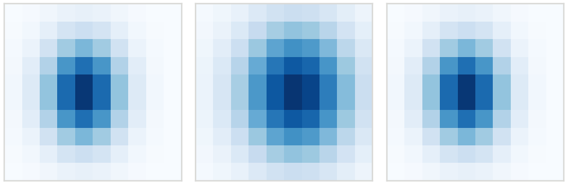

# 文本驱动的编辑

上一章的方法能改，但不知道该改哪里。文本驱动的方法围绕定位展开：利用 cross-attention 的空间含义，控制某个词影响哪些位置。

## 注意力图有空间含义

文本通过 cross-attention 进入网络。查询来自图像特征，键和值来自文本，注意力矩阵的每一行对应一个图像位置，每一列对应一个 token。

这个矩阵往往有清晰的空间结构。说"猫"时注意力集中在猫附近，说"天空"时集中在画面顶部。

## 三种操作

词替换：源提示词是"一只猫"，目标是"一只狗"。把"狗"的注意力图替换成源的"猫"，其余不变。布局跟着"猫"走，语义换成"狗"。

细化：在提示词里加词时，新词的注意力图初始化为零，再逐渐放开，避免一上来就打乱布局。

重加权：把某个词的注意力乘以系数，让它影响的范围变大或变小。

实现上要在注意力计算之后截获矩阵，按规则修改，再继续前向。

## 只在前面几步替换

替换不是全程都做。早期步决定布局，后期步只调纹理。常见做法是只在前一半步数里替换。

替换的步数越多，约束越强，布局越稳，但细节越难按新语义生成；替换得少，编辑更自由，也更容易失控。这个参数与 SDEdit 的 $t_0$ 是同一类东西。

## 反演为什么必要

真实图像没有对应的噪声。要把它送进这套流程，得先反演。

最直接用 DDIM 反演：把采样公式反过来，从 $x_0$ 推到 $x_T$。问题是它不精确：每一步用的噪声预测取自当前点，而真实的前向过程应该取下一步的点，误差累积之后，重建就偏了。

修正的办法有两类。一类是优化：为每一步引入一个可调的空文本嵌入，让重建尽量贴近原图，代价是慢。另一类是改积分格式：构造可逆的耦合更新，让反演在数值上精确，代价是每步两次前向。

## 指令微调：用数据学编辑

另一条路是训练一个专门的模型：输入图像与一句指令，输出编辑后的图。

训练数据是合成的：用注意力编辑生成大量配对，再用语言模型生成指令，得到（源图，指令，目标图）三元组。模型学会"照着指令改"。

这条路的泛化来自数据分布。指令没覆盖到的编辑类型，模型不会做。

## 局部的编辑

如果用户给了 mask，事情简单很多：只在 mask 内重绘，mask 外每步替换成原图加对应噪声。

这样 mask 外严格不变，mask 内自由生成。边界可能出现接缝，通常用羽化处理。

## 这一类的特点

文本驱动的方法擅长改语义，不擅长改结构。它能说清"换成什么"，说不清"放在哪里、什么姿势"。

所以真实系统里，它通常与结构条件配合使用：注意力管语义，条件管布局。下一章讲条件。

## 一个判断

如果编辑后布局变了但语义对了，说明注意力约束不够，应该增加替换的步数或换用更强的结构条件。

如果语义没变但画面糊了，说明编辑强度太大，模型在多峰之间取了平均，应该降低强度或换用一步模型之外的路线。
