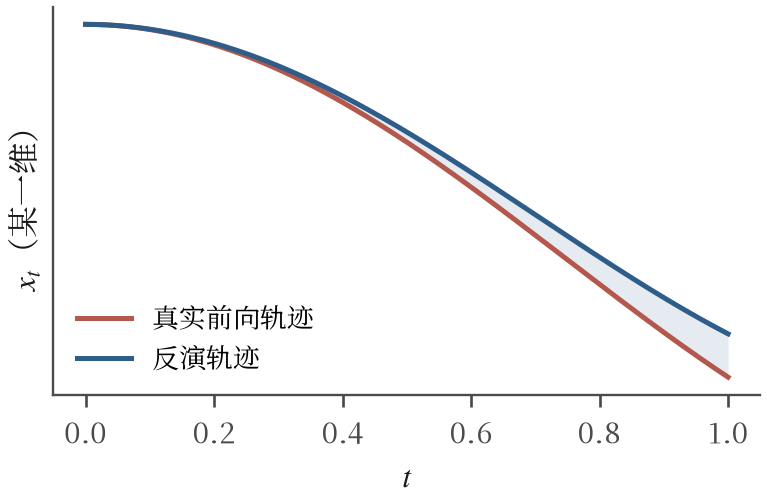
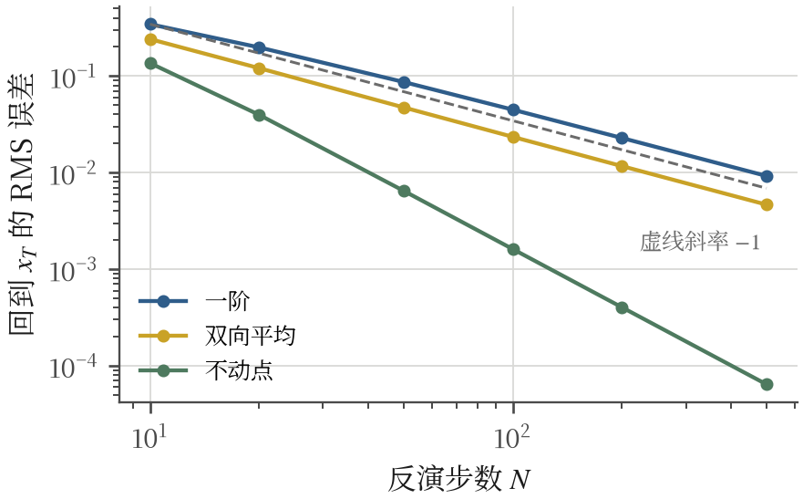

# 结构与反演

文本说不清“在哪里、什么姿势”。要做精确的空间控制，需要把边缘图、深度图、姿态这类信息注入模型。另一边，反演要准，才能把真实图像送回模型的坐标系。

这一章讲这两件事：条件注入解决“改哪里”，精确反演解决“怎么回得去”。

两个问题有一个共同点：都在跟模型已经学会的东西较劲。文本条件太软，一个词能覆盖半张图，想让它只落在某个轮廓上，就得额外喂一张比文本硬得多的条件；反演太糙，几十步的积分误差攒起来，送回去的点已经偏离了原来的轨迹。前者是给模型加一条新的输入通路，后者是修补一条已有的数值通路。

## ControlNet

做法是复制一份扩散网络的编码器，冻结原模型，只训练这份副本。副本读入条件图，输出多尺度特征，通过零卷积加回原模型的对应层。

零卷积是一个初始化为零的卷积。训练开始时副本输出为零，原模型行为完全不变；模型可以先保住原能力，再逐步接入条件。如果初始化为随机值，条件支路一上来就会破坏预训练特征。

### 零卷积为什么不是乘零

把这句话写清楚，能避开一个容易混淆的点。零卷积的运算是

$$y=W*z+b,\qquad W=0,\ b=0$$

其中 $*$ 是卷积。初始化时 $y\equiv 0$，与被加回去的原特征 $x$ 相加，得到 $x+y=x$。

关键在于梯度。损失对权重的偏导是

$$\frac{\partial L}{\partial W}=\frac{\partial L}{\partial y}\cdot\frac{\partial y}{\partial W}=\frac{\partial L}{\partial y}\,z^{\top}$$

只要输入 $z$ 不为零（条件图不是全黑，特征就不会全零），这个梯度就不为零。也就是说，第一步的前向完全无影响，第一步的反向就已经有信号，权重会立刻离开零点，条件开始慢慢渗进去。

对比另一种写法：把支路输出乘一个零标量，$y=\alpha\cdot(W*z)$，$\alpha=0$。这时 $\partial y/\partial W=\alpha\,z=0$，梯度恒为零，支路永远学不动，等于没接。同样是“输出为零”，一个能学、一个不能学，差别就在零放在乘法里还是放在权重里。

随机初始化为什么会破坏，也能算出来。3×3 卷积、输入 320 通道，按常见的 Kaiming 初始化，权重标准差约 $\sqrt{2/2880}\approx 0.026$，输出标准差与输入同量级，大约 1。原模型的中间特征也是这个量级，直接相加等于把预训练特征与一份随机特征搅在一起，相当于给网络注入了与输入无关的噪声。零初始化把这一步推迟到模型自己决定该注入多少。

### 副本里有什么

副本复制的是编码器加中间层。原 U-Net 的编码器有 12 个带跳连的模块，加上中间模块，一共 13 个输出点；每个输出点接一个零卷积，其中 12 个加到解码器的对应跳连上，1 个加到中间层。解码器不复制，因为它输出的是噪声预测，结构由编码器特征决定。

按这个规模，可训练参数是原 U-Net 的四成上下（SD1.5 的 U-Net 约 8.6 亿参数，ControlNet 的可训练部分在 3 亿多，量级估计）。条件图先经过一个小卷积塔把 3 通道映射到与输入同宽：$3\to16\to32\to64\to128$，每层接 SiLU，再与含噪潜变量拼在一起送进副本。

训练时锁住原模型，只更新副本与零卷积。文本条件按一定概率随机置空（常见做法是 50%），这样模型在纯条件控制下也能工作，用户可以用一个泛泛的提示词配一张精确的边缘图。

条件图的类型决定控制的内容：边缘控制轮廓，深度控制远近，骨架控制姿态，法线控制朝向。同一套结构，换条件图就换控制方式。

### 训练数据怎么配

这一步的技术含量不比结构低。训练需要（条件图，文本，目标图）三元组，而且三者必须严格对齐：条件图上的每一条线，都要对应目标图里真实存在的边缘。

对齐靠两类来源。一类是合成场景：从三维资产渲染出图，边缘、深度、法线、姿态这些条件图可以由几何直接算出，逐像素准确，而且可以换相机、换光照大量生成。代价是渲染图与真实照片的域差异，模型在真实照片上会有点“不会用”。

另一类是从真实图像反推条件图：用单目深度估计、边缘检测、姿态估计给已有照片打上条件。数据来自真实分布，但标注有误差，而模型会把这些误差当成“条件图的正常样子”学进去。

一张图可以同时配多张条件图，训练时随机挑一张。这样一个模型能同时接受边缘、深度、姿态，不用分四次训。这也是零卷积的一个附带好处：新加一种条件图只需要新接一路，主干不用动。

### 推理时的控制权重

条件支路在推理时可以缩放，控制强度是

$$\tilde{\epsilon}(z_t)=\epsilon_\theta(z_t,c_{\text{text}})+w_c\cdot\Delta\epsilon_{\text{ctrl}}(z_t,c_f)$$

其中 $\Delta\epsilon_{\text{ctrl}}$ 是控制分支贡献的那部分输出。$w_c=1$ 是训练时的行为；$w_c<1$ 放松控制，允许模型自己补细节；$w_c>1$ 收紧，画面更像条件图。0.6 到 1.4 是常用的范围，超出去往两头都有明显代价。

### 条件图从哪来

这一环常被忽略，但它的质量基本决定了上限。三种常见的条件图各有各的坑。

边缘图（Canny 之类）：两个阈值决定取哪些边。阈值松，图上全是纹理边缘，模型会把每一条都当结构描出来，结果像加了线稿滤镜；阈值紧，轮廓断成几段，模型只能按断掉的部分生成，物体会有缺口。手画草图则是另一类问题：线宽、抖动、闭合程度都与训练数据的分布不同。

深度图：单目估计给的是相对深度，尺度不确定，近处与远处的绝对距离不可知。对构图够用，对齐要求高的场景（把前景物体按深度分层）会出错。

姿态图：关键点检测在遮挡、多人、非常规视角下会失败，错误骨架会直接变成扭曲的肢体。

共同的一条：条件图必须落在训练分布内。反色的边缘图、加了抗锯齿的深度图、粗细不一的骨架，都会让效果突然变差，而模型不会报错，只会安静地给你一张不对的图。

### 失效模式

条件与文本冲突是最常见的。条件图是一个站立姿态，提示词写“坐着”，模型会在两者之间折中：要么姿势勉强站住但比例怪，要么画面里出现两个重叠的形体。这类冲突没有通用解，通常靠降低 $w_c$ 让文本赢，或者改提示词配合条件。

过度控制是另一个。$w_c$ 太大时，模型会照着条件的每一根线去画，物体的边缘变得死板，内部纹理重复，整体像“描了点边”的图。判断方法很简单：把 $w_c$ 从 1.4 降到 0.8，如果画面立刻自然很多，原来那张就是过度控制。

最后是分辨率。条件图在进网络前会被缩放到与潜变量同尺寸，细节如果超过 64×64 的分辨能力就会被丢，那些细节在输出里反而会以锯齿或条纹的形式冒出来。

## 更轻的适配器

复制整个编码器太贵。轻量版本只用几个卷积层提取多尺度特征，直接加到原模型上，参数量小一个数量级，还可以同时挂多个，按权重组合。

### 轻量条件适配

做法是四个分辨率层级的卷积块，每个块输出一组特征，经零卷积加到 U-Net 编码器的对应位置上。没有副本，没有跳连复制，只有一组前向通路。参数量在数十兆的量级，约为 ControlNet 的十分之一上下（数量级估计）。

代价是控制精度。控制信号没有经过与主干同构的网络，特征表达弱一些，复杂场景下（多物体、遮挡关系）容易只对得上大轮廓，对不上细节。

多尺度特征能多小，可以从信息量上看。一张 64×64 的边缘图，有效自由度远低于一张 64×64 的彩色图：它只有“有边/没边”这一个比特，而且大部分像素是零。条件支路要做的事是“把这个稀疏信号扩成多尺度的特征”，并不是重新学一套图像先验——后者主干已经会了。所以旁路不需要与主干同构，只需要在几个尺度上提供“这里的结构长什么样”。这也是条件副本能做到四成参数、轻量适配能做到一成的根据。

好处可组合。多个条件各挂一条通路，加权求和：

$$\tilde{\epsilon}=\epsilon_\theta(z_t,c_{\text{text}})+\sum_{i}w_i\,\Delta\epsilon_i(z_t,c_i)$$

边缘、深度、分割各给一个权重，权重本身可以在采样过程中随 $t$ 变化：早期步让深度主导布局，后期步让边缘主导细节。这类调度比单一权重更接近“先定大局再描细节”的实际需求。

### 图像提示适配

另一类适配器处理图像提示：给一张参考图，让结果的风格或内容接近它。做法是用图像编码器提取特征，通过独立的注意力分支注入，与文本分支分开，互不干扰。

具体的注入方式是解耦的交叉注意力。文本那一路照旧算

$$A_t=\mathrm{softmax}\!\left(\frac{QK_t^{\top}}{\sqrt{d_k}}\right),\qquad \mathrm{out}_t=A_tV_t$$

图像那一路用同一组查询、另一组键值：

$$A_i=\mathrm{softmax}\!\left(\frac{QK_i^{\top}}{\sqrt{d_k}}\right),\qquad \mathrm{out}=\mathrm{out}_t+w\,A_iV_i$$

$K_i,V_i$ 来自图像编码器的输出经过一个投影层。因为查询是共享的，图像特征与文本特征在同一套空间位置上竞争，但各自有自己的 softmax，所以文本的注意力不会被图像挤走——这是它与“把图像特征拼进文本序列”最本质的差别。后者会让两路互相抢概率质量，文本控制变弱。

参数量在两千万上下（数量级估计），主干完全冻结。$w$ 的作用类似条件权重：$w$ 在 0.5 到 0.8 之间通常能借到风格而保留构图；$w$ 到 1.5 以上，输出会开始明显复制参考图的内容，构图也被拉过去；$w$ 太小则只剩一点色调影响。

### 三者的分工

| 方法 | 注入内容 | 参数量级 | 空间对齐 | 典型用途 |
|------|----------|----------|----------|----------|
| 条件副本 | 边缘、深度、姿态 | 数亿 | 强，逐像素 | 精确布局、结构复用 |
| 轻量条件适配 | 同上，可多个 | 数十兆 | 中 | 多条件组合、轻量部署 |
| 图像提示适配 | 参考图的风格与内容 | 两千万 | 弱，无位置 | 风格迁移、主体参考 |

三者的差别不在“谁更好”，而在控制粒度。要“物体必须在这个轮廓里”，用条件副本；要“边、深、分割一起给，还能各自调权重”，用轻量适配；要“像这张图的画风”，用图像提示。

部署上的差别也能估出来。条件副本每步要多跑一遍编码器、多一份激活，50 步采样大约多三成耗时；轻量适配只多几个卷积、几组特征相加，几乎看不出来；图像提示适配多出来的只是几百个 token 的注意力，增量在一成上下。这些比例随分辨率、步数与硬件变，量级上是这个关系。

## 反演的误差

回到反演。DDIM 反演的每一步用当前点的噪声预测，而真实前向应该用下一步的点，两者相差一阶。一步误差很小，但方向一致，累积起来就是可见的漂移。

### 把公式写开

DDIM 的确定性采样从 $t$ 到 $t-1$ 是

$$x_{t-1}=\sqrt{\bar\alpha_{t-1}}\,\hat{x}_0(x_t)+\sqrt{1-\bar\alpha_{t-1}}\,\epsilon_\theta(x_t,t),\qquad \hat{x}_0(x_t)=\frac{x_t-\sqrt{1-\bar\alpha_t}\,\epsilon_\theta(x_t,t)}{\sqrt{\bar\alpha_t}}$$

代进去合并同类项：

$$x_{t-1}=a_tx_t+b_t\,\epsilon_\theta(x_t,t),\qquad a_t=\sqrt{\frac{\bar\alpha_{t-1}}{\bar\alpha_t}},\qquad b_t=\sqrt{1-\bar\alpha_{t-1}}-a_t\sqrt{1-\bar\alpha_t}$$

反演就是把下标反过来：从 $t-1$ 到 $t$，

$$x_t=a_t^{-1}\big(x_{t-1}-b_t\,\epsilon_\theta(x_{t-1},t-1)\big)$$

这里的 $a_t,b_t$ 都用采样那一侧的系数，逆运算才是精确的逆。问题出在 $\epsilon_\theta$ 的取点上：真实前向在 $t$ 时刻的噪声是 $\epsilon_\theta(x_t,t)$，反演却只能拿到 $x_{t-1}$ 处的 $\epsilon_\theta(x_{t-1},t-1)$。

两者的差可以展开：

$$\epsilon_\theta(x_t,t)-\epsilon_\theta(x_{t-1},t-1)\approx\frac{\partial\epsilon_\theta}{\partial x}(x_t-x_{t-1})+\frac{\partial\epsilon_\theta}{\partial t}\Delta t$$

$x_t-x_{t-1}$ 本身是 $O(\Delta t)$，所以这个差是 $O(\Delta t)$。乘上系数 $b_t$ 后，单步的偏差是 $O(\Delta t^2)$，看起来很小；但 $N$ 步累积起来是 $N\cdot O(\Delta t^2)=O(\Delta t)=O(1/N)$。步数翻倍，误差减半，这就是“一阶”。

### 在小模型上量一下

这个结论能用一维数据验证，用一个能写出解析 score 的玩具模型：两峰高斯混合，$p(x)=0.5\,\mathcal{N}(-1.2,0.35^2)+0.5\,\mathcal{N}(1.2,0.45^2)$，配 1000 步线性日程的 VP 前向。带噪分布的 score 有闭式：

$$s(x,t)=\sum_{k}w_k(x)\,\frac{-(x-\sqrt{\bar\alpha_t}\mu_k)}{\bar\alpha_t\sigma_k^2+1-\bar\alpha_t},\qquad w_k(x)=\frac{\pi_k\mathcal{N}(x;\sqrt{\bar\alpha_t}\mu_k,\ \bar\alpha_t\sigma_k^2+1-\bar\alpha_t)}{\sum_j\pi_j\mathcal{N}(x;\sqrt{\bar\alpha_t}\mu_j,\ \bar\alpha_t\sigma_j^2+1-\bar\alpha_t)}$$

$\epsilon$ 与 score 的关系是 $\epsilon=-\sqrt{1-\bar\alpha_t}\,s$。取 64 个标准正态的 $x_T$ 采样到 $x_0$，再用上面的公式反演回去，量一下回到 $x_T$ 的均方根误差：

| 步数 $N$ | 10 | 20 | 50 | 100 | 200 | 500 |
|---|---|---|---|---|---|---|
| 一阶反演误差 | 0.345 | 0.198 | 0.087 | 0.045 | 0.023 | 0.009 |

步数每乘 10，误差降到十分之一，斜率就是 $-1$。换成解不动点的格式（见后文），$N=500$ 时误差降到 $6\times10^{-5}$，斜率变成 $-2$。

### 误差为什么难自己消掉

随机误差会随步数平方根抵消，系统误差不会。这里的偏差有确定的符号：$\epsilon_\theta(x_{t-1},t-1)$ 与 $\epsilon_\theta(x_t,t)$ 的差主要由 $\partial\epsilon_\theta/\partial x$ 决定，而这一项在轨迹上是同向的。于是 $N$ 步的偏差线性叠加，而不是随机漫步。

一个推论：加大步数有效，但收益按 $1/N$ 递减；把误差压到肉眼不可辨（在 512×512 图上对应像素误差的千分之一量级），往往需要几百步，代价是几分钟的采样时间。

### 反演时的两个开关

引导尺度。反演阶段的引导强度应当设为 1。带引导的采样相当于把噪声预测改成 $\epsilon_{\varnothing}+s(\epsilon_c-\epsilon_{\varnothing})$，而反演用的也是这个改过的预测；$s$ 越大，预测对 $x$ 的导数就越大，同样的一步偏差被放大得越多，累积更快。经验上 $s=7.5$ 的反演，重建误差明显大于 $s=1$，且偏差方向与提示词相关，编辑时表现成“画面被拉向提示词描述的样子”。

时间步一致。反演的步序列必须与后续采样的步序列逐点对应，不能反演用 50 步、采样用 20 步。后者相当于在两个不同的离散化上做逆运算，误差从一阶变成常数项，重建基本失败。

### 不必回到 $T$

上文的推导假设反演到 $x_T$。实际编辑只需要回到一个中间时刻 $t_{\text{start}}$，从这里换提示词开始去噪。这样误差只在 $t\in[t_{\text{start}},T]$ 这一段累积，量级上按段长比例减小：$t_{\text{start}}=0.6$ 时的漂移大约是回到 $T$ 的六成。

代价是编辑自由度下降：$t_{\text{start}}$ 越低，保留的原图结构越多，能改的东西越少。这个旋钮与 SDEdit 的 $t_0$ 完全对偶，只是一个在“反演端”截断，一个在“加噪端”截断。

## 两类修法

思路有两个方向：把格式改得更高阶，或者把映射改成可逆的。

两者解决的不是同一件事。高阶格式压的是截断误差：每一步算得更准，$N$ 步之后残差更小，但它不保证反演与采样互为一对逆映射，也不管轨迹会不会跑出分布。可逆耦合保证的是映射关系：往返误差只剩舍入，但两条耦合轨迹会彼此分离，得靠额外的混合项拘住。实际使用中两者经常叠在一起：可逆格式 + 高阶单步。

### 可逆耦合

把每一步的变换写成两个变量互相依赖的形式，就能保证可逆。设两个潜变量 $x,y$ 从同一起点出发，采样一步是

$$x'\leftarrow a_tx+b_t\,\epsilon_\theta(y,t),\qquad y'\leftarrow a_ty+b_t\,\epsilon_\theta(x',t)$$

第一个更新只用 $y$，第二个更新用刚算出的 $x'$，两个式子串行，没有循环依赖。给定 $(x',y')$，可以一步步倒回去：

$$y=\frac{y'-b_t\,\epsilon_\theta(x',t)}{a_t},\qquad x=\frac{x'-b_t\,\epsilon_\theta(y,t)}{a_t}$$

因为每一步都是可逆的仿射变换，整条路径精确可逆，反演误差只剩浮点舍入的量级。代价是每步两次前向（$x$ 与 $y$ 各一次），以及两个潜变量同时占显存。

这样做还有两个副作用需要处理。一是两条轨迹会逐渐分离：它们从同一个点出发，却因为噪声预测的输入不同而各走各的。二是分离会让其中一条跑到分布外。常见的补法是每步把两者往中间拉一下：

$$x\leftarrow px+(1-p)y,\qquad y\leftarrow py+(1-p)x$$

$p$ 取 0.93 左右，一个很小的混合，作用是把两条轨迹绑在一起，代价是引入了与 $p$ 有关的偏差——$p$ 越小，绑得越紧，可逆性保留但采样质量下降。$p$ 与步数要一起调。

另一个副作用是初始化。两个潜变量不能都取噪声：一个来自噪声，另一个来自目标提示词引导下的采样结果，这样 $y$ 带着语义，$x$ 带着随机性，混合之后既有可逆性又不至于丢失文本控制。

### 双向估计

第二个方向不追求严格可逆，只把单侧偏差抵消掉一部分。反演到 $t$ 时，先用当前点得一阶估计 $\tilde{x}_t$，再在 $\tilde{x}_t$ 处取一次噪声预测，与原来的取平均：

$$\bar\epsilon=\frac{1}{2}\Big[\epsilon_\theta(x_{t-1},t-1)+\epsilon_\theta(\tilde{x}_t,t)\Big]$$

用 $\bar\epsilon$ 重算一步，相当于把 $\epsilon$ 的取点从区间端点挪到中点，误差的主项被对消一半：图 22.3 里的黄线就是这个格式，与一阶同阶（对数图上斜率还是 $-1$），但常数小了将近一半。再往前走一步，用新的估计再取一次噪声（不动点迭代），单步残差降到 $O(\Delta t^3)$，累积成 $O(1/N^2)$，就是图里的绿线；代价是每步 2 到 3 次前向，迭代也不一定收敛到更好的解，实际用一次就停。

精度与代价的对照大致是：

| 格式 | 每步前向 | 误差阶 | 备注 |
|------|----------|--------|------|
| 一阶反演 | 1 | $O(1/N)$ | 最常用，误差可见 |
| 双向平均 | 2 | $O(1/N)$，常数更小 | 实现简单，稳定 |
| 不动点迭代 | 2–3 | $O(1/N^2)$ | 迭代不保证收敛 |
| 可逆耦合 | 2 | 舍入误差 | 需处理轨迹分离 |

## 为什么在大模型上仍然不够

这些方法保证的是数值可逆，不保证反演出的噪声在先验分布内。

一张真实的照片往往“不典型”，它的反演结果也不典型。从这样的噪声出发去噪，得到的是“重建得还行但不像这个模型会生成的图”。编辑时，这种图会被推向奇怪的方向。

可以用范数看这件事的量级。潜变量有 $4\times64\times64=16384$ 维，标准正态下 $\mathbb{E}\|x\|^2=16384$，即范数约 128。反演只要让每一维带上 0.05 的系统偏差，范数只涨 0.1% 左右，从范数上看不出任何异常；但朝向偏了，去噪的第一步就会把这个偏差当成“这张图本来该有的样子”去解释。

换句话说，反演出来的点落在先验分布的高概率区外面一点点，而扩散采样对这个“一点点”很敏感：它会把不典型的结构逐步放大，因为它认为那就是数据。这就是为什么重建看起来还行、编辑却容易崩。

### 优化型修法

既然问题出在“送回去的点不典型”，一个直接的做法是：不修数值格式，改为逐时间步搜一个无条件嵌入，让重建尽量精确。

反演展开成 $T$ 步，每一步的噪声预测都依赖一个空文本嵌入 $\varnothing_t$；把这一串嵌入当作可优化变量，目标是最小化相邻两步轨迹的差异（等价于最小化最终重建误差）。因为 $\varnothing_t$ 只影响无条件项，优化它不会改变文本控制，只改变“模型认为空白长什么样”。

这套做法能把重建误差压到接近像素级不可辨，代价是优化 $T$ 个嵌入需要 $T$ 倍的前向与反向，还要为每张图单独存一份嵌入（几十个 token × 十几层，量级上每张图几 MB）。适合离线、少量图片的精细编辑，不适合在线服务。

它对第 21 章那类“编辑后崩”的问题只是部分有效：重建准了，编辑时的大幅改动依旧可能把图推出分布，因为推出去的那一步是编辑本身造成的。

这也说明“点的位置”与“点的精度”是两个问题。优化型修法把精度推到极限，不典型的那个点还在原地。要动位置，就只能换一条思路：不追求数值可逆，而是控制噪声的典型性，或者干脆不做反演。

## 组合使用

条件注入与反演可以叠加：先反演得到噪声，再用结构条件去噪。保真由反演保证，布局由条件保证，这是工程上最稳的组合。

要注意冲突。结构条件会限制改动范围，注意力替换又要求改语义，两者同时用的时候，谁的权重更大，需要试。

冲突的机制可以说清。条件支路贡献的是 $\Delta\epsilon_{\text{ctrl}}$，文本引导贡献的是 $s(\epsilon_{c}-\epsilon_{\varnothing})$，两者都加在同一个噪声预测上，谁的量级大谁主导：

$$\tilde{\epsilon}=\epsilon_{\varnothing}+s\big(\epsilon_{c}-\epsilon_{\varnothing}\big)+w_c\,\Delta\epsilon_{\text{ctrl}}$$

$w_c$ 大时，条件支路相当于一条绕开引导的“硬指令”，文本再强也拉不动轮廓；$s$ 大时反过来，文本会把条件图里已经定好的形状改掉一部分，出现“边缘在那儿但物体不认”的错位。稳妥的做法是先固定 $w_c\approx1$ 把结构调对，再往上调 $s$ 找语义，这时候如果轮廓开始松动，就把 $w_c$ 加到 1.2 左右。

还有一个顺序问题：条件是在引导之前加还是之后加，会影响有效强度。先加条件再引导，引导会同时放大条件带来的差异；先引导再加条件，条件按原样叠加。两种写法的权重不能直接换算，换实现时要重新调参。

### 一次完整的编辑

把本章的东西串起来，一个可控的局部编辑大致是这样跑的：

1. 用源提示词、引导尺度 1、$N=50$ 步反演，回到 $t_{\text{start}}$，得到 $x_{t_{\text{start}}}^{\text{src}}$。
2. 画 mask，在像素空间膨胀 15 像素、高斯羽化半径 8 像素，再降采样到 64×64。
3. 从 $t_{\text{start}}$ 开始用目标提示词去噪，同时挂边缘条件（$w_c=1.2$）和图像条件（$w=0.6$）。
4. 每步去噪后按 mask 把 $x_t^{\text{src}}$ 贴回 mask 外。
5. 前 40% 的步里做注意力替换，替换层选 16×16 与 8×8 那几层。

五个参数里，$t_{\text{start}}$ 管“能改多少”，mask 管“改哪里”，$w_c$ 管“新结构有多硬”，$w$ 管“像不像原图”，替换窗口管“语义换得多彻底”。它们的作用有重叠，所以调的时候一次只动一个，其余固定。

## 一个经验

如果重建几乎完美，但编辑后结构崩坏，问题在编辑强度或条件，不在反演。

如果连重建都对不上，说明反演不准，此时任何编辑都会带上这个偏差。先修反演，再谈编辑。

如果重建对上了，编辑后的结构也对，但画面发灰、对比度掉，那多半是条件与文本在同一点上互相抵消：把两者之一减弱，或者把条件的权重改成随 $t$ 衰减。

如果同一张图换一个随机种子重建就偏了，说明反演依赖的那个点本身不稳定，多试几个种子取重建最好的一次，比调步数更省时间。
