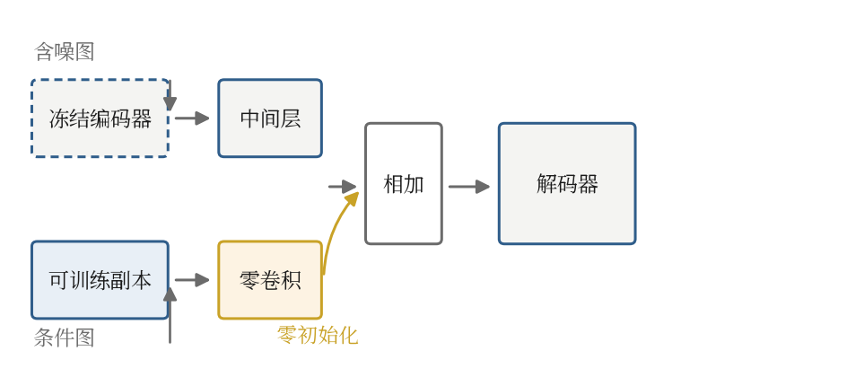

# 结构与反演

文本说不清"在哪里、什么姿势"。要做精确的空间控制，需要把边缘图、深度图、姿态这类信息注入模型。另一边，反演要准，才能把真实图像送回模型的坐标系。

这一章讲这两件事：条件注入解决"改哪里"，精确反演解决"怎么回得去"。

## ControlNet

做法是复制一份扩散网络的编码器，冻结原模型，只训练这份副本。副本读入条件图，输出多尺度特征，通过零卷积加回原模型的对应层。

零卷积是一个初始化为零的卷积。训练开始时副本输出为零，原模型行为完全不变；模型可以先保住原能力，再逐步接入条件。如果初始化为随机值，条件支路一上来就会破坏预训练特征。

条件图的类型决定控制的内容：边缘控制轮廓，深度控制远近，骨架控制姿态，法线控制朝向。同一套结构，换条件图就换控制方式。

## 更轻的适配器

复制整个编码器太贵。轻量版本只用几个卷积层提取多尺度特征，直接加到原模型上，参数量小一个数量级，还可以同时挂多个，按权重组合。

另一类适配器处理图像提示：给一张参考图，让结果的风格或内容接近它。做法是用图像编码器提取特征，通过独立的注意力分支注入，与文本分支分开，互不干扰。

## 反演的误差

回到反演。DDIM 反演的每一步用当前点的噪声预测，而真实前向应该用下一步的点，两者相差一阶。一步误差很小，但方向一致，累积起来就是可见的漂移。

## 两类修法

改积分格式：把一步变换写成可逆的耦合，让反演在数值上精确。代价是每步两次前向，而且两条轨迹会逐渐分离，需要额外参数把它们的距离控制住。

双向估计：反演时同时算前向与反向两个估计，取平均，抵消一部分单侧偏差。实现简单，精度不如前者，但稳定。

## 为什么在大模型上仍然不够

这些方法保证的是数值可逆，不保证反演出的噪声在先验分布内。

一张真实的照片往往"不典型"，它的反演结果也不典型。从这样的噪声出发去噪，得到的是"重建得还行但不像这个模型会生成的图"。编辑时，这种图会被推向奇怪的方向。

这个观察引出最后一条路线：不追求数值可逆，而是控制噪声的典型性，或者干脆不做反演。下一章讲。

## 组合使用

条件注入与反演可以叠加：先反演得到噪声，再用结构条件去噪。保真由反演保证，布局由条件保证，这是工程上最稳的组合。

要注意冲突。结构条件会限制改动范围，注意力替换又要求改语义，两者同时用的时候，谁的权重更大，需要试。

## 一个经验

如果重建几乎完美，但编辑后结构崩坏，问题在编辑强度或条件，不在反演。

如果连重建都对不上，说明反演不准，此时任何编辑都会带上这个偏差。先修反演，再谈编辑。
