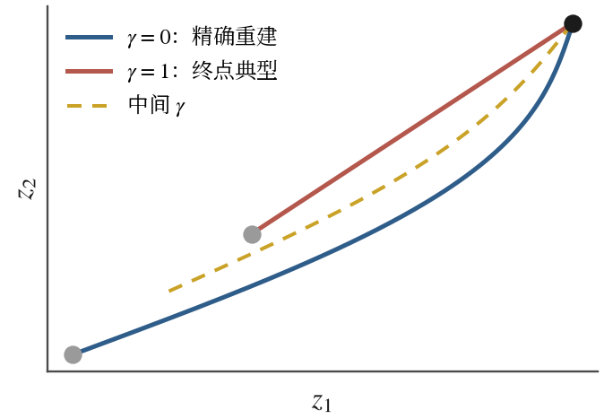

# 流模型上的编辑与一步编辑

前面几章的方法都建立在扩散模型上，而且大多需要反演。这一章讲最新的三类：用控制修反演、干脆不做反演、以及把编辑压到一步。

## 流模型的反演

流模型的采样是一条确定的 ODE。理论上把速度取负、反向积分就能精确反演。但两个问题仍在。

一是数值误差，步数少时明显。二是典型性：真实照片反演出的噪声往往不在标准高斯的典型集合里，从它出发去噪，得到的不像这个模型会生成的图。

第一类可以用高阶求解器缓解，第二类要靠控制。

## 用控制修反演

把反演写成一个"既要重建、又要终点典型"的最优控制问题：一项惩罚控制的大小，一项惩罚终点偏离标准噪声。

这个问题的解有一个漂亮的形式：最优控制就是沿着直线把点推向目标噪声。于是可以定义一个受控的 ODE，用参数 $\gamma$ 在"完全按模型走"与"完全按控制走"之间插值。

$\gamma$ 大，噪声更典型，编辑更自由；$\gamma$ 小，重建更准，改动更小。实践中让 $\gamma$ 随时间变化：前期大，把轨迹拉向典型区域；后期小，保证终点落在原图上。

## 不做反演

既然反演会引入误差，那就绕开它。

FlowEdit 的做法是构造两条并行路径。源支路是从源图出发、逐步加噪的直线，用来提供不同噪声水平下的源图；目标支路是"编辑路径加上同一份噪声"。

两条支路相减时，噪声成分互相抵消，剩下的只是干净图之间的差。用这个差更新编辑路径，整条路径全程接近无噪。

这样得到的路径更短，所以结构保持更好。代价是对齐稍弱：方向来自两个条件的差，不如注意力操作精确。

## 一步编辑

如果模型本身就是一步的（比如蒸馏出来的少步模型），上面两种方法都失效：反演没有多步可走，FlowEdit 的方向也没法逐步修正。

最直接的做法是把两个条件的速度相减，一步走过去。结果会崩：物体扭曲，背景碎裂。

原因在数值上。一步模型的场高度非线性，两个条件的场相减得到一个高能量、空间上不光滑的方向，用一步大积分走它，误差被完整放大。

ChordEdit 的解法是平滑。它在短时间窗上假设场近似不变，求一个既接近观测、又接近上一时刻估计的解，得到两个时刻观测的加权平均。平均之后能量变小、抖动被抹平，一步才走得稳。

它的默认设置还有一个解释：平滑相当于把有效编辑时刻往前挪了一点。所以这个方法可以看成"低频传输 + 高频精修"两段式。

## 三者的对比

| 方法 | 要不要反演 | 步数 | 擅长 |
| --- | --- | --- | --- |
| 控制反演 | 要 | 多步 | 保真与典型性兼顾 |
| FlowEdit | 不要 | 多步 | 结构保持 |
| ChordEdit | 不要 | 一步 | 快速交互、局部改动 |

## 这一章的位置

这三类方法代表了编辑的当前前沿：都在尽量减少对反演的依赖，也都在往更少的步数走。

它们的共同限制是：一步只有一次机会，结构大改仍然困难。这个限制在视频上更明显——视频还多了一个时间一致性要照顾。下一章讲视频编辑。
