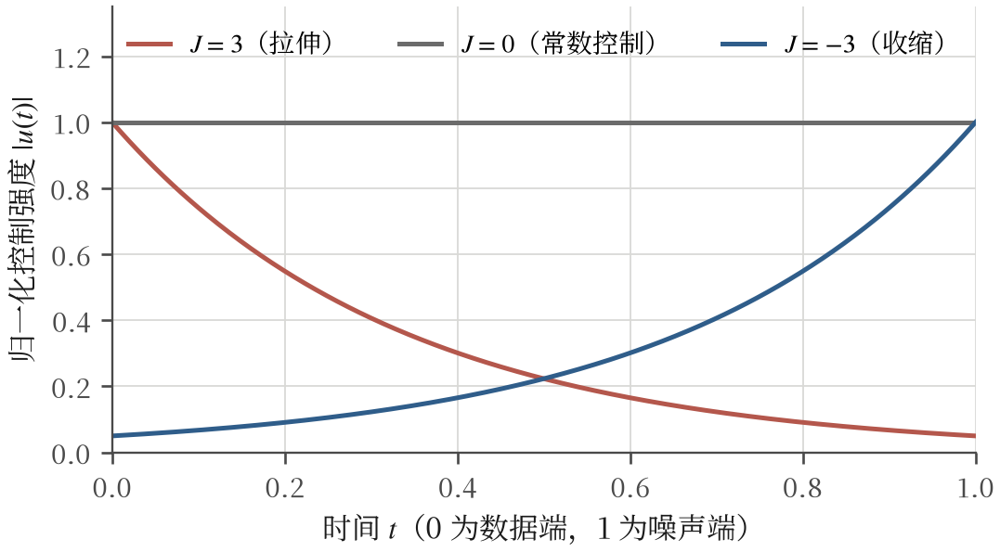
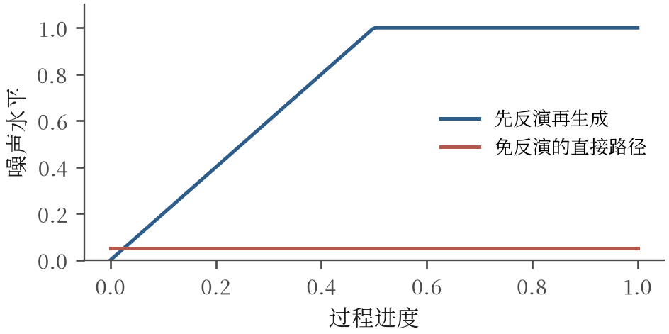
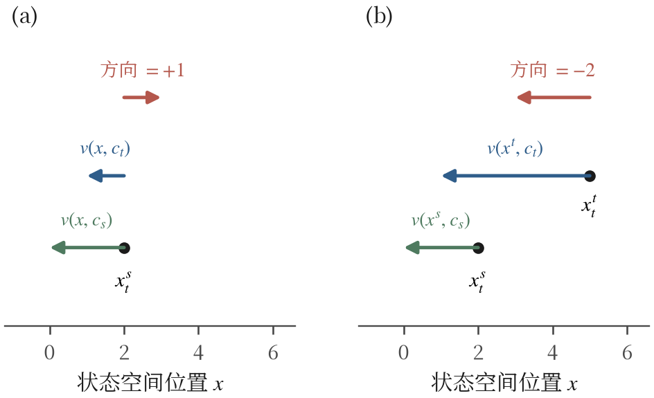
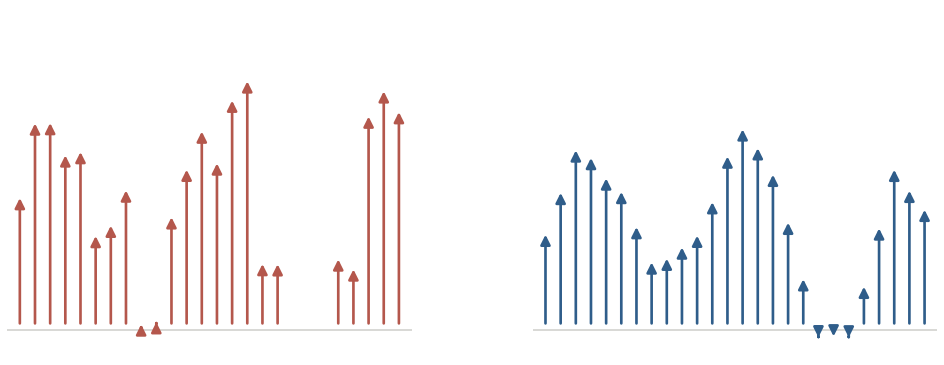

# 流模型上的编辑与一步编辑

前面几章的方法都建立在扩散模型上，而且大多需要反演。这一章讲最新的三类：用控制修反演、干脆不做反演、以及把编辑压到一步。

流模型值得单独讲一章，原因在它的速度场是确定的：条件直接进速度场，改条件就改方向，不像扩散那样要靠引导系数把两个预测拼起来。代价是它没有随机性，采样轨迹由初值唯一确定，“从哪出发”因此变得比扩散更要紧——编辑的麻烦都从这里长出来。

## 流模型的反演

流模型的采样是一条确定的 ODE。理论上把速度取负、反向积分就能精确反演。但两个问题仍在。

一是数值误差，步数少时明显。二是典型性：真实照片反演出的噪声往往不在标准高斯的典型集合里，从它出发去噪，得到的不像这个模型会生成的图。

第一类可以用高阶求解器缓解，第二类要靠控制。

### 倒着解同一个方程

把时间约定固定下来：$t=0$ 在数据端，$t=1$ 在噪声端，速度场 $v_\theta(x,t)$ 描述“往数据走”的方向。采样从噪声出发反向积分，反演从图像出发正向积分，两者是同一个初值问题的两个方向。流模型在这方面比 GAN 省事：GAN 的生成器没有可逆的逐步结构，反演得另做优化；流模型只要把积分方向换过来。

数学上没有问题，问题出在“这样解出来的终点是什么”。终点由初值和方程唯一确定，它一般不是我们想要的那个噪声。

### 两条误差来源的性质不同

第一条是求解器的离散误差。一阶 Euler 每步的局部误差是 $\tfrac12\Delta t^2|\dot v|$，$N$ 步累积到 $\tfrac12\Delta t\,|\dot v|$ 的量级，步数减半、误差大致减半。取 $N=50$（$\Delta t=0.02$）、$|\dot v|$ 与速度本身同量级，误差大约在速度的百分之一，画面上看不出来；把步数压到 10，误差上到百分之几，反演出的终点与真正的终点偏了一点，生成回来会开始偏色。这类误差可以花钱消掉：换高阶求解器、加步数都有用。

第二条是典型性，加多少步都消不掉。真实照片反演出的终点落在标准高斯的一个低概率区域，范数偏大，或者某几个方向偏强。从那里出发去噪，模型仍然能回到原图，因为 ODE 是确定映射，这是它的像；但一旦中途插入新的条件，轨迹就走进模型没训练过的区域，输出开始变形。

### 典型集合比想象的窄

“标准高斯里随便一个点”其实不随便。$d$ 维标准高斯样本的平方范数服从自由度为 $d$ 的卡方分布，均值 $d$、标准差 $\sqrt{2d}$，于是范数集中在

$$\|z\|=\sqrt d\left(1\pm\frac{1}{\sqrt{2d}}\right)$$

这层壳里。潜变量取 $64\times64\times4=16384$ 维时，$\sqrt d=128$，相对起伏 $1/\sqrt{32768}\approx0.55\%$，也就是 $128\pm0.7$。壳的厚度只有范数的半个百分点。

这个数字说明一件事：范数差几个百分点，在“能量”上看着微不足道，但已经离壳很远。反演出的终点离壳越远，模型在那里的速度场越不可信，编辑时条件给出的方向也越不可靠。要检查也很直接：比较 $\|z\|/\sqrt d$ 与 1，或者拿它和同尺寸随机噪声的平均范数对比。

## 用控制修反演

把反演写成一个"既要重建、又要终点典型"的最优控制问题：一项惩罚控制的大小，一项惩罚终点偏离标准噪声。

这个问题的解有一个漂亮的形式：最优控制就是沿着直线把点推向目标噪声。于是可以定义一个受控的 ODE，用参数 $\gamma$ 在"完全按模型走"与"完全按控制走"之间插值。

$\gamma$ 大，噪声更典型，编辑更自由；$\gamma$ 小，重建更准，改动更小。实践中让 $\gamma$ 随时间变化：前期大，把轨迹拉向典型区域；后期小，保证终点落在原图上。

### 把问题写成最优控制

记干净图为 $x_{\text{img}}$，无控反演得到的轨迹为 $x^m(t)$，终点的值 $x^m_1=x^m(1)$。加一项控制 $u(t)$ 之后，方程与约束是

$$\dot x=v_\theta(x,t)+u(t),\qquad x(0)=x_{\text{img}},\qquad x(1)=z.$$

代价取控制的总能量

$$J[u]=\int_0^1\|u(t)\|^2\,dt.$$

选平方而不是 $\int\|u\|\,dt$ 有两个理由。平方的约束问题是线性的，有闭式解；平方会惩罚短促的大修正，鼓励把修正摊到整段轨迹上。后一点正是想要的：不要在某一时刻把点硬拽过去，那里恰恰是模型没被训练过的地方，而是让整条轨迹轻微地整体偏移。

这套写法与引导不是一回事。引导改的是速度的方向：把有条件与无条件的预测加权，让轨迹拐向条件描述的区域，终点仍是模型自己选的那个。控制改的是轨迹的位置：终点被钉在给定的 $z$ 上，方向还是模型给的。两者可以叠加，实践中也常叠加：先用控制拿到一个典型的起点，再用引导把语义推到位。

### 线性化之后的最优控制

$v_\theta$ 是非线性的，但在一条已知轨迹附近可以做一阶展开。设 $\delta x$ 是受控轨迹与无控轨迹之差，则

$$\delta\dot x=J(t)\,\delta x+u(t),\qquad J(t)=\left.\frac{\partial v_\theta}{\partial x}\right|_{x^m(t)}.$$

这个线性系统的解可以写成状态的线性组合：

$$\delta x(1)=\int_0^1\Phi(1)\Phi^{-1}(t)\,u(t)\,dt,$$

$\Phi$ 是状态转移矩阵，满足 $\dot\Phi=J\Phi$、$\Phi(0)=I$。它的含义是“$t$ 时刻的一个小扰动传到终点会被放大多少倍”。记 $G(t)=\Phi(1)\Phi^{-1}(t)$，终点约束就成了一条线性等式：

$$\int_0^1 G(t)u(t)\,dt=\delta,\qquad \delta=z-x^m_1.$$

在 $\int\|u\|^2\,dt$ 最小、同时满足这条等式的问题里，写出拉格朗日函数 $J[u]+\lambda^\top\big(\delta-\int G u\big)$，对 $u(t)$ 求变分置零得 $2u(t)=G(t)^\top\lambda$，再代回约束解出 $\lambda$：

$$u(t)=G(t)^\top\Big(\int_0^1 G(s)G(s)^\top ds\Big)^{-1}\delta.$$

这是 LQR（线性二次型调节器）在“终端固定、控制能量最小”这一情形下的标准结果。结构很直观：偏差按“哪一段的扰动更容易被传到终点”来分配，$G$ 大的那段多给一点控制，$G$ 小的地方省着用。

如果连雅可比也忽略，把速度场在整段上当作不变（$\Phi\approx I$），则 $G\approx I$，上式的矩阵部分成为单位阵，控制退化成常值：

$$u(t)=\delta,\qquad x(t)=x^m(t)+t\,\delta.$$

偏移随 $t$ 线性增长，$t=0$ 时为零（起点必须还是原图），$t=1$ 时正好等于 $\delta$（终点命中 $z$）。两条轨迹的距离在噪声端最大，而噪声端的模型对扰动本来就不敏感——速度的方向主要由条件决定，位置挪一点，条件给的推力方向几乎不变。控制之所以能加在靠噪声的那一段而不破坏结构，原因就在这里。

雅可比不可忽略时，控制能量在时间上的分配会明显偏向一端。图 23.2 取一维线性场 $v=Jx$ 算了一遍：$J>0$ 表示轨迹沿时间被拉伸，早先施加的扰动会被一路放大，力气花在前面最省；$J<0$ 表示收缩，早先的扰动会被抹平，只能到后段再补；$J=0$ 回到常值。

实现上有一处要注意：上面的解需要 $x^m_1$，也就是先跑一遍无控反演拿到终点，等于两遍前向。省掉一遍的办法是在线估计终点。整流流里从当前位置预测终点的常用写法是

$$\hat x_1(x_t,t)=x_t+(1-t)\,v_\theta(x_t,t),$$

它假设剩下的一段是直线。用它替换 $x^m_1$，控制变成 $u=\gamma\,(z-\hat x_1(x_t,t))$，单遍就能算，代价是这个估计本身带误差，误差与 $1-t$ 同阶：$t$ 越靠近噪声端，直线假设越不可靠，控制方向也越飘。所以在接近噪声端的那几步里，这种在线写法通常要用小一点的 $\gamma$。

### γ 的两个端点

把 $\gamma$ 写进常值解：

$$x^\gamma(t)=x^m(t)+\gamma\,t\,(z-x^m_1).$$

$\gamma=0$ 时受控轨迹就是无控轨迹，重建精确到求解器的精度，终点是模型自己的 $x^m_1$；$\gamma=1$ 时终点严格等于 $z$，起点仍是原图，中间被拉开。中间的值给出的是一个凸组合终点 $x^m_1+\gamma(z-x^m_1)$。拿量级算一下：$64\times64\times4$ 维潜变量上，噪声的范数约 128，模型自己反演出的终点与目标噪声之差常在 10 到 20 之间。取 $\|\delta\|=15$、$\gamma=0.6$，中点 $t=0.5$ 处的偏移是 $0.6\times0.5\times15=4.5$，约为噪声尺度的 3.5%。控制的作用集中在终点附近，中间点的位移不大，这是它不破坏结构的原因。

两种误差随 $\gamma$ 反向移动。重建误差取决于“从终点出发用模型自己的场跑回去能不能回到原图”，终点离 $x^m_1$ 越远，回来时偏得越多，所以重建误差随 $\gamma$ 单调上升。可编辑性取决于“起点是不是模型熟悉的噪声”，$\gamma$ 越大起点越靠近典型集合，新条件给出的方向越可靠，所以可编辑性随 $\gamma$ 上升。两个要求在同一条曲线上朝相反方向走，$\gamma$ 就是那个旋钮。

$\gamma$ 也可以随时间变。按生成方向（噪声到图）读，一个自然的取法是让它在噪声端取大、往图像端衰减到零：

$$\gamma_t=\gamma_0\,s(1-t),\qquad s(0)=1,\ s(1)=0.$$

代进位移项 $\gamma_t\,t$ 会看到，图像端被 $s\to0$ 和 $t\to0$ 双重压低，轨迹在那一段几乎完全跟着模型走，终点自然贴住原图；噪声端的修正最大，终点被推到 $z$ 附近。前面说的“前期大、后期小”，换成这个写法就是 $s$ 的形状。反演时方向反过来，日程也要反过来用。

### 什么时候会坏

改动幅度大（换主体、换场景）时只能把 $\gamma$ 推到 1 附近，此时重建误差被牺牲掉，编辑结果开始出现轮廓歪斜、背景纹理被拉伸。原因是控制项是空间上均匀的位移：它把整幅图一起挪，并不知道哪里该改、哪里不该改。

细密结构也容易坏，文字、栅格、手指、链条这类东西对位置误差最敏感。受控轨迹的中间点已经偏离了训练分布，模型在那里的细节先验很弱，只能生成“看起来像”的纹理，笔画会粘连。

$\gamma$ 过大还有数值上的表现。终点与 $x^m_1$ 差得多，控制要在最后几步把轨迹硬拽过去，而模型的速度又往回拉，两者拉锯，轨迹在两个方向之间小幅振荡。重建结果上出现高频彩色噪点，通常就是这个原因。

## 不做反演

既然反演会引入误差，那就绕开它。

FlowEdit 的做法是构造两条并行路径。源支路是从源图出发、逐步加噪的直线，用来提供不同噪声水平下的源图；目标支路是"编辑路径加上同一份噪声"。

两条支路相减时，噪声成分互相抵消，剩下的只是干净图之间的差。用这个差更新编辑路径，整条路径全程接近无噪。

### 两条支路怎么搭

记源条件 $c_s$、目标条件 $c_t$，时间仍是 $t=0$ 干净、$t=1$ 噪声。

源支路从源图出发正向积分，$\dot x=v_\theta(x,t,c_s)$、$x(0)=x_{\text{src}}$，得到一串点 $x^s_t$。它不是反演：没有指定终点，模型走到哪算哪。它的作用只是提供“源图在各个噪声水平下的样子”，作为求编辑方向的参考系。

目标支路反向积分，从噪声端往图像端走。起点一般取源支路噪声端的那个点，或者简单地取 $x_{\text{src}}$ 加一个固定比例的高斯噪声。前者的好处是两条支路在起点重合，方向项从一开始就有意义；后者省掉源支路的前半段积分，但开头几步两条支路差得远，方向项里噪点更多。源条件可以直接用空串，此时 $c_s$ 表示“不加任何描述”，语义差退化成“这句描述比无描述多了什么”，对很多编辑够用，而且省一次文本编码。

每步的更新是

$$x^t_{t-\Delta}=x^t_t-\Delta\Big[\underbrace{v_\theta(x^t_t,t,c_t)}_{\text{目标自己的速度}}+\underbrace{v_\theta(x^s_t,t,c_t)-v_\theta(x^s_t,t,c_s)}_{\text{编辑方向}}\Big].$$

括号里第二项是这一节的主角：两个条件在同一个点上取值的差。

### 噪声相消的代数

把速度场拆成两部分

$$v_\theta(x,t,c)=b(x,t)+g(x,t,c),$$

$b$ 与条件无关，负责把点搬回数据流形（去噪、保结构）；$g$ 由条件决定，携带语义。这个拆分不是定理，而是一个经验近似：同一个点、同一个 $t$，只换提示词，速度的变化主要落在与语义相关的少数方向上，而“往干净图像走”的大方向基本不动。

在同一个点 $x^s_t$ 上取两个条件的差：

$$v_\theta(x^s_t,t,c_t)-v_\theta(x^s_t,t,c_s)=\big[b(x^s_t,t)-b(x^s_t,t)\big]+\big[g(x^s_t,t,c_t)-g(x^s_t,t,c_s)\big],$$

第一项恒等于零。这就是噪声相消：两条支路的噪声成分本来不一样，但在同一个点上求值时，与条件无关的那部分取值相同，相减自己抵掉了。剩下的只有语义差，它是一个“位移”而不是“去噪量”，加到目标支路自己的速度上不会与 $b$ 重复计算。

如果在不同的点上取值，$v_\theta(x^t_t,t,c_t)-v_\theta(x^s_t,t,c_s)$，差里就多出 $b(x^t_t,t)-b(x^s_t,t)$，也就是“两条支路现在差多远”。这一项与编辑意图无关，只反映结构错位，却被当作指令一步步传下去，结构于是被反复推歪。

一维玩具例子能把符号问题看清楚。取 $v(x,c)=a_c-x$，$a_s=0$、$a_t=1$。源支路从 $x=10$ 出发，$x^s(\tau)=10e^{-\tau}$；目标支路同一起点，$x^t(\tau)=1+9e^{-\tau}$。两条曲线处处差 1，形状完全一样——编辑只做了整体平移，结构没动。若某一时刻两条支路的位置分别是 $x^s=2$、$x^t=5$，则

$$\text{同点取差：}\ v(2,c_t)-v(2,c_s)=(-1)-(-2)=+1,$$

$$\text{异点取差：}\ v(5,c_t)-v(2,c_s)=(-4)-(-2)=-2.$$

前者方向是“往右 1”，正是要的编辑量；后者方向是“往左 2”，符号反了，量级还大了一倍。这个例子里场是线性的，异点取差只是把结构间隔加了进来；真实的速度场带高阶项，异点取差还会把两个位置上的曲率差一起卷进来，指令更不可控。

### 代价与限制

这样得到的路径更短，所以结构保持更好。代价是对齐稍弱：方向来自两个条件的差，不如注意力操作精确——注意力能指定“这个词对应哪一块像素”，速度的差只能给出一个全局方向。

每步要三次前向：$v_\theta(x^t_t,t,c_t)$、$v_\theta(x^s_t,t,c_t)$、$v_\theta(x^s_t,t,c_s)$。后两个在同一个点上算，把条件拼成 batch=2 一次调用就够，所以实际是两次。源支路可以整段先算完存下来，$T=50$ 步、潜变量 $64\times64\times4\approx1.6\times10^4$ 维、半精度，合计约 1.6 MB，显存上可以忽略。

方向项是全局的语义差，粒度比注意力粗。换整片颜色、换季节、换画风这类整体性改动，它给得很准；换掉画面角落里一个小物体这类局部改动，方向项几乎不响应，因为差被整幅图的平均语义稀释了。

改动幅度过大时也会失效。目标支路走远之后，两条支路的结构差重新出现，$b$ 不再对消，方法退化成“用结构差推着走”，画面开始扭曲。判断办法是看源图的结构还在不在：轮廓整体变形，说明已经越界。

## 一步编辑

如果模型本身就是一步的（比如蒸馏出来的少步模型），上面两种方法都失效：反演没有多步可走，FlowEdit 的方向也没法逐步修正。

最直接的做法是把两个条件的速度相减，一步走过去。结果会崩：物体扭曲，背景碎裂。

原因在数值上。一步模型的场高度非线性，两个条件的场相减得到一个高能量、空间上不光滑的方向，用一步大积分走它，误差被完整放大。

### 误差为什么被完整放大

一步模型的速度是在整个时间区间上平均出来的：从噪声端给一个点，它学的是“平均该往哪走”。方向与步长都压在这一个输出里，对输入的依赖就很陡，$\|\partial v/\partial x\|$ 大。蒸馏时学生要在一步内复现教师的整条轨迹，“走哪条路”的信息只能写进输出的幅值里，幅值因此携带方向，扰动幅值就扰动方向。

一步 Euler 走完与真实轨迹的差可以写出来。一步积分给 $x_1-v_\theta(x_1,1)$，真实值是 $x_1-\int_0^1v_\theta(x(s),s)\,ds$，两者之差为

$$\int_0^1\big[v_\theta(x(s),s)-v_\theta(x_1,1)\big]ds\approx\int_0^1\partial_x v\cdot\big(x(s)-x_1\big)\,ds,$$

量级是 $\|\partial_x v\|\cdot\|v\|$。单条件时这个偏差表现为“生成出来的图略有出入”，还能看；编辑时两个条件的场相减，两个场的雅可比不同，偏差项不相消，反而相互叠加，于是偏差直接变成画面上的碎裂。

还有一层是能量。编辑方向的范数比单条件速度的范数大得多，因为它是“两幅图之间的位移”。拿潜变量 $64\times64\times4$ 维作量级估计：每个分量差 0.1，范数就是 12 量级，与噪声本身的范数（约 128）相比是一个不可忽略的比例。大向量的积分对大步长最不宽容。

### 加权平均从哪来

ChordEdit 的解法是平滑。它在短时间窗上假设场近似不变，求一个既接近观测、又接近上一时刻估计的解，得到两个时刻观测的加权平均。平均之后能量变小、抖动被抹平，一步才走得稳。

它的默认设置还有一个解释：平滑相当于把有效编辑时刻往前挪了一点。所以这个方法可以看成“低频传输 + 高频精修”两段式。

取更早的时刻，方向就更“结构级”：平滑后的向量只够描述整体位移，空间上的小尺度差异没被写进去。一步大积分只负责搬运这部分低频位移，剩下的小尺度差异交给模型自身的细节先验补；如果后面还跟了低噪声端的几步，就由那几步补。于是整条链是“低频传输 + 高频精修”，两步各管一个频段。

### 平滑公式：两个观测的加权平均

设当前时刻的观测方向 $u_{\text{obs}}(t)=v_\theta(x,t,c_t)-v_\theta(x,t,c_s)$，取值仍在同一点（噪声相消同上），上一时刻已经定下的估计是 $u_{\text{prev}}$。假设真实方向在一个短窗内近似不变，就可以把“既要贴合观测、又要低能量平滑”写成一个最小二乘：

$$J(u)=\|u-u_{\text{obs}}(t)\|^2+\lambda\|u-u_{\text{prev}}\|^2.$$

对 $u$ 求导置零，得

$$u=\frac{u_{\text{obs}}+\lambda u_{\text{prev}}}{1+\lambda}=w\,u_{\text{obs}}+(1-w)\,u_{\text{prev}},\qquad w=\frac{1}{1+\lambda}.$$

$\lambda$ 大（$w$ 小）表示更信上一时刻，方向稳但反应慢；$\lambda$ 小则更信当前观测，反应快但抖。两项各管一件事，$\lambda$ 就是两者的兑换率。叫它“低能量”，是因为加权平均的范数不超过两个输入范数的最大值（三角不等式），而两个观测方向接近相反时会彼此抵消——抖动被抹掉，真信号也同时被削弱。

每步都用同一个 $w$，递推展开就是一个指数滑动平均：

$$u(t)=w\sum_{k\ge0}(1-w)^k\,u_{\text{obs}}(t-kh),$$

权重之和 $w\sum_k(1-w)^k=1$，有效窗长约 $1/w$ 步。若观测里的抖动在步与步之间相互独立、方差为 $\sigma^2$，平滑后的方差是

$$\sigma^2\cdot\frac{w^2}{1-(1-w)^2}=\sigma^2\cdot\frac{w}{2-w},$$

$w=0.5$ 时降到三分之一，$w=0.2$ 时降到九分之一。这就是“能量变小”的定量含义：抖动幅度按 $\sqrt{w/(2-w)}$ 缩小，$w=0.5$ 时约 0.58 倍。

实现上只需保存上一时刻的 $u$，内存是常数，与步数无关；换成固定窗口的平均，就要缓存整个窗口的方向，窗口内还没走完时也出不了结果。

代价是相位滞后。EMA 对斜坡信号的稳态滞后是 $(1-w)/w$ 步，所以用平滑值代替当前观测，等于把编辑时刻往前挪了同样多步。$w=0.5$ 时滞后一个步长，$w=0.2$ 时滞后四步。

### 平滑会抹掉什么

空间上不均匀的改动最先吃亏。设想一半画面要变红、另一半要变蓝，两个区域的编辑方向接近相反，全局平均后得到的是中间值，边界处混色，改不动。这也是为什么这类方法在“整体换风格”上好用，在“精确改一处”上偏弱。

结构改动大时也只能妥协：要么把 $w$ 推到接近 1（不信任历史，回到抖的状态），要么把有效编辑时刻往前推得更多（方向更粗，细节更少）。一步只有一次机会这句话，在这里变成了具体的一个参数取舍。

两类改动在同一个模型上共存时，只能在“改得多但糊”与“改得准但抖”之间选一边，没有一个参数能同时满足。工程上的做法是按任务预设两套参数，而不是让用户去调一个看不清含义的滑块。

## 三者的对比

| 方法 | 反演 | 每步前向 | 步数 | 一致性来自 | 主要失效 |
| --- | --- | --- | --- | --- | --- |
| 控制反演 | 要 | 1（+ 可选预跑 1 遍） | 20–50 | 受控 ODE 的确定性 | 大改动时结构变形 |
| FlowEdit | 不要 | 2 | 20–50 | 同点取值使噪声项相消 | 局部改动控制弱 |
| ChordEdit | 不要 | 2 | 1–4 | 时间平滑压低方向能量 | 空间不均匀的改动 |

表中的步数是量级估计，具体取值跟模型与任务有关。

三个方法共用一个假设：速度场的差近似等于语义差。控制反演把这个差写成一个终端约束，靠 $\gamma$ 调松紧；FlowEdit 靠同点取值把结构项消掉；ChordEdit 靠时间平均把抖动消掉。三条路都在回答同一个问题——如何在没有“真实编辑对”可监督的情况下，把“改哪里”与“保留什么”分开。

它们的步数也不同。控制反演和 FlowEdit 仍要靠多步累积，步数多才能让中间点落回训练分布；ChordEdit 把方向压成一个大步，代价是方向的空间分辨率。三条路都不处理“编辑后要不要重新保证物理合理”这种更细的问题，那是模型本身的能力上限。

选的时候看三件事。要改的东西是不是局部的？局部改动走控制反演或多步 FlowEdit，一步法会把它糊掉。手上有没有可用的多步模型？只有蒸馏过的一步模型，就只能走 ChordEdit 这条。能不能接受多跑一遍？能就上控制反演，重建精度和可编辑性都更好控制。三者都是推理期的改造，不涉及重训，这一点对落地很关键：换模型不用重新攒数据。

成本还可以再算细一点。多步法的总前向次数是“步数 × 每步次数”：控制反演 30 步、每步一次，加上可选的预跑反演就是 60 次；FlowEdit 30 步、每步两次，也是 60 次量级；ChordEdit 1 步、每步两次，只有 2 次。差了两个数量级。这就是交互式编辑里一步法的全部意义：不是效果更好，是能等得起。

## 这一章的位置

这三类方法代表了编辑的当前前沿：都在尽量减少对反演的依赖，也都在往更少的步数走。

它们的共同限制是：一步只有一次机会，结构大改仍然困难。这个限制在视频上更明显——视频还多了一个时间一致性要照顾。单帧一步走偏，帧与帧之间就错开，画面开始闪，少步数与时间一致在视频里互相拉扯。下一章讲视频编辑。
