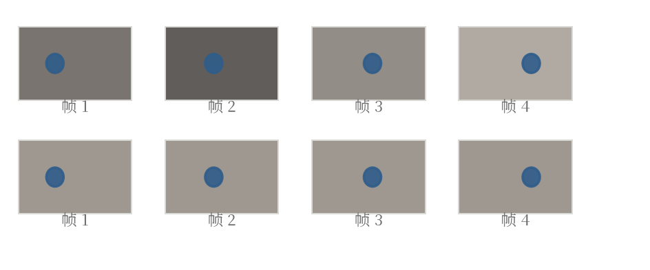
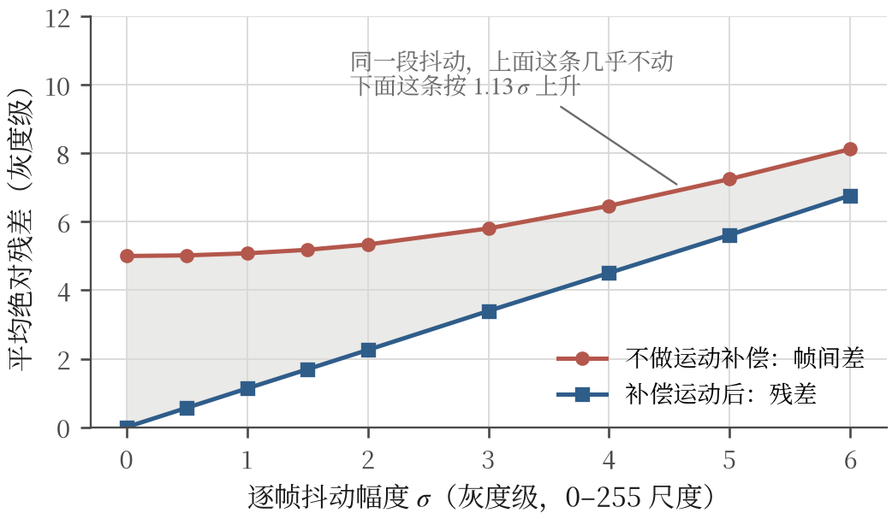

# 视频编辑：让时间保持一致

前面几章的编辑方法都是针对单张图的。把它们逐帧套到视频上，会得到一段"每一帧都改对了，连起来却在闪"的片子。

这一章讲视频编辑的特殊困难，以及三类应对方法：逐帧传播、跟踪与变形、以及把视频当成一个整体来生成。

## 为什么逐帧编辑会闪

独立地对每一帧做编辑，等价于在每一帧上独立采样。采样有随机性，两帧的随机数不同，结果就有细微差别。

单帧看，差别看不出来；连续播放，画面会像老电影一样抖动。人眼对这种高频变化极其敏感，哪怕只有百分之一的亮度差。

所以视频编辑的核心不是"改得对不对"，而是"改得一致不一致"。所有方法都在解决同一件事：怎样让帧与帧之间的改动互相对齐。



### 四处放大器

逐帧编辑的管线里，能让两帧产生差别的环节不止一个。

**初始噪声。** 每帧独立抽，两个 $d$ 维噪声向量之差的范数是 $\sqrt{2d}$ 量级。这是所有差异的源头，也是唯一无法避免的那一个。

**引导系数。** CFG 把有条件与无条件的预测之差放大 $w$ 倍，输入上 1% 的差异到输出就成了 $w\%$。$w=7.5$ 时，这个倍数足以把看不见的差异推到看得见。

**采样步数。** 步数少时离散误差大，而且每帧的误差方向不同，等于又叠了一层不相关扰动。

**VAE 解码。** 八位量化加上解码器在平坦区的增益，会把潜空间里的小差异摊成整片色偏。

四处里只有第一处是根因，后三处是放大器。这解释了一个常见现象：把 CFG 调低，闪烁会轻一些，但画面质量一起下降；把步数加上去，闪烁变细但不会消失。

### 闪到什么程度才看得见

把帧间差写成序列 $D_t=\text{mean}|I_t-I_{t+1}|$（0–255 尺度）。真实视频里 $D_t$ 由运动与曝光决定，是一条光滑的曲线；闪烁表现为这条曲线上的高频起伏。

八位量化下 1% 的亮度差是 2.55 级。在天空、墙面这类平坦区域，整片 ±2 级的跳变就能看见；在纹理密集处，同样的差值被掩蔽掉，看不出来。人眼对 3–10 Hz 的周期性亮度起伏最敏感，这是视觉研究里的常见量级，换算到 25 fps 就是 3–8 帧一个周期，正好是“每几帧跳一下”的那种闪。

所以判据不能只看 $D_t$ 的大小。快速平移的画面 $D_t$ 很大，静止画面 $D_t$ 很小，两者都不能说明有没有闪。要看的是 $D_t$ 减去滑动平均之后剩下的那部分，也就是它的时间高频成分，幅值越大、闪烁越明显。

这一点还有个直接后果：任何“比帧间差”的指标，都得先把运动除掉才有意义。

## 三类做法

**逐帧传播。** 先编辑关键帧，再把结果传播到其他帧：用光流把编辑后的像素搬运过去，或者用某种匹配找到对应位置。

**跟踪与变形。** 先估计视频里的运动（光流、点轨迹、形变场），把视频分解成"内容"与"运动"两部分；编辑内容，再按原来的运动重新渲染。

**整体生成。** 不把视频看成帧的集合，而是看成一个时空张量，直接用一个时空模型生成整段。这是视频生成模型成熟之后才可行的路线。

三类做法的代价不同：传播便宜但会累积误差；跟踪准确但依赖光流质量；整体生成效果最好但最贵。

| 做法 | 一致性来自 | 主要成本 | 典型失效 |
| --- | --- | --- | --- |
| 逐帧传播 | 光流对应 | 一次光流 + 逐帧插值 | 误差累积、遮挡 |
| 跟踪与变形 | 显式运动表示 | 轨迹跟踪、形变场训练 | 拓扑变化、光流不准 |
| 整体生成 | 视频模型的时空先验 | 多次视频模型推理 | 细节被稀释 |

三类也能组合。Rerender A Video 是“关键帧 + 整体生成”，AnyV2V 是把任意图像编辑塞进整体生成的框架。选的时候先问一句：运动能不能被显式写出来。能，就走前两类；写不出来（遮挡频繁、镜头复杂），就交给整体生成。

另一个区分是“改的是外观还是几何”。外观改动（颜色、材质、风格）可以直接在像素上搬运；几何改动（姿态、视角、物体增删）必须重新生成，因为搬运无法创造没见过的东西。前两类方法在几何上都不行，这是它们共同的上限。

## 用光流把编辑搬过去

先编辑几帧、再把结果搬到其余帧，是最省钱的做法。管线大致是：

```text
输入：源视频 I[0..T-1]，关键帧下标 K，单图编辑 E
1  for k in K:  J[k] <- E(I[k])
2  for t:       F[t] <- 光流(I[t], I[t+1])
3  for t 从已编辑帧向两侧推进:
       J[t] <- warp(J[t-1], F[t-1])                前向搬运
               或 0.5 * (前向 warp + 后向 warp)        双向平均
4  遮挡区（前后一致性检查失败的位置）用邻域或纹理补全
```

warp 就是按光流把像素搬过去，非整数位置做双线性插值。插值本身每次引入零点几像素的模糊，而模糊会累积：每搬一次边缘软一点，几十帧之后画面像蒙了层纱。

误差累积的量级可以估。假设每次 warp 的位置误差 0.1 像素，且不是随机方向而是略有系统性偏差，100 帧之后累积到 10 像素。一个 1080p 画面里 10 像素的错位眼睛一眼能看出来，边缘出现重影。

遮挡是硬伤。物体后面露出来的背景在任何一帧里都没被观测过，只能从邻近帧借或者靠修补，借来的部分随后又被 warp，错误跟着一路传下去。镜头切换更直接：两帧之间没有对应关系，光流给出的向量没有意义，画面直接跳变。

它对“编辑”这一侧还有个隐含假设：只改颜色和材质，不改几何。如果关键帧的编辑让物体变了形（比如换了姿态），warp 会把变形当成事实搬过去，但遮挡关系已经不对了。

判断这条路适不适合，看两件事：镜头动不动、需不需要改几何。两个都不需要，传播是最便宜的选项；只要有一个需要，就要靠后面的做法。

关键帧选在哪里也很影响结果。均匀间隔（比如每十帧一个）实现简单，但镜头切换处会被强行插值；更好的做法是按镜头切分，每个镜头至少一个关键帧，镜头内按光流幅值分配——运动快的段多放几个，静止的段一个就够。关键帧放少了，光流要搬的距离长，误差累积多；放多了，成本上升，而且相邻关键帧的编辑结果自己就不一致，汇合处会出现硬边界。

还有一种变体是在潜空间传播：把关键帧的潜变量按光流搬过去，再少步去噪；或者用 mask 只在编辑区域传播，其余像素直接保留原帧。后者的保真最高，因为大部分像素根本没被碰过，但它要求编辑本身的区域能被可靠地分割出来。

## 早期的两条路

Tune-A-Video 属于微调路线。给一段参考视频和一句新描述，在图像模型上做少量微调，同时改造注意力：让每一帧的查询都能看到第一帧的键值，从而保持主体一致。

Text2Video-Zero 属于免训练路线。它给所有帧共享大部分初始噪声，再在注意力里做跨帧交互，不改任何参数。

两条路在实现上都只动很小的一块。Tune-A-Video 改的是各层的空间自注意力，把它换成“稀疏因果”形式：第 $i$ 帧的查询，除了看自己这一帧，还看第一帧：

$$\text{Attn}_i=\text{softmax}\!\left(\frac{Q_i[K_0;K_i]^\top}{\sqrt d}\right)[V_0;V_i].$$

第一帧是锚，把外观固定住，其余帧只负责跟着动。训练时绝大多数参数冻结，只调注意力与少量卷积，几百步就能出结果。

Text2Video-Zero 改的是两处。一是初始噪声，所有帧共享同一份（或只做很小的扰动），潜空间里每帧的起点几乎一样。二是注意力，每帧做完自注意力后，再用第一帧的键值重做一次，把特征往第一帧对齐。它还有一个可选组件：从第一帧估一个全局运动场，把背景按运动平移，给画面一点“在动”的感觉。这个运动场是全局单应的，只能表达相机的平移缩放，表达不了每个物体的独立运动。

这两条路都只改注意力，不显式建模运动。对镜头固定、主体单一的短视频够用，对复杂运动就不行了。

微调的代价是每段视频都要训一次，几百步、几分钟量级（估计），换来的是主体一致。免训练那条省掉了训，但共享噪声只在开始时起作用：初始条件相同，之后的轨迹还是各自演化，几十帧之后会分开。这说明“一致”不能靠初值偷，必须在每一步都重新对齐。

## 用跟踪与变形

TokenFlow 的做法是：先逐帧编辑，得到一组"各自都对、彼此不一致"的结果；再在扩散特征空间里找对应关系，把同一物体的特征对齐，重新生成。

CoDeF 走得更远：它把视频表示成一个内容场加一个形变场。内容场描述"画面里有什么"，形变场描述"它怎么动"。编辑只改内容场，形变场保持不动，于是运动被完整保留。

这类方法的优点是结构保持得好，因为它们显式地分离了外观与运动。缺点是要先估计运动，光流不准的地方就会出错。

运动估计本身也有代价。逐对光流要在全分辨率上跑一次网络，一段 100 帧的视频就是 99 次；点轨迹便宜一些，但需要在前向跟踪后做后向校验才能剔除漂移。用哪个取决于对精度的要求：只搬颜色用稠密光流就够，要改局部细节则要把每个像素的对应都算准，前者做不到。

TokenFlow 的对应关系不在像素上找，而在扩散特征上找：逐帧编辑时把中间层特征留下来，对每一帧的每个位置，在关键帧的特征里找最近邻，把关键帧的特征搬过来替换，再继续去噪。特征层的对应比像素层稳，因为特征对颜色变化不敏感、只对结构敏感。代价是要把全视频的特征存下来：$T=16$、通道 320、空间 $40\times40$，约 800 万个半精度数，十几 MB，可以接受；但每一步都要做一次匹配，成本随帧数平方增长。

CoDeF 用两个网络表示一段视频：内容场是一张“规范图”，形变场把每个时刻的像素映射回规范图坐标。训练目标是重建每一帧，再加一项让形变场在时间和空间上平滑的正则。编辑时只改规范图，形变场原封不动，运动就被逐像素保留下来。限制也在这里：形变场是坐标映射，表达不了拓扑变化——物体出现、消失、互相穿越，映射就断了，这些位置会出现撕裂或鬼影。每段视频还要单独训一次，分钟量级。

## 用整体生成

2024 年之后，视频生成模型本身变强了，编辑开始转向"整体生成"。

Rerender A Video 的思路是层次化：先做关键帧编辑，再用视频模型补中间帧，最后用超分补细节。每一级都以关键帧为锚，漂移被控制住了。

AnyV2V 把这件事做成通用框架：给定任意图像编辑方法，用它改第一帧，再让视频模型把改动传播到整段。编辑方法可以换，视频模型负责一致性。

VACE 则把多种视频任务（生成、编辑、参考）统一到一个模型里，用条件的形式区分任务。

这条路线的好处是不用自己设计一致性机制，交给视频模型；代价是需要一个足够强的视频模型，而且推理成本高。

Rerender A Video 的三级可以摊开看成本：关键帧编辑只跑一两次图像编辑；中间帧补全要跑若干次视频生成，次数随段数增加；超分逐帧跑图像模型，次数等于帧数。三级里最贵的是中间那段，因为视频模型的注意力在时空上是平方的。

VACE 把条件做成 token：结构信号、mask、参考图各自编码成序列，和时间 token 拼在一起送进模型，用任务前缀告诉模型“这次是补全还是改写”。一套权重覆盖多种任务，每种任务分到的容量因此有限。

细节丢失是这条路线的通病。编辑信号要先经过 VAE 编码压到潜空间，再被切成 patch，小尺度改动在两次下采样里被平均掉：画面上的一个标志、一行字，进去时清楚，出来时成了色块。这类改动更适合走传播或跟踪那条路，因为它们在像素域搬运。

首帧锚定之所以有效，是因为它把一致性问题变成了条件问题：后面的帧只需要跟着首帧走，不需要彼此商量。代价是首帧的编辑质量直接决定了整段的上限——首帧里出一个小瑕疵，视频模型会把它当成事实，在每一帧里重演。所以这类方法对首帧编辑的要求比图像编辑高，常常需要多试几次挑一张。

还有一层限制：视频模型的运动先验是学来的，它会倾向于“合理”的运动。如果编辑想描述一种它没见过的动作（比如物体漂浮），模型会把它拉回常见运动，编辑意图被冲掉。

## 代表方法的定位

把这一章提到的代表方法摆在一起，看三列：要不要训练、一致性从哪来、一句定位。

| 方法 | 训练 | 一致性来自 | 一句定位 |
| --- | --- | --- | --- |
| Tune-A-Video | 每段微调 | 跨帧注意力（看首帧） | 用少量微调把图像模型改造成视频模型 |
| Text2Video-Zero | 不要 | 共享噪声 + 跨帧注意力 | 免训练，把噪声与注意力对齐就够 |
| TokenFlow | 不要 | 特征层最近邻对应 | 先各自编辑，再把对不上的特征拉齐 |
| CoDeF | 每段训练 | 显式形变场 | 内容与运动分离，编辑内容不动运动 |
| Rerender A Video | 不要（借现成视频模型） | 关键帧锚定 + 层次化 | 关键帧定调，视频模型补中间 |
| AnyV2V | 不要 | 首帧锚定 | 任意图像编辑加视频模型做传播 |
| VACE | 统一训练 | 时空生成 | 用条件编码把多种视频任务装进一个模型 |

读这张表可以从“一致性来自”那一列入手，它基本决定了失效模式。注意力共享怕镜头运动，因为首帧提供不了背面的信息；特征对应怕匹配错，重复纹理处最近邻会跳到错误的位置；形变场怕拓扑变化；时空生成怕细节稀释。一致性挂在哪，就知道它什么时候会掉。

## 视频编辑的额外评测

图像编辑看保真与对齐。视频还要看两件事。

时间一致性：相邻帧之间的差异是否平滑。常用指标是光流扭曲后的像素误差，或者特征空间里的帧间距离。

运动保真：编辑之后，原来的运动是否还在。把人的衣服换成红色，人还得继续走；如果把走路改成了站立，就不算保真。

这两个指标经常与语义对齐冲突。改得越多，越容易破坏运动；改得越少，越不像目标描述。

### 时间一致性怎么算

光流扭曲误差是最常用的一种：把 $t$ 帧按光流扭曲到 $t+1$ 的位置，与真实的 $t+1$ 帧比，取平均绝对差：

$$E_{\text{warp}}=\frac{1}{T-1}\sum_t\ \text{mean}\Big|I_{t+1}-W\big(I_t,F_{t\to t+1}\big)\Big|.$$

遮挡区要去掉。做法是前后向一致性检查：前向光流从 $t$ 到 $t+1$，后向光流从 $t+1$ 到 $t$，两次加起来能回到出发位置的像素才可信。

先用光流把运动除掉，是因为 $D_t$ 里运动占大头。图 24.2 是一个合成算例：一段缓慢平移的纹理，叠加逐帧独立的亮度抖动。不做补偿时，帧间差几乎不随抖动变化，被运动淹没；补偿之后，残差与抖动幅度成正比，斜率约 1.13：两个独立抖动之差的标准差是单帧的 $\sqrt2$ 倍，再取平均绝对值，乘一个 $2/\sqrt\pi$。



特征距离是另一种做法：取 CLIP 或 DINO 特征，算相邻帧的余弦距离，报均值与方差。它对材质变化敏感、对几何变化不敏感，与扭曲误差互补。

一条实践建议：报一致性时把运动量一起报，比如光流幅值的均值。只报一致性，一段几乎不动的视频能拿到满分。

报均值还是分位数也有讲究。闪烁往往是局部的（一块墙面、一片天空），均值会被大面积稳定的区域拉低；报逐帧残差的 90 分位数，或者按空间块取最差，才能把闪烁暴露出来。

### 一个算例

换成更接近实际的量级（以下都是估计）：一段 512×512、30 帧、整体缓慢平移的视频。帧间差里运动贡献约 4–5 级，逐帧抖动只有 2 级（约 0.8%）。不补偿时根本看不出抖动：帧间差从 4.5 变到 5.0，变化淹没在运动里。补偿之后残差降到 2.8 级，抖动成了残差的主体，差异一眼就能看出。同一段抖动在 30 帧里有 30 个独立取值，这就是“闪”的算术来源：单帧差很小，但它每帧都变。

这个算例还说明另一件事：指标的分辨率取决于场景。同样 1% 的抖动，在平坦背景上能被残差清楚地抓到，在强纹理场景里会被光流自身的误差盖住。报指标时得说清测试集里有多少平坦区域，否则数字无法比较。

### 运动保真怎么算

最直接的是光流一致性：编辑前后各估一次光流，比两个流场的端点误差；或者只比幅值，因为方向常常因为纹理变化而估不准。

也可以走轨迹：在原视频上取一批点，跟踪出轨迹，再看编辑后的视频里这些点偏了多少。轨迹比逐帧光流稳，因为它把误差平均掉了。

FVD 是分布层面的指标：把编辑后的视频与真实视频的时空特征做分布距离。它对运动异常敏感，一段“该动没动”的视频在 FVD 上会很差；但它的绝对值依赖参考集，跨论文比意义不大。

### 语义与主体一致

文本对齐一般逐帧算图文相似度再平均。这个平均会掩盖局部失败：一帧完全不符合描述，只要其余帧够好，平均分几乎不动。更严的做法是报最差的那几帧，或者按时间窗口取最小值。

主体一致要另一套特征：人脸识别或物体重识别的嵌入，算跨帧相似度。它与时间一致性不是一回事：后者管“画面跳不跳”，前者管“还是不是同一个人”。换脸做得再平滑，主体一致也会掉。

### 指标之间会互相作弊

几条常见的作弊路径。

把整段视频的所有帧替换成同一张编辑后的图。时间一致性满分（帧间差为零），运动保真零分。

把编辑幅度压得很小。保真高、对齐低；反过来，改得狠时对齐高、保真低。

把画面抹平（加模糊、降对比）。光流估计在模糊帧上更稳，扭曲误差反而下降。

所以报结果至少要成对：一致性与运动保真成对，对齐与保真成对。单独报一个数，读的人无法判断它是做对了还是偷了工。

## 一个判断

如果视频单帧看都对，连起来闪，问题在一致性，优先考虑传播或整体生成。

如果单帧就改错了，先按图像编辑的办法解决；视频部分的方法帮不上忙。

如果运动丢了，说明方法把视频当成了帧的集合，需要引入运动表示或整体生成。

这套判断有个前提：三种失败可以分开看。实际上它们会耦合——为了消除闪烁而加大平滑，运动就会被抹掉；为了保住运动而不做对齐，闪烁又回来了。所以调参的方向不是“把三项都做好”，而是先定哪一项不能牺牲，再在其余两项上让步。

拿一个具体选择举例：一段人物行走的视频，要求把外套改成红色。保真不能牺牲（人要还是那个人），运动不能牺牲（要走路），于是只能在“改得准”上让——外套的细节可能糊一点，袖口的边缘可能不够干净。这种让步是有意识的，不是失败；真正该担心的是三项里有一项彻底失效，比如人不动了、或者脸变了。

## 与前面章节的关系

这一章用的仍然是前面那些编辑手段：注意力、条件、反演、速度场。区别在于它们要作用在整段视频上，于是多了一个约束：改动必须沿时间对齐。

理解了这一点，再看具体的视频编辑论文，就只是在看“它用什么方式保证对齐”。

视频编辑还把前面几章的一个隐含假设打破了。图像编辑可以假设“改动是局部的”，因为一张图只有一次机会；视频里改动会在时间上被反复观看，任何局部瑕疵都会被反复暴露。一帧里的一个小色块，在一段 5 秒、25 fps 的视频里会重现 125 次。于是视频对编辑质量的要求实际上比图像高：单帧分数一样，观感差很多。

另一个差别是条件的作用强度。图像里提示词只影响一张图，模型可以把它“全用上”；视频里同一个条件要约束几十帧，时空注意力还要分一份给时间维持一致，条件本身的控制力被稀释。这解释了为什么视频编辑的改动幅度通常比图像编辑小——不是因为保守，是因为干扰太多。

到这里，生成与编辑的主要路线都走完了。最后一章把方法汇总成一张表，并给出按任务选方法的思路。
