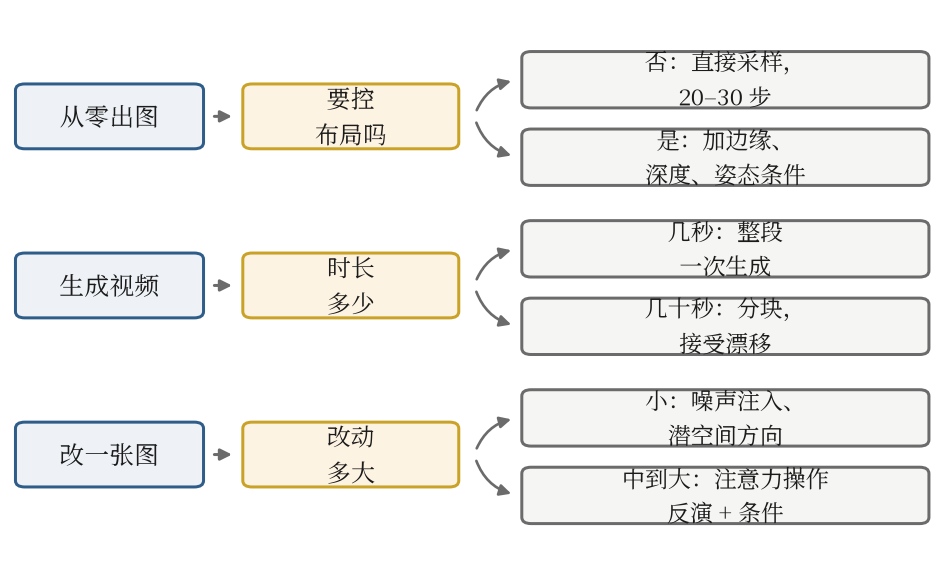

# 怎么选，怎么读

这一册从“图像是一个向量”讲到“一步编辑”，把生成与编辑的主要路线走了一遍。最后这一章给一张对照表，再谈两件实用的事：怎么选方法，怎么读论文。

选方法与读论文是一件事的两头。选方法时，要在论文的数字里找证据；读论文时，要判断它对你的任务有没有用。表里的量都是范围，落到具体项目会缩成一个点，缩到哪里由显存、延迟预算和数据决定。

## 一张总表

| 方法 | 学什么 | 训练信号 | 采样（典型 NFE） | 训练成本 | 编辑可用 |
| --- | --- | --- | --- | --- | --- |
| 变分自编码器 | 隐变量后验 | 证据下界 | 一次解码（1） | 单卡小时到单卡天 | 潜空间方向 |
| 对抗网络 | 生成器 | 对抗 | 一次前向（1） | 数十卡天 | GAN 反演 |
| 扩散模型（图像） | 噪声 | 加权均方误差 | 多步（20–1000） | 数千卡天 | 反演、注意力、条件 |
| 潜空间扩散 | 潜空间噪声 | 同上 | 多步（20–50） | 同量级，另加 VAE | 上述方法都在潜空间做 |
| 时空 U-Net | 时空噪声 | 同上 | 多步（20–50） | 万卡天量级（估计） | 逐帧或整体生成 |
| 3D VAE + 视频 DiT | 时空潜变量 | 同上 | 多步（20–50） | 万卡天以上（估计） | 视频编辑的底座 |
| 流匹配 | 速度 | 条件速度回归 | ODE 积分（10–50） | 与同规模扩散相当 | 速度场差 |
| 一步生成 | 速度或终点 | 蒸馏、恒等式 | 1–4 步（1–4） | 底座成本加蒸馏开销 | 一步编辑 |

表里最后一列是这一册后半部分的主题。同一套模型，换一种用法就是编辑；差别在于在哪一层介入、要不要反演。视频列出的两行不是新方法，而是把同样的思路搬到时空张量上：多了一个帧维，就多了一致性与内存的问题。

NFE 是网络前向的次数（number of function evaluations）。扩散模型的每一次去噪都调一次网络，步数与 NFE 相等；蒸馏出来的少步模型把多步压成一两次映射，NFE 与“步数”就不再是一回事。比较两个模型的推理成本，只能比 NFE 乘上单次前向的成本，不能只比步数。

视频要单独说。整段视频当成一个张量送进网络，NFE 不变，可每次前向要处理 $T$ 倍的 token，实际成本是图像的十几倍。反过来，逐帧生成一段 49 帧的片子，NFE 要乘 49。同样是“20 步”，两种实现的账单差近两个数量级。

端到端时间是三项之和：

$$T \approx \mathrm{NFE}\cdot c_{\text{前向}} + c_{\text{解码}} + c_{\text{编码}}$$

拿 512×512 的图像算一遍。0.9B 参数的 U-Net 在 A100 上单步约 30 ms（量级估计，含注意力与卷积），20 步就是 0.6 s；潜空间的 VAE 解码约 0.1 s，文本编码约 0.02 s，总计 0.72 s，采样占八成。换成一个 4 步的蒸馏模型，采样降到 0.12 s，总计 0.24 s：快了 3 倍，而不是 5 倍。步数压得越低，解码与编码的占比越高，单纯压 NFE 的收益越接近上限。

训练成本这一列给的是量级，精确数字很难拿到，但可以自己估。一次训练的前向加反向约 $6ND$ FLOPs，$N$ 是参数量，$D$ 是训练时看过的 token 数。取 $N=10^9$、$D=10^{11}$，得 $6\times10^{20}$ FLOPs。A100 在 bf16 下峰值约 $3\times10^{14}$ FLOP/s，按三成多的利用率算 $10^{14}$，需要 $6\times10^6$ 秒，约 70 天单卡时间；摊到 128 张卡上是 13 小时，摊到 8 张卡上是 9 天。

这个式子算出来的是下界。注意力那一项按 token 数的平方涨，$6ND$ 里没有它；数据加载、通信、失败重启、调参都要另算，实际账单常是估计值的两到三倍。公开报告里，一个 512 分辨率的文本到图像扩散模型动辄十万卡时，也就是几千卡天，正好落在这个量级。

表里写“数千卡天”“万卡天”，意思是一次从零训练需要的机器时间。这一列最容易被误读，因为多数项目并不从零训练：在开源底座上做 LoRA 或 ControlNet 微调，单卡几小时就能出一个风格。底座已经把这一列付过了，你要付的只是微调那一小段。另有一笔不在表里的开销：清洗、去重、打标、过滤低质量样本，工作量常与训练本身同量级，论文里却很少写。

读表的顺序可以固定下来：“学什么”定族，“采样”和 NFE 定延迟，“编辑可用”定要不要多付一次反演。三列对不上，这个方法就可以排除。

## 怎么选

按任务选，不按方法的新旧选。

动手之前先写清三件事。输出是什么：一张图、一段视频，还是一张改过的图。约束是什么：显存多大、延迟多少、能不能联网、能不能微调。哪种失败可以接受：糊一点、慢一点，还是不许改错位置。这三条写下来，选项通常只剩两三个。

只要能出图、不要求可控：用现成的扩散或流模型，配上合适的提示词。步数用 20 到 30，CFG 5 到 9。这个区间有来由：步数低于 15 时，高阶求解器的截断误差开始显形，画面出现结构性错误；步数超过 50 后收益递减，翻一倍步数换来的改善通常只有个位数百分比（量级估计）。CFG 低于 3 时提示词约束太弱，画面容易跑题；高于 12 时颜色过饱和，边缘出现锐化的硬边。不同模型的日程不同，这些数字要重测。

要改属性或风格：优先用噪声注入或潜空间方向，简单、快、可预期。代价是一次编码加一次短采样，NFE 大致与注入的噪声水平成正比；噪声水平越高，改得越多，保真度掉得越快，这条曲线在越过一半之后陡然变陡。

要改语义但保布局：用注意力操作，或者用指令微调模型。注意力替换要放在前若干步做，布局在早期的注意力图里就定下来了；越往后替换，能改的只剩纹理。指令模型省掉了调参，但对训练时没见过的指令类型会退化成“重画一张像的图”。

要精确控制布局：用结构条件，比如边缘、深度、姿态。条件强度和 CFG 会互相拉扯：两个都调高，画面会被拉成“贴着边缘的纹理”，物体像被压扁在轮廓里，实践中常常一个升一个降。

要编辑真实照片且要求高保真：用反演加条件，接受慢一点。预算按两倍算，反演一遍、采样一遍；双分支的方法（把两条轨迹耦合起来减小误差的那些）还要再翻一倍。

要交互式、实时：用一步模型加低能量平滑。细节会有损失，尤其是文字和小物体，换来的是每一步都能在几十毫秒内出结果。

要生成视频：先看时长。几秒钟的片段用现成的视频模型；几十秒以上要考虑分块或层次生成，并接受一定程度的漂移。

要编辑视频：看改动幅度。局部改色或换风格，用逐帧传播；要保住运动，用形变场类方法；要大幅改语义，用视频模型整体生成。

### 生成视频的分支

先按时长和分辨率估显存，这一步决定你能用哪一类方法。

3D VAE 常见的压缩比是空间 8 倍、时间 4 倍。512×512、49 帧的视频，压完是 $64\times64\times13$，约 5.3 万个 token；同样分辨率的单张图只有 4096 个。帧维把 token 数放大了 13 倍，全 3D 注意力的配对数按平方走，放大 169 倍。视频模型普遍采用分解注意力就是为了避开这个平方：空间维做一次，时间维做一次，把一项拆成两项。

显存随帧数近似线性涨（激活值），注意力随帧数平方涨。两件事叠在一起，几秒钟的片段还能整段放进去，几十秒就必须分块。

分块的做法是切 16 到 32 帧一块，块间重叠 4 到 8 帧。重叠区用来对齐：把上一块末尾的几帧当作下一块的条件，或者用光流把边界处的运动接上。重叠太少会跳帧，太多则成本线性上升。

漂移是分块绕不开的代价。块与块之间的颜色、亮度、构图会缓慢偏移，几十秒后主体开始变形。缓解手段有三个：锚定一张参考帧，让每块都看到它；每块用同一段文本条件，不让描述逐块漂；生成完做一次全局调色，把块间的色差压回去。

音频要单独安排。联合生成音视频的模型把两条流放在一条时间轴上，口型与敲击声能对上；先出画面再配音的做法在多说话人、快节奏的场景容易错位。声音不重要的话，先不要为它增加复杂度。

### 编辑的分支

图像编辑的选型由两件事决定：改动多大，保真要求多高。改动小、保真要求高，走反演与方向；改动大，走重绘。中间地带最难受，两类方法的缺点都会出现。

| 改动 | 常用方法 | NFE 量级 | 典型失败 |
| --- | --- | --- | --- |
| 色调、季节、光照 | 噪声注入、潜空间方向、低强度加噪重采 | 20–50 | 整体偏色，目标区域没改到 |
| 风格 | 风格 LoRA、参考图适配器、高强度加噪重采 | 20–50，另加编码 | 风格对上了，内容跑掉了 |
| 换物体、换背景 | 反演加注意力编辑、局部重绘 | 60–150 | 边缘有缝，阴影与光源不匹配 |
| 改结构、改姿态 | 深度或姿态条件，配合反演 | 100–200 | 结构对了，纹理与周围不搭 |
| 大幅改语义 | 指令微调模型、整体重绘 | 1–50 | 原图信息几乎不剩 |

表里的 NFE 是量级估计，按“反演一遍加采样一遍”算。真实项目还要加条件编码、分割掩码、检测与对齐，这些零碎开销在交互式场景中往往比采样本身更显眼。

保真与可编辑是一对矛盾，矛盾的根源在反演。反演步数越多，重建越准，可得到的噪声越不像标准高斯里的典型样本；从这样的点出发去噪，模型会把它拉回典型区域，改动一大就崩。流编辑那一类方法绕开反演，就是为了把这个矛盾解开。

实时编辑的预算要倒着算。给定 1 秒的延迟上限，减掉解码 0.1 秒、编码 0.05 秒，剩 0.85 秒；单步 30 ms 的话，NFE 上限是 28。20 步的采样器刚好落在预算内，想再快只能换更小的模型或者一步模型，而不是继续压步数。

视频编辑沿同一条思路，只是把“改动幅度”和“一致性”分开处理。改动局限在一小块区域时，逐帧传播最省；整段都要换风格时，逐帧传播会累积误差，改用整体生成更稳。运动复杂的片段不要用形变场类方法，光流一错，整个画面跟着错。

### 选错的症状

三种组合在实践里反复出现，症状很好认。

用 1000 步的原始扩散采样器试水，等了半分钟出一张图，于是断定“扩散太慢”。同一套权重换 20 步的确定性采样器，质量差别肉眼难辨。

拿 GAN 的反演去精修照片，发现连重建都回不去，更不用说改。GAN 的隐空间对分布外的点不友好，优化能找到的编码常常落在流形之外。

把逐帧方法用在有运动的视频上，得到一段闪烁的片子。帧与帧之间没有共享信息，随机性各自独立，播放起来就是高频抖动。

三件事的共同点：方法本身没错，错在把它用在了不适配的场景。

## 怎么读论文

拿到一篇新论文，先问三个问题。问题本身简单，难的是知道去哪里找答案。

**它解决的是哪一类任务？** 生成、条件生成、还是编辑？任务不同，指标不同，结论不能直接比较。

具体的问法有四个。输入里有没有一张原图？如果有，输出与原图之间的约束是什么——像素级、特征级，还是只有一句“尽量像”？它比较的 baseline 是不是同一任务？主指标测的是哪一面？

没有像素级约束的“编辑”，实际上是条件生成。这类方法能做出很惊艳的单张结果，也可以完全不保留原图的结构；把编辑论文和文本到图像论文放在一张表里比 FID，从指标定义上就不成立。

有一个检验很好用：把输入图换成纯噪声，或者换成一张完全无关的图，看指标掉多少。掉得很少，说明方法几乎没用上输入；掉得合理，才说明它真的在改这张图。

**它用什么换到了效果？** 更强的底座、更多的数据、更多的训练轮次，还是方法本身的改进？很多“提升”来自前者。

看表时先找一行：同底座、同数据、只换方法。找不到这一行，提升就可能来自更强的底座。再逐项对齐参数量、训练数据量、分辨率、训练步数、有没有额外的预训练编码器。

消融要看是不是单变量。一次去掉三个部件只报一个总数，说明不了哪个部件在起作用；逐个去掉，才知道哪一个是必需的。

还要看它的技巧依赖什么假设。采样器的步长表依赖噪声日程，换了日程系数就不匹配；蒸馏依赖教师的质量，教师弱则学生更弱；注意力编辑依赖底座已经学到布局，在小模型上做同样的替换，注意力图本身就是糊的。假设一破，方法就退化。

**它的失败模式是什么？** 论文通常只在成功案例上展示，失败案例要自己找：看补充材料，看后续工作的对比实验。

三个地方能看出端倪。项目页和附录里有没有随机样本网格——只放精修过的单张图，往往说明作者知道平均质量不好看。后续论文的对比图里，前作被放出来的通常是它最差的案例，这比读原文更能看到缺点。正文里有没有定量统计——成功率、人工评估的打分分布，只给几张好看的就等于没给。

自己跑一遍是最快的办法。固定种子，取一批最难的输入：多文字、手部、密集小物体、少见构图、极端长宽比。看失败率，不看最好看的那一张。同一个提示词换四个种子，如果结果差异很大，说明这个方法对用户的随机尝试不够稳。

### 读的顺序

从论文的第一张图和主表开始。那张图通常是方法的整体示意，一眼能看出它属于哪一族；主表决定它值不值得往下读。然后读方法节的第一段和最后一段：第一段是问题定义，最后一段是复现不出来的实现细节。公式放到第三遍再啃，很多公式只是把前面的话写成符号。

附录留给复现。清单至少六项：底座版本、噪声日程、采样器与步数、CFG 与 rescale 设置、随机种子、评测脚本与数据划分。缺一项，数字就对不上。多数“复现不出来”来自日程与 CFG 的默认值不同，而不是方法本身有问题。

## 三个常见的误解

**误解一：新方法一定更好。** 新方法往往在某个特定设置下更好，换一个底座、换一个数据集，结论可能反过来。

举个具体的：某个高阶求解器在 20 步上比 DDIM 好，是因为它的系数按那个模型的 $\bar\alpha$ 日程推出来。把同一张步数表搬到用 cosine 日程、或者用流匹配参数化的模型上，系数不再匹配，20 步可能反而不如最朴素的 Euler。方法没变，默认设置被当成了普适结论。

再举一个：蒸馏在 10 亿参数的底座上把 4 步做到接近 50 步的质量；换成 50 亿参数的底座，学生与教师的容量差距变大，同样的 4 步又不够用了。规模一变，结论要重测。

判断的办法是问一句：论文有没有在第二个底座上验证？没有的话，把“更好”读成“在这个底座、这个日程、这份数据上更好”。

**误解二：指标高就是好。** FID、CLIP、PSNR 都是代理指标。一张 PSNR 很高的编辑图，可能只是没改；一张 FID 很低的生成图，可能单张细节经不起看。

编辑任务里 PSNR 最高的做法是什么都不改。输出等于输入时误差为零，PSNR 无穷大，所以只报 PSNR 的编辑结果没有信息量。反过来，只有 CLIP 相似度的结果也不可靠：把整张图重画成提示词描述的样子，相似度会很高，原图却一点都不剩。两个指标一起看才勉强成立：一个鼓励改，一个鼓励不改。

生成任务里，IS 只看单张图在分类器眼里有多像真，不惩罚覆盖不全。一个只把某一类生成到极致、其余类别完全不出的模型，IS 可以很高。FID 对覆盖更敏感一些，但它仍然是特征空间里的均值与协方差，不看单张图的细节：一批图在特征统计上凑近了真实分布，逐张看却都有瑕疵，FID 照样会低。

还有一个容易忽略的：CLIP 分数可以靠堆提示词提上去。在提示词末尾加一串“高细节、4K、杰作”，文本嵌入会移动，分数跟着涨，画面未必有变化。看到分数涨而图没变好，先怀疑评测口径。

应对的办法很朴素：至少两个方向相反的指标一起报，比如保真与对齐、真实与多样；再看 20 张随机样本。指标负责筛掉明显差的，眼睛负责发现指标看不见的问题。

**误解三：一步模型等于快。** 要看你数的是 NFE 还是墙钟时间。有的“一步”模型单次前向很贵，总算下来并不快。

一个 20 步的小模型，单步 30 ms，采样 0.6 s；一个一步的大模型，参数多三五倍、分辨率高一档，单次前向 0.4 s。加上解码 0.1 s，前者 0.7 s，后者 0.5 s。NFE 从 20 降到 1，端到端只快 1.4 倍。

解码的占比还会变。NFE 为 20 时，解码占七分之一；NFE 为 1 时，占五分之一。要再快，得连解码一起优化：更小的 VAE、蒸馏过的解码器，或者先出低分辨率再超分。

服务端的账又不一样。一次跑 8 张，瓶颈从单步延迟变成显存与吞吐，NFE 的优势会被批处理摊平；一步模型省下的时间，可能还不够它多占的那部分显存。

比较速度时至少报三件事：NFE、单次前向的实测延迟、端到端墙钟。只报第一件，等于没报。

## 往下读什么

想动手实现，从扩散模型开始：前向过程、噪声预测、DDIM 采样，这三件事写出来就能跑。然后加条件（CFG）、加潜空间（VAE 编码器）、加编辑（反演与注意力）。先在 256 或 512 的潜空间版本上跑通，再去碰视频，视频的麻烦有很多落在显存上。

想理解原理，把这册的第 6、7 章读透，再看流匹配与 MeanFlow 的原始论文。它们的推导不短，但核心只有一两个式子。

想做编辑，从 SDEdit 与 Prompt-to-Prompt 入手，再看 EDICT 与 FlowEdit，最后看 ChordEdit。前两个建立直觉，中间两个处理误差，最后一个处理一步。

## 最后

生成与编辑的界限正在变模糊。同一个模型，既能从噪声造图，也能从一张图改出另一张图；区别只在于初始条件与约束。

理解了“把简单分布搬到复杂分布”这条主线，再看到新方法时，就不会被名字和术语挡住：它无非是选了另一种描述方式，或者换了一种把误差压下去的办法。选型时也一样，不必看名字，看它把成本放在哪一步。
