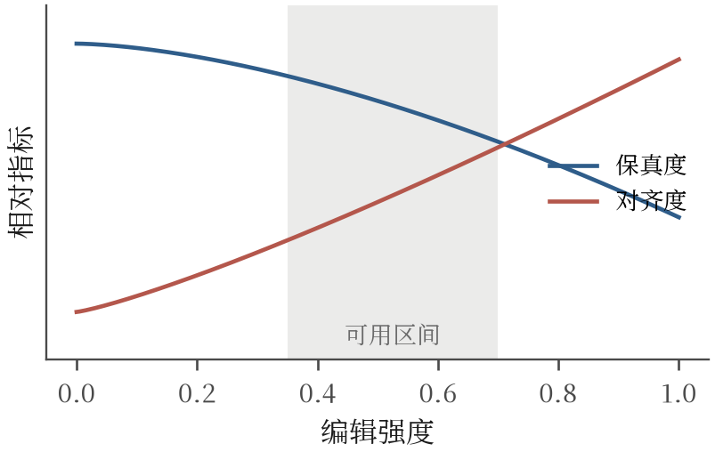
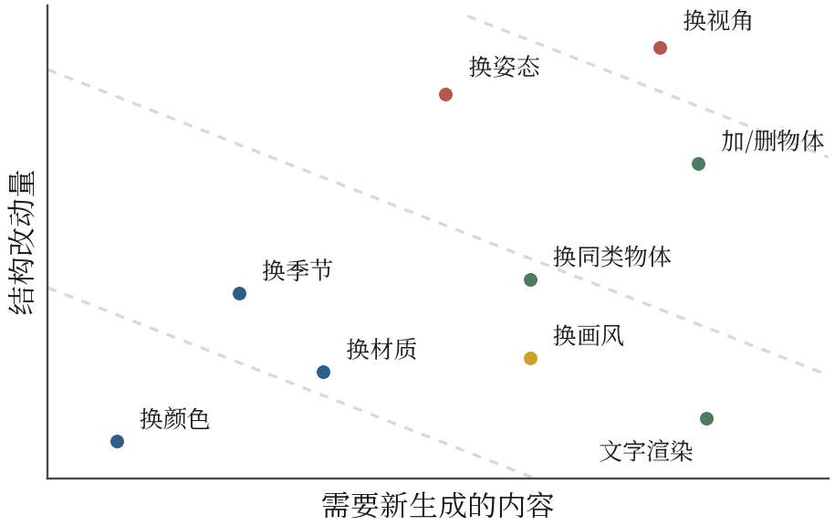
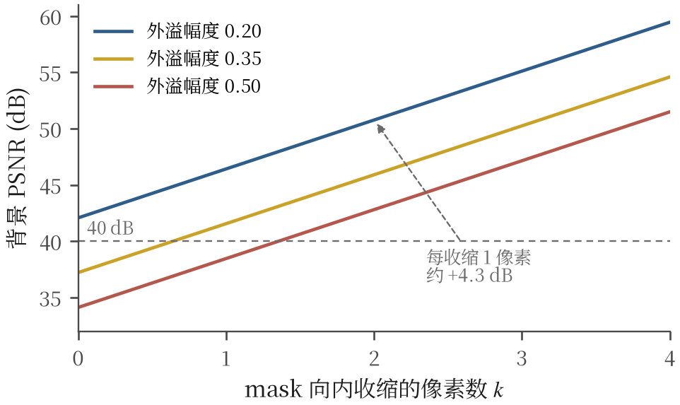

# 编辑问题的形状

一张橘猫的照片，要把猫变成绿色。人做这件事时同时完成两件事：认出哪块区域是猫，并在那块区域换颜色，其余部分不动。模型要做到同样的事，需要同时具备定位与改写两种能力。

这一章把这件事写成数学，并说明它为什么比生成更难。视频的版本放在后面：同样的要求，再加一条时间上的约束。

## 三个要求

输入是源图 $x_{\text{src}}$、源描述 $c_{\text{src}}$、目标描述 $c_{\text{tar}}$，输出 $x_{\text{tar}}$。要求有三条。

保真：在非编辑区域，$x_{\text{tar}}$ 与 $x_{\text{src}}$ 接近。背景、未提及的物体不该发生变化。

对齐：$x_{\text{tar}}$ 整体符合 $c_{\text{tar}}$。该改的地方必须真的改了。

真实：$x_{\text{tar}}$ 看起来像一张照片，而不是拼贴。

### 写成优化问题

$$\min_x \|x-x_{\text{src}}\|^2 \quad \text{s.t.} \quad x\sim p(x\mid c_{\text{tar}}).$$

这个写法只是概念性的：$p(x\mid c_{\text{tar}})$ 的支撑是一个高维流形，约束没法直接处理。所有实际方法都在用不同的方式近似它。

要让它变得能算，第一步是把“编辑区域”从自然语言里取出来，写成掩码。$M\in\{0,1\}^{H\times W}$，$M_{ij}=1$ 的像素允许改，$M_{ij}=0$ 的像素不许动。保真这条要求于是有了确切形式

$$\big\|(1-M)\odot(x_{\text{tar}}-x_{\text{src}})\big\|^2=0,$$

$\odot$ 是逐元素乘。这个等号太硬：它要求掩码内外的差在边界那一圈从有限值突然跳到零，而图像在空间上是连续的，硬跳变本身就是一道接缝。实际能做到的，是让左边小于某个容差 $\varepsilon_b$。

三要求写成三个不等式，作用范围各不相同：

$$\underbrace{\big\|(1-M)\odot(x-x_{\text{src}})\big\|^2\le\varepsilon_b}_{\text{保真，只在 }M=0},\qquad
\underbrace{S(x,c_{\text{tar}})\ge s_0}_{\text{对齐，只在 }M=1},\qquad
\underbrace{x\in\mathcal M}_{\text{真实，全局}}$$

$S$ 是任意一个能打分的函数，比如图文相似度；$\mathcal M$ 是自然图像的集合，一条嵌在高维空间里的低维流形。

三条约束作用在三个不同的集合上，这个分工规定了后面所有的冲突。约束之间没有公共的作用域，也就没有一次投影能同时满足它们：改 $M=1$ 内的像素只影响对齐，改 $M=0$ 的只影响保真，而真实约束横跨两边，与两者都冲突。凡是“分别满足再拼起来”的做法，都会在 $M$ 的边界上栽跟头。

把 $\mathcal M$ 换成参数化，问题才落地。生成模型给了一个映射 $x=G(z,c)$，输出天然落在 $\mathcal M$ 附近，第三条约束不必再写。剩下两条：

$$\min_{z}\ \big\|(1-M)\odot\big(G(z,c_{\text{tar}})-x_{\text{src}}\big)\big\|^2
\quad\text{s.t.}\quad \|z-z_{\text{src}}\|^2\le\rho^2 .$$

$z_{\text{src}}$ 是源图在模型坐标里的表示，由反演得到；$\rho$ 是允许偏离多远，也就是编辑强度。这个式子把三件事摆在一行里：保真项在像素上算，对齐通过条件 $c_{\text{tar}}$ 隐式进入，真实由生成器保证，结构由 $z$ 到 $z_{\text{src}}$ 的距离保住。

后面各章的方法，差别几乎都在这条约束怎么写。加噪再降噪把 $\rho$ 换成噪声水平；注意力操作把 $\rho$ 换成“哪几层的注意力图允许换”；速度场差把 $\rho$ 换成一个方向，而不是一个半径。约束的外形变了，含义没变：限制模型的内部表示离源图多远。

换了写法，求解的难处也跟着换。$\rho$ 是一个标量，好调，但方向不可控——偏多少、往哪偏都由优化自己决定。噪声水平是一个时间，好调，方向由条件决定。注意力替换根本不连续，$\rho$ 退化成一个整数：替换几层、替换到第几步。这些差别会在具体方法里显出来。

### 三个要求两两冲突

保真与对齐的冲突下一节单独算。

对齐与真实也冲突，冲突的方式不一样。要让“一只绿色的猫”被打高分，最省力的解是把猫所在的区域刷成一片饱和的绿：图文相似度上去了，可这片绿没有毛、没有阴影、没有体积，离开了 $\mathcal M$。真实的绿猫，颜色必然被光照、毛发、环境色染得不那么纯，分数反而低一点。两个目标在最优点附近方向相反：一个要纯度，一个要纹理。

这类冲突在文字上最明显。要让“STOP”四个字母被认出来，最直接的做法是把笔画刷得又黑又锐，可自然照片里的字总有抗锯齿、反光、透视变形。越追求“认得出来”，越容易得到一张印刷品。

保真与真实在边界上冲突。最保真的做法是把 $M=0$ 的像素原样搬过来，最真实的要求是边界两侧的亮度、纹理连续。两者同时成立的唯一情形，是源图在边界附近足够平滑；碰上高对比边界，比如黑发贴着白墙，搬过来就是一道硬缝，缝两侧的梯度比 $\mathcal M$ 里任何自然图像都陡。严格保真自己就会造出不真实的图。

三者同时不可满足，有一个不依赖具体方法的论证。掩码外的像素只由源图决定，不携带 $c_{\text{tar}}$ 的任何信息；掩码内的像素要符合 $c_{\text{tar}}$，可它在边界上的取值必须接上掩码外的值。边界那一圈同时被两种互相矛盾的来源夹住：外面要它等于源图，里面要它符合新条件。于是任何解都会在边界上留痕迹，区别只在痕迹落在哪里——硬接缝、模糊过渡、还是缓慢的颜色偏移。

这不是某个方法的缺陷，是问题的形状。方法能做的只有两件事：把痕迹挪到人眼不敏感的地方（纹理密集处、暗部），或者把痕迹摊薄成一段过渡，代价是边界附近的保真度下降。

## 两个要求互相拉扯

保真与对齐是一对矛盾。改动越大，越容易破坏结构；完全不改又是恒等映射。

图 1.1 里的曲线不是示意性的摆设。它解释了一个常见的困惑：为什么同一个方法在不同图上表现差异很大。每张图、每个编辑的可用区间不同，固定的超参数只能取一个平均意义上的折中。

### 拉扯的度量

设编辑强度 $s\in[0,1]$，$s=0$ 是恒等映射，$s=1$ 是完全按目标条件重画。两条曲线：背景保真 $B(s)$ 单调降，对齐 $A(s)$ 单调升并饱和。

背景误差的形状可以估出来。编辑的影响从掩码边界向外泄漏，泄漏幅度正比于 $s$，泄漏量的平方进入均方误差，于是

$$\mathrm{MSE}_b(s)=\mathrm{MSE}_b(0)+c\,s^2,$$

$c$ 由边界两侧的对比度与掩码周长决定，$\mathrm{MSE}_b(0)$ 是 $s=0$ 时也存在的本底误差，主要来自变分自编码器的往返重建。换成 dB：

$$\mathrm{PSNR}_b(s)=\mathrm{PSNR}_b(0)-10\log_{10}\!\left(1+\frac{c\,s^2}{\mathrm{MSE}_b(0)}\right).$$

平方不是拟合出来的，是误差平方的直接结果。它有两个可检验的推论。其一，$s$ 小时损失按 $s^2$ 走，前期很平，过了某处才变陡。其二，本底误差大的方法对 $s$ 不敏感，因为它本来就泡在噪声里，多点泄漏看不出来。后者解释了一个反直觉的现象：重建本来就不像的模型看起来更“抗编辑”，不是它保真做得好，是分母太大。

对齐曲线形状不同，它有上界，前段涨得快：

$$A(s)=A_\infty\left(1-e^{-s/s_0}\right).$$

$s_0$ 是特征强度：$s$ 每增加 $s_0$，剩下的差距就缩小到 $1/e$；走到一半是在 $s=s_0\ln2\approx0.69s_0$ 处。它取决于编辑类型：换颜色时 $s_0$ 小，走几步就到；换姿态时 $s_0$ 大，要走到很深才动得了。$A_\infty$ 是这条路的上限——模型画不出绿猫的毛，$s$ 再大也到不了，曲线在低处压平。

把两条曲线画在一张图上，交点附近是直觉上的折中强度；换了度量单位交点会挪，所以它只能当直觉用。只看一个指标的话，最优强度分别落在两头。$c$、$\mathrm{MSE}_b(0)$、$s_0$、$A_\infty$ 四个量都是图相关的，四个一起变，可用区间的位置与宽度都变。这就是“固定超参只能取平均折中”的算术。

### 一组数

先把 PSNR 的量级和“看上去还行”这个印象对上。图像归一化到 $[0,1]$，只有一部分像素出现幅度 $\delta$ 的偏差，其余像素完全一致，则 $\mathrm{MSE}=p\,\delta^2$，$p$ 是受影响的比例。

| 受影响比例 | $\delta=0.02$ | $0.05$ | $0.10$ | $0.30$ |
| --- | --- | --- | --- | --- |
| $1\%$ | 54.0 | 46.0 | 40.0 | 30.5 |
| $2\%$ | 51.0 | 43.0 | 37.0 | 27.5 |
| $5\%$ | 47.0 | 39.0 | 33.0 | 23.5 |
| $10\%$ | 44.0 | 36.0 | 30.0 | 20.5 |

表里是 dB。$0.10$ 在 8 位量化下是 25 个灰度级，一眼能看出；$0.02$ 是 5 个灰度级，属于“好像有点脏”的程度。

读法分横竖两个方向。竖着看：$2\%$ 的像素有 25 级偏差，PSNR 还有 37 dB，按“30 dB 以上可用”的习惯会被判为合格，可那 $2\%$ 恰好压在物体轮廓上，人看第一眼就注意到。横着看：$1\%$ 的像素被彻底改错，PSNR 掉到 30 dB 上下，比“$10\%$ 的像素轻微偏色”还低。

所以 PSNR 对大片轻伤宽容，对小块重伤敏感。这个不对称与人的判断恰好相反：人眼对轮廓处的小块错误最敏感，对大面积轻微偏色最迟钝。这是后面要引入感知指标与结构指标的直接原因。

回到拉扯。取 $c=4\,\mathrm{MSE}_b(0)$，即最坏情况下泄漏把背景误差放大到本底的五倍。

$s=0.5$ 时下降 $10\log_{10}(1+4\times0.25)=10\log_{10}2\approx3.0$ dB；
$s=0.8$ 时下降 $10\log_{10}(1+2.56)\approx5.5$ dB；
$s=1$ 时下降 $10\log_{10}5\approx7.0$ dB。

本底 42 dB 的方法，走到 $s=1$ 还剩 35 dB；本底 35 dB 的方法，走到 $s=1$ 只剩 28 dB，已经不能用。同一个 $s$，一个还能看，一个废了。要同时覆盖两个方法，$s$ 只能取到 0.5 附近，而这个值对前者太保守，改不动。

实际系统会做两件事缓解：把掩码边界做成几个像素宽的软过渡，让泄漏曲线变缓，等效于把 $c$ 调小；或者让强度自适应，先用小强度跑一次，量一下背景误差，再决定要不要加大。后者相当于把上面两条曲线的参数在线估出来。

## 视频多出来的一条要求

视频编辑还要求时间一致：同一个物体在第一帧改了颜色，第十帧也得是同样的颜色，中间不能跳。

把这条要求写成约束，是对相邻两帧

$$\big\|x^{(t+1)}-\mathcal W\big(x^{(t)},F_{t\to t+1}\big)\big\|^2\le\varepsilon_t ,$$

$\mathcal W$ 按光流 $F_{t\to t+1}$ 做重采样：把第 $t$ 帧的像素沿运动场搬到第 $t+1$ 帧的位置上再比较，$\varepsilon_t$ 取在“人眼分辨不出”的量级。

这条约束与前三条的作用方式不同。它不问“改哪里”，只问“两帧之间对不对得上”。它可以与前三条完全无关地满足——全片都是同一张错图时它满分；也可以在前三条全满足的情况下被违反——每帧都改对，连起来在闪。

所以视频编辑是四个不等式。可行域的收缩比“多一条”听起来严重：若四条各自通过的概率是 $p$，按独立估计四条同时通过约 $p^4$，$p=0.9$ 时只有 $0.66$。四条并不独立，背景保真与时间一致有共同来源，实际没有这么悲观，但方向是对的：把图像方法逐帧套上去，通过率不是保持不变，是往下掉。

逐帧独立做，帧间差的标准差被顶到单帧抖动的 $\sqrt2$ 倍，也就是主动放弃了这条约束。要让它重新起作用，必须在帧之间建立显式的联系——共享噪声、光流对应、特征轨迹，都是这种联系的不同实现。

这条要求会牵出一连串问题：怎么知道两帧之间的对应关系，改动怎么沿时间传播，误差怎么不累积。第 9 章专门讲这些。

在读完前八章之前，可以把视频编辑理解成“图像编辑加上一条一致性约束”。有了这个理解，第 9、10 章就不难读。

## 编辑的类型

不同类型对保真的要求不同。

属性编辑，比如颜色、材质、季节，改动局部，结构几乎不变。这类最容易。

对象编辑，比如增加、删除、替换，需要新的内容，还要与环境协调，涉及光照、遮挡、透视。这类最难，因为模型必须想象出没见过的部分。

风格编辑，全局改变，但结构可以保留。

结构编辑，比如姿态、布局，改动最大，保真最难，通常需要额外的结构条件。

把“难度”拆成两个可以分别估的量：编辑要补多少源图上没有的信息，编辑前后结构差多少。前者决定结果假不假，后者决定结果崩不崩。

信息补多少，用能不能从源图里查到来衡量。换颜色几乎不要新信息——毛的纹理在图里，只是颜色统计要换；换材质多一点，砖缝的排布得重排；加一个物体最多——被它挡住的那片背景，源图里根本没有，只能按上下文编。

结构差多少，用编辑前后的深度图或边缘图差来量。这个量在条件方法里可以直接算出来，比凭感觉判断可靠。颜色编辑的深度图完全不变，姿态编辑的深度图几乎处处变。

两个量对应的失败模式不同，修法也不同。信息补不够，结果是贴上去的一块：边界融不进去，光照接不上。结构改动太大，结果是比例错、透视错、物体互相穿插。前者要更强的先验，后者要更强的结构条件。

图 1.2 把常见的编辑放上去，其中三个点可以拿来说明两个维度各自对应不同的难处。

文字渲染落在右下：结构几乎不动，但需要的新内容极精确——笔画的位置、粗细、连笔一个都不能差，而且不允许模糊。它的难处不在改动大，在容错小，用一步模型基本做不出来。

换画风落在右下一带、贴着文字渲染：结构改动不大（画风是统计量，不改布局），需要的新内容却不少（整片笔触要重画）。这类编辑的难处集中在结构保留，不在位移。老办法用统计匹配加结构约束就做得不错，原因也在这里。

换姿态落在中上偏左：不需要编太多新内容（人还是那个人），可结构要整体改，改成什么样必须由外部指定。文本说不出“右臂抬到 45 度”这样的几何细节，所以这类编辑几乎总要额外的骨架或深度条件。

按这两个量排序，大致是：颜色、材质、季节、风格、同类物体替换、增删物体与姿态、视角与布局。这个顺序与“能否用一步模型”的顺序一致，也与“路径有多弯”的顺序一致，三者说的是同一件事。

## 评测

自动指标分两类。

背景保真：在非编辑区域算 PSNR、MSE、LPIPS、SSIM。它们衡量没被改的地方是否真的没变。

语义对齐：CLIP 相似度，整图与编辑区域分别算，衡量改得对不对。

两者经常矛盾。PSNR 很高，可能意味着几乎没改；CLIP 很高，可能意味着改得过头、背景崩坏。所以论文里通常两个都报，再配人工评价。

常用的基准是 PIE-bench，700 张图，10 类编辑，每张带 mask 与源/目标描述。它的价值在于把编辑区域标出来，可以只在该区域算指标。

### 四个指标各自在看什么

形式上写一遍，指标的脾气全在定义里。

PSNR 只看逐像素差的均方值

$$\mathrm{PSNR}=10\log_{10}\frac{1}{\mathrm{MSE}},\qquad \mathrm{MSE}=\frac{1}{HW}\sum_{i,j}\big(x_{ij}-y_{ij}\big)^2 .$$

它不含任何关于结构的信息。把图整体平移一个像素，MSE 会很大，人却看不出差别；把一片区域整体压暗一点，人一眼看出，MSE 却很小。

SSIM 补这一块。它在局部窗口（$11\times11$ 高斯，$\sigma=1.5$）里比较均值、方差、协方差

$$\mathrm{SSIM}(x,y)=\frac{(2\mu_x\mu_y+c_1)(2\sigma_{xy}+c_2)}{(\mu_x^2+\mu_y^2+c_1)(\sigma_x^2+\sigma_y^2+c_2)},$$

再对所有窗口取平均。第一项比亮度，第二项比对比度与结构；$c_1,c_2$ 是防止除零的小常数。它对整体亮度偏移相当宽容，对结构翻转立刻扣分。

LPIPS 走得更远，用预训练网络的特征距离

$$\mathrm{LPIPS}(x,y)=\sum_l w_l\big\|\phi_l(x)-\phi_l(y)\big\|_2^2 ,$$

$\phi_l$ 是第 $l$ 层的特征图，$w_l$ 由人评比拟合。它衡量“看起来像不像”：两图逐像素差得远、但纹理与语义一致时，分数仍然低。这既是它比 PSNR 更接近人判断的原因，也是它会被“风格相似、内容不同”骗过的原因。

CLIP 相似度是两个编码器输出的余弦

$$\cos\big(f_I(x),\,f_T(c)\big),$$

$f_I$、$f_T$ 分别是图像与文本编码器。它衡量这张图与这句话整体上有多匹配，不衡量位置、数量、关系。这是它最大的盲区。

### 指标怎么被刷高

定义里的这些取舍，正好给退化解留了门。

**靠掩码收缩刷背景分。** 背景指标只在 $M=0$ 上算，把掩码向内收缩几个像素，边界那一圈误差就被划到统计范围外。这不是个小便宜。取一张 $512\times512$ 的图，掩码覆盖 $5\%$，等效成半径 $64.6$ 像素的圆，周长约 $406$ 像素。设编辑的影响从边界向外按 $\delta e^{-d/2}$ 衰减，$d$ 是到边界的距离（单位像素），收缩 $k$ 像素就是把 $d<k$ 的一段剔掉，剩下的均方误差是

$$\mathrm{MSE}(k)=\frac{P\,\delta^2 d_0}{2HW}\,e^{-2k/d_0},$$

$P$ 是周长，$HW$ 是总像素数，$d_0=2$。每收缩一个像素，PSNR 涨 $10\log_{10}e^{2/d_0}\approx4.3$ dB，与 $\delta$ 无关。

图 1.3 是这条式子的图。收缩 4 像素，三条线各涨 17 dB；外溢幅度 $0.5$ 的那条从 34 dB 升到 51 dB，跨过了“看不出差别”的门槛。而画面上真正丢掉的东西，只有掩码边缘一圈 4 像素宽的边。

**靠一块色块刷语义分。** CLIP 的图像编码器把整张图池化成一个向量，空间布局在池化里被压掉。把掩码内一小块（比如 $5\%$ 面积）刷成目标颜色的高饱和色块，“绿色的猫”的相似度就能明显上升，而猫的形状、姿态、毛色斑纹一概没变。上涨幅度取决于原图与目标描述的差距，方向是确定的：色块越纯、越大，分数越高，直到它自己变成一个与描述不符的物体。

**两个分都高，结果仍然错。** 把猫所占的区域整体刷成一片绿，背景没动（背景分高），绿色对上了描述（语义分高），可猫的轮廓、姿态、斑纹都消失了。背景分和语义分都看不见这件事，因为一个只算 $M=0$，另一个只做全局池化。

PIE-bench 因此再加一项：结构距离。取 DINO-ViT 的 patch 特征 $f_i$，构造自相似矩阵

$$S_{ij}=\cos(f_i,f_j),$$

比较编辑前后两个矩阵的差 $\|S(x_{\text{tar}})-S(x_{\text{src}})\|_F$。自相似矩阵不含颜色与亮度，只记录哪些块彼此相似，所以它对换色免疫，对形状与布局的变化敏感，正好补上前两项的盲区。

把退化解与指标放在一张表里：

| 结果 | 背景 PSNR | 编辑区 CLIP | 结构距离 | 人眼判断 |
| --- | --- | --- | --- | --- |
| 几乎不改 | 高 | 低 | 好 | 没改 |
| 只改掩码中心 | 高 | 中 | 好 | 边缘露馅 |
| 贴一块纯色 | 高 | 高 | 差 | 假 |
| 整图重绘 | 低 | 高 | 中 | 背景丢了 |
| 过渡糊成一片 | 高 | 中 | 中 | 糊 |
| 目标结果 | 高 | 高 | 好 | 对 |

每一行都是一个“某个指标看起来没问题”的坑，被坑的指标各不相同。这就是为什么只报一个数不够，也是为什么人工评价一时半会去不掉。

## 反演

要在模型的坐标系里表示一张真实图像，需要反演。

对扩散模型，坐标是噪声：找一个 $x_T$，使得从它出发、以 $c_{\text{src}}$ 为条件采样，能回到 $x_{\text{src}}$。对流模型，坐标也是噪声，但路径是确定的。对 GAN，坐标是隐向量。

反演误差会直接变成重建误差：反演不准，重建就不像原图，后面的编辑也无从谈起。这是所有基于反演的编辑方法的第一道坎。

三类坐标的差别不只是记号。

噪声坐标。采样算子是从噪声到图像的映射 $\Phi:x_T\mapsto x_0$，反演就是求它的逆。$\Phi$ 并不唯一：换调度器、换步数、换随机性开关，$\Phi$ 就换成另一个。反演必须用与生成完全相同的 $\Phi^{-1}$，否则连 $c_{\text{tar}}=c_{\text{src}}$ 都重建不回来。实现里最常见的错就在这里——反演用一套步长，生成用另一套。

隐向量坐标。GAN 的 $z$ 是 512 维上下，图像是十几万维。$G$ 把低维映到高维，像一张嵌在大空间里的曲面，绝大多数图不在曲面上。反演于是不是求逆，而是求到曲面的距离

$$\min_z\ \big\|G(z)-x_{\text{src}}\big\|^2 ,$$

残差就是“这张图不在生成器能力范围内”的那一部分。优化确实能把它压到很小，代价是 $z$ 跑到高斯分布几乎不覆盖的地方，后面沿语义方向移动时行为不可预测。

速度场坐标。流模型的映射是常微分方程的解，正向积分与反向积分在数学上互逆，数值上不等价：正向积分每一步都在收缩（加噪、抹平），反向积分每一步都在膨胀。同一个求解器、同一步长，正向稳，反向飘。

三类坐标的误差来源不同，但共用一个结构。图像对坐标的依赖是收缩的，坐标对图像的依赖是膨胀的。把生成映射在 $z_{\text{src}}$ 附近线性化

$$\delta x=J\,\delta z,$$

$J$ 是生成映射的雅可比。已知图像端的偏差 $\delta x$，反演要给坐标端的修正，最小范数的解是 $J^{+}\delta x$，$J^{+}$ 是伪逆。$J$ 的小奇异值方向在正向被压成很窄的一条，反向被放大 $1/\sigma$ 倍。那些方向恰好对应图像里最不显眼的变化：低对比度的纹理、缓慢的明暗渐变。反演误差总是先出现在纹理上，原因就在这里——它在生成时被压掉了，反演时要把它从数值噪声里捞回来。

量级可以估。设单步反向把偏差放大 $a=1/\sigma_{\min}$ 倍，第 $k$ 步注入的偏差还要走完剩下的 $T-k$ 步，一共放大 $a^{T-k}$ 倍。总偏差是这些项的叠加，取上界

$$|e|\le\epsilon\sum_{j=0}^{T-1}a^{j}=\epsilon\,\frac{a^{T}-1}{a-1},$$

$\epsilon$ 是单步偏差的幅度。$a$ 只比 1 大一点点时，求和约等于 $T$，误差按步数线性涨；$a$ 明显大于 1 时，和由最大项支配，按几何级数涨。取 $T=50$：$\sigma_{\min}=0.98$ 时 $a^{50}\approx2.69$，求和约 $83$；$\sigma_{\min}=0.9$ 时 $a^{50}\approx194$，求和约 $1.7\times10^{3}$。两个 $\sigma$ 只差 $0.08$，单步放大只差百分之九，累积下来却是二十倍。

代进两种 $\epsilon$。若偏差只来自浮点精度（$\epsilon\sim10^{-7}$），第一种情形累积到 $10^{-5}$，看不出来，第二种累积到 $10^{-4}$，在潜空间里开始可见。若偏差来自模型预测本身（$\epsilon\sim10^{-2}$），两种情形都越过 $1$，重建就崩了。这是把每步偏差都往同一方向叠的上界，真实反演里偏差有正有负，实际漂移比这个界小；但这个界把三件事说清了：低噪声段的收缩率、步数、单步误差，各自怎么进入结果。

| 坐标 | 求逆方式 | 是否双射 | 主要误差 |
| --- | --- | --- | --- |
| 噪声（扩散） | $N$ 步反向 | 数值上近似 | 逐步膨胀累积 |
| 噪声（流） | 反向积分 | 数学上是 | 刚性、离散化 |
| 隐向量（GAN） | 编码器或优化 | 否，$z$ 的像低维 | 流形外残差 |

还有一层要分清：反演得准，不等于编辑得好。精确反演常把坐标推到一个“能重建、但不典型”的点上——重建误差小，可它落在分布的边缘，周围没有多少合理的邻居，沿着编辑方向走一步就掉出合理区域。这其实是三要求在坐标上的另一种说法：重建误差对应保真，坐标的典型性对应真实。

## 编辑作用在什么对象上

后面几章按“编辑作用在哪个对象上”来分。

潜空间方向：在 GAN 的 $W$ 空间里找一个方向，沿着它移动。

加噪再去噪：把图加噪到某个程度，再用新条件去噪，噪声水平控制强度。

注意力操作：改写 cross-attention 的图，把某个词的影响替换成另一个词。

条件注入：用边缘图、深度图、姿态约束生成。

速度场差：在流模型上，直接用目标条件的速度减源条件的速度作为编辑方向，必要时做平滑。

每一类都对应一种把编辑意图翻译成模型能懂的量。读后面几章时，可以一直问同一个问题：这个方法在哪一层保住结构？

把这个问题现在就问一遍，答案排成表，后面读起来会顺很多。

| 作用对象 | 编辑方向怎么来 | 结构靠什么保住 |
| --- | --- | --- |
| 潜空间方向 | 属性分类器的法向量、主成分 | 只动 $z$ 的少数分量，其余坐标不变 |
| 加噪再去噪 | 噪声水平当作强度 | 低噪声段只允许改细节 |
| 注意力 | 目标词的注意力图替换源词的 | 空间布局来自源图的注意力图 |
| 条件注入 | 额外的结构图 | 结构本身由条件图给定 |
| 速度场差 | 两个条件的场相减 | 没有显式机制，靠幅度与方向 |

前四行都有一个明确的锚：没被改动的那部分坐标、噪声水平以下的成分、源图的注意力图、条件图本身。第五行没有锚，它只给一个方向，结构保不保取决于这个方向有多小、有多平滑。速度场方法总要额外做平滑，就是在补一个结构锚。

没有锚的代价可以估。方向 $u$ 加在源图上，位移是 $\|u\|$，结构被破坏的程度大致随位移与图像特征尺度之比增长。特征尺度（纹理的相关长度）在平坦区是几十像素，在细节区只有两三个像素。同样大小的位移，落在天空上无事，落在发丝上就乱。
