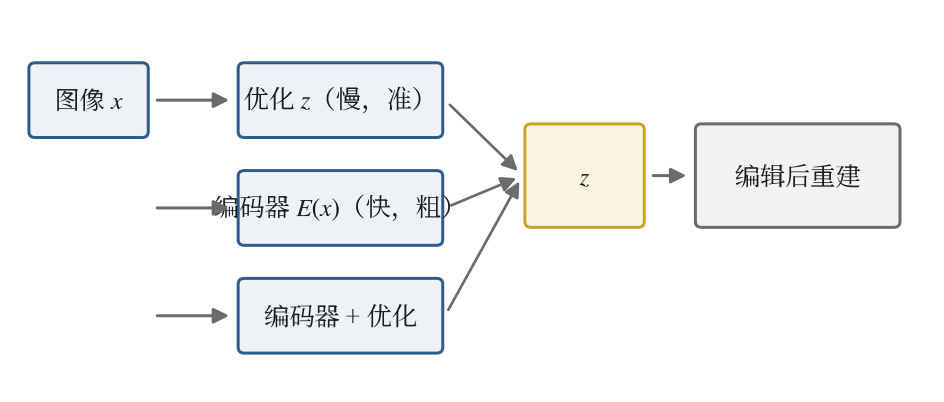
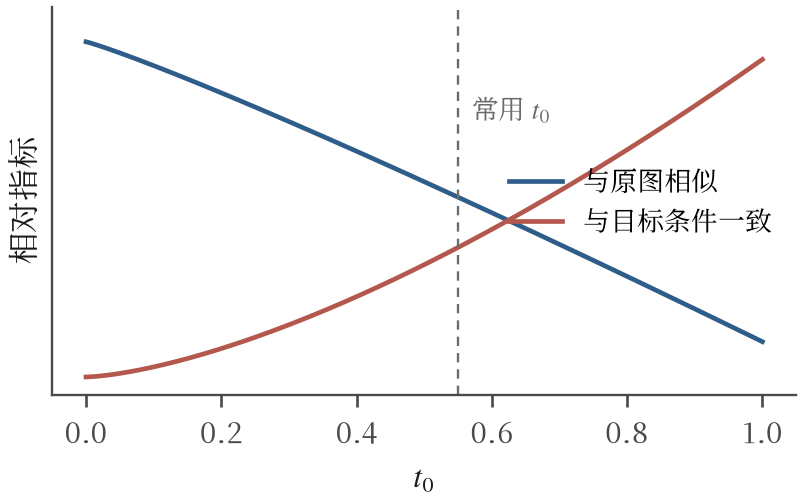

# 在潜空间里改

最早的图像编辑建立在 GAN 上。生成器把低维隐向量映射成图，如果能找到一张图对应的隐向量，就能在潜空间里做修改。

这条路留下了两个有用的东西：潜空间可以解耦成语义方向；以及"用噪声水平控制改动强度"这个旋钮。后者在扩散模型上被重新发现，成了 SDEdit。

## GAN 反演

给定一张图 $x$，要找一个 $z$ 使 $G(z)\approx x$。三种做法。

优化式：直接对 $z$ 做梯度下降，最小化 $\|G(z)-x\|^2$，可能加一个正则项把 $z$ 拉向高概率区域。慢，但准。

编码器式：训练一个网络 $E(x)\to z$，一次前向就得到结果。快，但对训练时没见过的图泛化差。

混合式：编码器给初值，再优化几十步。折中。

这三种做法的取舍揭示了一个问题：重建好不等于编辑好。优化式能找到精确的 $z$，但这个 $z$ 可能落在潜空间的边缘，沿着语义方向移动时容易跑出合理区域；编码器式的 $z$ 更典型，但重建差一些。

## StyleGAN 的潜空间

StyleGAN 在 $z$ 与生成器之间加了一个映射网络，得到 $w = M(z)$。$w$ 所在的空间叫 $W$。

映射网络的动机是解耦。$z$ 是高斯，各个维度混在一起；映射网络把高斯卷成一个更规整的形状，使得 $W$ 中的方向更容易对应到语义属性，比如性别、年龄、发色。

进一步，生成器的每一层可以用不同的 $w_i$，得到 $W^+$ 空间。逐层控制让粗尺度与细尺度分开，编辑时可以只改其中一部分。

## 找方向

InterFaceGAN 的做法是在 $W$ 空间训练一个线性分类器区分"有胡子"与"没胡子"，分类器的法向量就是属性方向。沿着它移动

$$w' = w + \alpha n.$$

这个做法的局限在线性假设。属性之间并不正交，加胡子的方向可能同时改变年龄。后来的工作用条件扩散、或者用多个方向的组合来缓解。

## SDEdit：用噪声控制强度

SDEdit 换了一个思路，不需要反演。

给定源图 $x_{\text{src}}$，先按前向过程加噪到某个时刻 $t_0$

$$x_{t_0} = \sqrt{\bar\alpha_{t_0}}\,x_{\text{src}} + \sqrt{1-\bar\alpha_{t_0}}\,\epsilon,$$

然后从 $t_0$ 出发，用新的条件去噪回 $t=0$。

$t_0$ 控制编辑强度。$t_0$ 很小，加噪少，去噪几乎还原原图；$t_0$ 很大，原图的信息被抹掉，结果主要由条件决定。

为什么这样能保结构？低噪声阶段，$x_t$ 里保留了布局、颜色分布这些低频信息；去噪过程只需要重新采样高频细节。$t_0$ 越大，保留的低频信息越少，改动越彻底。

## SDEdit 的局限

SDEdit 没有定位能力。它改的是整张图，只是改多改少的区别。把猫变成绿色这样的编辑，它会把整张图的色调都带偏。

它也无法做增加物体这类编辑：加噪去噪只能在已有结构上重采样，不能凭空生出新对象。

这两个局限指向两个方向：让模型知道改哪里，以及让模型能精确回到原图。前者靠注意力与条件注入，后者靠反演。

## 留下的两个概念

第一，潜空间的方向性。虽然后来的编辑主要用扩散模型，但"在低维空间里找语义方向"的想法没有消失，只是从 GAN 的 $W$ 换成了扩散模型的噪声空间或文本嵌入空间。

第二，噪声水平作为强度的旋钮。这个旋钮在后面的方法里反复出现：注意力操作靠"替换的步数"控制，FlowEdit 靠"从哪一步开始"控制，ChordEdit 靠 $t$ 与 $\delta$ 控制。形式不同，本质都是"在多早的阶段介入"。
