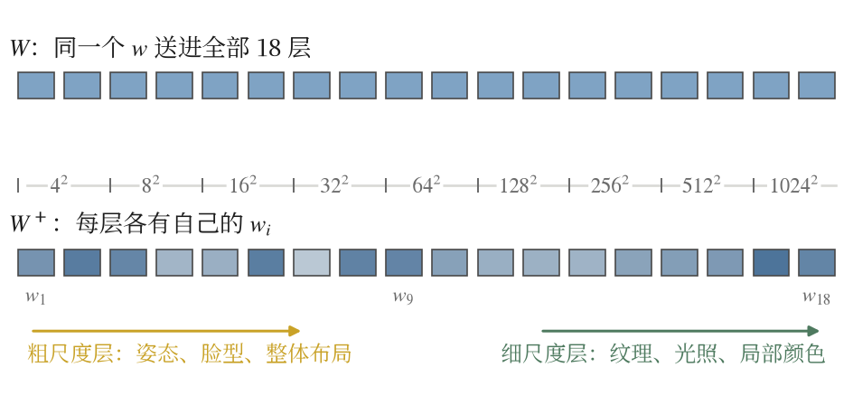
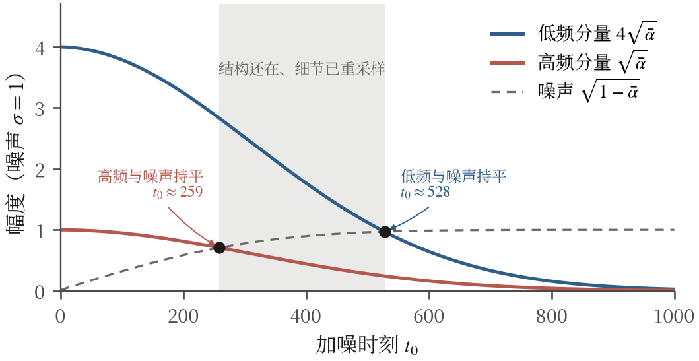

# 在潜空间里改

最早的图像编辑建立在 GAN 上。生成器把低维隐向量映射成图，如果能找到一张图对应的隐向量，就能在潜空间里做修改。

低维是这件事成立的前提。一张 $1024\times1024$ 的彩色图有三百万个数值，直接在这三百万个位置上做约束，几乎每个改动都会把图带出“像照片”的范围。生成器的隐向量只有几百维，从隐向量到图像的那张映射又把整个空间压成一张薄薄的曲面——只有落在曲面上的点才是逼真的图。改动发生在曲面上，输出就还在曲面上。代价是自由度少：能被表达的变化只有几百种组合，超出这个范围的东西（文字、精确的背景、某个特定角度的侧脸）改不了。

这条路留下了两个有用的东西：潜空间可以解耦成语义方向；以及“用噪声水平控制改动强度”这个旋钮。后者在扩散模型上被重新发现，成了 SDEdit。

## GAN 反演

给定一张图 $x$，要找一个 $z$ 使 $G(z)\approx x$。三种做法。

优化式：直接对 $z$ 做梯度下降，最小化 $\|G(z)-x\|^2$，可能加一个正则项把 $z$ 拉向高概率区域。慢，但准。

编码器式：训练一个网络 $E(x)\to z$，一次前向就得到结果。快，但对训练时没见过的图泛化差。

混合式：编码器给初值，再优化几十步。折中。

### 优化式的目标与代价

写成标准形式，优化式反演解的是

$$\hat z=\arg\min_{z}\ \underbrace{\|G(z)-x\|_2^2}_{\text{重建}}+\lambda\,\underbrace{R(z)}_{\text{先验}}.$$

第一项要求重建得像，第二项要求解不荒唐。只看第一项会出问题：生成器的像是一张低维曲面，而 $x$ 一般不在曲面上，最近点的位置由曲面的局部几何决定，不一定落在“常见”的区域。更麻烦的是曲面在某些方向上很平——雅可比的奇异值小，沿这些方向移动 $z$ 几乎不改变图像，梯度接近零，优化器会停在一片平坦区域的任意一点。正则项的作用就是给这些平坦方向一个指向高概率区的力。

$R$ 的两种常见取法：$R(z)=\|z\|_2^2$，把解往原点附近拉，因为 $z$ 的先验是标准高斯，原点附近概率最高；或者用 $-\log p(z)$，其中 $p$ 用一个在 $W$ 上拟合的密度（高斯混合之类）估计。前者简单，后者更贴合 $W$ 的实际情况。也有人在判别器特征空间算重建误差，理由是像素级的 $L_2$ 对纹理不敏感，而感知距离对结构更敏感。

梯度是

$$\nabla_z=\underbrace{2J^\top\big(G(z)-x\big)}_{\text{经雅可比回传}}+\lambda\,\nabla_z R(z),$$

$J=\partial G/\partial z$ 是 $3\times10^6$ 乘 $512$ 量级的矩阵。实现里不需要显式写出 $J$，一次反向传播就把它乘进梯度里了。

代价可以估个量级。StyleGAN2 在 $1024^2$ 分辨率上一次前向大致是几十 GFLOP 的量级，反向大约是同量级的两倍。跑 $500$ 步迭代就是 $1500$ 次前向等价的计算，在消费级显卡上是几十秒到几分钟一张图。这个数字决定它只能离线用：想交互式地拖着滑杆改，每拖一下等半分钟，没法用。

有一处容易踩的坑：$W$ 的各维方差不一样，同一个学习率在不同图上表现差很多，图上“好改”的那张可能几十步就收敛，另一张要么不收敛要么把 $z$ 推得很远。实践中对 $z$ 做逐维归一化，或者干脆用 Adam 让它自己调步长。

### 编码器式：一次前向换精度

编码器式训练

$$\min_{E}\ \mathbb{E}_{z\sim\mathcal N(0,I)}\Big[\big\|G\big(E(G(z))\big)-G(z)\big\|_1+\lambda\,\mathcal L_{\text{perc}}\Big].$$

注意监督信号是 $G(z)$ 而不是真实图像：采样一个 $z$，生成一张图，让编码器把它反推回去，标准答案是原来那个 $z$ 生成的图。这样训练不需要成对的真实图片，只要生成器。$\mathcal L_{\text{perc}}$ 是感知损失，用预训练网络的特征距离，补上 $L_1$ 对纹理的迟钝。

一次前向的代价是几 GFLOP 量级，比优化式快两个数量级以上，可以做到实时拖动。代价落在泛化上。编码器见过的是 $G$ 的像，真实照片落在像之外：镜头畸变、运动模糊、被裁掉一半的脸、非自然的白平衡，这些输入编码器没学过怎么处理，输出会明显偏离正确解。改进的做法是把编码器的输出接到 $W^+$ 而不是 $W$（自由度多，重建容易），并在训练时加一条“输出要靠近 $W$”的正则；再进一步是拿少量真实图做微调，但要成对数据，通常没有。

还有一层偏差来自损失本身。$L_1$ 在不确定时给出条件中位数，而编码器对细节本来就不确定，于是倾向于输出一张“平均的脸”：轮廓对，眼睛的高光、皮肤的颗粒感这类高频内容被抹平。这正是“快但糊”的算术来源。

### 混合式：编码器加几十步

混合式拿编码器的输出当初始点，再跑 $k$ 步优化，$k$ 通常取 $10$ 到 $50$。有效的原因是误差的分布：编码器已经把大部分误差消掉了，剩下的是局部修正，几十步梯度足够走完；而且初值落在合理区域，优化不会跑到曲面上那些平坦的边角去。

实现上有一个容易忽略的细节。此时正则项不该再拉向原点，而该拉向初值：

$$R(z)=\|z-z_0\|_2^2,$$

否则优化会把编码器的解拽回高概率区，几步就把重建精度又丢掉了。这个改动看起来小，实际决定了混合式能不能比纯优化更好。

三种做法的对照：

| 做法 | 单图耗时（量级估计） | 重建质量 | 解的典型性 | 主要失效场景 |
|---|---|---|---|---|
| 优化式 | 几十秒 | 高 | 差，易落在边缘 | 编辑时 $\alpha$ 稍大就崩 |
| 编码器式 | 几十毫秒 | 中 | 好 | 域外输入（照片、裁切、模糊） |
| 混合式 | 一到几秒 | 高 | 中 | 初值太偏时优化步数不够 |

### 重建准不等于好改

这三种做法的取舍揭示了一个问题：重建好不等于编辑好。优化式能找到精确的 $z$，但这个 $z$ 可能落在潜空间的边缘，沿着语义方向移动时容易跑出合理区域；编码器式的 $z$ 更典型，但重建差一些。

把生成器换成一维的 $G(z)=\tanh z$，这件事可以手算。假设目标图的值是 $x=0.9$，精确反演解是

$$z^\star=\operatorname{artanh}(0.9)=\tfrac12\ln\frac{1.9}{0.1}=1.472,$$

这里的导数 $G'(z)=1-\tanh^2 z=1-0.81=0.19$。再取一张“常见”的图 $x'=0.462$，它的解是 $z=0.5$，导数 $1-0.213=0.786$。

现在沿同一个方向走同样的步长 $\alpha=0.1$。在 $z=0.5$ 处，图像变化约 $0.786\times0.1=0.079$；在 $z=1.472$ 处只有 $0.19\times0.1=0.019$。差四倍。反过来，要让图变化 $0.05$（肉眼可见的量），前者走 $0.064$，后者要走 $0.263$——四倍多的潜空间距离。

这就是“边缘样本改不动、中心样本一改就过”的来历。$z$ 的先验是标准高斯，$|z|>1.472$ 的概率是 $14\%$ 左右，也就是七分之一的图落在这类位置上，它们需要完全不同的 $\alpha$。生成器的压缩性是根源：$\tanh$ 在饱和区斜率小，每单位 $z$ 换来的图像变化少，精确反演把大部分“预算”用在了弥补压缩上，留给编辑的余量就小。真实的生成器没有这么极端，但雅可比同样是各向异性的，同一件事以更复杂的形式发生。

反演残差还有它自己的去处。记 $r=G(\hat z)-x$，编辑后

$$G(\hat z+\alpha n)\approx G(\hat z)+\alpha Jn=x+r+\alpha Jn.$$

残差原封不动地留在结果里，位置和方向都是原图特征的错位，不会被后续任何步骤消掉。给个数的量级：$r$ 的均方根 $0.02$（对应 $34$ dB 左右的 PSNR），编辑量 $\alpha\|Jn\|$ 的均方根 $0.08$（$22$ dB）。两者叠加后 PSNR 变成 $21.7$ dB，只掉了不到 $0.3$ dB——从能量上看残差被编辑淹没。但从视觉上看不是这样：这 $0.02$ 的残差是“眼睛偏了一个像素”“发际线糊了三像素”这类结构错位，人眼对它们比对同能量的随机噪声敏感得多。指标的排序和人眼的排序在这里不一致，这也是后来编辑方法普遍改用感知指标与用户研究的原因之一。

## StyleGAN 的潜空间

StyleGAN 在 $z$ 与生成器之间加了一个映射网络，得到 $w = M(z)$。$w$ 所在的空间叫 $W$。

映射网络的动机是解耦。$z$ 是高斯，各个维度混在一起；映射网络把高斯卷成一个更规整的形状，使得 $W$ 中的方向更容易对应到语义属性，比如性别、年龄、发色。

进一步，生成器的每一层可以用不同的 $w_i$，得到 $W^+$ 空间。逐层控制让粗尺度与细尺度分开，编辑时可以只改其中一部分。

### 映射网络把分布摆正

$M$ 是一个八层左右的全连接网络，输入 $z\in\mathbb R^{512}$，输出同样维度。它本身没什么特别，真正起作用的是它和 $G$ 一起训练，而训练信号只从 $G$ 那边来。这带来一个自由度：把 $z$ 同分布地重排（换一组正交基）对 $G$ 毫无影响，所以 $M$ 可以任意地“扭”输入空间，只要扭完之后 $G$ 好走。训练会自动把这个自由度用满——$G$ 需要的是各维解耦、尺度均匀、容易插值的输入，$M$ 就把它推成那个样子。

这件事的效果是 $W$ 的边缘分布不再各向同性。$z$ 的每一维方差都是 $1$，$W$ 里却有的方向方差大、有的方差小；$W$ 也不以原点为中心，系数的均值不为零。跟着来的一个副作用值得记住：在 $W$ 里做线性插值或求平均，得到的不是“平均的脸”，而是一张会突然跳变的图，因为分布的等概率面在 $W$ 里是弯的。求平均应该在像素上做，而不是在潜码上做。

### 逐层注入

StyleGAN 的第一版用 AdaIN 把 $w$ 注入每一层。给定该层特征 $h$（按通道算均值与标准差），

$$\text{AdaIN}(h,w)=w_s\odot\frac{h-\mu(h)}{\sigma(h)}+w_b,$$

$w_s,w_b$ 是从 $w$ 线性投影出来的一组缩放与偏置，逐通道。这式子的含义直白：该层输出的每个通道被强行掰到指定的均值和方差，而均值和方差决定了这一层“长什么样”——对比度、色彩倾向、纹理的粗细。后来的版本把 AdaIN 换成权重调制（用 $w_s$ 去缩放卷积核，再除以它造成的增益），数学上是同一件事的不同参数化，作用位置也一样。

逐层注入解释了为什么尺度能分开。第 $i$ 层的特征图分辨率是 $r_i\times r_i$，改动这一层的 $w_i$ 相当于统一改写这一级的统计量：$4^2$ 这一级的每个位置覆盖整张脸，动它就动整体几何；$512^2$ 这一级的每个位置只覆盖几个像素，动它只改局部色泽。$r_i$ 越小，感受野相对整图越大，改动越“粗”。这条规律不是设计出来的，是分辨率决定的。

还有一个顺序上的事实：后层的输入来自前层的输出，所以后层可以重画细节，却改不了前层定下的布局。前层把脸摆成什么姿势，后层只能在这个姿势上添纹理。编辑时“只改细节、不动结构”之所以可行，靠的就是这个单向性。

### $W$ 与 $W^+$

$1024^2$ 的模型从 $4^2$ 到 $1024^2$ 共九级分辨率，每级两个风格层，一共 $18$ 层。$W^+$ 是 $18\times512=9216$ 维，$W$ 只有 $512$ 维，两者的关系是 $W$ 为 $W^+$ 的对角子空间：所有 $w_i$ 相等。

$W^+$ 的自由度是 $W$ 的 $18$ 倍，反演时可以只用一层去贴合轮廓、另一层去贴合纹理，重建误差能压得很低。代价是解常常不在 $W$ 里：十八个 $w_i$ 互相不一致，等于让生成器用十八个人的风格去画同一张脸，结果是局部伪影——左眼的形状来自一个人的统计量，右眼的来自另一个，拼在一起轮廓对得上，质感对不上。

一个常用的折中是加“层间一致性”正则。记 $\bar w=\frac1{18}\sum_i w_i$，在反演目标里加

$$\lambda\sum_{i=1}^{18}\|w_i-\bar w\|_2^2,$$

$\lambda$ 越大，解越靠近 $W$，重建越差但越容易编辑；$\lambda$ 越小，重建越好但编辑时各层会打架。这条正则的系数实际上是在“保真”与“可编辑”之间画一条曲线，和前面 $\alpha$ 的问题同源。

逐层控制还有一种用法是“换层”：把目标图的 $w_i$ 取前六层，源图的取后十二层，生成的结果有目标图的轮廓与源图的纹理。这类操作不需要找方向，只要知道哪几层管什么。

## 找方向

InterFaceGAN 的做法是在 $W$ 空间训练一个线性分类器区分“有胡子”与“没胡子”，分类器的法向量就是属性方向。沿着它移动

$$w' = w + \alpha n.$$

分类器的训练数据是现成的：采样十万个左右的 $z$，过 $M$ 得到 $w$，再过 $G$ 得到图；拿一个在真实人脸上训练好的属性分类器给这些图打标签；在 $W$ 上用这些带标签的点拟合一个线性分类器。拟合出来的东西是一个超平面，法向量 $n$ 与阈值 $b$ 满足 $f(w)=\operatorname{sign}(n^\top w+b)$。

### 为什么法向量是属性方向

分类器的分数 $n^\top w+b$ 在 $W$ 上的梯度处处是 $n$，所以沿 $n$ 走是让分数涨得最快的一步。这只是一阶的道理，背后还有一层：若两类样本的均值是 $m_+,m_-$、共享协方差是 $\Sigma$，最优的线性方向就是

$$n\propto\Sigma^{-1}(m_+-m_-).$$

推一下。记 $u=n^\top(m_+-m_-)$，$v=n^\top\Sigma n$，要最大化两类间距与类内方差之比 $u^2/v$。对 $n$ 求梯度置零：

$$\frac{d}{dn}\frac{u^2}{v}=\frac{2u\,(m_+-m_-)\,v-u^2\cdot 2\Sigma n}{v^2}=0
\ \Longrightarrow\ \Sigma n=\frac{v}{u}\,(m_+-m_-),$$

两边左乘 $\Sigma^{-1}$ 就得到 $n\propto\Sigma^{-1}(m_+-m_-)$。这就是线性判别分析的方向。

两种极端情形把它看透了。若 $\Sigma=\sigma^2 I$，则 $n\propto m_+-m_-$，方向就是两类均值之差；若各维方差相差很大，$\Sigma^{-1}$ 会把方差小的维放大，因为那些维上的均值差异更可信。所以“分类器法向量”与“均值差”在等方差假设下是一回事，先白化再取均值差是同一件事的另一种算法。实践里两者结果接近，差别主要出现在高方差方向上。

### 只改一个属性

方向不正交是这套方法最大的麻烦。数据里“有胡子”与“男性”总是一起出现，分类器学到的方向里就混着性别的分量；沿它走，脸会同时变男性。InterFaceGAN 的处理是在方向上做正交化：要改属性 $1$、保持属性 $2$，就把 $n_1$ 中落在 $n_2$ 上的分量减掉，

$$n^\star=n_1-\frac{n_1^\top n_2}{\|n_2\|^2}\,n_2.$$

验证一下：$n_2^\top n^\star=n_2^\top n_1-\frac{n_1^\top n_2}{\|n_2\|^2}\,n_2^\top n_2=0$，所以

$$f_2(w+\alpha n^\star)=f_2(w)+\alpha\,n_2^\top n^\star=f_2(w),$$

属性 $2$ 的分数一阶不变。要保持三个属性，就把 $n_1$ 投影到这三个方向张成的子空间的正交补上；两个方向逐个正交化与同时投影结果相同，三个以上逐个做就与顺序有关了。

### 局限

这个做法的局限在线性假设。属性之间并不正交，加胡子的方向可能同时改变年龄。后来的工作用条件扩散、或者用多个方向的组合来缓解。

线性只在局部成立。$W$ 里区分“有胡子”的边界是弯的，$\alpha$ 一大，$w+\alpha n$ 就离开了边界附近，方向不再是等值方向。实际操作里要扫一遍 $\alpha$，找到属性翻转的那个临界值 $\alpha^\star$，只在临界附近用线性近似，超过就失效。

属性相关不是数学问题而是数据问题。正交化只保证分类器分数不变，不保证人的感知不变：分类器本身是线性的，它对“性别”的判断可能依赖于与胡子无关的另一个线索，正交化把那个线索的分数也一起固定住了，结果看起来还是变了性别。标签噪声会把方向拉向噪声与属性的偶然相关，而分类器在生成图上的准确率本来就不如在真图上，域差会系统地抬高某些方向。

最隐蔽的一条：反演得到的 $w$ 不一定在训练分布里。方向是在十万个采样点上拟合的，拟合处的数据密度高；反演解的密度低，同一方向在那里未必对应同一语义。这三条叠在一起，使“找一个方向拖滑杆”在演示里很好用，在真实照片上经常需要人工调系数。

## SDEdit：用噪声控制强度

SDEdit 换了一个思路，不需要反演。

给定源图 $x_{\text{src}}$，先按前向过程加噪到某个时刻 $t_0$

$$x_{t_0} = \sqrt{\bar\alpha_{t_0}}\,x_{\text{src}} + \sqrt{1-\bar\alpha_{t_0}}\,\epsilon,$$

然后从 $t_0$ 出发，用新的条件去噪回 $t=0$。

$t_0$ 控制编辑强度。$t_0$ 很小，加噪少，去噪几乎还原原图；$t_0$ 很大，原图的信息被抹掉，结果主要由条件决定。

为什么这样能保结构？低噪声阶段，$x_t$ 里保留了布局、颜色分布这些低频信息；去噪过程只需要重新采样高频细节。$t_0$ 越大，保留的低频信息越少，改动越彻底。

### 从 $x_{t_0}$ 反推原图

去噪网络给的是噪声估计 $\epsilon_\theta(x_t,t)$，代回加噪式并解出 $x_0$，得到

$$\hat x_0=\frac{x_t-\sqrt{1-\bar\alpha_t}\,\epsilon_\theta(x_t,t)}{\sqrt{\bar\alpha_t}}.$$

这个式子在扩散模型里到处出现，读法是把 $x_t$ 里的噪声减掉，再除以信号系数把幅度缩回去。它的误差传播可以直接算：若噪声估计有误差 $\delta$，则

$$\hat x_0 \text{ 的误差}=\frac{\sqrt{1-\bar\alpha_t}}{\sqrt{\bar\alpha_t}}\,\delta,$$

放大因子就是噪声与信号的幅度比。$\bar\alpha=0.5$ 时放大 $1$ 倍，$\bar\alpha=0.09$ 时放大 $3.2$ 倍，$\bar\alpha=0.01$ 时放大 $10$ 倍。这是“$t_0$ 越大越不敢保原图”的算术来源：去噪器手里的原图估计本来就被噪声放大了若干倍，它只能更多地相信条件。

### 保结构靠的是频带之间的时间差

把“低频保留得多”摆成数字。设原图某个低频系数的幅度是 $4$，某个高频系数是 $1$，噪声标准差是 $1$。加噪后两部分的信噪比是

$$\text{SNR}=\frac{\bar\alpha A^2}{1-\bar\alpha},$$

$A$ 是该分量的幅度。取 DDPM 常用的线性日程（$T=1000$，$\beta$ 从 $10^{-4}$ 线性升到 $0.02$，由此算得 $\bar\alpha_{140}=0.81$、$\bar\alpha_{259}=0.50$、$\bar\alpha_{528}=0.059$、$\bar\alpha_{700}=0.007$）：

| $t_0$ | $\bar\alpha_{t_0}$ | 低频 SNR（$A=4$） | 高频 SNR（$A=1$） |
|---|---|---|---|
| 140 | 0.81 | 68 | 4.3 |
| 259 | 0.50 | 16 | 1.0 |
| 528 | 0.059 | 1.0 | 0.063 |
| 700 | 0.007 | 0.11 | 0.007 |

高频在 $t_0=259$ 就与噪声持平（SNR 降到 $1$），低频要到 $t_0=528$ 才持平。中间这 $270$ 步就是可用区间：细节已经重采样，布局还能认。

再换一个角度看同一件事。给定 $x_t$，单个像素对应的原图值仍有残余不确定度，在单位方差数据上是 $\sqrt{\bar\alpha(1-\bar\alpha)}$，最大不过 $0.5$（在 $\bar\alpha=0.5$ 处取到）。但布局不是单像素，是一块一块的平均：$2^k\times2^k$ 的块，平均值的不确定度降到 $0.5/2^k$。$32\times32$ 的块（$k=5$）是 $0.016$，$256\times256$ 的整图是 $0.002$。这就把“低频信息保住了”说成了可量的东西：单像素说不准，大块的平均值几乎确定。去噪器要做的事因此变得具体——把每块的平均值往源图那边拉，块内怎么填由条件与自己决定。

### $t_0$ 怎么选

实践里少有人直接报 $t_0$，因为 $t_0$ 的含义随 $T$、随日程而变。用 $\bar\alpha_{t_0}$ 或相对比例记更稳。另外三个细节经常被忽略。

步数。从 $t_0$ 到 $0$ 的步数通常与全程相同，比如全程 $50$ 步的采样器，从 $t_0=0.5$ 起步就只有 $25$ 步可用，细节质量会差一些；把剩余步数加回来是个成本。

采样器。只有能给 $x_{t_0}$ 定出正确噪声水平的那一类能从中间起步：DDIM 与各种 ODE 采样器只需要 $\bar\alpha$ 序列，天然支持；祖先采样（每一步重新注入随机噪声）也可以，但注入的方差会让同一个 $t_0$ 不同种子的结果差很多，可复现性下降。

噪声种子。$x_{t_0}$ 里的 $\epsilon$ 决定了细节怎么重画。固定种子，同一 $t_0$ 的结果可复现；换种子，布局一样、纹理不同。做“强度滑杆”的交互界面时，这个种子必须在整个拖动过程中保持固定，否则用户会看到画面在滑杆不动时自己乱跳。

## SDEdit 的局限

SDEdit 没有定位能力。它改的是整张图，只是改多改少的区别。把猫变成绿色这样的编辑，它会把整张图的色调都带偏。

它也无法做增加物体这类编辑：加噪去噪只能在已有结构上重采样，不能凭空生出新对象。

色调被带偏的原因可以看得更具体。整张图统一变色，在频域上是直流分量与最低几个频率被改写。前面那张表说得很清楚：这些分量在 $t_0$ 不太大时信号远强于噪声，SNR 是几十倍，去噪器几乎没有自由度可以不理它们。但条件（“绿色的猫”）又确实要求那里变绿，于是优化在两者之间妥协，而妥协的方式是把偏移平摊到全图——毕竟模型并不知道猫在哪里。

加物体失败的原因在预算分配。新对象需要位置、轮廓、与场景的遮挡关系，这些信息在 $x_{t_0}$ 里一个都没有；它们只能由条件通过注意力长出来，而长出这些需要足够的噪声预算。$t_0$ 太小，预算不够，新对象只能是个模糊色块；$t_0$ 太大，预算够了，原图的结构也一起丢掉了。这个矛盾在 SDEdit 的框架里解不开，因为它只有一个全局旋钮，而“改哪里”与“改多少”是两件事。

这两条局限指向两个方向：让模型知道改哪里，以及让模型能精确回到原图。前者靠注意力与条件注入，后者靠反演。

## 两类方法的两处短板

### 改哪里

GAN 这条路上，方向是全局的：沿 $n$ 移动等于给整张图加同一个语义偏移，想让只有左半边变，只能靠 $W^+$ 的层选择（粗层改整体、细层改局部）或把生成图按 mask 分区替换。前者只有粗糙的空间分辨，后者需要一张分割图；两者都具备时，才能做到“改这块区域的眼睛”。这一步的工程量往往比找方向本身还大。

SDEdit 更彻底：它的输入端只有一张已经加了噪的整图，模型没有任何通道可以接受“这里改、那里不改”的信号。后来把 mask 显式喂进去（把未编辑区域每一步都用源图重新覆盖）成为主流，正是因为缺了这个通道。

### 装得下多少

$W$ 有 $512$ 维，$W^+$ 有 $9216$ 维。这两个数看着不少，但要装下姿态、光照、背景、发型、表情、饰品的所有组合，仍然紧张。真实图像里还有大量内容根本不在生成器的像里：印刷文字、精确的背景物体、不规范的光学畸变。这些部分无论怎么优化 $z$ 都重建不出来，残差留在那里，编辑时跟着一起走。经验上反演残差的 PSNR 到 $30$ dB 上下就很难再降，剩下的能量集中在文字边缘与高频纹理（量级估计）。

SDEdit 那条路的“容量”不在隐空间而在条件。文本、类别标签、参考图能表达的变化有粒度上的下限：可以要求“笑着”，很难要求“嘴角上扬三毫米”；可以要求“移到左边”，很难要求“左移三个像素”。条件本身没有空间坐标，所以定位与精度的天花板由条件的形式决定，而不是由模型的能力决定。

## 留下的两个概念

第一，潜空间的方向性。虽然后来的编辑主要用扩散模型，但“在低维空间里找语义方向”的想法没有消失，只是从 GAN 的 $W$ 换成了扩散模型的噪声空间或文本嵌入空间。

第二，噪声水平作为强度的旋钮。这个旋钮在后面的方法里反复出现：注意力操作靠“替换的步数”控制，FlowEdit 靠“从哪一步开始”控制，ChordEdit 靠 $t$ 与 $\delta$ 控制。形式不同，本质都是“在多早的阶段介入”。
