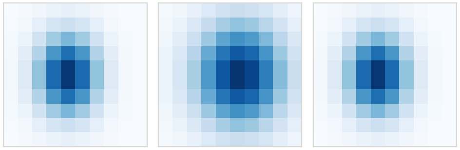

# 文本驱动：改写注意力

上一章的 SDEdit 能改，但不知道该改哪里。这一章的方法围绕定位展开：利用 cross-attention 的空间含义，直接控制某个词影响哪些位置。

## 注意力图有空间含义

扩散模型的 U-Net 里，文本通过 cross-attention 进入

$$Q = W_Q z,\quad K = W_K\tau,\quad V = W_V\tau,\quad \mathrm{Attn} = \mathrm{softmax}\!\left(\frac{QK^\top}{\sqrt d}\right)V,$$

$z$ 是图像特征，$\tau$ 是文本 token 序列。注意力矩阵的每一行对应一个图像位置，每一列对应一个 token。

这个矩阵往往有清晰的空间结构。说"猫"的时候，注意力集中在猫所在的位置；说"天空"的时候，集中在画面顶部。

## 三种操作

Prompt-to-Prompt 提出三种操作。

词替换：源 prompt 是"一只猫"，目标是"一只狗"。把"狗"这个 token 的注意力图替换成源 prompt 里"猫"的图，其余 token 不变。这样布局跟着"猫"走，语义换成"狗"。

细化：在 prompt 里加词，新词的注意力图初始化为零，然后在若干步内逐渐放开，避免新词一上来就打乱布局。

重加权：把某个 token 的注意力乘以系数，让它影响的范围变大或变小。

实现上需要在 cross-attention 的 softmax 之后截获注意力矩阵，按规则修改，再继续前向。

## 只在前面几步替换

替换不是全程都做。早期步决定布局，后期步只调整纹理。常见做法是只在前 $k$ 步替换，$k$ 取总步数的一半左右。

$k$ 太大，后期也被约束，细节无法按新语义生成；$k$ 太小，布局没被约束住，编辑会失控。这个参数与 SDEdit 的 $t_0$ 是同一类东西：控制在多早的阶段介入。

## 一个变体：用 mask 限定范围

如果用户给了 mask，注意力操作可以只在 mask 内生效：把 mask 外的注意力图强制设成源 prompt 的值。

这样改动被限制在指定区域，边界处的过渡靠注意力本身的平滑性，通常比硬拼接自然。

## 局限

注意力操作依赖具体模型的内部结构。换个模型，注意力的组织方式变了，方法就要重写。U-Net 的 cross-attention 与 MMDiT 的联合注意力不是一回事，后者的文本与图像在同一个注意力里，没有独立的"文本到图像"矩阵可以截获。

第二个局限是它需要反演。要把真实图像送进这套流程，得先得到它的噪声表示，而反演本身有误差，下一章会专门处理。

## 与条件注入的区别

注意力操作改的是"已有的条件怎么起作用"，条件注入加的是"新的条件"。前者适合改语义，后者适合加约束。

举例：把猫变成狗，是改语义，用注意力替换；让生成的人物摆出指定姿势，是加约束，用 ControlNet。

两者可以叠加，但要注意冲突：注意力替换会削弱结构条件的影响，因为布局被源图锁住了。
