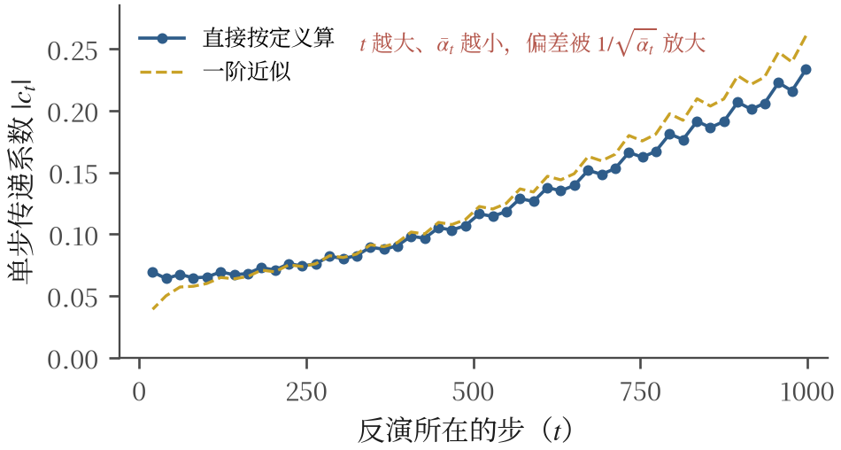
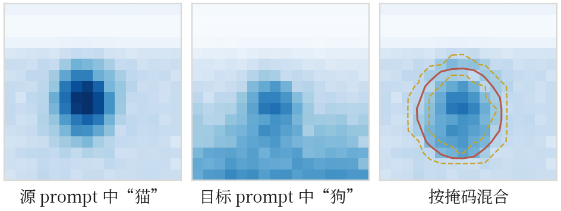

# 文本驱动：改写注意力

上一章的 SDEdit 能改，但不知道该改哪里。这一章的方法围绕定位展开：利用 cross-attention 的空间含义，直接控制某个词影响哪些位置。

## 注意力图有空间含义

扩散模型的 U-Net 里，文本通过 cross-attention 进入

$$Q = W_Q z,\quad K = W_K\tau,\quad V = W_V\tau,\quad \mathrm{Attn} = \mathrm{softmax}\!\left(\frac{QK^\top}{\sqrt d}\right)V,$$

$z$ 是图像特征，$\tau$ 是文本 token 序列。注意力矩阵的每一行对应一个图像位置，每一列对应一个 token。

这个矩阵往往有清晰的空间结构。说“猫”的时候，注意力集中在猫所在的位置；说“天空”的时候，集中在画面顶部。

### 一行是一个分布

把形状写清楚，后面的所有操作才有落脚点。一次前向里，$z$ 被展平成 $hw\times d$ 的矩阵（$h\times w$ 是该层特征图的分辨率），$\tau$ 是 $L\times d$，对 CLIP 文本编码器来说 $L=77$，空位用 padding 补齐。于是

$$A=\mathrm{softmax}\!\left(\frac{QK^\top}{\sqrt d}\right)\in\mathbb{R}^{hw\times L}$$

softmax 沿 $L$ 方向做，每一行的 77 个数加起来等于 1。读法是：给定一个图像位置 $i$，它把解释权按比例分给各个词。

输出再乘 $V$，位置 $i$ 得到的是各词向量的加权平均 $\sum_j A_{ij}v_j$。所以 $A$ 决定“从哪些词取内容”，$V$ 决定“那些词的内容是什么”。这句话是本章所有方法的支点：把某一列换掉，等于换掉“这个位置去听谁的”而保留“听了之后取到什么”。

把第 $j$ 列拉回 $h\times w$ 的形状，就是词 $j$ 的注意力图。Stable Diffusion 1.5 在 $512\times512$ 的输入上，cross-attention 出现在 $64\times64$、$32\times32$、$16\times16$、$8\times8$ 四个尺度上，每个尺度 8 个头，U-Net 里共 16 个这样的模块。规模如下。

| 特征图 | 每格覆盖像素 | 格数 | 单头 $A$ 元素数 |
|---|---|---|---|
| $64\times64$ | $8\times8$ | 4096 | $3.2\times10^{5}$ |
| $32\times32$ | $16\times16$ | 1024 | $7.9\times10^{4}$ |
| $16\times16$ | $32\times32$ | 256 | $2.0\times10^{4}$ |
| $8\times8$ | $64\times64$ | 64 | $4.9\times10^{3}$ |

16 个模块各自的 $hw$ 从 4096 到 64 不等，全按最大的那一层做上界估计，单张图一次前向的注意力张量约 $4\times10^{7}$ 个数，fp16 下 80 MB。全程保存 50 步就是 4 GB，不现实。实现上只保存需要动的那几列：替换 1 个词、16 层、8 头、50 步，是 $50\times16\times8\times4096\approx2.6\times10^{7}$ 个数，50 MB 左右，可以接受。

### 空间结构从哪里来

键与位置无关：$k_j=W_K\tau_j$ 只由词决定，整幅图共用同一组键。查询是逐位置的：$q_i=W_Qz_i$ 由位置 $i$ 的局部特征决定。所以 logit $q_i^\top k_j/\sqrt d$ 衡量的是“位置 $i$ 的特征与词 $j$ 的方向有多像”，注意力图是这张相似度场经过 softmax 归一化后的形状。

图像特征在空间上连续，相似度场也就连续，注意力图因此是成片的而不是零散的。分辨率的差别体现在边界上：$64\times64$ 的层感受野小，图上能看清轮廓；$8\times8$ 的层几乎只剩方位信息，把这张图上采样回 512，形状已经糊成一团。

多头是另一层复杂。8 个头学到的方向不同，有的头盯物体，有的头盯背景，单看一个头噪声很大。常见的两个做法是：把若干层若干头的图取平均后再可视化（看趋势），以及对所有层所有头执行同样的替换（改行为）。Prompt-to-Prompt 属于后者——它不挑层，凡是有 cross-attention 的地方都改。

层与步也要分清。同一个词在 $64\times64$ 层和 $16\times16$ 层的图不一样，在第 5 步和第 35 步也不一样。说“猫的注意力图”，必须同时指明层和步，否则这句话没有确定含义。

### 注意力图不是掩码

拿它当分割用，会踩三个坑。

分辨率。$16\times16$ 的图一格覆盖 32 像素，想精确框住一只眼睛做不到。$64\times64$ 的图一格 8 像素，勉强能框住，但那一层的注意力更碎，图的语义也更弱。

单选性质。每一行在 77 个词里做一次单选，两个物体挨在一起时，中间那几格会被折中，图上出现一条过渡带，而不是干净的两个区域。

峰值位置。最大响应往往落在“最典型的局部块”上，不一定在物体几何中心。深色毛衣上的猫，峰值可能落在猫脸而不是整只猫。

所以基于注意力的编辑适合“能连成一片的区域”——换一只动物、换天空、换衣服颜色；不适合“一条线、一个角”——把耳环取掉、把纽扣改成两颗。

## 三种操作

Prompt-to-Prompt 提出三种操作。

词替换：源 prompt 是“一只猫”，目标是“一只狗”。把“狗”这个 token 的注意力图替换成源 prompt 里“猫”的图，其余 token 不变。这样布局跟着“猫”走，语义换成“狗”。

细化：在 prompt 里加词，新词的注意力图初始化为零，然后在若干步内逐渐放开，避免新词一上来就打乱布局。

重加权：把某个 token 的注意力乘以系数，让它影响的范围变大或变小。

实现上需要在 cross-attention 的 softmax 之后截获注意力矩阵，按规则修改，再继续前向。

### 替换的写法

记第 $l$ 层第 $h$ 头、第 $t$ 步的注意力矩阵为 $A^{(l,h)}_t$。源 prompt 记 $\tau^{s}$，“猫”在其中的位置是 $j_s$；目标 prompt 记 $\tau^{t}$，“狗”的位置是 $j_t$。替换操作是

$$A^{(l,h)}_t[:,j_t]\leftarrow A^{s,(l,h)}_t[:,j_s],\qquad t\ge T-k\Delta$$

其余列保持目标 prompt 自己的值。

为什么这样就能“布局随源、语义随目标”：输出是 $\sum_j A_{ij}v_j$，换掉第 $j_t$ 列只改了权重，$v_{j_t}$ 仍是目标 prompt 里“狗”的嵌入。位置由 $A$ 决定，内容由 $v$ 决定，两件事被这个式子拆开了。

有一个必须补的步骤：重新归一化。替换前某一行的第 $j_t$ 列可能是 0.2，换上去的源图对应列是 0.4，这一行的和就从 1 变成 1.2。若直接往下传，attention 的输出整体放大了 20%，潜变量的尺度在第一个去噪步就偏了，后面所有步都在补偿这个偏差。正确做法是

$$A\leftarrow \frac{A}{\sum_j A_{ij}}$$

按行归一化之后再算 $AV$。这个细节在复现里经常被漏掉，症状是编辑结果的对比度和原图对不上。

实现要点有四处容易出问题。

拿到概率矩阵。给每个 cross-attention 模块挂前向钩子，把 softmax 之后的矩阵存下来最简单。但如果推理走的是 xformers 或 FlashAttention 的融合核，矩阵根本不会被写出来，必须切回普通的注意力实现。代价是显存：$64\times64$ 那一层，单头 $3.2\times10^{5}$ 个数，8 头 2.5 M，fp16 下 5 MB，一层一层加起来比平时多出几十 MB 到上百 MB。

步号对齐。每个去噪步会依次调用 16 个 cross-attention，钩子里的调用计数要除以层数才是步号。用无分类器引导时每步前向两次（条件支与空条件支），通常只改条件支；两路都改会让引导失去作用，因为引导之所以有效，正是靠两路预测的差。

token 索引不能硬编码。“狗”是第几个 token 取决于 tokenizer，前面有起始符，长词会被拆成多个子词（“sunglasses” 常被切成两三个），CLIP 上限 77，超长 prompt 会被截断。稳妥的做法是拿 tokenizer 的偏移映射，按字符区间定位词，再把同一个词的多个子词当作一组一起替换——只换其中一半，会得到语义残缺的结果。

数值类型。回写的矩阵要和原矩阵同 dtype、同 device。fp16 的尾数只有 10 位，换列再行归一化之后，行和与 1 的偏差会累积到 $10^{-3}$ 量级；更要紧的是一列替换后的行和若接近 0（源图那列在这一行全取到极小的值），归一化会把噪声放大成主体。

### 细化的写法

“一只猫”改成“一只戴墨镜的猫”，多出来的是“墨镜”。新词一进入 softmax 就要占一份质量，而每行的质量总和是 1，它占的那份只能从别的词那里抢，布局于是立刻改变——这是细化要解决的问题。

做法是让新词那一列从零开始，按步放开：

$$A^{(new)}[:,j_{new}]=(1-\lambda_t)\cdot 0+\lambda_t A^{(tar)}[:,j_{new}]$$

$\lambda_t$ 随步号 $i$ 上升，例如 $\lambda_i=\min\big(1,\,(i-i_0)/m\big)$，$i_0$ 是开始放开的步，$m$ 是放开所需的步数（常见取 $k/2$ 量级）。

置零那一列在数学上等于“这个词此刻不存在”：它贡献的质量是 0，行归一化后其它列的比例不变。$\lambda$ 从 0 到 1 的过程，是新词逐步在已有解释里“腾出位置”的过程。第一步就放开，模型没有机会调整构图；放到最后，新词只影响纹理，语义进不去。

放开结束之后，新词得到的是目标 prompt 里它本来的份额。中间态的实际份额介于两者之间，具体比例取决于这一行其它列的和，因此不必（也不该）再额外补偿——补偿会让不同位置的份额不一致，图上会出现块状的强弱差别。

### 重加权的写法

$$\tilde A[:,j]\leftarrow w\,A[:,j],\qquad \tilde A\leftarrow \frac{\tilde A}{\sum_j\tilde A_{ij}}$$

$w>1$ 扩大该词的影响，$w<1$ 收缩，$w\to0$ 退化成删词。

效果是非线性的。若某个 token 在某一行的份额原本是 $a$，重加权并归一化之后变成

$$a'=\frac{wa}{wa+1-a}$$

代几组数：$a=0.2$ 时，$w=1.5$ 给 0.273，$w=2$ 给 0.333，$w=0.5$ 给 0.111。份额已经到 0.5 的 token，$w=2$ 只能把它推到 0.67 附近——份额越接近 1，边际收益越小。想让某个词“再多一点”而它已经占主导时，调 $w$ 基本没用。

另一种写法是在 softmax 之前给 logit 加偏置：$\mathrm{logit}_{ij}\leftarrow q_i^\top k_j/\sqrt d+b_j$。它抬的是该词对所有位置的竞争力，图上表现为整体变亮或变暗；列缩放则是对已有的份额重新分配，形状改得多、总量改得少。实践里重加权比替换温和，常用来微调构图松紧，而不是改变画面内容。

## 只在前面几步替换

替换不是全程都做。早期步决定布局，后期步只调整纹理。常见做法是只在前 $k$ 步替换，$k$ 取总步数的一半左右。

$k$ 太大，后期也被约束，细节无法按新语义生成；$k$ 太小，布局没被约束住，编辑会失控。这个参数与 SDEdit 的 $t_0$ 是同一类东西：控制在多早的阶段介入。

把步号约定写清楚：采样共 $N$ 步，第 $i$ 步处理时间 $t_i=T-i\Delta$，$i=0$ 是噪声端，$i=N-1$ 是图像端。替换条件写成 $i<k$，等价于 $t_i>T-k\Delta$。

为什么早期步管构图：在 $t$ 大的阶段，$z_t$ 里低频结构占主导，模型还没决定“哪儿画什么”，此时 $A$ 的空间分布就是一张草图，改它等于改构图。往后 $\bar\alpha_t$ 接近 1，$z_t$ 已经带上纹理，$A$ 变得琐碎，每步只在细节上挪一点，此时替换的效果主要是“把纹理往源图那边拽”，而不是“换掉一只动物”。

一个可观察的旁证是相邻两步注意力图的变化量：前期变化大，后期变化小。改动前期的一步，影响是全局的；改动后期的一步，影响是局部的。替换要放在“改动影响全局”的那一段。

$k$ 的量级：50 步采样里 $k$ 常取 15–30；换成 20 步采样，按比例取 6–12。$N$ 变了而 $k$ 保持不变，等于改变了介入的时间位置，效果会跟着变，这一点在更换采样器时容易忽略。

失效的两种样子。$k$ 偏小：构图只在最初几步被锁住，之后条件通道重新自由，生成图会偏离源布局，常见的是物体移位、数量变化、背景重排。$k$ 偏大：后期纹理也被源的注意力锁住，新词语义进不了细节，结果是“轮廓像狗，毛色和布纹还是猫的”——远看换了，近看没换。

与 SDEdit 的 $t_0$ 相比，这两个旋钮管的是不同位置。$t_0$ 决定从哪一个带噪版本重新出发，整条轨迹都被换掉；$k$ 不改变轨迹，只改变条件在传递过程中的作用时长。因此 $k$ 可以比 $t_0$ 更“晚”而仍然保住结构——结构由轨迹负责，条件只负责语义。

## 要先反演

### 为什么绕不开

编辑的输入是真实图像，采样器的输入是噪声。潜变量 $z_0=E(x)$ 只解决了一半问题，起点 $z_T$ 还得靠模型自己的轨迹反着走一趟，这就是反演。

反演给的也不只是起点。替换操作要用源 prompt 的注意力图 $A^{s}_t$，这些图只有在跑源支路时才存在；而源支路必须从某个 $z_T$ 出发，这个 $z_T$ 就是反演的结果。如果反演出来的轨迹已经偏离真实前向轨迹，$A^{s}_t$ 描述的就是“另一张图的布局”，锁住它没有意义。

代价要算清：反演是一次完整前向（$N$ 步，每步一次 U-Net），编辑时再跑源、目标两条支路，总计算约等于三次采样。开无分类器引导，每条支路每步两次前向，再翻一倍。

### DDIM 的写法

采样一步时，先用当前点估计 $\hat z_0$，再按 $\hat z_0$ 与方向 $\epsilon_\theta(z_t,t)$ 跳到 $t-1$：

$$\hat z_0^{(t)}=\frac{z_t-\sqrt{1-\bar\alpha_t}\,\epsilon_\theta(z_t,t)}{\sqrt{\bar\alpha_t}}$$

$$z_{t-1}=\sqrt{\bar\alpha_{t-1}}\,\hat z_0^{(t)}+\sqrt{1-\bar\alpha_{t-1}}\,\epsilon_\theta(z_t,t)$$

把 $\hat z_0^{(t)}$ 代入第二式，合并 $\epsilon_\theta$ 的两项：

$$z_{t-1}=r_t z_t+\Big(\sqrt{1-\bar\alpha_{t-1}}-r_t\sqrt{1-\bar\alpha_t}\Big)\epsilon_\theta(z_t,t),\qquad r_t=\sqrt{\bar\alpha_{t-1}/\bar\alpha_t}\ge1$$

反演把上式里的 $t-1$ 换成 $t+1$，其余照抄，即用当前点的场往噪声方向推一步：

$$z_{t+1}=r'_t z_t+\Big(\sqrt{1-\bar\alpha_{t+1}}-r'_t\sqrt{1-\bar\alpha_t}\Big)\epsilon_\theta(z_t,t),\qquad r'_t=\sqrt{\bar\alpha_{t+1}/\bar\alpha_t}\le1$$

注意 $r'_t=1/r_t$：两个式子是同一个线性映射的正反两面。到这里可以看出反演的本质——它不是在解一个方程，而是在用“当前点的估计”近似“下一个点的真值”。

### 漂移从哪里来

若 $\epsilon_\theta$ 在两步里取同一个向量，上面两式严格互逆，反演没有误差。误差全部来自 $\epsilon$ 变了：真实前向链上能走到 $z_t$ 的那个点是 $z^*_{t+1}$，在 $z_t$ 处算出的方向与在 $z^*_{t+1}$ 处算出的方向差 $\delta_t=\epsilon_\theta(z_t,t)-\epsilon_\theta(z^*_{t+1},t+1)$。把差值传进递推式，得到

$$\Delta_{t+1}=r'_t\Delta_t+c_t\delta_t,\qquad c_t=\sqrt{1-\bar\alpha_{t+1}}-r'_t\sqrt{1-\bar\alpha_t}$$

$\Delta_t$ 是反演点与真实前向点之差。因为 $r'_t\le1$，旧误差只会被轻微收缩，不会被放大；每一步按 $c_t$ 写入一份新误差，$c_t$ 的符号决定这两份误差是同向累加还是相互抵消。

$c_t$ 有个解析近似。记 $a=\bar\alpha_t$，$a'=\bar\alpha_{t+1}$，两个式子做一阶展开：

$$r'_t=\exp\!\Big(\tfrac12\log\tfrac{a'}{a}\Big)\approx1+\frac{a'-a}{2a},\qquad \sqrt{1-a'}\approx\sqrt{1-a}-\frac{a'-a}{2\sqrt{1-a}}$$

相减得

$$c_t\approx-\frac{a'-a}{2a\sqrt{1-a}}$$

中间用到 $\dfrac{1}{\sqrt{1-a}}+\dfrac{\sqrt{1-a}}{a}=\dfrac{1}{a\sqrt{1-a}}$。反演朝噪声端走（下标加一，$a'=\bar\alpha_{t+1}<a$），$c_t>0$；采样朝图像端走则 $c_t<0$。反演用的是前一种，取绝对值后

$$|c_t|\approx\frac{\bar\alpha_t-\bar\alpha_{t+1}}{2\bar\alpha_t\sqrt{1-\bar\alpha_t}}$$

两条结论直接读出来。单步系数与步长 $\Delta\bar\alpha$ 或正比，步数加倍，每步引入的偏差减半。系数还带着 $1/(\bar\alpha_t\sqrt{1-\bar\alpha_t})$ 这个因子：$t$ 大时 $\bar\alpha_t$ 很小，$1/\bar\alpha_t$ 把偏差放大；而这一段 $\beta_t$ 也最大（线性日程末端 $0.02$ 是开头 $10^{-4}$ 的 200 倍），两个因素同向，噪声端的系数就最大。图像端 $1/\sqrt{1-\bar\alpha_t}$ 虽然也在变大，但 $\beta_t$ 极小，$\Delta\bar\alpha$ 收缩得更快，净效果反而是系数最小。图 3.2 的单调上升就是这两股力量合成的结果。

具体数字（线性 $\beta$ 从 $10^{-4}$ 到 $0.02$，$T=1000$，取 50 步子序列，按定义算）：$|c_t|$ 从 $t\approx40$ 处的 0.064 涨到 $t\approx998$ 处的 0.233；整条序列上 $c_t$ 不变号，抵消只能来自 $\delta_t$ 自身的正负，系数本身不会把相邻两步的误差翻个方向；$\sum_t|c_t|\approx6.1$；$\sqrt{\sum_t c_t^2}\approx0.94$。把子序列换成 20、100、200 步，后两个量分别是 $6.8/1.71$、$5.9/0.64$、$5.8/0.44$。

这组数说明一件不太直观的事：$\sum|c_t|$ 几乎与步数无关（从 20 步到 200 步只从 6.8 降到 5.8），而 $\sqrt{\sum c_t^2}$ 随步数下降得很快。若每步的 $\delta_t$ 是确定性的、同号的偏差，累积误差的上界是 $\sum|c_t|$ 乘最大偏差，加密步数并不管用；若 $\delta_t$ 更像零均值的随机量，累积误差约为 $\sqrt{\sum c_t^2}$ 乘单步偏差的均方根，加密步数有用，但很慢——步数翻四倍，只降到一半。

取 $\delta_t$ 的典型幅度 0.02 到 0.1（$\epsilon$ 是单位量级的场，相邻两步在同一空间位置上给出这个量级的差是常态，属量级估计），累积漂移在 $10^{-2}$ 到 $10^{-1}$ 这个量级（潜变量单位）。潜变量的尺度是 1 的量级，$10^{-1}$ 的偏移足以让细纹理换一种样子。

肉眼看到的现象是：反演回 $z_T$ 再原样采样回来，图像和原图很像，但不相等。头发丝、文字、细条纹、织物纹理先变，因为高频成分对应的注意力图最容易被重新解说；大色块和构图基本不动。

### 反演误差怎么暴露在编辑里

编辑流程里有一个必须做的检查：把目标 prompt 设成源 prompt，跑一遍完整流程。这条“零编辑”路径的输出与原图之间的差别，就是这套流程的下限误差。它来自两处：反演的漂移，以及“截获注意力再写回”本身引入的数值差（行归一化、fp16 精度）。

这条检查给出的量可以直接用：编辑强度必须明显超过这个下限才有意义。换一只动物、换一件衣服，差得远，无所谓；只想把耳环去掉、把一处文字改掉，差别可能和下限同量级，此时结果大概率是“没改掉，还把周围弄脏了”。

下一章要处理的就是这个下限：优化空文本嵌入去吸收漂移、把反演改成可逆格式、双向估计，都是在缩小“零编辑”的差。

## 一个变体：用 mask 限定范围

如果用户给了 mask，注意力操作可以只在 mask 内生效：把 mask 外的注意力图强制设成源 prompt 的值。

这样改动被限制在指定区域，边界处的过渡靠注意力本身的平滑性，通常比硬拼接自然。

“把 mask 外的注意力图设成源的值”这句话要落实，得先决定混在哪一层。两个 prompt 的 token 不同，$K$ 与 $V$ 都不同，混掉注意力矩阵却不混 $V$，得到的是“源的位置 + 目标的内容”的错配。更直接的做法是算两路输出再按掩码混：

$$\mathrm{out}_i=M_i\,(A^{tar}V^{tar})_i+(1-M_i)\,(A^{src}V^{src})_i$$

$M_i\in[0,1]$ 是位置 $i$ 的掩码值，广播到 $d$ 个通道。掩码内取目标 prompt 的一路，掩码外取源 prompt 的一路。

这个混合有个好性质：它是凸组合，每行仍然归一化（$M\cdot1+(1-M)\cdot1=1$），不必再除一次行和。前面换掉一列会打破行和、必须补一步归一化，这里天然满足。

两路共享同一个 $z_t$，只是 prompt 不同：所谓“源的那一路”，不是反演轨迹上的点，而是“用源 prompt 去解释当前正在编辑的这张图”。这样 mask 外的区域每一步都按源 prompt 的注意力更新，不会因为轨迹被目标 prompt 改写而漂走。

代价是两路各算一遍，计算翻倍。两个 prompt 只差一个词时，$K$、$V$ 里大部分行相同，可以共享；但 $QK^\top$ 这种 $hw\times d$ 乘 $d\times L$ 的乘积仍要对两套不同的 $\tau$ 各算一遍，$A V$ 里的 $V$ 也不同，省下来的只有 $K$、$V$ 的投影，占单步开销的一小部分。

mask 的对齐要小心。像素级掩码降到 $h\times w$ 必须用面积平均，不能用最近邻——最近邻会丢掉细边界，还会把掩码外的值抽进来，导致边界处出现锯齿。$512$ 的 $16\times16$ 层，一格 32 像素，一个 300 像素宽的物体只占不到 10 格；面积平均后，边界那一圈格子的值是 0 到 1 之间的小数。

图 3.3 用的是 $16\times16$ 的合成算例：$16\times16=256$ 格里，边界格有 26 格，约一成。这些格子的混合比例介于 0 与 1 之间，等价于自动羽化了 32 像素——这就是“比硬拼接自然”的来源，也是它的代价：边界那一圈的编辑强度被削掉一半上下。

小物体会失败，原因也在这里。一个 $20\times20$ 像素的掩码若整个落在某一格内，池化后覆盖率约 $400/1024\approx0.39$；若跨在两格之间，每格只剩 0.2 上下。再往后，$8\times8$ 层的一格覆盖 64 像素，掩码可能完全消失。补救有三条：在 $64\times64$ 层上做混合（一格 8 像素）、把掩码向外扩一两格、或者放弃注意力混合，改用潜空间的局部重绘（每一步把掩码外的 $z_t$ 换成源轨迹上的 $z_t$）。

收尾拼接也有讲究。生成结束得到 $z_0^{edit}$，若在像素空间把掩码外的区域贴回原图，边界会出现色差——原图与输出各自经过不同的编码-解码路径，同一块颜色会有细微差异。更稳的是在潜空间混：$z_0=M\,z_0^{edit}+(1-M)\,z_0^{src}$，然后只解码一次，混合带取 4 到 8 像素宽。

## 不走注意力：训一个编辑模型

InstructPix2Pix 走另一条路：不在推理时改内部结构，而是训一个模型，输入“图 + 指令”，输出改后的图。它把定位问题交给了数据，代价是需要训练。

### 数据怎么造

难点是缺少“源图、指令、目标图”三元组。人工标注这类数据既慢又难统一口径，规模上不去。公开做法是合成，三步。

用图文对生成指令对。拿一条图像描述，让大语言模型改写成两段：一条是祈使句指令（“让他变成机器人”），一条是改写后的描述（“一个机器人在走路”）。要求两段描述只在一处语义上不同，这样后面的编辑才有明确的对应。

用文生图模型造图对。按两段描述各生成一张图，并让两张图共享潜变量与注意力图——用的就是本章前面的替换操作，让布局一致。这一步决定数据集的质量：若两张图连构图都不同，模型学到的是“按指令重新画”，而不是“改”。共享注意力之后，两张图的物体位置、姿态、背景都对齐，只剩被改的那部分不同。

过滤。用 CLIP 之类的相似度打分检查“图对的方向”与“指令”是否一致，丢掉不符合的样本。规模在几十万对的量级。

这套合成流程有两处继承来的偏差：风格来自造数据用的那个文生图模型；改动类型偏向提示词能表达的属性、风格、局部物体，结构级的大改（换视角、换人物姿态）样本少。后一点直接决定了模型的能力边界。

### 模型与双 CFG

结构上复用现有的文生图 U-Net：源图经 VAE 编码得到 $c_I=E(x)$，与噪声潜变量在通道维拼接（4+4=8 通道），第一层卷积相应扩宽，新增通道的权重初始化为零。零初始化让训练开始时模型退化成原来的文生图模型，不会一上来就把预训练特征打乱。

条件变成三份：文本 $\tau_T$、图像 $c_I$、以及“两样都不给”。双引导把它们叠起来，需要三次前向——空/空、$c_I$/空、$c_I$/$\tau_T$：

$$\tilde\epsilon=\epsilon_\theta(z,\varnothing,\varnothing)+s_I\big[\epsilon_\theta(z,c_I,\varnothing)-\epsilon_\theta(z,\varnothing,\varnothing)\big]+s_T\big[\epsilon_\theta(z,c_I,\tau_T)-\epsilon_\theta(z,c_I,\varnothing)\big]$$

两个方括号都是“加上这个条件之后往哪个方向偏”，图像项先加，文本项在“已有图像条件”的基础上再加。这样两项的分工不互相污染：$s_I$ 管“离原图多远”，$s_T$ 管“多听指令”。

参数的经验范围：$s_I$ 在 1.2 到 2.0 之间，$s_T$ 在 5 到 9 之间（不同权重与数据集会偏，属经验值）。$s_I$ 太大，输出几乎等于输入，指令被忽略；太小，结构漂移，结果像按指令重新生成。$s_T$ 太大则颜色过饱和、细节发硬，这是普通无分类器引导就有的老问题，与图像项无关。

代价对比很直接：每步三次前向（普通引导是两次），但只跑一次采样，不需要反演，也不需要双支路。总计算约为注意力编辑的三分之一到二分之一，而且没有“零编辑下限”这个隐患——模型直接输出，不经过“编码-反演-再采样”。

### 边界在哪

分辨率与训练尺寸绑定。超出范围的图要先缩放，缩放本身改动了细节，小幅度的属性编辑会被重采样抹平。

指令是文本，表达不了“只改这块”。要局部编辑还是得配 mask：在潜空间按掩码混两路输出，或者改用带掩码输入的局部重绘模型。

非编辑区不保证不动。没有显式约束，背景常被轻微重绘，批量处理时前后帧的背景会跳。这一点和注意力编辑相反——后者锁住了布局，背景天然稳定。

可控性也差一档。注意力编辑能指定层、步、词，能在中途改参数；训好的模型只有一个“旋钮”，就是引导尺度，出问题时没有中间手段介入。选择哪条路，取决于任务是“偶发的一次编辑”还是“批量、固定类型、要求速度”的编辑。

## 局限

注意力操作依赖具体模型的内部结构。换个模型，注意力的组织方式变了，方法就要重写。U-Net 的 cross-attention 与 MMDiT 的联合注意力不是一回事，后者的文本与图像在同一个注意力里，没有独立的“文本到图像”矩阵可以截获。

第二个局限是它需要反演。要把真实图像送进这套流程，得先得到它的噪声表示，而反演本身有误差，下一章会专门处理。

还有一笔工程账。三次采样等价的计算，加上融合注意力核必须关掉带来的显存上涨，在 $512$ 上尚可接受，在 $1024$ 上 $64\times64$ 层变成 $128\times128$，注意力规模涨四倍，往往只能在部分层、部分头上做替换。视频编辑里再乘帧数，多数实现只在前几帧算完整的源注意力，其余帧复用。

词边界模糊也是一个隐性限制。一个概念常分散在多个 token 上（“denim jacket” 是两个词，语义在两者之间的交互里），只替换其中一个，得到的是半新半旧的东西；整组替换又可能带进不想要的属性。

## 与条件注入的区别

注意力操作改的是“已有的条件怎么起作用”，条件注入加的是“新的条件”。前者适合改语义，后者适合加约束。

举例：把猫变成狗，是改语义，用注意力替换；让生成的人物摆出指定姿势，是加约束，用 ControlNet。

两者可以叠加，但要注意冲突：注意力替换会削弱结构条件的影响，因为布局被源图锁住了。

冲突从哪里来，可以拆开看。替换锁住的是“哪个位置听哪个词”，结构条件（姿态、深度、边缘）提供的也是空间上的强约束，两者都在决定“哪里画什么”。前者拿源图当证据，后者拿条件图当证据，两张证据不一致时，模型只能在中间摇摆，结果常是“姿势改了一半，物体也跟着变形”。

缓解有三条。把替换限于 mask 内，让两者分管不同区域；缩短 $k$，把锁定限制在最初几步，后面交给结构条件重塑；降低结构条件的权重，让它只做局部修正而不主导构图。反过来也成立：若结构条件已经很硬，可以把替换只用在“颜色、材质”这类外观词上，不必去锁物体词的布局。

选择的依据不复杂。编辑目标的“位置”已经由条件给出（换姿势、换视角），就不要再用注意力替换锁布局；编辑目标的“位置”要沿用源图（换物体、换颜色、换材质），注意力替换更合适。
