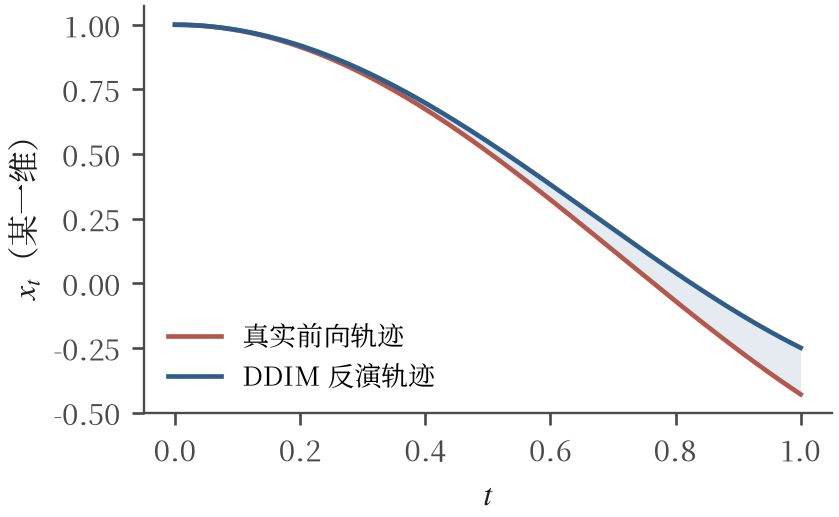
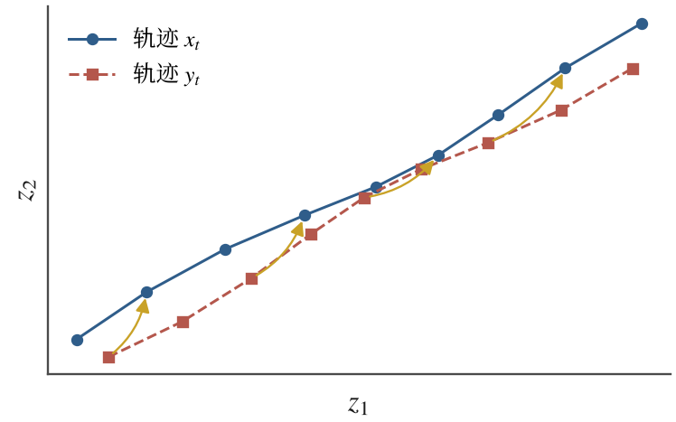

# 反演的误差

要在编辑中使用真实图像，得先把它送回模型的坐标系，也就是反演成噪声。这一步看起来只是"把采样倒着走"，实际会引入两类误差：数值误差，以及"反演出的噪声不在先验分布内"。这一章处理第一类，第二类留给第 6 章。

## DDIM 反演为什么会漂移

DDIM 的前向一步是

$$x_{t+1} = \sqrt{\bar\alpha_{t+1}}\,\hat{x}_0(x_t) + \sqrt{1-\bar\alpha_{t+1}}\,\epsilon_\theta(x_t,t),$$

其中 $\hat{x}_0$ 与 $\epsilon_\theta$ 都取自 $x_t$ 和 $t$。但真实的前向过程在 $t+1$ 处的噪声是 $\epsilon_\theta(x_{t+1},t+1)$，与 $\epsilon_\theta(x_t,t)$ 相差一阶。

把这个差记为 $\delta_t$。一步的误差是 $O(\Delta t^2)$，累积 $T$ 步之后是 $O(\Delta t)$。步长越小误差越小，但步数少的时候，误差就明显了。

## Null-text 反演

一个直接的想法是：把误差吸收到一个可优化的量里。

固定模型，为每一步引入一个可优化的空文本嵌入 $\emptyset_t$，让反演轨迹尽量能重建原图

$$\min_{\emptyset_t}\ \big\|x_t^{\text{rec}}(\emptyset_{1:t}) - x_t^{\text{inv}}\big\|^2,$$

其中 $x_t^{\text{rec}}$ 是从当前噪声出发、用 $\emptyset_t$ 去噪得到的重建。

这个优化的效果很好，代价是每张图要几十秒，每步几十次前向。它属于用优化换精度。

## EDICT：用两条轨迹做可逆变换

EDICT 把一步变换写成可逆的仿射耦合。维护两条轨迹 $x_t,y_t$，交替更新

$$x_{t+1} = a x_t + b\,\epsilon_\theta(y_t,t),\qquad y_{t+1} = a y_t + b\,\epsilon_\theta(x_{t+1},t),$$

$a,b$ 满足 $a^2+b^2=1$ 一类的关系，具体取值由噪声日程决定。

关键在于：给定 $(x_{t+1},y_{t+1})$ 可以解出 $(x_t,y_t)$，因为这是两个线性方程。所以反演是精确的，不依赖网络的近似。

代价有两个。每步两次前向；两条轨迹会逐渐分离，数值上不稳定，需要用一个混合参数 $p$ 把 $y$ 往 $x$ 拉。$p$ 太大，可逆性被破坏；太小，两条轨迹重合，方法退化成 DDIM。

## BDIA：双向积分

BDIA 换了一个更简单的思路：反演时同时算前向与反向两个估计，取平均。

从 $x_t$ 估计 $x_{t+1}$ 时，用 $\epsilon_\theta(x_t,t)$ 算一次，再用 $\epsilon_\theta(x_{t+1},t+1)$ 反推一次，两次结果加权平均。这样单侧的偏差被抵消一部分。

BDIA 不需要额外前向，实现只是几行代码。精度不如 EDICT，但稳定得多。

## 这些方法为什么在大模型上失效

EDICT、BDIA 都是在较小的扩散模型上验证的。迁移到更大的模型时，效果下降。

原因有两个。大模型的场更陡，同样的步长下离散化误差更大。更根本的是：这些方法保证的是数值上可逆，但不保证反演出的噪声在先验分布内。

一个不在先验内的噪声，从它出发去噪，会得到一张"重建得还行但不像这个模型会生成的图"。编辑时，这种图会被推向奇怪的方向。

这个观察引出后面两章：与其追求数值可逆，不如控制反演出的噪声要像标准高斯；或者干脆不做反演。

## 一个经验判断

如果重建误差在肉眼可见的范围内，比如背景纹理对不上，说明反演不够准，编辑结果一定会有偏移。这时应该先解决反演。

如果重建几乎完美，但编辑后结构崩坏，问题在编辑强度或条件，不在反演。

这个判断能省下很多调参时间。
