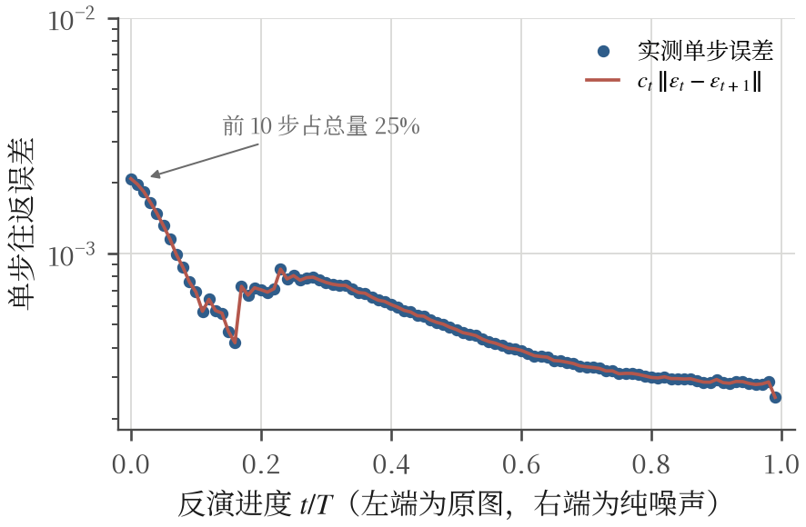
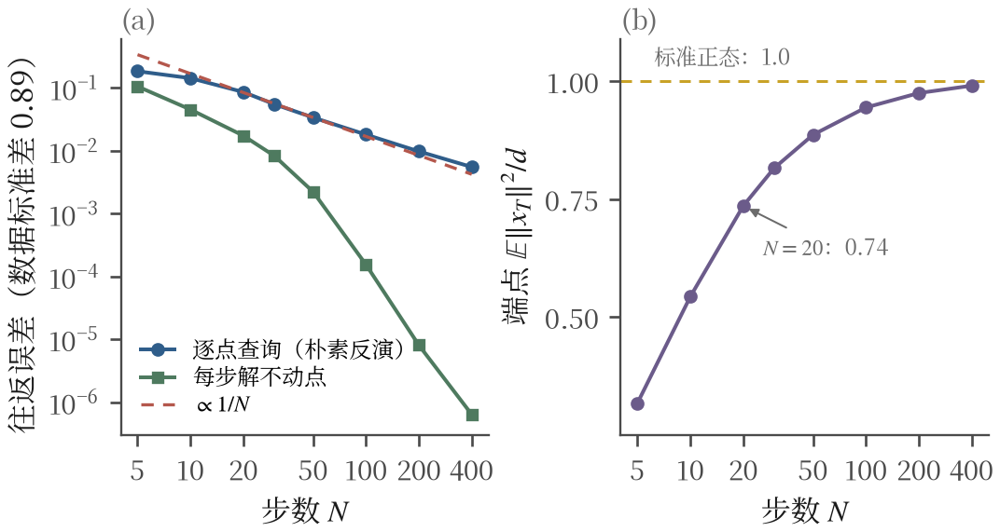

# 反演的误差

要在编辑中使用真实图像，得先把它送回模型的坐标系，也就是反演成噪声。这一步看起来只是“把采样倒着走”，实际会引入两类误差：数值误差，以及“反演出的噪声不在先验分布内”。这一章处理第一类，第二类留给第 6 章。

反演可以做得很朴素：不训练任何东西，把采样的每一步反过来跑一遍，采样花多少次前向，反演就花多少次。代价低，毛病也清楚——它反的不是采样真正走的逆，而是一个“看起来像”的逆。两种偏差叠在一起：每一步的查询点错了一点，错的地方又被后面的步继续当成正确的点用下去。

## DDIM 反演为什么会漂移

DDIM 的前向一步是

$$x_{t+1} = \sqrt{\bar\alpha_{t+1}}\,\hat{x}_0(x_t) + \sqrt{1-\bar\alpha_{t+1}}\,\epsilon_\theta(x_t,t),$$

其中 $\hat{x}_0$ 与 $\epsilon_\theta$ 都取自 $x_t$ 和 $t$。但真实的前向过程在 $t+1$ 处的噪声是 $\epsilon_\theta(x_{t+1},t+1)$，与 $\epsilon_\theta(x_t,t)$ 相差一阶。

把这个差记为 $\delta_t$。一步的误差是 $O(\Delta t^2)$，累积 $T$ 步之后是 $O(\Delta t)$。步长越小误差越小，但步数少的时候，误差就明显了。


这两个数量级要先信一半。一步为什么是二阶、累积为什么掉到一阶，得把一步的往返算开才看得见。

### 一步错在哪儿

把这一对相邻水平记成 $a=\bar\alpha_t$、$b=\bar\alpha_{t+1}$，加噪方向上 $b<a$。从水平 $t$ 上的点 $\bar{x}_t$ 出发反演一步，用的是 $t$ 处的预测

$$\varepsilon_t=\epsilon_\theta(\bar{x}_t,t),\qquad \hat{x}_0(\bar{x}_t)=\frac{\bar{x}_t-\sqrt{1-a}\,\varepsilon_t}{\sqrt{a}},$$

代进 DDIM 的式子，得到

$$\hat{x}_{t+1}=\sqrt{\frac{b}{a}}\,\bar{x}_t+\Big[\sqrt{1-b}-\sqrt{\frac{b}{a}}\sqrt{1-a}\Big]\varepsilon_t .$$

采样方向走的是同一张式子，只是查询点换成 $t+1$：

$$\hat{x}_t=\sqrt{\frac{a}{b}}\big(\hat{x}_{t+1}-\sqrt{1-b}\,\varepsilon_{t+1}\big)+\sqrt{1-a}\,\varepsilon_{t+1},\qquad \varepsilon_{t+1}=\epsilon_\theta(\hat{x}_{t+1},t+1).$$

把 $\hat{x}_{t+1}$ 代进第二式。第一项里 $\sqrt{a/b}\cdot\sqrt{b/a}=1$，正好把 $\bar{x}_t$ 还原出来；剩下两个系数，合并同类项：

$$\hat{x}_t-\bar{x}_t=\Big[\sqrt{\frac{a}{b}}\sqrt{1-b}-\sqrt{1-a}\Big]\,\varepsilon_t+\Big[\sqrt{1-a}-\sqrt{\frac{a}{b}}\sqrt{1-b}\Big]\,\varepsilon_{t+1}.$$

两个方括号互为相反数，于是

$$\hat{x}_t-\bar{x}_t=c_t\,\big(\varepsilon_t-\varepsilon_{t+1}\big),\qquad c_t=\sqrt{\frac{a\,(1-b)}{b}}-\sqrt{1-a}.$$

这一步没有用任何近似。给定模型在这两个点上吐出的 $\varepsilon_t$ 与 $\varepsilon_{t+1}$，等式精确成立。误差的全部来源就是括号里那个差：同一个模型在相邻两个时刻、两个略有不同的点上给出的预测不一样，而这个不一样，在往返里没有被消掉。

再看 $c_t$ 的量级。设 $\Delta=b-a<0$，把 $c_t$ 在 $b=a$ 附近展开。$\sqrt{1-b}=\sqrt{1-a-\Delta}\approx\sqrt{1-a}-\Delta/(2\sqrt{1-a})$，$\sqrt{a/b}\approx1-\Delta/(2a)$，两者相乘再减去 $\sqrt{1-a}$，一阶项留下

$$c_t=\frac{\lvert b-a\rvert}{2}\left(\frac{1}{\sqrt{1-a}}+\frac{\sqrt{1-a}}{a}\right)+O(\Delta^2).$$

括号里的函数记作 $g(a)$。它在两端都发散：$a\to1$ 时头一项炸，$a\to0$ 时后一项炸。中间有个最小值，求一下。令 $u=\sqrt{1-a}$，则 $g=1/u+u/(1-u^2)$，求导置零

$$-\frac{1}{u^2}+\frac{1+u^2}{(1-u^2)^2}=0\ \Longrightarrow\ (1-u^2)^2=u^2(1+u^2)\ \Longrightarrow\ u^2=\frac13 ,$$

也就是 $a=2/3$ 处取最小，最小值 $g(2/3)=3\sqrt3/2\approx2.60$。最小值落在 $2/3$ 而不是 $1/2$，是因为两个发散项的权重不对称：$1-a$ 小时 $1/\sqrt{1-a}$ 涨得快，$a$ 小时 $\sqrt{1-a}/a$ 涨得更快，平衡点被挤到偏信号的一侧。

两个因子各自带着一阶小量：$c_t\propto\lvert\Delta\rvert$，$\delta_t=\varepsilon_t-\varepsilon_{t+1}$ 也正比于步长（模型输出沿轨迹变化是光滑的）。乘起来是二阶，这就是“一步 $O(\Delta t^2)$”的来历。

### 误差为什么不会被平均掉

$N$ 步的误差不是 $N$ 个独立小量相加。如果 $\delta_t$ 各步方向随机，总和按 $\sqrt N$ 长，误差大致是 $\sqrt N\cdot\Delta t^2=N^{-3/2}$；实际按 $N$ 长，误差是 $N\cdot\Delta t^2=N^{-1}$，慢了半阶。差别在于 $\delta_t$ 并不随机：它是一条光滑曲线上相邻两点的差，前后几步的增量方向高度一致，符号也一致（$c_t>0$ 对所有 $t$ 成立）。于是它们同向叠加，像积分而不是像随机游走。

同向叠加还有一个后果：偏差是系统性的，不是噪点。多跑几张图、把结果平均，压不掉它；它表现为整幅图朝一个方向的偏移——颜色整体偏一点、结构整体错开一点。这也解释了为什么在编辑里，反演不准的后果常常是“编辑很成功，只是位置不对”。

### 单步误差沿日程的分布

$c_t$ 不是常数，$\delta_t$ 也不是。两者的乘积沿日程怎么分布，可以直接算，也可以直接测。



图 4.2 是一个二维三峰混合分布上的测量，模型是解析的（混合高斯的得分函数写成闭式），日程用余弦，取 100 步。做法很直接：在 $\bar{x}_t$ 上反演一步、再采样一步，量 $\hat{x}_t-\bar{x}_t$ 的均方根；每一步都用真实的轨迹点作起点，所以量到的是纯单步误差，不含累积。

曲线有两个特征。形状上，头几步明显最重，之后快速下降，到中段已经降到峰值的四分之一，噪声端最平。数量上，前 5 步吃掉总误差的 $16\%$，前 10 步吃掉 $25\%$，最后 10 步只占 $5\%$。这不是巧合：$g(a)$ 在 $a\to1$ 处以 $1/\sqrt{1-a}$ 发散，而余弦日程在这一端的 $\lvert\Delta\rvert$ 收缩得比它慢（$1-\bar\alpha$ 是 $s$ 的平方），发散压过收缩，乘积就在头几步达到最大。

预测曲线与实测的比值中位数是 $1.00$，逐点偏差在两成以内；两端稍微偏大，因为那里 $c_t$ 的一阶展开最粗。到这里可以确认推导本身没有算错——公式能预测测量值。

这条分布有个直接用处。想减少漂移，加密日程应该加密在靠近图像的那一端，而不是均匀加密或者加密在中间；反过来说，如果只能在某处少走一步，少在噪声端，代价最小。同样，反演的步数往下砍时，先坏的是纹理和色偏，因为那里的误差权重最大。

### 累积：实测的 $1/N$

把上面的一步误差连起来跑，就得到重建误差。



(a) 栏还是那个二维混合分布，从数据样本出发、反演到 $\bar\alpha\approx10^{-6}$ 再采样回来，量末端的欧氏误差。数据本身的标准差是 $0.89$，可以拿来做标尺。5 步、10 步、20 步、50 步、100 步、200 步、400 步的误差依次是 $0.18$、$0.14$、$0.086$、$0.034$、$0.018$、$0.0097$、$0.0055$，5 步时误差是数据标准差的五分之一，20 步时约一成，50 步时 $3.8\%$，100 步时 $2\%$。从 50 步往后，每翻一倍，误差降到 $0.55$ 倍左右，正好贴着 $1/N$ 那条虚线。

这个斜率本身就是证据：如果误差是各步随机方向的叠加，指数应该是 $-1.5$，实测是 $-0.87$，落在 $-1$ 附近。相干叠加的判断成立。

同一栏里还有一条绿线：每步不做显式反演，而是解一个小方程。反演要找的是 $y$，使得从 $y$ 采样一步能回到 $x_t$，

$$x_t=\underbrace{\sqrt{a}\,\hat{x}_0(y,b)+\sqrt{1-a}\,\epsilon_\theta(y,b)}_{G(y)},$$

这是一个关于 $y$ 的非线性方程。用不动点迭代 $y\leftarrow y+(x_t-G(y))$，初值取显式的结果，三次就收敛得差不多。50 步时误差降到 $0.0022$（$0.25\%$），100 步时 $1.5\times10^{-4}$，比逐点查询低两三个数量级。(a) 栏两条线的差距说明一件事：反演的误差几乎全部来自“查询点取错”，不是模型不准、也不是浮点不够。把查询点解对，误差就没了。

代价是每步多两次前向，而且这两次必须串行——第 $t$ 步的结果是第 $t-1$ 步的输入。50 步反演从 50 次前向变成 150 次，时间翻三倍。

(b) 栏换了个量：反演出的端点 $x_T$ 的一批样本，二阶矩除以维数，理想值应等于 $1$（标准正态）。5 步时只有 $0.32$，20 步 $0.74$，50 步 $0.89$，100 步 $0.95$，400 步才回到 $0.99$。误差随步数一起收，但注意 50 步这一档：重建误差已经降到 $3.8\%$，肉眼几乎看不出，端点的方差却还缺一成。数值可逆和“端点在先验内”是两把尺子，这里第一次看到它们不同步。

### 重建误差在图像上长什么样

把这几个量翻成视觉印象，判读会快很多。

端点方差亏空，最直接的后果是接下来那次采样的起点落在分布的内圈。模型以为自己在处理一张噪声很足的图，实际拿到的噪声比它预期的少，输出于是偏保守，图偏软：高频纹理被抹平，平坦区出现轻微的色偏，整张图看起来像被降过噪。这类偏差在纹理丰富的区域最容易被看出来——草地、织物、皮肤。

相干漂移的后果是整体错位。反演与采样走的不是同一条曲线，回来时落在旁边一点，表现为画面轻微平移、缩放，或者色温整体偏一点。它不会随机跳动，所以单看重建图很难发现，把原图和重建图并排、做一次差分才明显。

两种偏差在差分图上分得开：颗粒状的高频成分对应方差亏空，成片的低频成分对应相干漂移。前者加步数能压，后者加步数也能压，但需要更多——因为它靠的是每步省下的那一小点系统误差。

顺带得到一个判读经验：如果重建图“很像，但更干净”，说明端点亏空；如果“很清楚，但整体挪了一点”，说明相干漂移。两种情况下都不要急着调编辑强度，先解决反演。

## Null-text 反演

一个直接的想法是：把误差吸收到一个可优化的量里。

固定模型，为每一步引入一个可优化的空文本嵌入 $\emptyset_t$，让反演轨迹尽量能重建原图

$$\min_{\emptyset_t}\ \big\|x_t^{\text{rec}}(\emptyset_{1:t}) - x_t^{\text{inv}}\big\|^2,$$

其中 $x_t^{\text{rec}}$ 是从当前噪声出发、用 $\emptyset_t$ 去噪得到的重建。

这个优化的效果很好，代价是每张图要几十秒，每步十几次到几十次前向。它属于用优化换精度。

### 目标怎么落到每一步

前面那个式子只是概念上的写法，落地时是一串逐步的问题。先把 DDIM 反演跑完，得到一条序列 $\bar{x}_0,\dots,\bar{x}_N$（$\bar{x}_0$ 就是原图），端点 $\bar{x}_N$ 是后面一切的起点。再从 $t=N$ 往回走。第 $t$ 步要解的是一维嵌入上的无约束问题

$$\min_{\emptyset_t}\ \big\|\,x_{t-1}^{\text{rec}}-\bar{x}_{t-1}\,\big\|^2,\qquad x_{t-1}^{\text{rec}}=\sqrt{\bar\alpha_{t-1}}\,\hat{x}_0\big(x_t^{\text{rec}},\emptyset_t\big)+\sqrt{1-\bar\alpha_{t-1}}\,\epsilon_\theta\big(x_t^{\text{rec}},t,\emptyset_t\big),$$

其中 $x_t^{\text{rec}}$ 是上一步重建出来的点（第一步就是 $\bar{x}_N$），$\bar{x}_{t-1}$ 是 DDIM 序列上的对应点。解出来的 $\emptyset_t$ 立刻冻结，接着做第 $t-1$ 步。

这套做法是贪心的：每一步只要求“从当前点出发、用这个嵌入，能落到下一个路标上”，不管更远的步。贪心的代价是局部最优未必全局最优，好处是每一步都是小问题，十几次梯度就够。

带无分类器引导时，嵌入只进无条件那一支。模型的输出拆成

$$\epsilon_\theta(x,t,\emptyset_t)=\epsilon_{\text{un}}(x,t,\emptyset_t)+s\,\big(\epsilon_{\text{cond}}(x,t)-\epsilon_{\text{un}}(x,t)\big),$$

优化的是 $\epsilon_{\text{un}}$ 的输入，条件那一支完全不动。所以修正的效果相当于在无条件支路上加了一个随步变化的偏置：条件方向不变，输出被平移。

### 为什么这样修得动

前面算过，一步往返的偏差是 $c_t(\varepsilon_t-\varepsilon_{t+1})$，来源是查询点错位——反演在 $t$ 处查，采样在 $t+1$ 处查。null-text 不改正查询点，它换了一个自由度：让 $\varepsilon$ 偏离“模型在该点的自洽输出”。目标函数只提一个要求，从当前点出发、用这个嵌入，能走到下一个路标；满足这个要求的嵌入就可以。

几何上，DDIM 序列的每个点被当成一个路标，每步配一个嵌入，让采样能一站一站地贴着路标走回来。路标是给定的，所以这套优化不会累积——每一步的误差都在该步内被压掉，不会带到下一步。

另一半原因在修正落的位置。编辑时换掉条件文本，$\emptyset_t$ 不动，修正按上面的拆式继续作用在输出上：条件项变了，无关项留了下来。这就是为原图拟合出来的修正能直接搬到新条件上的原因，也是它比“重新拟合一遍”实用的地方。

### 代价的账

前向次数：每步 $K$ 次迭代，每次一次前向加一次反传。$N=50$、$K=15$，就是 $750$ 次前向等价，是纯反演的十五倍。单张图在 A100 上几十秒到一分多，这是量级估计，准数跟模型大小和迭代上限走。

存储：每步一个空文本嵌入，SD 这一档模型是 $77\times1024$，50 步约四百万个浮点，几十兆，可以忽略。但它属于每张图一份——换一张图、换一个提示词都要重算。

并行性：链条必须顺序。第 $t$ 步的起点是第 $t-1$ 步的重建结果，单张图内部无法按 batch 并行；多张图之间可以并行，所以批量处理时吞吐还能接受，单张延迟压不下来。

超参：每步迭代十几次到二十次，学习率在 $10^{-2}$ 的量级，各步损失通常不加权。要不要按 $\lVert\bar{x}_{t-1}\rVert$ 归一化，实现上两种都有；归一化的好处是噪声端的数值不至于把梯度淹没，坏处是图像端的步被压得太轻。

### 它修了什么，没修什么

修的是沿程的查询点偏差，外加模型在偏离轨迹处的输出误差。后者是 DDIM 反演给不了的——它要求 $\varepsilon$ 必须是模型在轨迹上的输出，null-text 允许它偏一点。

没修的是端点。$\bar{x}_N$ 还是 DDIM 反演给的那个点，优化只沿着它往下走。如果端点本身方差亏空，优化能做到的最好结果是“用这个端点能重建出的最像的图”，不能把它拉回先验。50 步那一档近一成的方差亏空，null-text 一点忙也帮不上。这是它在大模型上不够用的一个原因。

另一件没修的事在目标函数里：只有“回到路标”，没有“像不像”。重建可以很准，重建出来的图却未必是模型自己愿意生成的图。这两件事要分开看，后面几章会反复用到这个区分。

## EDICT：用两条轨迹做可逆变换

EDICT 把一步变换写成可逆的仿射耦合。维护两条轨迹 $x_t,y_t$，交替更新

$$x_{t+1} = a x_t + b\,\epsilon_\theta(y_t,t),\qquad y_{t+1} = a y_t + b\,\epsilon_\theta(x_{t+1},t),$$

关键在于：给定 $(x_{t+1},y_{t+1})$ 可以解出 $(x_t,y_t)$，因为这是两个线性方程。所以反演是精确的，不依赖网络的近似。


代价有两个。每步两次前向；两条轨迹会逐渐分离，数值上不稳定，需要用一个混合参数 $p$ 把 $y$ 往 $x$ 拉。

上面的式子还缺两块：系数 $a,b$ 到底取什么，混合加在哪里。补上之后，可逆性可以证明，代价也可以算清。

### 一步是一个仿射映射

把 $\hat{x}_0$ 代回 DDIM 的式子，一步是 $x$ 的仿射函数，可以写成

$$x_{t+1}=a_t\,x_t+b_t\,\epsilon_\theta(x_t,t),\qquad a_t=\sqrt{\frac{\bar\alpha_{t+1}}{\bar\alpha_t}},\qquad b_t=\sqrt{1-\bar\alpha_{t+1}}-a_t\sqrt{1-\bar\alpha_t}.$$

验算：$\sqrt{\bar\alpha_{t+1}}\hat{x}_0=\sqrt{\bar\alpha_{t+1}}(x_t-\sqrt{1-\bar\alpha_t}\varepsilon)/\sqrt{\bar\alpha_t}=a_tx_t-a_t\sqrt{1-\bar\alpha_t}\,\varepsilon$，再加 $\sqrt{1-\bar\alpha_{t+1}}\,\varepsilon$，就是上面那式。$a_t$ 与 $b_t$ 的关系不是 $a^2+b^2=1$——那个式子对不上任何一个真实的日程，正确的约束只有上面两个定义。

两个系数的符号有用。$a_t=\sqrt{\bar\alpha_{t+1}/\bar\alpha_t}<1$，逐步收缩；$b_t>0$ 恒成立，因为 $a_t\sqrt{1-\bar\alpha_t}<\sqrt{1-\bar\alpha_{t+1}}$ 等价于 $\bar\alpha_{t+1}<\bar\alpha_t$，而这正是“越往后噪声越大”。所以每步是“信号项收缩 + 噪声项注入”，两项都是正的，没有相消。

### 交叉预测与混合

两条轨迹的更新是串行的，不是并行的：

$$\tilde{x}_{t+1}=a_t\,x_t+b_t\,\epsilon_\theta(y_t,t),\qquad\tilde{y}_{t+1}=a_t\,y_t+b_t\,\epsilon_\theta(\tilde{x}_{t+1},t),$$

$\tilde{y}_{t+1}$ 用的预测取自 $\tilde{x}_{t+1}$，所以必须先算 $x$ 那一侧。这一步交叉是全部机制的核心：两条轨迹因为共用对方的预测而互相约束，反演时这个约束给出两个方程、两个未知量。

交叉之后再做一次混合，把两条轨迹往中间拉：

$$\begin{aligned}
x_{t+1}&=p\,\tilde{x}_{t+1}+(1-p)\,\tilde{y}_{t+1},\\
y_{t+1}&=p\,\tilde{y}_{t+1}+(1-p)\,\tilde{x}_{t+1}.
\end{aligned}$$

$p\in(1/2,1]$。混合是两条轨迹之间的线性重分配，总和不变。$p$ 越大，两条轨迹越独立；$p$ 越接近 $1/2$，它们越像同一条。

### 可逆性

给定 $(x_{t+1},y_{t+1})$，倒推三步，每步都是显式的。

第一步，反混合。把上面的两式写成矩阵

$$\begin{pmatrix}x_{t+1}\\ y_{t+1}\end{pmatrix}=M_p\begin{pmatrix}\tilde{x}_{t+1}\\ \tilde{y}_{t+1}\end{pmatrix},\qquad M_p=\begin{pmatrix}p&1-p\\ 1-p&p\end{pmatrix},$$

行列式 $\det M_p=p^2-(1-p)^2=2p-1$。只要 $p\neq 1/2$，$M_p$ 可逆，逆是

$$M_p^{-1}=\frac{1}{2p-1}\begin{pmatrix}p&p-1\\ p-1&p\end{pmatrix}.$$

第二步，解 $y_t$。由 $\tilde{y}_{t+1}=a_t\,y_t+b_t\,\epsilon_\theta(\tilde{x}_{t+1},t)$ 这一式，把已知量挪到一边：

$$y_t=\frac{\tilde{y}_{t+1}-b_t\,\epsilon_\theta(\tilde{x}_{t+1},t)}{a_t}.$$

注意这里 $\epsilon_\theta$ 的自变量是 $\tilde{x}_{t+1}$——第一步已经解出来了，所以这一次查询是已知量代入，不是未知数。

第三步，解 $x_t$：

$$x_t=\frac{\tilde{x}_{t+1}-b_t\,\epsilon_\theta(y_t,t)}{a_t}.$$

这一步的 $\epsilon_\theta$ 自变量是刚解出的 $y_t$，同样是已知量代入。

三步都是有限次的加减乘除，没有迭代、没有近似。每步的映射可逆，可逆映射的复合可逆，所以从 $x_N$ 到 $x_0$ 的整条链精确可逆，逆映射就是采样方向。

可逆的条件也要说清：$a_t\neq0$（即 $\bar\alpha_t>0$，加噪日程上除最后一步之外都成立）与 $2p-1\neq0$。这两条与网络好坏无关，与训练好坏无关。自然，可逆不等于可算，下一节就是这个“可算”的问题。

### 条件数与代价

反混合里带一个 $1/(2p-1)$。$p\to1/2$ 时它发散：两条轨迹被压成一条，第二个方程退化成第一个，$M_p$ 的信息丢了一半。$p=1/2$ 恰好是 DDIM 的退化点——那时两条轨迹始终重合，只剩一个自由度，混合不可逆，方法也就不再是精确反演。所以准确的说法是：$p$ 太接近 $1/2$ 会破坏可逆性，太大则让两条轨迹各走各的，压不住分离。

反演的每一步还带一个 $1/a_t=\sqrt{\bar\alpha_t/\bar\alpha_{t+1}}$。单步只是略大于一，整条链乘起来却是

$$\prod_{t}\frac{1}{a_t}=\sqrt{\frac{\bar\alpha_0}{\bar\alpha_N}}.$$

取 $\bar\alpha_0\approx1$、$\bar\alpha_N=10^{-6}$，这个乘积是 $10^3$。EDICT 说自己是“精确反演”，但在浮点数上，端点处的扰动被放大三个数量级——它精确的是代数，不是数值。这和 DDIM 反演的困境不同：DDIM 是算错了，EDICT 是算对了但把误差放大。

实际用的时候有两个对策。一是在 $\bar\alpha$ 不太小处停下，比如反演到 $\bar\alpha\approx10^{-3}$ 而非 $10^{-6}$，放大倍数退到三十几。二是最后一步不做 EDICT，直接取预测的噪声当端点——这一小步本来贡献就小，图 4.2 里最后十步只占百分之五。

两条轨迹的分离是另一个代价。每步 $y$ 的更新用的预测来自 $x$ 那一侧，两个输入差一点，输出就差一点；这个差按 $b_t\partial_x\epsilon$ 的量级增长，混合再按 $p$ 把它压回去。$p$ 给定之后，分离的大小取决于场有多陡：场平，两条轨迹贴得住；场陡，分离增长得快，混合就得往下调，可调太低又会撞上 $1/(2p-1)$ 的发散。常见取值在 $0.93$ 到 $0.99$ 之间，就是在这两难之间找的位置。

### 编辑时它怎么用

反演跑完之后，两条轨迹都换成编辑条件，往下采样。混合持续把两条轨迹往中间拉，所以它们不会因为条件改变而散开；输出取 $x$ 一侧，或者两者平均，差别不大。

收益是重建误差不再来自离散化：EDICT 的往返偏差在浮点精度内，几乎为零。代价是上面那 $10^3$ 的放大，以及每步两次前向——50 步就是 100 次，比 DDIM 反演慢一倍。

还有一件事它管不了：端点是不是典型的高斯样本。EDICT 把“算错”消掉之后，“分布在不在先验内”这件事就露出来了，后面的转向也是从这里开始的。

## BDIA：双向积分

BDIA 换了一个更简单的思路：反演时同时算前向与反向两个估计，取平均。

从 $x_t$ 估计 $x_{t+1}$ 时，用 $\epsilon_\theta(x_t,t)$ 算一次，再用 $\epsilon_\theta(x_{t+1},t+1)$ 反推一次，两次结果加权平均。这样单侧的偏差被抵消一部分。

BDIA 实现只是几行代码，额外的前向也可以省，代价是滞后一拍。精度不如 EDICT，但稳定得多。

### 两侧的估计

同一步有两种离散写法，都用同一个 $\varepsilon$ 的查询：

一是 DDIM 的仿射式，把 $x_t$ 先折算成 $\hat{x}_0$、再按 $t+1$ 的日程重新加噪，

$$x^{(1)}_{t+1}=a_tx_t+b_t\,\varepsilon_t ;$$

二是把这一步当成概率流 ODE 的欧拉步，沿速度方向走一段

$$x^{(2)}_{t+1}=x_t+\Delta_t\,v_t,\qquad v_t=\frac{\mathrm{d}\sqrt{\bar\alpha_t}}{\mathrm{d}t}\,\hat{x}_0+\frac{\mathrm{d}\sqrt{1-\bar\alpha_t}}{\mathrm{d}t}\,\varepsilon_t .$$

两者都只用 $t$ 处的信息，都没有迭代。余弦日程下 $\mathrm{d}\sqrt{\bar\alpha_t}/\mathrm{d}t=-\sin\theta_t\cdot\mathrm{d}\theta/\mathrm{d}t$、$\mathrm{d}\sqrt{1-\bar\alpha_t}/\mathrm{d}t=\cos\theta_t\cdot\mathrm{d}\theta/\mathrm{d}t$，可以把 $v_t$ 写成闭式。

两个估计不相等。$x^{(1)}$ 假设这一步之内 $\hat{x}_0$ 不变，$x^{(2)}$ 假设这一步之内速度不变，两个假设各自漏掉一部分对方补上的变化，偏差同阶而符号常常相反。取平均之后一阶项相消，局部误差降一阶，这是数值积分里梯形法的道理：前向与后向各偏一点，平均正好补上。

$$\bar{x}_{t+1}=\tfrac12\big(x^{(1)}_{t+1}+x^{(2)}_{t+1}\big).$$

反演和采样用同一个平均式，方向反过来跑就行。两侧都用同一个平均算子，本身就是一个额外的对称性：往返时两次偏差用的是同一套权重，收得比单侧更齐。

### 代价与实际收益

第二次查询在 $t+1$ 处，形式上要多一次前向。顺序扫描时有个省法：第 $t$ 步需要的 $\varepsilon_\theta(x_{t+1},t+1)$，下一步（$t+1$）本来就要算，可以留给下一步用，只是滞后一拍——用上一次留下的值代替当前值。要么多一次前向、要么滞后一拍，两个实现都有，前者精确，后者省算力。

收益可以量。同一套玩具模型、同一个日程，50 步时 DDIM 反演的往返误差是 $3.7\%$，取平均后降到 $2.9\%$；20 步时从 $8.6\%$ 降到 $7.4\%$。改善是真的，幅度有限。和每步解到不动点比（50 步 $0.2\%$），差一个数量级以上。

它换来的是稳定。没有第二条轨迹，就没有 $p$ 的调节，也没有 $1/(2p-1)$ 那种只在特定参数下才不炸的项。往两个估计里加一点噪声重跑，结果变化很小；EDICT 在 $p$ 偏小的时候不是这样。

### 它为什么不够

平均消掉的是对 $t$ 的离散误差，消不掉“模型在这一点上的输出本身偏了”——后者要靠优化，或者靠换坐标。这也解释了它在大模型上的收益为什么比在小模型上更小：大模型的条件分布更尖，$\hat{x}_0$ 在一步之内的变化更剧烈，“这一步之内 $\hat{x}_0$ 不变”这个假设更不像话，两个估计一起偏，平均就补不上了。

## 这些方法为什么在大模型上失效

EDICT、BDIA 都是在较小的扩散模型上验证的。迁移到更大的模型时，效果下降。

原因有两个。大模型的场更陡，同样的步长下离散化误差更大。更根本的是：这些方法保证的是数值上可逆，但不保证反演出的噪声在先验分布内。

一个不在先验内的噪声，从它出发去噪，会得到一张“重建得还行但不像这个模型会生成的图”。编辑时，这种图会被推向奇怪的方向。

这个观察引出后面两章：与其追求数值可逆，不如控制反演出的噪声要像标准高斯；或者干脆不做反演。

### 场更陡意味着什么

一步的误差正比于 $\partial_x\varepsilon\cdot\Delta x$。$\Delta x$ 是一步之内点移动的距离，由日程定；$\partial_x\varepsilon$ 由模型定。大模型在近图像端的响应更尖锐：合成数据里两个相邻样本的差别被放大，得分函数在它们之间变化得更快，雅可比的谱半径更大。同样 50 步，小模型上的误差可能看不出来，大模型上就是可见的纹理偏移。

更麻烦的是陡的场把误差锁死在那里。反演到某一步偏了一点，下一步的查询点就落在偏的地方，$\partial_x\varepsilon$ 大意味着这一点偏差被读出更大的预测差，$c_t(\varepsilon_t-\varepsilon_{t+1})$ 也跟着变大。图 4.2 里那条曲线的前提是偏差小、一阶展开站得住；偏差一大，展开失效，误差不再按 $\Delta t$ 收。

### 端点不在先验内

第二类失效更根本，而且可以量。玩具模型上，20 步反演的端点方差只有标准正态的 $0.74$，50 步 $0.89$，100 步 $0.95$（图 4.3b 栏）。端点方差不足，意味着它所在的区域是高斯分布的“内圈”——概率密度不算低，但模型在训练里很少从这个半径的球面上起步。

从这样的点出发去噪，模型是在做外推。外推没有误差界：它给出的 $\varepsilon$ 只是“往最像的方向走”的一个猜测，而不是条件期望。编辑正是在这一步上与它较劲——条件一换，外推的方向就变得难以预测，结构可能整块崩掉，也可能只是颜色偏一点。

还有一个正反馈。端点偏了，采样轨迹就偏，模型在偏的轨迹上给出的预测更不像条件期望，下一点偏得更多。小模型上这个回路收敛，因为场平缓、预测对输入不敏感；大模型上场陡，回路增益大，几十步之后就发散成另一种图像。

### 可逆的三种含义

到这里可以把手里的三个词分开，它们在这类方法里被混着用。

代数可逆：存在显式逆映射，给定 $x_{t+1}$ 能唯一解出 $x_t$。EDICT 有，DDIM 反演没有（它的逆是另一个方法，不是它自己）。

数值可逆：在浮点数上真的能解回来，误差在可接受范围内。EDICT 的代数逆带 $\sqrt{\bar\alpha_0/\bar\alpha_N}\approx10^3$ 的放大，实际能解回来的精度取决于这一点；把最后几步截掉，这个数能压到几十。

分布在先验内：端点落在模型训练时见过的噪声分布里，样本的统计性质与标准正态一致。前两种可逆都不蕴含这一条。DDIM 反演 100 步时重建误差 $2\%$、端点方差 $0.95$，两把尺子量的东西并不一样。

前几节的方法都在争第一、第二条，第三条一直是空的。这不是实现不够好，是问题本身：把一张具体图像映成噪声，映出来的点天然地贴在数据决定的某个低维结构附近，而先验是各向同性的高斯。两者只在一个很薄的壳上才重合。

## 落到流程：强度怎么定

方法选完之后，实际动手时最容易含糊的是“强度”这个词。它不是一个参数，至少是两个：反演走到哪一步，条件在多大范围、以多强的程度起作用。

第一个是停止水平。把原图只送到 $\bar\alpha_s$，不送到 $\bar\alpha_N$，然后从那里带着新条件往下走：

$$x_s=\sqrt{\bar\alpha_s}\,x_0+\sqrt{1-\bar\alpha_s}\,\epsilon,\qquad s<N .$$

$\bar\alpha_s$ 越小（越靠近噪声端），留给编辑的自由度越大，结构越可能整体改写；$\bar\alpha_s$ 越接近 $1$，越接近只做纹理层面的润色。这条曲线在 SDEdit 那一类方法里被反复用到。

顺带一个不显然的好处：部分反演省掉的正是噪声端那一段，而图 4.2 里最后十步只占总误差的 $5\%$。所以把反演停在半路，误差并没有比全程反演大多少，步数却少了一半；真正贵的误差在近图像端那几步，而那几步在两种做法里都得走。

第二个是条件介入的时刻。条件从头到尾都在，但作用强度随 $\bar\alpha$ 变化：噪声端条件决定全局布局，图像端条件只影响局部细节。所以“在哪一步换条件”和“换到什么程度”要一起调。把 CFG 尺度调大，等于让条件在每一层都更强势，结构改写的能力变强，端点的偏离也跟着变大——这两个效果用的是同一个旋钮，压不住其中一个而不动另一个。

### 一次可用的流程

```text
输入：x0、源提示 c_src、目标提示 c_tgt、停止水平 s、步数 N
1  用 N 步日程从 x0 反演到 x_s
2  空编辑：用 c_src 从 x_s 采样回 x0_rec，量 ||x0_rec - x0||
3  误差超过基线就回 1：加步数、换反演方法、或抬高停止水平（少走几步）
4  用 c_tgt 从 x_s 采样，得到 x0_edit
5  比较 x0_edit 与 x0_rec 的差，差就是这次编辑真正改动的地方
6  改动溢出到不该动的区域：降 CFG、抬高停止水平、收紧 mask，回到 4
7  换一个噪声起点重跑 4，两次结果的结构是否一致
```

第 2 步是最省时间的一步，也最容易被跳过。它把反演的误差单独量出来，后面所有偏差都可以在这条基线上解释：编辑后整体挪了，是基线之上的增量，还是基线本身？没有这条基线，改了半天不知道在改什么。

第 7 步量的是稳定性。同一个源图、同一个条件、换一个噪声实现，结构应该基本一致；如果两次的结构不一样，说明停止水平太低或者 CFG 太大，编辑落在了条件的多峰之间。

### 四种典型失败与对应处理

| 现象 | 最可能的原因 | 先动什么 |
| --- | --- | --- |
| 空编辑重建就有可见偏移 | 步数太少，$1/N$ 误差没压住 | 加步数，或每步解一次不动点 |
| 重建很准，编辑后整体挪位或改色 | 端点不在先验内，条件把它推得更远 | 降 CFG，抬高停止水平 |
| 编辑区边缘有接缝、颜色不连续 | mask 太紧，边界处条件突变 | 扩边界几像素，羽化过渡 |
| 条件换了，画面几乎没变 | 停止水平太高（$\bar\alpha_s$ 接近 1），自由度不够 | 降低停止水平，加 CFG |

四种失败的定位办法不一样，但都在同一条链上：先用空编辑把反演这一环摘出去，剩下的才归编辑。这一步做对，调参会快很多。

## 一个经验判断

如果重建误差在肉眼可见的范围内，比如背景纹理对不上，说明反演不够准，编辑结果一定会有偏移。这时应该先解决反演。

如果重建几乎完美，但编辑后结构崩坏，问题在编辑强度或条件，不在反演。

这个判断能省下很多调参时间。

再加一层顺序：先看空编辑的重建，再看编辑前后差分的形状。重建偏移是低频的、成片的，说明相干漂移；重建偏移是高频的、颗粒的，说明端点方差亏空；两者都没有，却还是改坏了，问题一定在条件或强度，而且通常是两者的乘积——把 CFG 降一半和把停止水平抬一档，效果相近，先动哪个都一样，不要同时动。

几个误差值可以当手感：100 步时 DDIM 反演的重建误差在玩具模型上是数据的 $2\%$，50 步 $3.8\%$，20 步一成。真实模型的场比这个玩具陡得多，同一步数下的偏差只会更大。所以“50 步够用”这句话只在小图上成立，尺寸上去之后，同样的日程需要更多步，或者换一种不靠离散化的反演。

还有一条边界：这一章修的都是“算回来”的误差。就算算得完全准，端点还是可能不在先验内——那是反演这个概念本身的限制，不是实现问题。要绕开它，只能改坐标，或者干脆不反演。
