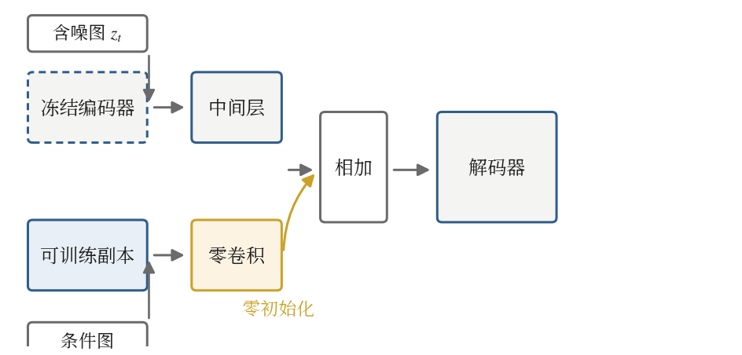
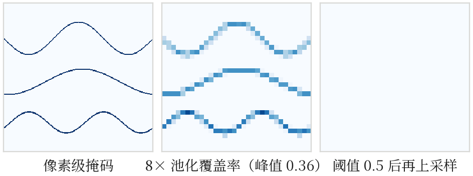
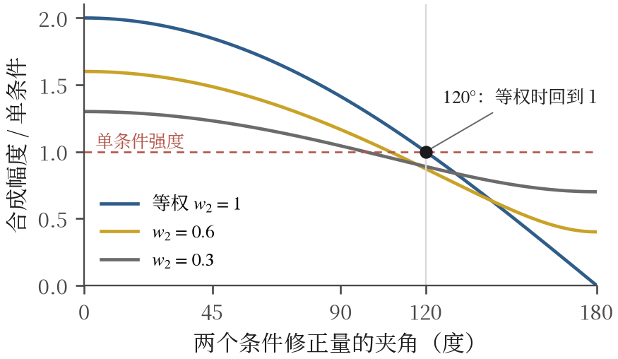

# 结构条件：告诉模型改哪里

前几章的方法都在改语义，但不擅长控制空间结构。文本说不清“在哪里、什么姿势”，要做精确的空间控制，需要把边缘图、深度图、姿态这类信息注入模型。

## ControlNet

ControlNet 的做法是复制一份 U-Net 的编码器，冻结原模型，只训练这份副本。

副本的输入是条件图，比如 Canny 边缘，输出是一组多尺度特征。这些特征通过零卷积加回原模型的对应层。

零卷积是一个 $1\times1$ 卷积，权重初始化为零。这个细节很关键：训练开始时，副本的输出恒为零，原模型的行为与未加条件时完全一致。模型不必在初期抵抗随机初始化带来的扰动，可以先学会保留原能力，再逐步接入条件。

条件图的类型决定控制的内容：Canny 控制轮廓，深度控制远近，OpenPose 控制骨架，法线控制表面朝向。同一套结构，换条件图就能换控制方式。

训练时随机丢弃条件，比如 50%，使模型同时支持有条件和无条件生成。

### 为什么复制编码器

要注入的是“逐像素对齐”的信息。边缘、深度、骨架都与图像逐点对应，它们必须在与原图相同的空间位置上起作用。U-Net 的编码器逐层下采样，每层特征都与输入保持固定的空间对应：某一层特征图的一个位置，对应输入图像里一个 $s\times s$ 的方格。跳连把这些多尺度特征直接送到解码器，是原模型保住细节的通道。条件特征要起作用，就得沿同样的通道进入，在每一层与对应特征相加，覆盖到同样的格子。

只把条件压成一个向量加到瓶颈，空间信息就丢了。Stable Diffusion 的输入是 $64\times64$ 的潜变量，瓶颈层是 $8\times8$，一个格子对应原图 $64\times64$ 像素的区域。一张 512 像素宽的 Canny 图降到 $8\times8$，细线基本消失，只剩下“这一带有一片边缘”的粗略分布。这也解释了为什么把条件图或 mask 压成 pooled embedding 的做法在结构控制上总是软绵绵的。

复制而不是重新设计，有两个现实理由。层结构必须与原编码器一致，否则特征无法相加：通道数、分辨率、每个 stage 的 block 数都要对上。另外，副本用原编码器的权重初始化，第一步就具备提取边缘和纹理的能力，不必从随机权重学“什么是边缘”。这一点与零卷积配合，构成了“先继承、再接入”的顺序。

### 零卷积的梯度通路

把注入写成

$$y = F(x;\Theta) + Z\big(F_c(c;\Theta_c); w, b\big),$$

其中 $F$ 是冻结的原网络，$F_c$ 是可训练的副本，$Z$ 是 $1\times1$ 卷积。取 $w=0$、$b=0$，则 $y=F(x;\Theta)$，逐位相等，连浮点舍入都一样。

梯度要分开看：

$$\frac{\partial L}{\partial w} = \Big(\frac{\partial L}{\partial y}\Big)^{\!\top} F_c(c), \qquad
\frac{\partial L}{\partial \Theta_c} = w\cdot\Big(\frac{\partial F_c}{\partial \Theta_c}\Big)^{\!\top}\Big(\frac{\partial L}{\partial y}\Big).$$

第一式里没有 $w$，只要 $F_c(c)\neq 0$，零卷积的权重在第一步就收到非零梯度；第二式整体乘了 $w$，$w=0$ 时副本收不到任何梯度。两式合起来说明了训练的实际顺序：先由零卷积学会“往主支路里加多少、加在哪个方向”，权重长起来之后，梯度才通过它流进副本，副本再开始调整。

用一阶近似估这个预热有多长。若梯度在最初若干步大致不变，第 $k$ 步的权重约 $w_k\approx k\eta g$，零卷积的输出幅度约 $k\eta g\|F_c(c)\|$，是线性增长的。取学习率 $\eta=10^{-4}$、梯度分量 $10^{-1}$ 的量级，每步涨 $10^{-5}$，一千步之后到 $10^{-2}$，与特征自身的涨落可比。这是量级估计，真实速度取决于数据与学习率调度。

零初始化还有一个不常被提起的用处：它把“条件强度”落在一个可读的位置上。训练完之后 $\|w\|$ 就是“这个条件被信任多少”的度量，推理时在零卷积输出上乘一个标量，就能连续调节条件强度，不必重训。

有一种替代做法是把零卷积换成 $10^{-2}$ 量级的小随机权重。数值上两者差别不大，输出幅度都是 $10^{-2}$ 量级。差别在副本内部。副本的中间层带归一化，归一化会把激活的幅度拉回标准尺度，与权重本身的尺度无关；所以“小随机”只压住了最后一层的输出，副本内部依然在产生与训练好的网络同量级、方向随机的激活，这些激活在 $w$ 长起来之后会立刻变成大幅扰动。零初始化时这一步严格是零，副本的内部状态从接入之后才开始被塑形。

### 训练与条件丢弃

损失与原模型相同，只是条件多了一项：

$$L = \mathbb{E}_{z_0,\varepsilon,t,c_{\text{text}},c_{\text{ctrl}}}\Big[\big\|\varepsilon - \varepsilon_\theta(z_t,t,c_{\text{text}},c_{\text{ctrl}})\big\|^2\Big].$$

训练数据是三元组：图像、描述文本、由图像算出的条件图。条件图不需要人工标注——Canny 用双阈值，深度用单目估计网络，姿态用关键点检测器，都可以离线批量生成。代价是这些自动标注本身有错：单目深度只有相对尺度，反光与透明表面会估错，遮挡处的关键点会丢失。这些错误会被当作“正确答案”学进去，表现为模型对这类输入特别听话地画出错误结构。

条件丢弃的做法是每一步独立地以概率 $p$（常取 0.5）把 $c_{\text{ctrl}}$ 换成全零图。这样同一个网络里就有两条支路：见过条件的和没见过条件的。推理时可以对两条支路做引导：

$$\tilde\varepsilon = \varepsilon_\theta(z_t,t,c_{\text{text}},\varnothing) + s_c\big[\varepsilon_\theta(z_t,t,c_{\text{text}},c_{\text{ctrl}}) - \varepsilon_\theta(z_t,t,c_{\text{text}},\varnothing)\big].$$

$s_c=1$ 是训练时的期望行为，$s_c>1$ 加强条件，$s_c<1$ 放松。$s_c$ 调得过大时，边缘变成双线、颜色过饱和、纹理出现重复条纹，机理与文本 CFG 过大的伪影同类：把“有条件”与“无条件”的差外推得太远，越出了模型见过的范围。

训练成本上，前向要跑两份编码器，反向只更新副本。参数里副本占大头，可训练参数在几亿量级；一张 512 分辨率、batch 8 的配置在 24GB 卡上通常要开梯度检查点才放得下。

### 对齐与分辨率

条件图必须与输入逐点对齐，这是最容易被忽略的一环。潜变量的一个像素对应原图 8 个像素，条件图在进入副本前一般被下采样到这个分辨率。下采样方式决定控制精度：最近邻保留细线但会产生锯齿，平均池化干净但会把一像素宽的线抹成一片灰。

错位的后果可以估。若整体平移 4 个原图像素，在 $64\times64$ 的潜空间里只是半个像素，等效于把边缘糊成两个格子宽，生成的图会沿边缘出现两条平行的亮线。看到“双线”，先查对齐，再查 $s_c$。

还有一层隐性错位来自 VAE：条件图是从原图算的，而模型在潜空间工作；编码器把细密的边缘压成低频潜变量之后，条件图与潜变量描述的不是同一个东西。把条件图先编码再下采样，有时比直接下采样更一致，代价是多一次编码。

### 失效模式

条件图有歧义时，控制会退化成“跟着噪声走”。单目深度对树枝、头发、栅栏这类细结构经常估成一片平面，模型照做，生成出来的画面在这些地方失去前后关系。Canny 阈值设低了会把纹理当轮廓，整张图的每个褶皱都被勾出来，画面像版画。

条件与文本冲突时，模型通常优先服从结构，再用生成能力去解释文本。文本写“双手”，骨架只给一只手，结果往往是一只按骨架画的、一只位置别扭的手。

条件落在训练分布之外时，控制力掉得很快。训练用 Canny，推理给手绘草图，草图里有闭合区域和不等宽的线，模型不认，会把草图当噪声，产出与输入无关的画面。

多个条件同时失效时，定位靠逐个关闭：保持其他条件不变，把某一个的权重置零跑一次，看输出变化最大的是什么——变化小的那个条件其实没有起作用，它只是被其他条件隐式满足了。这个测试比调权重快得多，十次以内能弄清楚哪个条件真正在管事。

## 轻量替代

T2I-Adapter 是 ControlNet 的轻量版。它不复制整个编码器，只用几个卷积层提取多尺度特征，直接加到原模型的特征上。参数量小一个数量级，可以同时挂多个适配器，按权重组合。

### 结构与公式

输入条件图先做一次像素级重排（把 $H\times W$ 的图拼成 $H/2\times W/2$ 的四通道图，而不是池化，避免丢信息），再送进 4 个 adapter block。每个 block 是两三个 $3\times3$ 卷积加一个零初始化的 $1\times1$ 卷积，输出一条与 U-Net 编码器对应层同分辨率的特征：

$$f_i \leftarrow f_i + w\,Z_i\big(A_i(c)\big),\qquad i=1,\dots,4.$$

参数量在几百万量级，ControlNet 的副本加中间层在几亿量级，相差一到两个数量级。多个适配器并存时

$$f_i \leftarrow f_i + \sum_{g} w_g\,Z_i^{g}\big(A_i^{g}(c_g)\big),$$

每个条件一条支路，各带一个权重。

轻量能用的原因在条件本身：边缘是稀疏的高梯度，深度是分片光滑的低频场，信息量都低，不需要大容量去编码。ControlNet 的容量主要花在“让条件与文本协商”上，而 T2I-Adapter 把这件事交回原模型的 cross-attention。代价是精度：布局能大致对上，边缘的锐利程度不如 ControlNet；条件带语义时（分割图里有二十个类别、参考图里有具体物体），轻量适配器容易退化成“色块跟随”——边界跟着分割走，内部内容不受控。

### IP-Adapter

IP-Adapter 处理的是图像提示：给一张参考图，让结果在风格或内容上接近它。做法是用 CLIP 的图像编码器提取特征，通过一组独立的 cross-attention 注入。文本与图像各有一套 $K,V$，输出的注意力相加：

$$\mathrm{Attn} = \mathrm{softmax}\!\left(\frac{QK_{\text{text}}^\top}{\sqrt d}\right)V_{\text{text}} + \lambda\,\mathrm{softmax}\!\left(\frac{QK_{\text{img}}^\top}{\sqrt d}\right)V_{\text{img}}.$$

解耦的好处是两种条件不互相干扰：改文本不会破坏图像风格，反之亦然。

把每一项的来路写清。查询 $Q=W_q f$ 来自 U-Net 的特征图，$W_q$ 冻结，与文本注意力共用。文本键值 $K_{\text{text}}=W_k^{t}c_{\text{text}}$、$V_{\text{text}}=W_v^{t}c_{\text{text}}$ 走原模型训练好的投影。图像侧新加两个投影

$$K_{\text{img}}=W_k^{i}\,\phi_{\text{CLIP}}(I_{\text{ref}}),\qquad V_{\text{img}}=W_v^{i}\,\phi_{\text{CLIP}}(I_{\text{ref}}),$$

只训练 $W_k^{i},W_v^{i}$（以及可选的重采样层），U-Net 与 CLIP 都不动，可训练参数在千万量级以下。参考图只经过一次 CLIP 前向，之后每一步复用同一组 $K_{\text{img}},V_{\text{img}}$，所以图像条件的边际成本很小。

两个 softmax 各自归一化，每一行的权重各自和为 1，输出的和是两组“值”的凸组合，比例是 $1:\lambda$。图像 token 在输出里占的份额是 $\lambda/(1+\lambda)$：$\lambda=1$ 时各占一半，$\lambda=2$ 时图像占三分之二，$\lambda=0.5$ 时占三分之一。这个读法比“强度旋钮”更准，因为它解释了 $\lambda$ 增大时文本为什么被压下去——不是图像分支压过文本，而是文本的份额被摊薄了。

$\lambda$ 过大时文本基本失效，输出接近把参考图的构图搬过来。参考图与文本语义相距很远时（参考图是油画风景、文本要求“一只猫在桌上”），结果常是“猫被画进油画的风景里”，两者都在，关系僵硬。IP-Adapter 只管语义与风格，不管位置；位置要交给结构条件，两者注入点不同（一个在 cross-attention，一个在编码器特征），冲突比两个结构条件小得多。

### 三条注入路线

把这一章的方法按注入位置摆在一起，差别其实是控制粒度：

| 路线 | 注入位置 | 可训练参数 | 擅长 | 弱在 |
| --- | --- | --- | --- | --- |
| ControlNet | 编码器各层，逐像素 | 几亿 | 边缘、深度、姿态 | 语义类条件 |
| T2I-Adapter | 编码器各级，$1\times1$ 缝合 | 几百万 | 同类结构条件、多条件并存 | 精度 |
| IP-Adapter | 每层 cross-attention | 千万量级 | 风格、身份、构图倾向 | 位置 |

位置控制要落在特征图上，因为特征图保留着空间对应；语义控制落在注意力上，因为注意力本来就是“把哪个词、哪个区域对应起来”的机制。把语义条件塞进编码器特征，模型只能把它当成一张“很奇怪的图”去看；把结构条件塞进 cross-attention，位置信息会被注意力的全局平均抹平。选错路线的症状是“条件加不强”——权重推到很大，结果只变得更模糊。

## Inpainting 的两种做法

第一种是把 mask 作为额外通道，重新训练模型。模型学会在 mask 内生成、在 mask 外复制。简单，但需要重训。

第二种是免训练的：在采样每一步，把 mask 外的区域替换成“原图加对应噪声”的结果

$$z_{t-\Delta} \leftarrow m\odot z_{t-\Delta}^{\text{gen}} + (1-m)\odot z_{t-\Delta}^{\text{src}}.$$

这种方法不需要训练，但要求原图能准确反演到噪声，否则替换的内容与生成的内容对不上，边界会闪烁。

实践中，第一种更稳，第二种更灵活。

### 重训：把 mask 编进输入

通道数是最直接的差别。输入从 4 通道变成 9 通道：含噪潜变量 $z_t$ 占 4 个，未遮挡区域的干净潜变量 $z_0\odot(1-m)$ 占 4 个（训练时按 schedule 加噪到当前步），下采样到潜分辨率的 mask 占 1 个。多出来的 5 个通道告诉网络“哪里要画、周围长什么样”，相当于把“补”这个任务从“凭空生成”变成“条件生成”。

损失可以只算 mask 内，也可以算全图。只算 mask 内时网络专注在补上，边界一致性靠结构的自然延伸；算全图时网络同时被要求复现未遮挡区域，等价于加了一个重建正则，边界通常更平滑，但 mask 外的微小重建误差也会被计入损失，训练早期的梯度会被这些误差主导。

训练数据的 mask 分布决定能力边界。矩形 mask 练出来的模型对大洞有效，边缘生硬；不规则笔刷（随机游走、噪声场阈值化）更接近人真实涂抹的形状；从分割结果里取的物体级 mask 让模型学会“补一整个物体”，而不只是“补一块”。覆盖率要覆盖从 0 到接近 100% 的整个区间：只在覆盖率 30% 以下训练，遇到大洞会崩成一片模糊，因为模型没见过这种“信息几乎全缺”的输入。

### 免训练：每步替换

把这一步在数学上做什么写清。设 $z_t=\alpha_t z_0+\sigma_t\varepsilon$。源图编码得到 $z_0^{\text{src}}$，用同一个 $\varepsilon$ 算出源支路每一步的潜变量

$$z_t^{\text{src}} = \alpha_t z_0^{\text{src}} + \sigma_t\varepsilon .$$

采样走到 $t-\Delta$ 时，生成支路给出 $z^{\text{gen}}_{t-\Delta}$；混合时 $m=1$ 的地方用生成的，$m=0$ 的地方用源支路的。$m$ 与潜变量同分辨率，$\odot$ 是逐元素乘。

“同一个 $\varepsilon$” 是关键。两条支路若用不同噪声，mask 边界两侧的潜变量差是 $\sigma_t(\varepsilon_1-\varepsilon_2)$，幅度约 $\sqrt2\,\sigma_t$。在噪声最大的那几步，这个差与噪声同量级，模型分辨不出哪部分是信号；在噪声小的时段这个差已经变小，但每一步又重新注入一次。看到的现象是边界上一圈与噪声颗粒尺度相关的细密抖动，放大看能看到颗粒。

另一类误差不衰减。DDIM 的确定性更新对潜变量的扰动近似保范，第 $t$ 步在边界处留下的残差 $\delta$ 会基本原样留到 $z_0$，多走几步也不会淡掉。这与反演的漂移是同一个机理的另一面：确定性采样不收缩误差，只搬运它。所以“多做几步就修好了”在这类方法上不成立。

实现上有三个坑。mask 要在潜空间分辨率上，一条宽 2 像素的笔刷在 $8\times$ 下采样后几乎消失，通常要把 mask 膨胀 1 到 2 个潜像素。替换要按 schedule 用正确的 $\alpha_t,\sigma_t$，而不是把原图与随机噪声按某个比例线性混合——后者只有在 $\alpha_t$ 与 $\sigma_t$ 恰好是同一个线性比例时才等价。混合要做羽化：对 mask 做一次高斯模糊，过渡带取 2 到 4 个潜像素（相当于原图 16 到 32 像素），硬边会变成一条可见的接缝。

### 边界为什么难

三个来源叠在一起。分辨率上，遮挡边界在潜空间里是一条 $8$ 像素宽的模糊带，网络看到的是一个软边；语义上，新内容的光照方向、色温、噪点水平与原图不同，几何对齐了也会出现亮边或色偏；噪声上，两条支路的噪声不同步，如上一节。

图 5.2 用真实的池化算了一遍：宽 2 像素的线落在 $8\times8$ 的格子里，单格覆盖率只有 $0.25$ 到 $0.36$，其余格子为零；二值化阈值取 $0.5$ 时整条线被抹掉，取 $0.1$ 时残留一条断续的拖影。这解释了为什么细笔刷编辑总要膨胀 mask 再动手。

有一个不改模型的缓解办法是重采样：每隔若干步，把当前潜变量按 schedule 往回加噪 $j$ 步，再重新走回来。这相当于让边界处的内容在几个不同的噪声水平上被反复协商，接缝被磨平。代价是步数乘以 $1+r/j$，取 $r=10$、$j=10$ 时步数翻倍。

### 两种做法的取舍

| 维度 | 重训 | 每步替换 |
| --- | --- | --- |
| 训练成本 | 需要微调或重训 | 无 |
| 边界质量 | 较好，网络自己处理 | 依赖羽化与噪声同步 |
| 大洞能力 | 取决于 mask 分布 | 弱，容易出现重复纹理 |
| 换底模 | 要重训 | 直接可用 |
| 可解释性 | 低 | 高，每一步能看到替换 |

实践中常见的是叠加：用重训的 inpaint 模型做主生成，再用每步替换把未遮挡区域钉住，避免模型在背景上做微小改动。这样既拿到了网络级的边界处理，又保证了背景逐像素不变。

## 组合多个条件

真实应用常常要同时满足多个条件：文本描述内容，深度图约束布局，参考图控制风格。

组合方式有几种：多个适配器的特征相加；条件拼在通道维；或者多个 cross-attention 分支。难点是冲突。文本说“红色的椅子”，深度图说“这是一把椅子”，参考图说“木质的”，三者可能给出不同的纹理倾向。谁优先靠权重调，没有理论保证。

### 三种组合的代价

特征相加最便宜：$\sum_g w_g Z_g(c_g)$ 直接加到同一层，不改网络结构。缺点是所有条件被压进同一个特征空间，权重之间没有可比性——$w=0.8$ 的深度与 $w=0.8$ 的边缘，实际影响差多少取决于各自零卷积的范数，而范数是训练出来的，不可预知。

通道拼接要让第一个卷积的输入通道变多，等于改网络、要重训。好处是权重由网络自己学，不必手调；坏处是换一个条件就要重训一次，条件组合不再灵活。

多分支是注入点分开：文本走原有的 cross-attention，参考图走新增的第二套，结构条件走编码器特征。三者在不同的层、不同的算子上相遇，冲突最小。代价是显存与延迟：注意力的计算量按键值数量增长。文本 77 个 token，图像侧若只用 4 个投影 token，两条分支的键值合计 81 个，开销的增长可以忽略；若把 257 个 patch token 拼进同一序列，长度到 334，注意力矩阵从 $77^2$ 涨到 $334^2$，约 19 倍。

### 冲突的几何

把每个条件看成一步的修正量 $g_i=\varepsilon_\theta(z_t,c_i)-\varepsilon_\theta(z_t,\varnothing)$。多个条件同时作用时，实际用的场大致是

$$\varepsilon = \varepsilon_\theta(z_t,\varnothing) + \sum_i w_i g_i .$$

两个等权条件的合成幅度是

$$\|g_1+g_2\| = \sqrt{2+2\cos\theta},$$

$\theta$ 是两者的夹角。$\theta=0$ 时两倍，互相加强；$\theta=90^\circ$ 时 $\sqrt2\approx1.41$；$\theta=120^\circ$ 时正好 $1$——两个向量在角平分线方向上的分量相加恰好等于单条件，垂直方向的分量互相抵消，净效果与只有一个条件相同，方向却被拉到了角平分线上；$\theta=180^\circ$ 时合成为零，两个条件都不生效，模型退回无条件生成。

夹角大的情形有具体来源：深度说“这里远”，参考图说“这里有一面近处的墙”，两者的修正在同一批像素上指向相反；文本要求“戴帽子”，姿态关键点把头的位置定在一个不可能戴帽子的角度。

这个分解也解释了为什么条件不是加得越多越好。式中的和丢掉了交叉项：它假设每个条件的修正可以独立叠加，而真实的联合条件场并不是这样。叠加只是把几个单向推力加起来，不是求它们的交。

### 调权与顺序

实用的优先级是结构、身份或风格、纹理，从硬到软。先把结构权重定在 $0.6$ 到 $1.0$（量级估计，取决于适配器的训练尺度），确认布局对了；再把风格权重从 $0$ 往上加，加到边缘开始变软、物体位置开始漂移，就退一档；纹理类的权重最后加，因为它最容易压过结构而不易察觉。

总强度要留余量。多条件叠加时有效强度是各项之和，超过单条件训练时见过的范围就会过饱和：边缘双线、颜色过艳、纹理重复。把总量控制在“单条件时 $s_c\approx1.2$ 的等效强度”以内，比较稳。

顺序上，把任务拆成几步比一次全给更容易定位问题：用文本与结构条件生成布局，确认几何对了；再注入参考图定风格；最后用局部 inpainting 修细节。每一步只动一个条件，出错时知道该退哪一个。

权重不可跨模型迁移。同一个适配器接在另一份底模上，最优权重会变，因为底模的特征尺度不同，零卷积输出在特征里的占比跟着变。换底模时从上一组权重的一半开始试，比从零重新摸快。

## 与反演方法的关系

这一章的方法解决“如何注入约束”，不解决“如何保住原图”。它们可以与反演组合：先反演得到噪声，再用 ControlNet 注入结构条件去噪。

组合时有一个相互抵消的问题。反演得到的噪声里编码了源图的全部结构，条件图又在外面对同一批像素提出结构要求。两者一致时（条件图就是从源图算出来的）没有问题；不一致时（用户手画了一张新骨架），模型要在“回到源图”与“服从新骨架”之间分配，结果是各让一半——旧结构的残影与新骨架叠在一起，出现重影。把反演强度调低，或者干脆从随机噪声出发只给条件，能避开这种拉扯。

在一步模型上，这些方法会遇到新问题：一步模型没有多步去噪的过程，条件注入只能在唯一的一次前向里完成，控制精度会下降。这也是一步编辑要处理的问题。
