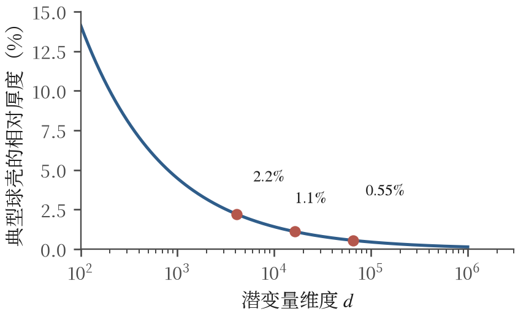
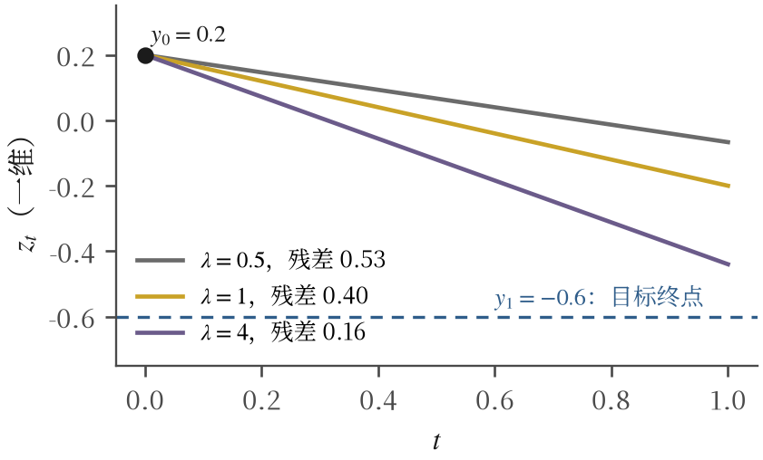

# 流模型的反演

流模型的 ODE 是确定性的，理论上可以精确反演：把速度取负，从 $t=0$ 积到 $t=1$。但“数值上能反”不等于“反演出的噪声合理”。这一章讲这个差别，以及用控制去弥补的办法。

## 直接反演的两个问题

第一个是数值误差。ODE 求解器的离散化误差会累积，步数少时更明显。这和第 4 章的漂移是同一类问题，可以用高阶求解器缓解。

### 误差从哪里来

显式 Euler 一步是 $z_{n+1}=z_n+h\,u_{t_n}(z_n)$，$h=1/N$，局部截断误差约 $\frac{h^2}{2}\|\dot u\|$，$\dot u$ 是速度沿轨迹的全导数。取 $N=50$、$\|\dot u\|$ 在 $10$ 的量级（归一化到单位方差的潜变量上，噪声端的场变化确实快），每步误差约 $2\times10^{-3}$，五十步朴素累积到 $10^{-1}$；相对图像的动态范围，这是百分之十的偏差。这是量级估计，没有算 Jacobian 的放大，真实误差只会更大。

噪声端更糟。接近 $t=1$ 时场要把最后一点结构消散掉，幅度与变化率同时变大；把步距均匀摊在 $[0,1]$ 上，分辨率在最需要的地方最不够。

有一个能算清的例子是直线场 $u(z,t)=(y_1-z)/(1-t)$，它的真解就是直线。Euler 迭代给出

$$w_{k+1}=w_k\Big(1-\frac{h}{1-t_k}\Big),$$

放大因子在 $1-t_k<h$ 时变成负数，轨迹开始绕着直线振荡。$h=1/50$ 时，最后一步的 $1-t$ 正好与 $h$ 同量级，一脚踩到边界。实现上要么积分到 $1-\epsilon$（$\epsilon$ 取 $10^{-2}$ 量级）再用解析式收尾，要么在末端把步长缩一半。

二阶方法（Heun、中点）把局部误差降到 $O(h^3)$，每步两次前向。同样两次前向的预算下，$N$ 步 Heun 的精度大致相当于 $2N$ 步 Euler，这是经验说法，取决于场的平滑程度。流模型的场由网络给出，光滑性有限，提阶的收益不如在扩散模型上明显。

这里说的“反演”不是把场取负再向前积，而是同一个场沿 $t$ 增大的方向积分。把场取负、从 $t=1$ 积到 $0$，那是生成。两个方向用的是同一个 $u_t$，所以 ODE 的可逆性完全依赖于同一个场在两个方向上的一致性：一旦某一步的数值误差让轨迹偏离了真实轨迹，后面就没有东西把它拉回来。

第二个更根本。假设源图 $x_{\text{src}}$ 是一张不典型的图，真实照片往往如此，它的反演结果 $z_1$ 也会不典型：不在标准高斯的典型集合里。从 $z_1$ 出发、用目标条件去噪，得到的不一定是目标分布中的典型样本。

换句话说，反演能找到“能重建原图的噪声”，但这个噪声可能离先验很远。编辑时，模型会同时被“重建”和“去噪”两个目标拉扯。

### 典型性：一个能算的判据

标准高斯的范数平方服从 $\chi^2_d$，均值 $d$、标准差 $\sqrt{2d}$，所以范数的相对涨落是 $\sqrt{2/d}$：

$$\frac{\|z\|-\sqrt d}{\sqrt d}\approx\frac{1}{\sqrt{2d}}\quad(\text{相对标准差}).$$

$d=4\times64\times64=16384$ 时，$\|z\|\approx128\pm1.4$，相对涨落 $1.1\%$；$d=4\times128\times128=65536$ 时降到 $0.55\%$。维度越高，典型集合越薄，几乎所有样本都贴在一层薄壳上。



含义很具体：模型训练时见到的噪声几乎都在薄壳里。反演若给出 $\|z_1\|$ 偏离 $5\%$（128 里的 6 个），它已经在壳外，从那里出发的任何一步都是外推。

范数只是粗判据。真实图像落在高维空间的低维流形附近，传输映射把这个流形送到噪声空间里一张弯曲的薄片上；反演沿场回到这张薄片，得到的噪声方向分布与各向同性不同。范数可以正常，方向仍然偏。这就是为什么“检查范数”只能抓到一部分不典型。

真实照片还比合成图更难反演。照片里的传感器噪声、压缩伪影、失焦都落在“模型没学过”的方向上，这些细节在编码后仍然存在，反演时必须用额外的高频噪声去解释它们，终点因此偏离壳内。同一套参数在干净渲染图上能重建得很好，换到手机拍的室内照片就崩，原因常在这里。

### 两条误差的叠加

把两类误差分开记：$\delta_{\text{num}}$ 来自离散化，随步数下降；$\delta_{\text{typ}}$ 来自源图不典型，与步数无关。它们对结果的影响不同。$\delta_{\text{num}}$ 是“终点位置偏了一点”，轨迹仍在模型认为合理的区域里，采样回来是一张与源图略有差异的图；$\delta_{\text{typ}}$ 是“终点位置没错，但那里不该有样本”，采样回来是一张差异很大的图，甚至语义都变了。

判别办法很直接：把步数从 20 加到 100，误差若明显下降，主因是 $\delta_{\text{num}}$；若几乎不动，主因是 $\delta_{\text{typ}}$，加步数没有意义，该动的是 $\gamma$ 与注入噪声。这个二分法比笼统地说“反演不准”有用，因为它指出了该调哪个旋钮；数值误差占优时换求解器有救，典型性误差占优时换求解器是白花时间。

### 编辑时的拉扯

把目标写成条件打分，拉扯就看得见了：

$$\nabla\log p_t(z\mid y)=\nabla\log p_t(z)+\nabla\log p_t(y\mid z).$$

前一项要把 $z$ 拉回高密度区，也就是拉向“像一张图”的地方；后一项要求保留 $y$ 指定的内容。$z_1$ 离典型集越远，前一项的拉力越大，轨迹越容易在中途把源图的结构改掉；反过来把条件强度调大，轨迹被钉在源结构上，编辑又改不动。

一个可操作的判据：把反演得到的 $z_1$ 用源条件采样回来，与原图比。差得少，说明这个噪声确实是“这张图的”噪声，编辑有基础；差得多，说明 $z_1$ 已经在壳外，先别谈编辑，先把反演调好——减步长、用二阶求解器、或加大 $\gamma$ 与注入噪声。

## 把反演写成控制问题

一个自然的想法是：既要重建，又要终点典型。把它写成一个带终端代价的最优控制问题

$$V(c) = \int_0^1 \frac12\|c(Z_t,t)\|^2\,dt + \frac{\lambda}{2}\|Z_1 - Y_1\|^2,\qquad dZ_t = c(Z_t,t)\,dt,\quad Z_0 = y_0.$$

第一项惩罚控制的大小，希望轨迹自然；第二项惩罚终点偏离给定的噪声 $Y_1$，希望终点典型。这是一个线性二次调节器问题。

它的解有一个漂亮的形式：最优控制器正好是条件直线路径的速度

$$c^*(z_t,t) = \frac{y_1 - z_t}{1-t}.$$

也就是说，如果只考虑从 $y_0$ 到 $y_1$ 的直线传输，最优的控制就是沿着直线匀速推过去。

### 为什么动力学这样写

把速度当成可以直接指定的量，而不是“给一个漂移再叠加控制”，端点就只由控制的积分决定：

$$Z_1=y_0+\int_0^1 c(Z_t,t)\,dt .$$

问题退化成对函数的优化，能手算，不必去解 Riccati 方程。$\lambda$ 是两项的兑换率：$\lambda\to0$ 时只剩控制成本，最优是不动，$c\equiv0$，终点停在 $y_0$；$\lambda\to\infty$ 时终点被硬钉在 $y_1$，控制成本顾不上。

另有一条路是不写控制，直接对 $z_1$ 做梯度下降，最小化 $\|D(z_1)-x_{\text{src}}\|^2$。这条路不需要模型暴露速度场，但每次迭代要跑一整条采样链，几百步下去就不可接受。控制形式把“重建”变成一次前向积分，代价是必须先知道终点往哪里去。

### 解一：先固定终点

固定 $C=\int_0^1 c\,dt$，先用 Cauchy–Schwarz 处理控制项：

$$\Big\|\int_0^1 c\,dt\Big\|^2\le\int_0^1\|c\|^2\,dt,$$

等号当且仅当 $c$ 在时间上为常值。所以给定终点，最省能量的控制是常速，成本 $\|C\|^2$。把它代进目标：

$$J(C)=\frac12\|C\|^2+\frac{\lambda}{2}\|y_0+C-y_1\|^2 .$$

对 $C$ 求梯度置零，$C+\lambda(y_0+C-y_1)=0$，解出

$$C=\frac{\lambda}{1+\lambda}(y_1-y_0).$$

轨迹是 $z_t=y_0+tC$，终点残差

$$\|Z_1-y_1\|=\frac{1}{1+\lambda}\|y_1-y_0\| .$$

$\lambda\to\infty$ 时 $C\to y_1-y_0$，轨迹变成直线 $z_t=y_0+t(y_1-y_0)$。在这条直线上 $y_1-z_t=(1-t)(y_1-y_0)$，所以 $c^*=(y_1-z_t)/(1-t)$——开头那个式子是从这里来的。

有限 $\lambda$ 也有反馈形式。由 $z_t=y_0+tC$ 得 $y_1-z_t=(y_1-y_0)\big(1-t\lambda/(1+\lambda)\big)$，代回 $C$：

$$c^*(z_t,t)=\frac{\lambda}{1+\lambda-\lambda t}(y_1-z_t).$$

$t=0$ 处它退化为 $\frac{\lambda}{1+\lambda}(y_1-y_0)$，与上面的 $C$ 一致；$\lambda\to\infty$ 时退化为 $(y_1-z_t)/(1-t)$。

### 解二：值函数

同一个问题可以写成 Hamilton–Jacobi–Bellman 方程：

$$-\partial_t V(z,t)=\min_{c}\Big\{c^\top\nabla V(z,t)+\frac12\|c\|^2\Big\},\qquad V(z,1)=\frac{\lambda}{2}\|z-y_1\|^2 .$$

内层对 $c$ 求导得 $c^*=-\nabla V$，代回得 $-\partial_t V=-\frac12\|\nabla V\|^2$。猜二次形式 $V(z,t)=\frac12 a(t)\|z-y_1\|^2$，则 $\nabla V=a(z-y_1)$，

$$-\frac12 a'\|z-y_1\|^2=-\frac12 a^2\|z-y_1\|^2\quad\Longrightarrow\quad a'=a^2,\quad a(1)=\lambda .$$

解这个初值问题，$1/a=1/\lambda+(1-t)$，即

$$a(t)=\frac{\lambda}{1+\lambda(1-t)},\qquad c^*(z,t)=a(t)(y_1-z).$$

$t\to1$ 时 $a\to\lambda$；$\lambda\to\infty$ 时 $a\to1/(1-t)$，与解一相同。两种解法分工不同：解一给轨迹，解二给反馈律与剩余代价。$V$ 回答“从这里走到 $y_1$ 还要花多少控制能量”，$a(t)$ 随 $t$ 递增，越接近终点，同样的偏差越贵。

### 终端代价与终端约束

把终点写成惩罚项而不是硬约束，不只是为了让式子好看。硬约束要求解一个两点边值问题，$c^*$ 里会出现 $1/(1-t)$ 的奇点，离散化时末端容易炸；软约束把奇点换成 $1/(1+\lambda(1-t))$，$\lambda$ 有限时最优控制在整个区间上都有界，数值上稳得多。

两个极限也值得记住：$\lambda=0$ 时 $a\equiv0$，$c^*=0$，轨迹不动；$\lambda\to\infty$ 时 $a\to1/(1-t)$，回到直线场。所有中间的 $\lambda$ 都是这两者的插值，而 $\lambda$ 只影响“多快到达”，不影响“往哪里去”。

### 一个一维算例

取 $y_0=0.2$、$y_1=-0.6$，$y_1-y_0=-0.8$。$\lambda=1$ 时 $C=-0.4$，终点 $-0.2$，残差 $0.4$，正好是 $0.8/2$；控制成本 $\frac12(0.4)^2=0.08$，终端代价 $\frac12(0.4)^2=0.08$，两项相等。$\lambda=9$ 时 $C=-0.72$，终点 $-0.52$，残差 $0.08=0.8/10$，控制成本升到 $0.26$。$\lambda$ 越大总代价越高，因为它是兑换率，不是被最小化的对象。



## 受控 ODE

实际的反演要在两个目标之间插值。用一个参数 $\gamma$ 把模型自己的场与最优控制器混合

$$dY_t = \Big[u_t(Y_t) + \gamma\big(u_t(Y_t\mid y_1) - u_t(Y_t)\big)\Big]dt,\qquad \gamma\in[0,1].$$

$\gamma=0$ 时完全按模型走，能精确重建；$\gamma=1$ 时完全按控制走，终点严格服从先验，但内容与源图无关。


### γ 在插值什么

$\gamma=0$ 的场把 $y_0$ 送到模型认为合理的位置，终点由场决定；$\gamma=1$ 的场是直线场，终点严格是给定的 $y_1$，但沿途的 $z_t$ 不在训练分布里——它只保证端点，不保证路径。

中间的 $\gamma$ 是两个速度场的凸组合。这不等于“把两个终点平均一下”：ODE 的解对速度场是线性的，凸组合给出的是新的一条轨迹，它在每个 $t$ 的位置取决于沿途的线性化程度，不能由两条端点轨迹插值得到。$\gamma$ 从 $0$ 加到 $1$ 的过程中，终点不按 $(1-\gamma)y_1^{\text{model}}+\gamma y_1$ 移动，实测的移动是单调但非线性的。

### 终点从哪来

$c^*$ 里的 $y_1$ 正是反演要求的东西，这里有循环。三种处理方式：

两遍法。先用 $\gamma=0$ 跑一遍，把终点记作 $\hat y_1$；再以 $\hat y_1$ 当 $y_1$ 跑第二遍。轨迹被拉向第一遍的终点，代价翻倍，但结果稳定，$\gamma$ 也有了明确含义：它衡量“多相信第一遍算出来的终点”。

一遍法。每步把 $y_1$ 取成用当前场外推的终点 $z_t+(1-t)u_t(z_t)$，代进 $c^*$ 得 $c^*=u_t(z_t)$，受控场退回模型场本身。不知道终点时“预测”出一个终点，它与模型场是一回事，不产生新信息。这个恒等式能解释为什么有些实现里调 $\gamma$ 完全没有效果。

给定噪声。如果流程本来就要停在某个指定的噪声上（想复现一次特定的采样，或者想把两张图编辑到同一个噪声再混合），$y_1$ 是已知的，$c^*$ 直接可用，不必两遍。

### 偏离量里装着什么

把模型场与直线场的差记作

$$d_t(z)=u_t(z)-\frac{\hat y_1-z}{1-t},$$

受控场就是 $u_t+\gamma d_t$——$\gamma$ 给偏离量打折。这个写法把信息量摆明了：反演的全部内容都在 $d_t$ 里。$d_t\equiv0$ 时模型场就是直线场，反演退化为线性插值，一次网络前向都不需要；$d_t$ 越大，说明模型知道的越多，也越要小心地用它。

$\gamma$ 因此不是“强度旋钮”，而是对模型知识的不信任程度。源图典型、模型在它附近见过大量样本时，$d_t$ 可信，$\gamma$ 取小；源图罕见、$d_t$ 在低密度区里靠外推得来时，$\gamma$ 取大。

### 调度

$\gamma$ 随 $t$ 变比取常数好，理由在两段路的可靠性上。小 $t$ 处（数据端）模型场描述的是细节，直线场会把细节抹成匀速下滑；大 $t$ 处（噪声端）模型场在低密度区工作，方向不可靠，需要直线把它钉住。

一个可用的形状是 $\gamma(t)=\gamma_{\max}t^p$，$p=1$ 或 $2$，$\gamma_{\max}$ 取 $0.5$ 到 $0.8$（量级估计，随模型与步数变）。$p$ 越大，钉住的时段越靠后；反演是从 $t=0$ 走到 $1$，所以这个形状对应“靠近数据端松、靠近噪声端紧”。

### 离散实现

```text
输入: 源图 x_src，步数 N，调度 γ(t)，编解码器 (E, D)，速度场 u_θ
z  ← E(x_src)                      # t = 0
ŷ  ← 反演一遍(γ = 0)                # 只为拿到终点估计
for k = 0 … N-1:
    t ← k/N,  h ← 1/N
    u ← u_θ(z, t)                  # 一次模型前向
    c ← (ŷ - z) / max(1 - t, h)    # 直线场，末端截断防除零
    v ← u + γ(t)·(c - u)
    z ← z + h·v                    # Heun 则在 t+h 处再算一次 v 并取平均
输出: z，作为 t = 1 的结构化噪声
```

Two-pass 的写法把反演跑了两遍，所以总前向次数是 $2N$（或 Heun 的 $4N$）。

## 随机版本

受控 ODE 也可以写成 SDE。加一点噪声后，过程对初值不那么敏感，早期误差会被随机性冲淡。这是随机采样器的老经验，用在反演上同样成立。

### 把速度换算成漂移

线性插值 $z_t=(1-t)x_0+t\varepsilon$ 下，给定 $z$ 的后验均值满足两个恒等式。第一个是消元：$z=(1-t)\mathbb{E}[x_0\mid z]+t\,\mathbb{E}[\varepsilon\mid z]$，而 $u=\mathbb{E}[\varepsilon\mid z]-\mathbb{E}[x_0\mid z]$，两式联立消去 $\mathbb{E}[x_0\mid z]$，得

$$\mathbb{E}[\varepsilon\mid z]=z+(1-t)u_t(z).$$

第二个是高斯核的 Tweedie 恒等式，$\nabla\log p_t(z)=-\mathbb{E}[\varepsilon\mid z]/t$。两者合并：

$$\nabla\log p_t(z)=-\frac{z+(1-t)u_t(z)}{t}.$$

$t\to1$ 时右端趋于 $-z$，正是标准高斯的打分，可以当作检验。

与原 ODE 同边缘分布的 SDE 是

$$dZ_t=\Big[u_t(Z_t)+\frac{g_t^2}{2}\nabla\log p_t(Z_t)\Big]dt+g_t\,dW_t,$$

代入打分：

$$dZ_t=\Big[u_t(Z_t)-\frac{g_t^2}{2t}\big(Z_t+(1-t)u_t(Z_t)\big)\Big]dt+g_t\,dW_t .$$

这个写法的好处是只需要模型的速度场，不必另训一个打分网络。

### 随机性买到了什么

设反演早期留下偏差 $\delta$。在 ODE 里它按 Jacobian 传播，可能被放大也可能被压缩，但不会消失。加噪之后，每步注入方差 $g^2h$，到 $t=1$ 累积 $V=\int_0^1g_t^2\,dt$，终点里“随机成分”的幅度是 $\sqrt V$，早期偏差的相对重要性被稀释到 $\delta/\sqrt{1+V}$ 的量级。

取 $g=0.2$ 且全程注入，$V=0.04$，$\sqrt V=0.2$。终点潜变量的范数约 128（上一节算过），0.2 的扰动在范数上可以忽略；但分摊到每个像素是 0.2 倍标准差，足以让轨迹走另一条分支。随机性起作用的方式不是改变整体尺度，而是改变轨迹的分支。

代价落在重建上：终点里混进了随机成分，采样回来的图与原图在细节上不再一一对应。所以 $g$ 通常取小（$0.05$ 到 $0.3$ 是常见范围，量级估计），并且集中在中间时段注入——小 $t$ 处结构信息最密，加噪等于直接破坏内容；大 $t$ 处结构已经被场磨掉大半，加噪的代价最小。

### 为什么反演用 SDE、采样用 ODE

反演需要的是“对初值不敏感”：源图不典型、离散化有误差，这两样都希望被随机性冲淡。采样需要的是可复现、可逐步调参：同样的噪声给同样的图，改一个条件只影响该影响的部分，这些需要确定性。两边共用同一个速度场，只是用法不同，所以两段可以拼在一起而不用串两个模型。

两边各取所需，流程于是分成两段：随机地离开数据，确定地回到数据。两段不共用同一个动力学，反演得到的噪声与采样使用的场之间有细微不匹配，这个不匹配会以漂移的形式留在结果里。

### 噪声该加在哪一段

全程均匀注入并不是最好的选法。把 $\int g_t^2dt$ 看成预算，分配的原则有两条。一条是代价：噪声加在小 $t$（结构最密）处等于直接毁掉内容，加在 $t$ 接近 $1$ 处基本等于换一个噪声样本，后者便宜得多。另一条是时机：随机性只能稀释已有偏差的相对比重，不能把已经走歪的轨迹拉回来，所以注入要落在这场不稳定发生的那一段，也就是中间区间，而不是全堆到末端。

一个常见的做法是只在 $[t_1,1]$ 上注入，$t_1$ 取 $0.4$ 到 $0.6$（量级估计）。这样 $V$ 比全程注入小很多，同样能把轨迹推离不稳定区。

注入强度与步数要一起看。步数多时每步的漂移小，同样的 $g$ 不会把轨迹推得太远；步数少时一步走得长，噪声乘在更长的步上，总偏移反而大。换步数时把 $g$ 按 $1/\sqrt N$ 缩放，是一个够用的经验规则。

## 编辑怎么用

得到结构化噪声 $y_1$ 之后，用它作为初值，以目标条件去噪，得到编辑结果。

如果想控制改动强度，可以调整 $\gamma$ 的调度：$\gamma$ 大，噪声更典型，编辑更自由，保真更差；$\gamma$ 小，重建更准，改动更小。

### 流程

1. 步数取 20 到 50。少于 20，末端误差明显；多于 50，收益递减而时间线性增长。
2. 在源条件下反演，得到 $z_1$，用 $\gamma_{\text{inv}}$ 或两遍法。
3. 自检：用 $z_1$ 与源条件采样回 $t=0$，与原图比。这次“空编辑”的差就是整条流程的保真上限，后面的编辑不可能更好。
4. 换成目标条件，从 $z_1$ 积分到 $0$，用 $\gamma_{\text{edit}}$ 与 CFG 强度。
5. 迭代：改动不够就降 $\gamma_{\text{edit}}$、升 CFG；结构漂了就反向调。

### 改动强度从哪里来

能调改动幅度的旋钮有三个：$\gamma_{\text{edit}}$、CFG 强度、以及“只用目标条件跑前多少步”。它们不等价。CFG 放大的是“条件与无条件之差”，改动集中在条件指定、模型又有把握的区域；$\gamma_{\text{edit}}$ 拉的是整条轨迹的形状，改动是全局的、连背景一起动；只换前 $k$ 步则把改动限制在粗尺度上，$k$ 越小越只改大结构。

区分它们的方法是看背景：背景不动而主体变了，调的是 CFG；背景也变了，调的是 $\gamma$。

反演得到的噪声可以重复用。同一张源图想做多种编辑，反演只需跑一次，后面每个目标条件各采样一遍，代价从 $2N$ 降到 $N$ 加一次。这也是两遍法值得做的原因：反演那一半的开销可以摊到多次编辑上。

### 失败的样子

三种失败在流模型的反演里最常碰到，症状各不相同。背景整体位移或纹理变了，而主体只变了很少：反演那端的 $\gamma_{\text{inv}}$ 太小，或者步数太少，$z_1$ 里还留着一半结构，采样时模型把它当成要改的东西。改了半天几乎没有变化：$\gamma_{\text{edit}}$ 太大，或 $z_1$ 过分典型，目标条件的修正在噪声端被直线场抵掉了。语义碎了、物体多了或少了：$\delta_{\text{typ}}$ 太大，反演出的噪声本身不在模型能处理的区里，此时该降分辨率、换两遍法，而不是继续调强度。

三种症状分别指向三个不同的旋钮，分清楚比盲目调参省时间。还有一种看起来像失败、其实不是的情况：改动很小但就是发虚。那是反演本身已经在壳外，采样时模型把一部分力度花在“把不合理的东西拉回来”上，留给编辑的就不够了。

### 参数的作用方向

| 参数 | 调大 | 调小 | 常用范围 |
| --- | --- | --- | --- |
| 步数 $N$ | 末端误差小，耗时线性涨 | 噪声端欠采样 | 20 到 50 |
| $\gamma_{\text{inv}}$ | 终点更典型，编辑更自由，保真降 | 重建更准，噪声可能不典型 | 0 到 0.8 |
| $\gamma_{\text{edit}}$ | 更贴原噪声，改动更小 | 更听目标条件，容易漂 | 0 到 0.5 |
| 注入强度 $g$ | 抗初值误差，重建变松 | 重建准，误差易留 | 0.05 到 0.3 |

### 代价

反演一遍加采样一遍，等于 $2N$ 次前向，用 Heun 则 $4N$ 次。每步都是一次完整的网络前向，所以 30 步的编辑在十亿参数级的模型上要跑 60 次前向。有了反演这一半，编辑的力度可以连续调、可以精确回到原图，代价是时间翻倍。

### 跑一次要多久

512 分辨率的图，潜变量 $64\times64\times4$，$N=32$，两遍反演加一次采样，共 $96$ 次前向。单次前向在消费级显卡上取 $0.1$ 秒的量级，整条流程十秒上下；同规模的“不做反演、直接加噪到某个 $t_0$”的做法是三分之一的耗时，但背景只能大致保留。

步数降到 16，时间省一半，末端误差从不可见变成可见。原因在网格上：均匀网格的最后一个区间是 $t\in[1-h,1]$，而直线场的放大因子 $1-h/(1-t)$ 在 $1-t<h$ 时为负；均匀网格正好把最后一个点放在 $1-t=h$ 上，因子为零，再往外一步就变号。步数多少都会碰到这个边界，所以末端单独处理（积分到 $1-\epsilon$）比加步数有效。

## 与扩散反演的对照

两条路线都在求“数据到噪声”的逆映射，误差进入的通道不同。

扩散模型里，反演迭代要用调度系数把 $x_t$ 推回 $x_{t+1}$，每步误差按 $\alpha_{t+1}/\alpha_t$ 与 $\sigma_{t+1}-(\alpha_{t+1}/\alpha_t)\sigma_t$ 这两个系数传播，而它们在不同 $t$ 差别很大；反演相当于用一个不精确的逆去走一条被调度表固定了形状的路。流模型的 ODE 只有一个速度场，误差按 Jacobian 传播，没有调度表的除法，路径形状也由场自己决定。前者把“表的细节”也变成了误差源，后者更干净，但把责任全推给了场的光滑性。

两者共同的根源是同一个：确定性映射的逆在远离数据流形处不稳定。源图不典型，反演点落在低密度区，那里的 Jacobian 条件数大，任何小扰动都被放大。这是结构性的，换求解器、换调度只能改善量级，不能消除。

实践上的差别主要是经济性：流模型的场平滑一些，20 到 50 步就能反演到可用的程度；扩散模型的 DDIM 反演通常要 50 步以上，步数一少漂移就明显。这是量级上的差别，不是原理上的。

## 局限

这套方法要求模型暴露速度场。如果只有噪声预测，要先把噪声换算成速度，换算本身有误差。

### 换算是另一处误差

设 $z_t=\alpha_t x_0+\sigma_t\varepsilon$、$\alpha_t^2+\sigma_t^2=1$。模型若输出 $v=\alpha_t\varepsilon-\sigma_t x_0$，速度要由一次联立得到：$x_0=\alpha_t z_t-\sigma_t v$、$\varepsilon=\sigma_t z_t+\alpha_t v$，相减即

$$u_t=(\sigma_t-\alpha_t)z_t+(\alpha_t+\sigma_t)v .$$

$t=1$ 处 $\alpha=0,\sigma=1$，$u=z+v$，与“速度等于噪声减数据”一致。

模型若输出 $\varepsilon$，则 $x_0=(z_t-\sigma_t\varepsilon)/\alpha_t$，再代入 $u=\dot\alpha_tx_0+\dot\sigma_t\varepsilon$，分母上有 $\alpha_t$。$\alpha_t\to0$ 的时段正好是噪声端，换算误差被 $1/\alpha_t$ 放大，反演最不可靠的地方恰是换算最不可靠的地方。这与“末端步长要缩”是同一片区域的两个问题，实践中都是把末端单独处理：少走几步，或者用解析式收尾。

### 分辨率与分块

典型的厚度随维度下降，这一条直接决定了反演在不同分辨率上的难度。同样的模型，$512$ 分辨率上能用的 $\gamma$，到 $1024$ 上往往偏小，因为潜变量维度大了四倍，典型壳的厚度从 $1.1\%$ 降到 $0.55\%$，反演终点更容易落在壳外。高分辨率编辑遇到“怎么调都在变背景”，先看看是不是这个原因。

分块生成会在这个基础上再加一层麻烦：各块独立反演，块与块之间的噪声不相关，拼接处的场不连续，出来的接缝比 inpaint 的接缝更硬。缓解办法是分块重叠加大，并在重叠带上对潜变量做加权平均；代价是计算量。

参数 $\gamma$ 的调度需要按模型调。论文里给的默认值在某个模型上有效，换一个模型往往要重调，因为 $\gamma$ 的合适取值取决于模型场与直线场差多远，而这与训练数据、分辨率、步数都有关。

最后，它仍然是反演类方法：需要把源图送到噪声空间再送回来，中间任何一步不准，误差都会留在结果里。下一章讲的方法干脆不做这一步。