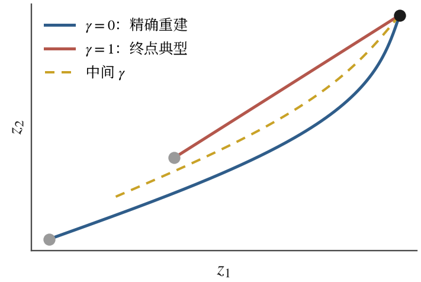

# 流模型的反演

流模型的 ODE 是确定性的，理论上可以精确反演：把速度取负，从 $t=0$ 积到 $t=1$。但"数值上能反"不等于"反演出的噪声合理"。这一章讲这个差别，以及用控制去弥补的办法。

## 直接反演的两个问题

第一个是数值误差。ODE 求解器的离散化误差会累积，步数少时更明显。这和第 4 章的漂移是同一类问题，可以用高阶求解器缓解。

第二个更根本。假设源图 $x_{\text{src}}$ 是一张不典型的图，真实照片往往如此，它的反演结果 $z_1$ 也会不典型：不在标准高斯的典型集合里。从 $z_1$ 出发、用目标条件去噪，得到的不一定是目标分布中的典型样本。

换句话说，反演能找到"能重建原图的噪声"，但这个噪声可能离先验很远。编辑时，模型会同时被"重建"和"去噪"两个目标拉扯。

## 把反演写成控制问题

一个自然的想法是：既要重建，又要终点典型。把它写成一个带终端代价的最优控制问题

$$V(c) = \int_0^1 \frac12\|c(Z_t,t)\|^2\,dt + \frac{\lambda}{2}\|Z_1 - Y_1\|^2,\qquad dZ_t = c(Z_t,t)\,dt,\quad Z_0 = y_0.$$

第一项惩罚控制的大小，希望轨迹自然；第二项惩罚终点偏离给定的噪声 $Y_1$，希望终点典型。这是一个线性二次调节器问题。

它的解有一个漂亮的形式：最优控制器正好是条件直线路径的速度

$$c^*(z_t,t) = \frac{y_1 - z_t}{1-t}.$$

也就是说，如果只考虑从 $y_0$ 到 $y_1$ 的直线传输，最优的控制就是沿着直线匀速推过去。

## 受控 ODE

实际的反演要在两个目标之间插值。用一个参数 $\gamma$ 把模型自己的场与最优控制器混合

$$dY_t = \Big[u_t(Y_t) + \gamma\big(u_t(Y_t\mid y_1) - u_t(Y_t)\big)\Big]dt,\qquad \gamma\in[0,1].$$

$\gamma=0$ 时完全按模型走，能精确重建；$\gamma=1$ 时完全按控制走，终点严格服从先验，但内容与源图无关。

实践中让 $\gamma$ 随 $t$ 变化：前期大，把轨迹拉向典型区域；后期小，保证终点落在 $y_0$ 上。

## 随机版本

受控 ODE 也可以写成 SDE。加一点噪声后，过程对初值不那么敏感，早期误差会被随机性冲淡。这是随机采样器的老经验，用在反演上同样成立。

代价是随机性会让重建不那么精确。所以常见的做法是：反演用 SDE，采样用 ODE，两边各取所需。

## 编辑怎么用

得到结构化噪声 $y_1$ 之后，用它作为初值，以目标条件去噪，得到编辑结果。

如果想控制改动强度，可以调整 $\gamma$ 的调度：$\gamma$ 大，噪声更典型，编辑更自由，保真更差；$\gamma$ 小，重建更准，改动更小。

## 局限

这套方法要求模型暴露速度场。如果只有噪声预测，要先把噪声换算成速度，换算本身有误差。

参数 $\gamma$ 的调度需要按模型调。论文里给的默认值在某个模型上有效，换一个模型往往要重调。

最后，它仍然是反演类方法：需要把源图送到噪声空间再送回来，中间任何一步不准，误差都会留在结果里。下一章讲的方法干脆不做这一步。
