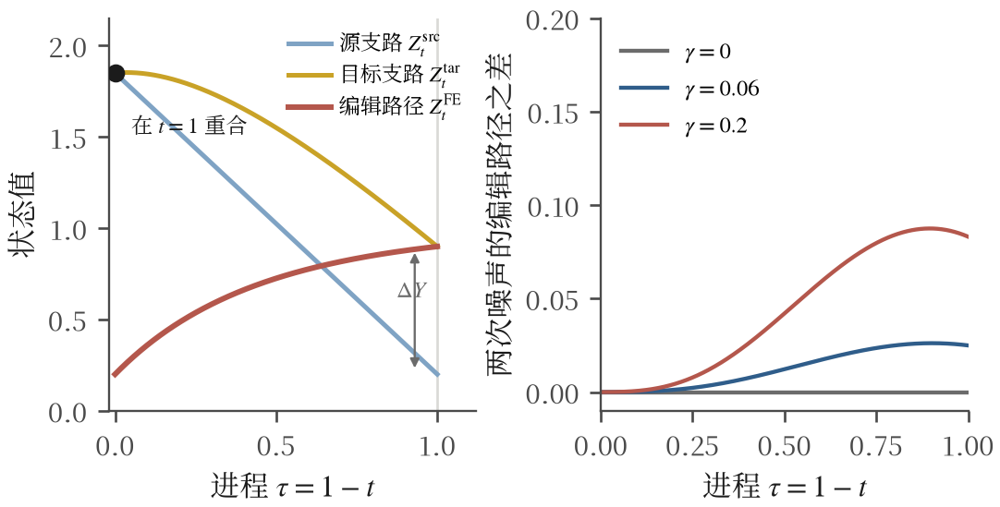
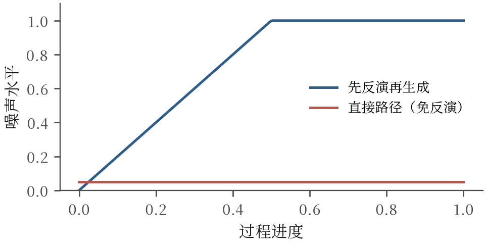
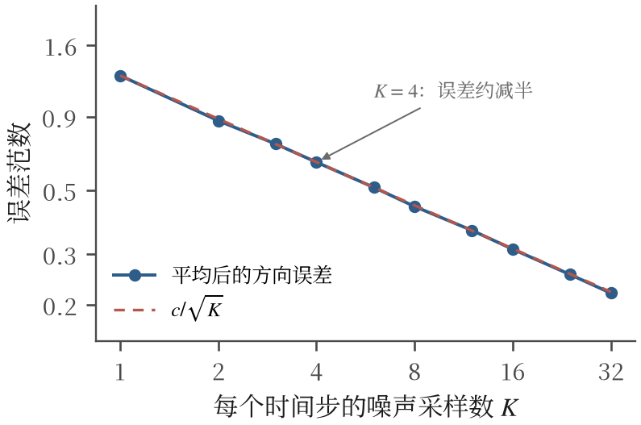

# 免反演：FlowEdit

反演会引入误差，那就不要反演。FlowEdit 的出发点是：构造一条从源图直接走到目标图的路径，全程不经过噪声。

要把这句话变成算法，得先回答两个问题。没有噪声就没有“时刻”——流的场按噪声水平编排，每一次查询都要给出 $t$，而编辑路径上的点不是加噪得到的，$t$ 从哪里来。方向又由谁给——目标图未知，手里只有目标条件，方向必须从模型里读出来。

这两个问题 FlowEdit 一起解决：给源图单独拉一条加噪支路，用它提供“每个噪声水平下源图长什么样”，当作时刻的标尺；再把目标条件与源条件的场在这根标尺上相减，读出一个方向。编辑路径自己始终待在低噪声那一侧，被这个方向推着走。

## 构造

准备两条并行的路径。源路径是从源图出发、逐步加噪的直线

$$Z_t^{\text{src}} = (1-t)x_{\text{src}} + tN_t,$$

$N_t$ 是随机噪声，$t=1$ 时这条路径到达噪声。注意它不是采样轨迹，只是一个“提供不同噪声水平下的源图”的辅助过程。

### 源支路是一根标尺

这条式子每一维都是 $x_{\text{src}}$ 与噪声之间的线性插值，$t$ 只是插值系数。把 $t$ 从 0 扫到 1，$Z_t^{\text{src}}$ 就画出从干净图到纯噪声的一族点。流匹配训练时的直线路径造的正是这种插值，所以在任意 $t$ 上查询，输入都落在模型见过的区域里。换一种缩放方式（比如按余弦日程加权）也能用，前提是与模型训练时一致；不一致的话，查询点落在训练分布之外，场会外推出古怪的值。

有一处容易混淆：$N_t$ 在不同 $t$ 上是各自独立采样的，因此 $Z_t^{\text{src}}$ 对 $t$ 不可导。这条支路没有切线，也没有速度，“沿支路求导”没有意义，只有“在某个时刻取一个点去查询”有意义。后面所有关于 $\Delta t$ 的写法，都是对编辑路径做的差分离散，而不是对支路求导。

### 目标支路

目标路径定义为

$$Z_t^{\text{tar}} = Z_t^{\text{FE}} + Z_t^{\text{src}} - x_{\text{src}},$$

其中 $Z_t^{\text{FE}}$ 是要积分的编辑路径，从 $x_{\text{src}}$ 出发。把偏移记作

$$D_t = Z_t^{\text{src}} - x_{\text{src}} = t\,(N_t - x_{\text{src}}),$$

于是 $Z_t^{\text{tar}} = Z_t^{\text{FE}} + D_t$。这个偏移有三条性质，都能一眼读出。

$t=0$ 时 $D_0 = 0$，两条支路在 $x_{\text{src}}$ 处重合，编辑还没有开始。$t=1$ 时 $D_1 = N_1 - x_{\text{src}}$，偏移最大，目标支路被推到“源噪声”那一端。偏移随 $t$ 线性增长，斜率是 $N_t - x_{\text{src}}$，也就是源支路自己的位移方向。

减掉 $x_{\text{src}}$ 这一步是必须的。若直接把 $Z_t^{\text{src}}$ 当偏移加在编辑路径上，$t=0$ 时目标支路会落在 $2x_{\text{src}}$ 附近，两条支路的起点就错开了；减掉之后，偏移在起点归零，两支路同起。

还有一层。$N_t$ 零均值时 $E[D_t] = -t\,x_{\text{src}} \ne 0$，偏移有一个指向原点的系统分量。有的写法把源支路换成 $x_{\text{src}} + tN_t$，偏移就退化成 $tN_t$，均值回到零。两种写法相差一个不随 $N_t$ 变化的常数 $-t\,x_{\text{src}}$。这个差别只影响查询点落在哪里，不影响方向本身——下面的一阶相消与偏移的具体取值无关。

### 噪声相消的代数

每一步的方向是两条路径上速度之差

$$V_t^{\Delta} = V^{\text{tar}}\big(Z_t^{\text{tar}},t\big) - V^{\text{src}}\big(Z_t^{\text{src}},t\big),$$

两个场都带条件，$V^{\text{tar}}$ 用目标条件，$V^{\text{src}}$ 用源条件。要看清噪声如何被消掉，在同一个点 $z_0 = Z_t^{\text{src}}$ 附近把两个场都做一阶展开

$$\begin{aligned}
V^{\text{tar}}(z,t) &\approx a_{\text{tar}}(t) + M(t)\,\big(z - Z_t^{\text{src}}\big),\\
V^{\text{src}}(z,t) &\approx a_{\text{src}}(t) + M(t)\,\big(z - Z_t^{\text{src}}\big),
\end{aligned}$$

$a_c(t) = V(z_0,t,c)$ 是两个条件在同一查询点的输出，$M(t) = \partial_z V$ 是场的雅可比。两个展开共用一个 $M$，理由是两个查询处在同一时刻、同一个展开点，只是条件不同；条件改的是场的取值，不是场对输入的响应方式。这在 $z_0$ 附近是合理的近似，误差是 $O(\|z-z_0\|^2)$。

把 $z = Z_t^{\text{tar}}$ 代入第一式，$z = Z_t^{\text{src}}$ 代入第二式，相减

$$V_t^{\Delta} \approx \big(a_{\text{tar}} - a_{\text{src}}\big) + M\big(Z_t^{\text{tar}} - Z_t^{\text{src}}\big) = \big(a_{\text{tar}} - a_{\text{src}}\big) + M\big(Z_t^{\text{FE}} - x_{\text{src}}\big).$$

最后一等号用了 $Z_t^{\text{tar}} - Z_t^{\text{src}} = Z_t^{\text{FE}} - x_{\text{src}}$，这个差可以从前面的定义直接算出来，与 $t$、与 $N_t$ 都无关。结果是：$N_t$ 在 $V_t^{\Delta}$ 里完全消失了。方向的线性部分只取决于两个条件之间的差，以及编辑路径已经离开源图多远。

这就是“共享同一份噪声”的全部作用。两次查询的展开点因为带有同一份噪声而重合，场的线性响应 $M$ 于是在相减时抵消；剩下的是条件差带来的常数项，和编辑进度带来的线性项。若两次查询用不同的噪声实现，两个展开点相差一个随 $t$ 增长的量，$M$ 的两份消不掉，残差落到一阶，方向被噪声主导。

相消只到一阶。残差来自场的曲率，量级是 $O(\|\Delta z\|^2)$，$\Delta z$ 是两个查询点相对展开点的位移。两份位移都在起作用：$t$ 大时偏移 $D_t$ 大，查询点被推到远离数据的噪声区，那里的场在大尺度上平缓、在局部却极不稳定；编辑推进之后，两个查询点之间的间距 $Y_t$ 变大，差值里混进了更多空间变化。噪声依赖正是从这里进来的：不同的 $N_t$ 把查询点放到曲率不同的位置，读出的方向跟着变。这就解释了两件事：为什么编辑路径在 $t$ 大的阶段最“吵”，为什么需要对多个噪声取平均——平均压的正是这部分残差。

代数还可以换一个几何读法。$Z_t^{\text{tar}} - Z_t^{\text{src}} = Z_t^{\text{FE}} - x_{\text{src}}$ 说明两条支路的间距恰好等于编辑已经走了多远：噪声只会把两条支路一起平移，改不了间距。间距小的时候（起步阶段）两个查询几乎重合，$V_t^{\Delta}$ 接近“同一点上两个条件之差”；间距大的时候，场在两个不同的点上被采样，差里混进了空间变化。这给下面的粗到细埋了一个伏笔。

图 7.1 的左栏是一维算例，把过程切成 $\tau = 1-t$ 看。取 $x_{\text{src}} = 0.2$、$\mu_{\text{src}} = 0$、$\mu_{\text{tar}} = 0.9$，场取 $V(z,t,c) = (1+t)(z - \mu_c)$，这是一维的线性条件场，采样时把 $z$ 拉向条件均值。噪声实现取 $N = 1.85$。源支路从 $1.85$ 线性降到 $0.2$，编辑路径从 $0.2$ 爬到 $0.9$，目标支路从 $1.85$ 降到 $0.9$。三条曲线的形状说明一件事：编辑路径的取值全程落在 $[0.2, 0.9]$，而两条支路要走到 $1.85$，噪声那一大段行程与编辑无关。

这个算例还能给出闭式解。记 $Y_t = Z_t^{\text{FE}} - x_{\text{src}}$，一阶相消后有 $V_t^{\Delta} = (1+t)(Y_t - 0.9)$，更新式给

$$\frac{dY}{d\tau} = (1+t)\,\big(0.9 - Y\big) = (2-\tau)\big(0.9 - Y\big),$$

初始 $Y(0) = 0$。解为

$$Y(\tau) = 0.9\Big(1 - e^{-2\tau + \tau^2/2}\Big),$$

终点 $\tau = 1$ 时 $Y = 0.9(1-e^{-1.5}) \approx 0.70$，即编辑只走完了条件位移的 $78\%$。这个“走不满”不是实现缺陷，而是一阶差场在有限时间内积分的一般现象：越接近终点，$Y$ 越靠近 $0.9$，驱动力越小，末端趋近是几何式的。

右栏检验相消的精度。给场加上一项 $\gamma\sin(1.7z)$ 的非线性，用两份不同的噪声各跑一遍，画两条编辑路径之差。$\gamma = 0$ 时差恒为零，与代数一致；$\gamma = 0.06$ 时差值在终点约 $0.02$；$\gamma = 0.2$ 时峰值约 $0.09$，与 $\gamma$ 近似成正比。两条曲线都在中后段抬升，之后在平台附近徘徊：那里两个查询点离展开点最远，曲率的作用最强，而 $Y_t$ 已接近饱和，位移不再明显增长。真实模型的场远比线性项弯曲，同样的机制在图像上表现为可见的差异，多噪声平均才变得必要。

### 与 CFG 的差场有什么不同

无分类器引导也用“两个场的差”，形式上是 $V^{\text{cond}} - V^{\varnothing}$，把有条件的场与无条件场的差放大，用来加强模型对同一个条件的响应。FlowEdit 的差是 $V^{\text{tar}} - V^{\text{src}}$，两个场都带条件，没有一边是“无”。

区别在于差的使用方式。CFG 的差是梯度方向，放大系数作用在同一条方向的长度上，不改方向本身；它做的事是“沿条件指定的方向走得更远”。FlowEdit 的差是一个位移场，直接当速度用，作用是“把这个样本从源条件的解释搬到目标条件的解释”。一个调强度，一个调内容。

两件事可以叠加。先算差场、再对它做引导放大，等于“搬得远一点再搬”：语义上更接近目标条件，结构上更不稳定。实际会把引导系数压得比纯生成时低，因为差场本身已经带了一份条件对比。

### 从方向到一步更新

$$Z_{t-\Delta t}^{\text{FE}} = Z_t^{\text{FE}} - \Delta t\,V_t^{\Delta}.$$

减号来自积分方向。$t$ 从 1 减到 0，把 $t$ 当作时间轴，走一步就是往回走 $\Delta t$，位移是 $-\Delta t$ 乘速度。若把式中的 $\Delta t$ 记成负数，减号就要换成加号，两种写法等价，混用是常见的符号错误来源。

取 $N$ 步、步长 $\Delta t = 1/N$，从 $t=1$、$Z_1^{\text{FE}} = x_{\text{src}}$ 出发，积分到 $t=0$ 得到编辑结果。每步 $K$ 个噪声实现，每个实现要在两个条件上各查一次模型，成本是每步 $2K$ 次条件求值、整条路径 $2KN$ 次。两个条件的查询可以合成一个批次，所以显存占用约等于一次前向的两倍，而计算时间大致也是两倍——与“再跑一次反演”相比，这个开销是可控的。

粗到细的顺序不是额外加的规则，而是更新式自己长出来的。$t$ 大时两条支路的噪声都很强，查询点被噪声淹没，场在这种输入上只能返回与条件相关的大尺度结构；$V_t^{\Delta}$ 于是携带条件之间的语义差，幅值大、空间上低频。$t$ 降下来，噪声退去，细节逐步进入场，$V_t^{\Delta}$ 变成小幅值的高频修正。用一句话概括：这条路径的每一段都在处理当前噪声水平下唯一能看见的那一层信息。

## 为什么这样能保结构

关键在于两条支路共享同一份噪声 $N_t$。

$Z_t^{\text{tar}}$ 可以改写成

$$Z_t^{\text{tar}} = Z_t^{\text{FE}} + Z_t^{\text{src}} - x_{\text{src}} = Z_t^{\text{FE}} + t\,(N_t - x_{\text{src}}).$$

也就是说，目标支路就是“编辑路径 + 源支路自己的加噪位移”。位移里的 $N_t$ 与源支路用的是同一份，两条支路被同一份噪声一起平移；相减时这部分平移一并消掉，剩下的只是干净图之间的差。若把源支路改成 $x_{\text{src}} + tN_t$，位移就写成 $tN_t$，噪声成分相同，结论一样。

结果 $V_t^{\Delta}$ 近似是一个无噪的方向。用它更新 $Z_t^{\text{FE}}$，整条编辑路径全程接近无噪。

这也解释了编辑的粗细顺序。$t$ 大时，两条支路的噪声都很强，$V_t^{\Delta}$ 主要反映粗结构的差异；$t$ 变小时，噪声减弱，细节逐渐显现。整条路径是粗到细的。

保结构的另一面是“少动”。编辑路径在状态空间里走的距离，等于最终位移 $\|x_{\text{tar}} - x_{\text{src}}\|$ 加上沿途的摆动；而反演方法要先走到噪声再走回来，路径里必然包含 $\|N - x_{\text{src}}\|$ 这一大段。同样一幅 $1024\times1024$ 的图，源图与编辑结果的差别可能只占几个百分点，而源图到噪声的距离与图像本身的尺度同量级。走完一大段与编辑无关的行程，结构就有机会在中途被模型“改写”，这是反演类方法掉结构的直接原因。

高噪声段还有一个隐性的好处。编辑发生在 $t$ 从 1 降到 0 的过程中，但真正决定布局的步集中在 $t$ 接近 1 的少数几步里：那时场对条件最敏感，一点条件差异就被放大成全局的布局差异。等 $t$ 降到 0.3 以下，场几乎只关心纹理与边缘，位置关系已经定死，改动被限制在像素级。这种“先定大局、后补细节”的分配，与图像本身的信息层次是对应的。

## 为什么要对多个噪声取平均

单次实现的 $V_t^{\Delta}$ 方差很大，因为 $N_t$ 是随机的。FlowEdit 在每个时间步采样多个 $N_t$，把对应的方向平均，再走一步。

平均的作用是降方差。这和“多采样几个噪声估计梯度”是同一个道理，代价是每步的计算量乘以采样数。

### 方差的算术

把第 $k$ 次实现的方向记作 $V_t^{\Delta,(k)}$，平均方向是

$$\bar{V}_t^{\Delta} = \frac{1}{K}\sum_{k=1}^{K} V_t^{\Delta,(k)}.$$

若各次实现独立、每一维的方差为 $\sigma^2$，平均后每一维的方差是 $\sigma^2/K$，标准差是 $\sigma/\sqrt{K}$。误差的范数也跟着按 $1/\sqrt{K}$ 收缩，二维时 $\mathbb{E}\|\bar{V}\| \approx \sigma\sqrt{\pi/(2K)}$，$d$ 维时是 $\sigma\sqrt{2d/(\pi K)}$ 的量级。要把方向误差减半，$K$ 得乘四；把误差压到十分之一，$K$ 得乘一百。这条曲线很平，所以实际做法是取一个够用的 $K$，不再往上堆。

图 7.3 是二维蒙特卡洛的结果：每步方向取“真实方向 + 单位高斯噪声”，重复六千次试验，统计平均后误差范数的均值。散点与 $c/\sqrt{K}$ 的参考线重合，说明在这个设置下方向误差的随机部分确实按平方根律收缩。

降方差只作用于随机部分。条件差带来的偏差不随 $K$ 变：若模型的场对目标条件的响应已经饱和，或者两个条件在语义上纠缠（比如“换成水彩画”与“保持构图”互相拉扯），平均一万次也还是那个方向。这一点在后面讲局限时还要用到。

### 每一步都重采样

一个容易被忽略的细节是 $N_t$ 在每一步重新采：第 $k$ 次实现不是“一条噪声走完全程”，而是每一步换一组噪声。两种做法都叫“多采样”，效果不同。

整条路径用一组固定噪声，随机性只体现在起点上，路径之间的差异来自初值；每步重采样，则每个时间步的方向都在不同的噪声背景上评估，平均压的是“当前这一步的条件响应在不同背景下的波动”。后者的方差下降更快，因为相邻两步之间的噪声不相关，平均不会引入相关性带来的抵消。

代价是每步重采样让路径本身带一点随机跳动：同一条轨迹的两个相邻步用的是两份不同的噪声，若 $\gamma$ 项不小，接缝处会有微小的不连续。步数多、步长小的时候这点跳动被摊薄，看不出来；步数少的时候它和离散误差混在一起，很难分开。

### 平均的次数与总成本

总成本是 $2KN$ 次条件求值。$N=28$、$K=1$ 时是 56 次，$K=4$ 时是 224 次。图像生成的单次前向在消费级显卡上通常要几十到上百毫秒，224 次要十几到二十几秒，比“反演 + 生成”两边加起来还慢。所以 $K$ 的选择是精度与时间的直接交换，不是越大越好。

经验上的取值：$K=1$ 适合草稿，接口先看方向对不对；$K=2$ 是默认，误差已降三成；$K=4$ 用在需要结构稳定的场合，比如要批量输出同一编辑的多个变体。再往上加，收益与时间不成比例。

## 与反演方法的关系

把 FlowEdit 的更新式与“先反演再生成”对照，会发现两者在数学上可以互相变形：反演方法相当于把源路径固定成“先走到噪声再走回来”，因此路径必然经过 $t=1$；FlowEdit 让源路径只作参考，编辑路径自己保持在低噪声区域。

前者的传输代价更大，因为它绕了远路；后者更短，所以结构保持更好。这个解释与最优传输的直觉一致：路径越短，改动越少。

### 一维的传输代价

“绕远路”可以算出来。取一维例子：$x_{\text{src}} = 1.0$，$x_{\text{tar}} = 1.2$，抽到的噪声 $N = -2.0$。反演要从 $1.0$ 升到 $-2.0$，再降回 $1.2$；免反演只需要从 $1.0$ 走到 $1.2$。

用积分动能 $\int_0^1 \|u_t\|^2\,dt$ 度量路径代价，匀速直线走的能量就是位移的平方。反演的两段分别贡献 $3.0^2 = 9.0$ 与 $3.2^2 \approx 10.2$，合计 $19.2$；直接路径贡献 $0.2^2 = 0.04$。相差约 $480$ 倍。

| 路线 | 一维行程 | 动能 $\int_0^1\|u_t\|^2\,dt$ |
| --- | --- | --- |
| 先反演再生成 | $1.0 \to -2.0 \to 1.2$ | $9.0 + 10.2 = 19.2$ |
| 免反演直接编辑 | $1.0 \to 1.2$ | $0.04$ |

推到 $d$ 维，量级关系不变。各维单位方差时，源图到噪声的距离平方期望是 $2d$，走一个来回约 $4d$；编辑位移按每维 $0.2$ 算，平方和约 $0.04d$。两者相差约一百倍，这是量级估计，具体倍数随编辑幅度与图像统计量变化，但“反演路径的代价由噪声距离决定、与编辑幅度无关”这个结论不随维度变。

这个“无关”能推出两个实用结论。编辑幅度越小，反演越吃亏：把一朵花改成红色，实际位移只有几个百分点，而反演仍然要走完一整趟噪声距离，误差与代价全部白白付出。图像越大，反演也越吃亏：潜空间的维度随面积增长，噪声距离按 $\sqrt{d}$ 增长，路径变长，场的不精确被积分的时间也变长。

### 三条路线摆在一起

| 路线 | 路径经过的最高噪声 | 条件求值次数 | 结构保持 | 语义强度 |
| --- | --- | --- | --- | --- |
| 先反演再生成 | $t=1$ | 约 $2N$ | 中 | 强 |
| 受控 ODE | 中（受控器压低） | 约 $2N$ | 中偏强 | 中 |
| FlowEdit | 低（仅作查询） | 约 $2KN$ | 强 | 中偏弱 |

表的最后一列值得琢磨：结构保持越强的路线，语义改动越保守。原因是同一个——路径越短，模型改写内容的机会越少。需要大改语义时，反演的远路反而成了优势，因为它给模型留了足够的时间把旧结构“忘掉”。

### 反演在什么情况下仍然更好

第一，需要精确保真时。反演之后手里有一个具体的噪声，重建一遍就能检查保真度，出问题可以调步数或换方法；FlowEdit 没有这个中间量，只能看结果。

第二，需要空间定位时。注意力替换、掩码混合这类操作都要求能拿到每一步的中间表示，并指定“只改这块”。FlowEdit 的方向是全局的一个场，没有“只改这里”的接口。

第三，两件条件差别极大时。方向是两个条件的差，差得越远，一阶近似越不可靠，二阶残差吃掉了大部分信号；此时反演虽然绕路，至少每一步的变化是可信的。

## 参数

步数通常取 20 到 50。步数太少，方向估计不准；步数太多，收益递减。

每个时间步的噪声采样数取 1 到 4。取 1 时最快，但方向抖；取 4 时稳定，但慢。

停止时间可以控制编辑强度：不从 $t=1$ 开始，而是从 $t=0.8$ 开始，相当于少改一点。

### 三个旋钮的相互作用

| 参数 | 典型值 | 调大的后果 | 代价 |
| --- | --- | --- | --- |
| 步数 $N$ | 20–50 | 离散误差按 $1/N$ 下降 | 线性增加时间 |
| 噪声数 $K$ | 1–4 | 方向误差按 $1/\sqrt{K}$ 下降 | 线性增加时间 |
| 起始时刻 $t_{\text{start}}$ | 0.8–1.0 | 编辑幅度变大，结构风险上升 | 不变 |

起始时刻的作用可以用一句话解释：$t_{\text{start}}$ 以上那段（从 1 到 $t_{\text{start}}$）是改动最大的一段，跳过它就等于放弃那部分语义改动。$t_{\text{start}} = 0.8$ 时，粗结构已经由源图定下来，后面的步只能在既有布局里调整颜色与材质；$t_{\text{start}} = 1.0$ 时，布局本身也在可改范围内。这个旋钮比“编辑强度”更接近“允许改到哪一层”。

步数与噪声数是两种不同的精度。$N$ 管的是“积分准不准”，$K$ 管的是“方向稳不稳”。步数不足时，结果是整体偏移（走不到该到的位置）；噪声数不足时，结果是局部斑块（不同区域被不同的噪声拽向不同方向）。这两种症状能分开诊断，所以调参时先固定一个、再调另一个。

一组能用开的配置是 $t_{\text{start}} = 0.9$、$N = 32$、$K = 2$：条件求值 $2 \times 2 \times 32 = 128$ 次，编辑幅度中等偏强，结构基本稳定。同样的时间换个用法：$N = 64$、$K = 1$，求值次数一样，但方向抖、轨迹细。前一种在换风格、换材质这类任务上更稳，后一种在只改局部颜色时够用。

步长的分配不必均匀。由于 $t$ 接近 1 的几步承担大部分语义改动，而 $t$ 小于 0.3 后改动量已经很小，把步长取成前密后疏能省掉不少空转。代价是实现上多一层调度，且不同模型的最优分布不一样，调起来费事；均匀步长搭配足够的 $N$ 是最稳的默认选择。

## 局限

FlowEdit 依赖两个条件的速度场。如果模型只支持一个条件，就不能用。

它的语义对齐比反演方法稍弱。因为方向是“两个条件的差”，它对条件的响应不如显式的注意力操作精确。在需要大幅改变语义的任务上，往往要配合更强的引导。

最后一个限制与这一册后半部分的主题有关：FlowEdit 仍然是多步方法，步数少时方向估计不准。一步怎么办，是下一章要处理的问题。

### 双条件的门槛

“支持两个条件”听起来是个小要求，实际包含两层。模型要能被分别查询 $c_{\text{src}}$ 与 $c_{\text{tar}}$，这是接口层面的事；两个条件的场要在同一个潜空间、同一个时刻尺度上可比，这是训练层面的事。第二层更容易出问题：若训练时条件分支的 dropout 很重，模型对“换了条件”这件事的响应被平均掉了，两个场的差就变得又小又钝，方向几乎没有力气。诊断办法是把 $t_{\text{start}}$ 拉到 1 看结果有没有变化——如果换了目标条件结果几乎不动，问题不在参数，在模型的条件响应。

### 语义的“重心”问题

方向 $\bar V^{\Delta}$ 指向的是“条件分布的重心差”，不是一个具体的编辑操作。“改成梵高风格”对应的方向是所有梵高风格图与所有原图的平均差，它会把画面推向“更像梵高”的区域，却不会告诉你哪一笔该落在哪里。需要更精确的语义控制时，要在后面接一个按语义凹槽加权的引导，或者干脆换成掩码式的局部编辑。

### 失败长什么样

源图与目标条件差得太远时，路径中段会出现“两种语义并存”的结果：画面里既有源物体的轮廓，又有目标物体的颜色与质感，交界处有重影。这不是随机噪声，而是差场在中段把两个条件各自的部分同时推进，模型在两种解释之间来回。

小的、高对比的物体在编辑中容易整体消失。原因在粗到细的顺序：$t$ 大的几步先把低频布局改掉，小物体在低频层的权重很低，等 $t$ 降下来它已经被移出了场的作用范围。

源图的强纹理（织物、文字、窗格）在 $K$ 小的时候会被抹平。纹理属于高频，靠 $t$ 小的几步恢复；若那几步的方向抖动大，纹理就成了噪声的牺牲品，表现为模糊而不是错乱。

### 结果不可复现

同一个源图、同一对条件，换一个随机种子就会得到不同的结果，$K = 1$ 时差别最明显：画面的大布局一致，细节的位置会小范围移动。原因是方向的估计本身带随机成分，$1/\sqrt{K}$ 的收缩律只保证误差变小，不保证结果固定。

要在批量生产里稳下来，固定种子与提高 $K$ 同时做。只固定种子不够，因为计算顺序一变（比如换了显卡或批次大小），浮点的舍入顺序跟着变，舍入差异会在 $t$ 大的几步里被放大成可见差别。
