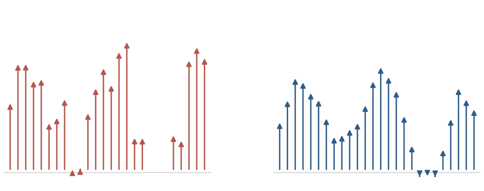
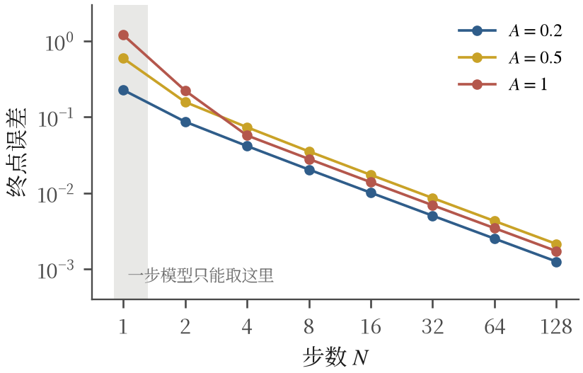
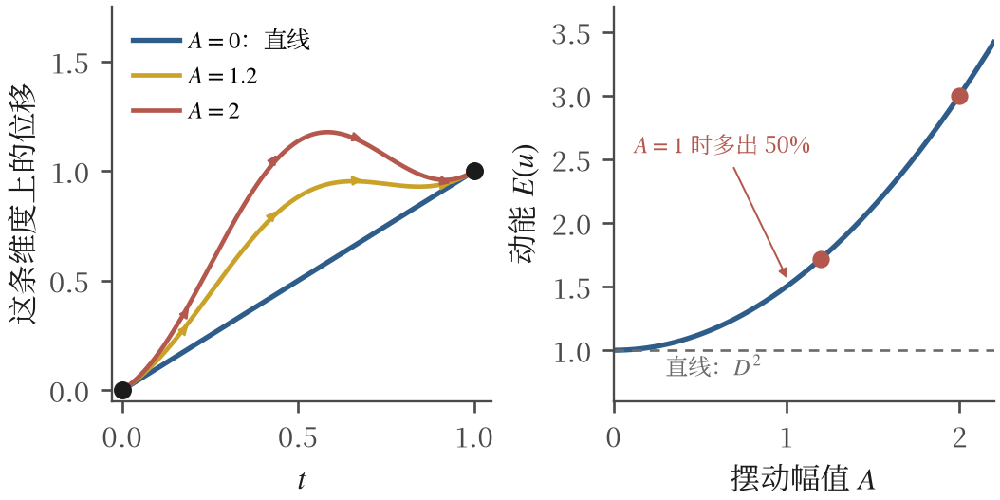
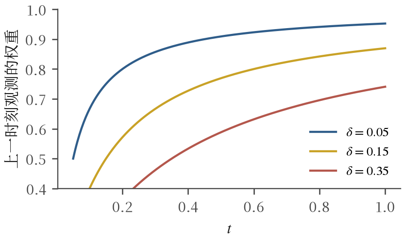

# ChordEdit：低能量传输

前面三章都在多步模型上做编辑。一步模型把采样压成一次前向，速度快一个数量级，但编辑一下子变得很难：简单地把两个条件的速度相减，再走一步，结果会崩。

一步模型的做法是先训一个多步模型，再把它蒸馏成“从噪声到干净图的一次映射”。得到的网络 $F$ 只需要一次求值就给出 $x_0 = F(x_1)$，采样成本从几十步降到一步。代价藏在网络内部：多步模型每一步只需要在很窄的噪声区间上正确，错了下一步还能纠；一步模型必须在整段上都正确，于是它学到的场更陡、更弯，对输入的微小变化更敏感。

ChordEdit 处理的就是这个场景。它不需要训练，也不需要反演，只在一步模型上做一次加减，关键是用一个时间加权的平均把不稳定的编辑方向抹平。

## 一步编辑为什么会崩

最自然的做法是算出目标条件与源条件的速度之差

$$\Delta v(x,t) = v(x,t,c_{\text{tar}}) - v(x,t,c_{\text{src}}),$$

然后一步走过去

$$x_{\text{tar}} = x_{\text{src}} + \Delta v.$$

在多步模型上，这个差每步只作用一点点，误差会被后续步骤纠正。在一步模型上，它要一次走完全程，问题就暴露了：物体严重扭曲，背景碎裂，出现本不存在的结构。

原因在数值上。一步模型是被蒸馏出来的，从条件到速度场的映射高度非线性。两个条件的速度场各自都是大幅值、方向差异很大的场，相减之后得到一个高能量、空间上不光滑的场。用一步大积分去走这个场，局部截断误差被完整放大。



### 一次积分的误差有多大

把“误差被放大”写成式子。沿速度场积分满足 $x'(t) = v(x(t),t)$，从 $t=1$ 积到 $t=0$ 的精确解是

$$x(0) = x(1) - \int_0^1 v\big(x(t),t\big)\,dt.$$

一步 Euler 只取积分区间左端的速度

$$\hat{x}(0) = x(1) - v\big(x(1),1\big),$$

误差是把被积函数整段拉平所丢掉的量

$$e = \hat{x}(0) - x(0) = \int_0^1\Big[v\big(x(t),t\big) - v\big(x(1),1\big)\Big]dt.$$

被积的差可以按自变量展开。$t$ 方向的变化给出 $(t-1)\,\partial_t v$，$x$ 方向的变化给出 $\nabla v\cdot(x(t)-x(1))$，而 $|x(t)-x(1)| = \big|\int_1^t v\big| \le (1-t)\|v\|_\infty$。两项合起来

$$|e| \le \int_0^1 (1-t)\,dt\ \Big(\|\partial_t v\|_\infty + \|\nabla v\|_\infty\|v\|_\infty\Big) = \frac{1}{2}C(v),$$

其中

$$C(v) = \|\partial_t v\|_\infty + \|\nabla v\|_\infty\|v\|_\infty.$$

这个量把两件事装在一起：场随时间的变化有多快，场沿空间的变化有多陡。步长越小，这个上界越小。取 $N$ 步、步长 $\Delta t = 1/N$，每一步的局部误差是 $(\Delta t^2/2)C$，累积起来是

$$|e_N| \le \frac{\Delta t}{2}C(v) = \frac{C(v)}{2N}.$$

一次方收益：步数翻倍，误差减半。多步模型有几十步可用，$N=50$ 时上界被压到 $C/100$；一步模型只允许 $N=1$，误差就是 $C/2$，一点折中都没有。能动的只有 $C$ 本身——把场变平、变光滑，让它在整段上的变化量降下来。ChordEdit 的全部技巧就是降 $C$。



图 8.2 是一维算例：$dx/dt = -[1 + A\sin(3x)]$，$x(1) = 0.6$，精确解用极细的 RK4 作参照，Euler 用 $N$ 步。三条曲线的斜率都是 $-1$，与上面的 $1/N$ 一致；纵轴的高度随 $A$ 上升，因为 $\partial_x v = -3A\cos(3x)$ 直接进了 $C$。$N=1$ 那一端，$A=1$ 的误差约 $1.2$，而整段位移只有 $0.76$——误差比位移还大，一步走完的结果与答案没有关系。这张图说明为什么“一步编辑”不是把多步算法少跑几步就行，它要求另一个量级的场。

同一个差场放在多步模型上为什么不崩，可以照上面的界算一次。多步积分里每步只有 $\Delta t = 1/N$，位移是 $\|\Delta v\|\Delta t$，局部误差是 $(\Delta t^2/2)C$，$N=50$ 时位移被压到原来的五十分之一，误差被压到 $C/100$。差场本身一点没变，只是被摊薄了。一步模型把 $N$ 设成 1，位移与误差各放大五十倍，量级上都越过了还能用的边界。

### 三个高能量源

条件差本身就有量。$\Delta v$ 是两个条件均值之差，在语义变化的地方幅值大。图像的潜向量有上万个分量，两个条件的平均速度差在这些分量上同向叠加，范数与 $\sqrt{d}$ 同阶。位移大不是错，位移大且方向不一致才是错。

蒸馏把多步折叠成一步，$\partial_t v$ 变大。多步模型在第 $k$ 步只负责从 $t_k$ 走到 $t_{k-1}$，场在时间上的变化被分摊到很多个小步里；一步模型没有这个分摊，整段的时间依赖都压在一次求值上，$\|\partial_t v\|_\infty$ 天然比多步模型高一个量级。

空间上的不光滑来自物体的边界。同一幅图上，天空、人脸、衣服对应的编辑方向不一样；在物体的轮廓处，方向要在一个像素宽的范围内切换。这就是图 8.1 左栏画的东西：相邻位置的方向差别大，场在空间上抖动。$\|\nabla v\|_\infty$ 的最大值几乎总在边界上取到。

三个源里，条件差无法消除（要编辑就得有位移），时间上的陡峭只能改模型（重训），只有空间上的抖动可以用算法层面的手段缓解：不改变方向的大致指向，只把方向在空间与时间上的抖动抹掉。这就是“平滑而不缩小”的意思。

### 崩了之后长什么样

失败不是均匀的模糊，而是有固定形状的。最先坏的是边界：轮廓处两个方向的差最大，一次大位移把边界两侧的像素推到互相矛盾的位置，于是出现重影与锯齿。

纹理区的坏法不一样。天空、墙面这类低频区域本来能容忍较大的位移，但一旦位移超过纹理的相关长度，纹理就被拉成条纹或者被洗成平色。

还有一类错误是凭空多出来的结构。场在陡峭处被大步跨过，模型读到的输入不再是它在训练中见过的那种分布，输出里于是冒出原图与目标条件都没有的东西——多出来的窗户、凭空长出的枝干。这类错误最难定位，因为它看起来像是“生成”的一部分。

## 把编辑写成传输

换一个视角：编辑是把源分布 $p_1(\cdot\mid c_{\text{src}})$ 搬到目标分布 $p_0(\cdot\mid c_{\text{tar}})$。

在最优传输的框架里，理想的传输场是下面这个能量泛函的解

$$\min_{\rho,u}\ \int_0^1\!\!\int \frac12\|u_t(x)\|^2\rho_t(x)\,dx\,dt \quad \text{s.t.}\quad \partial_t\rho_t + \nabla\cdot(\rho_t u_t) = 0.$$

约束是连续性方程，目标是最小化动能。这个解的性质是：传输路径尽量短、尽量直，不会有多余的来回摆动。

理想的 $u_t$ 未知，我们只能通过模型查询它。

### 动能为什么等价于“少动”

动能最小这条准则看着抽象，其实只说了两件事：每个粒子走直线，且速度不变。

先看单个粒子。设它的轨迹是 $x(t)$，两端固定为 $x(0)=a$、$x(1)=b$。由 Cauchy–Schwarz

$$\Big(\int_0^1 \dot x\,dt\Big)^2 \le \Big(\int_0^1 1\,dt\Big)\Big(\int_0^1 \|\dot x\|^2\,dt\Big),$$

左端就是 $\|b-a\|^2$，于是

$$\int_0^1\|\dot x(t)\|^2\,dt \ \ge\ \|b-a\|^2,$$

等号当且仅当 $\dot x$ 是常数，也就是匀速直线。任何绕路都要多付能量。

多付多少也能算。把速度拆成“平均速度加零均值摆动”：$\dot x = \Delta + w$，其中 $\Delta = b-a$、$\int_0^1 w\,dt = 0$。展开平方

$$\int_0^1\|\dot x\|^2\,dt = \|\Delta\|^2 + 2\Delta\cdot\int_0^1 w\,dt + \int_0^1\|w\|^2\,dt = \|\Delta\|^2 + \int_0^1\|w\|^2\,dt,$$

交叉项因为 $\int w = 0$ 而消失。多出来的能量就是摆动的能量，与摆动往哪个方向摆无关。



图 8.3 用 $x(t) = \Delta t + A(1-\cos 2\pi t)/(2\pi)$ 做例子，$\dot x = \Delta + A\sin 2\pi t$，于是 $\int_0^1\|\dot x\|^2dt = \Delta^2 + A^2/2$。取 $\Delta = 1$：$A=1$ 时能量 $1.5$，比直线多出 $50\%$；$A=2$ 时能量 $3$，多出两倍。摆动幅值翻倍，多付的能量翻四倍。这条二次关系是下面“低能量估计”的来源：把方向抹平一点，能量就降一块，误差上界跟着降。

### 分布层面，不是逐点层面

还有一处要分清。Benamou–Brenier 的能量约束的是分布 $\rho_t$ 的运动，不是逐个像素的对应。它要求整体的搬运尽量省力，允许局部某个像素走得很远，只要别处因此走得更近。

这个区别解释了为什么编辑方向可以用“条件差的期望”来近似。逐点最优要求知道源图每个位置该配到目标图的哪个位置，这需要两张图都在手；分布层面只要求整体上少动，于是模型给出的条件差（一个在分布上平均过的方向）就可以当作 $u_t$ 的一个估计。

代价是精度。分布层面的解不唯一：很多不同的场都能把 $\rho_1$ 搬到 $\rho_0$，动能最小的那个只是其中一个。模型给的方向不必是这一个，只要够接近，编辑结果就说得过去。

## 能观测到什么

模型给出的不是真值场，而是在噪声状态上的查询结果。在时刻 $t$，把源图加噪到对应水平，查询目标与源条件的输出之差，再映射到统一的速度空间

$$R(x_\tau,t) = E_{z\sim K_t}\big[B_t\big(Q(z,t,c_{\text{tar}}) - Q(z,t,c_{\text{src}})\big)\big].$$

$Q$ 是模型的输出，$B_t$ 是一个只依赖时间的线性映射，把噪声预测换算成速度。

把这个观测写成真值场加噪声

$$R(x_\tau,t) = u_t(x_\tau) + \varepsilon_t,\qquad E[\varepsilon_t]=0.$$

直接用 $R$ 当编辑方向，就是前面说的简单 drift。它的能量大、方差大。

### 加噪核与那个 $1/(1-t)$

$K_t$ 是加噪核，$z = (1-t)x_\tau + t\varepsilon$，$\varepsilon\sim\mathcal N(0,I)$。查询点落在“源图在这一噪声水平上的各种形态”里，模型对这些点返回的是条件平均速度 $\mathbb{E}[v(z,t,c)\mid z]$。取期望是因为单次采样只给一个点，而我们要的是这一噪声水平上的平均编辑方向。

$B_t$ 的形状取决于模型输出什么。直接输出速度的模型，$B_t$ 是恒等映射。输出噪声预测 $\hat\varepsilon$ 的模型（扩散模型常见的参数化）要先换算。由 $z = x_0 + tv$ 与 $\varepsilon = x_0 + v$ 两式消去 $x_0$，得 $\varepsilon = z + (1-t)v$，于是

$$v = \frac{\hat\varepsilon - z}{1-t}.$$

分母在 $t\to 1$ 时趋于零，同样的噪声误差被放大成很大的速度误差。这个 $1/(1-t)$ 是后面所有“$t$ 大时观测不可信”判断的来源，也是权重取 $t/(t+\delta)$ 而不取常数的理由。

### 两个条件必须分别查

无分类器引导的差是 $v(z,c_{\text{tar}}) - v(z,\varnothing)$，其中 $\varnothing$ 是空条件。这里要的是 $v(z,c_{\text{tar}}) - v(z,c_{\text{src}})$，右边那一项带的是源条件，不是空条件。两者不能互换：空条件对应“不带任何提示”的平均场，源条件对应“源图那句话”的场，差出来的东西不同。

用一个具体例子说明差别。源图是一只橘猫，目标是“一只黑猫”。$v(\cdot,c_{\text{tar}}) - v(\cdot,\varnothing)$ 给出的是“往猫这个方向推”的量，与原图是不是猫无关；$v(\cdot,c_{\text{tar}}) - v(\cdot,c_{\text{src}})$ 给出的是“从橘猫变成黑猫”的量，包含颜色的方向。做编辑要的是后者。

代价是两次条件查询而不是一次。这就是“共两次前向”的由来——它不是重复计算，而是两个不同的条件各自要一次。

### 一步模型只查得起一两次

多步模型可以在每个噪声水平上采十几次取平均，把 $\varepsilon_t$ 压下去。一步模型没有这个预算：编辑本身只想花一次前向的时间，多查几次就退回了多步的成本。

采样数给的是 $1/\sqrt{S}$ 的收缩，$S=1$ 就没有收缩。但时间维度上还有免费的东西：相邻的 $t$ 与 $t-\delta$ 上，真值场 $u_t$ 变化不大，两次观测的差主要来自噪声。把两个时刻的观测加权平均，等于用时间上的冗余换采样上的不足。这份冗余有多少，取决于 $u_t$ 在 $\delta$ 这段里变了多少，也就是前面那个 $\|\partial_t u\|_\infty$。场在时间上变得越慢，靠两个时刻平均能榨出的精度越多；变得越快，两个观测说的就不是同一件事，平均会把方向拉偏。这就是 $\delta$ 不能随便取大的底线。

下一个目标函数就是这件事的严格版本。

## 低能量估计

在短窗口 $[t-\delta,t]$ 上假设场近似为常数，求一个使“偏离观测”与“偏离上一时刻估计”都尽量小的解

$$\Phi_t(u) = t\|u-\hat{u}_{t-\delta}\|^2 + \int_{t-\delta}^{t}\|u-R(x,\xi)\|^2\,d\xi.$$

第一项是能量的先验，希望新的估计不要离上一时刻太远；第二项是拟合观测，在窗口内积分。

### 两项各管什么

第一项的权重是 $t$，不是常数。这条选择与上一节的方差分析对应：观测的方差随 $t$ 增大（$B_t$ 里有 $1/(1-t)$），$t$ 大的时候观测不可信，应当更依赖先验；$t$ 小时观测可靠，先验可以让路。权重跟着 $t$ 走，正好复现这个次序。取成常数的话，$t$ 小的时候平滑过强，语义被抹掉。

第二项在窗口上积分而不是只取一个点，是把 $\delta$ 这段区间里的观测都算进来。窗口越长，平均的样本越多，方向越稳，但“场在窗口内是常数”这个假设越勉强。$\delta$ 就是这两者的折中。

窗口是单边的，这一点也有理由。对称窗口 $[t-\delta, t+\delta]$ 看上去更“公平”，但 $t+\delta$ 那一侧的观测对应的是“改动更少”的状态，把它混进来会把编辑方向往回拉；而且那个时刻的观测在时间顺序上还没轮到，用它等于提前消费了下一步的信息。单边窗口是因果的：每一步只用已经走过的观测，递归可以从 $t$ 一直推到 0。

这是严格的凸二次函数，对 $u$ 求导令其为零

$$2t\big(u-\hat{u}_{t-\delta}\big) + 2\int_{t-\delta}^t(u-R)\,d\xi = 0,$$

### 闭式解

把积分拆开：$\int_{t-\delta}^t u\,d\xi = \delta u$（$u$ 与 $\xi$ 无关），$\int_{t-\delta}^t R\,d\xi$ 记作 $\bar R$。方程变成

$$t(u-\hat{u}_{t-\delta}) + \delta(u - \bar R) = 0,$$

整理

$$(t+\delta)\,u = t\,\hat{u}_{t-\delta} + \delta\,\bar R,$$

解出

$$\hat{u}_t = \frac{t\,\hat{u}_{t-\delta} + \int_{t-\delta}^t R\,d\xi}{t+\delta}.$$

凸性可以直接验证：$\Phi$ 对 $u$ 的二阶导是 $2(t+\delta)I$，正定，所以这个驻点是唯一的最小点，不是鞍点。目标函数里没有交叉项，$u$ 的各维独立求解，逐坐标做加权平均即可。

解的形式值得停一下：它是先验估计与窗口内平均观测的加权平均，权重分别是 $t$ 与 $\delta$。这与卡尔曼滤波的更新式同构——两个带不确定性的估计，按精度加权融合。在这里，“精度”就是 $t$ 与 $\delta$。

### 两个一阶近似

上式里有两处不好直接算：$\hat u_{t-\delta}$ 是上一时刻的估计，$\int R$ 要在窗口上逐点查询。各用一次一阶近似。

上一时刻的估计就取那次观测，$\hat{u}_{t-\delta}\approx R(x,t-\delta)$；这一步的误差是 $O(\delta)$，但乘上的系数 $t/(t+\delta)\le 1$，不会放大。

窗口内场变化不大，积分用矩形公式，$\int_{t-\delta}^t R\,d\xi \approx \delta R(x,t)$；误差是 $(\delta^2/2)\,\partial_\xi R$，除以 $t+\delta$ 后是 $O(\delta^2/(t+\delta))$，比前一项小一阶。

合并得到实用形式

$$\hat{u}_t = \frac{t\,R(x,t-\delta) + \delta\,R(x,t)}{t+\delta}.$$

这是 $R$ 的一个因果、单边加权平均，权重分别是 $t/(t+\delta)$ 与 $\delta/(t+\delta)$，和为 1。



权重还能做一次自洽检查。$t\to 0$ 时 $w = t/(t+\delta)\to 0$，估计完全交给当前观测；这与“低噪声段的观测可靠”一致，此时不该再让旧观测说话。$t$ 相对 $\delta$ 很大时 $w\to 1$，估计几乎等于旧观测，编辑也几乎不动——高噪声段本来就该保守。两端的行为都对得上，说明这个权重不是凑出来的。

数值上也稳：$t+\delta$ 恒大于零，$t=0$ 附近不会除零；两个权重都落在 $[0,1]$ 内，和为 1，所以 $\hat u_t$ 不会超出两个观测张成的线段，不会凭空造出更大的位移。

### 等价于把有效时刻往前挪

两个权重之和为 1，所以 $\hat u_t$ 是两个观测的凸组合。把 $R$ 在 $t$ 处线性化，$R(x,t-\delta)\approx R(x,t) - \delta\,\partial_t R$，代入

$$\hat{u}_t \approx R(x,t) - \frac{\delta t}{t+\delta}\,\partial_t R \approx R\big(x,\ t - \delta_{\text{eff}}\big),\qquad \delta_{\text{eff}} = \frac{\delta t}{t+\delta}.$$

线性场里这是精确等式：加权平均与“把查询时刻提前 $\delta_{\text{eff}}$”给出同一个数。$\delta_{\text{eff}}$ 比 $\delta$ 小，因为两个观测不是等权。

| $\delta$ | 权重 $t/(t+\delta)$（$t=0.9$） | 有效滞后 $\delta_{\text{eff}}$ | 有效时刻 |
| --- | --- | --- | --- |
| 0.05 | 0.947 | 0.047 | 0.853 |
| 0.15 | 0.857 | 0.129 | 0.771 |
| 0.35 | 0.720 | 0.252 | 0.648 |

表里默认配置那一行说：$t=0.9$、$\delta=0.15$ 时，实际起作用的是 $t\approx 0.77$ 附近的场。这一条后面还会用到，它解释了为什么 $\delta$ 的效果与“直接把 $t$ 调低”很像，却又更温和。

## 为什么这样就稳

三个层次的理由。

能量收缩。平均是线性运算，由 Jensen 不等式，$\|\hat{u}\|^2$ 的积分不超过 $\|R\|^2$ 的积分。平滑之后场能量更小，不会出现尖峰。

导数收缩。求导与卷积可交换，所以 $\hat{u}$ 的时间导数、空间梯度的上确界都被 $R$ 的对应量控制住，抖动被抹平。

误差界收紧。显式 Euler 的局部截断误差有一个标准上界

$$C(u) = \|\partial_t u\|_\infty + \|\nabla u\|_\infty\|u\|_\infty.$$

前两条保证 $C(\hat{u})\le C(R)$，因此一步的全局误差上界也更紧。

三件事连起来：平滑让能量与导数变小，单步误差随之变小，一步编辑才可行。

### 能量收缩

记两个观测为 $R_1 = R(x,t-\delta)$、$R_2 = R(x,t)$，权重 $w = t/(t+\delta)$。由平方的凸性

$$\|\hat u\|^2 = \|wR_1 + (1-w)R_2\|^2 \le w\|R_1\|^2 + (1-w)\|R_2\|^2 \le \max\big(\|R_1\|^2, \|R_2\|^2\big).$$

等号只在 $R_1 = R_2$ 时成立。两个观测方向一致时平均不改变任何东西——那也不需要改变；方向不一致时，平均把不一致的成分压下去。

不一致的成分能压多少，取决于两个方向的夹角。设 $\|R_1\| = \|R_2\| = \|R\|$，夹角余弦为 $\cos\theta$，则

$$\|\hat u\|^2 = \|R\|^2\Big(w^2 + (1-w)^2 + 2w(1-w)\cos\theta\Big).$$

两个极端：$\theta = 0$ 时系数为 1，什么都不降；$\theta = \pi$（两个方向相反，对应边界两侧的冲突）时系数为 $(2w-1)^2$，$w=0.857$ 时为 $0.51$，能量减半。正交（$\theta = \pi/2$）时系数为 $w^2+(1-w)^2 = 0.755$，能量降四分之一。图 8.1 左栏那些尖刺，正是一串近似正交的方向被平均掉了。

### 导数收缩

对 $u$ 求空间梯度，$\nabla\hat u = w\nabla R_1 + (1-w)\nabla R_2$，与能量同样的凸性给出

$$\|\nabla\hat u\|^2 \le w\|\nabla R_1\|^2 + (1-w)\|\nabla R_2\|^2.$$

在物体内部，两个梯度同向，收缩为零；在边界上，两个梯度方向差异大，收缩接近能量那一档。$\|\nabla \hat u\|_\infty$ 因此被 $R$ 的梯度上界压住，尖峰被削掉。

时间方向同理：$\partial_t\hat u = w\,\partial_t R_1 + (1-w)\,\partial_t R_2$，加权平均的导数不超过两个导数的加权平均。

这里还可以看方差。两次观测不独立（同一起点、相邻时刻），但它们含的噪声成分大体独立。若各维噪声方差为 $\sigma^2$ 且互不相关，平均后的方差是

$$\sigma^2\big(w^2 + (1-w)^2\big).$$

$w=0.857$ 时系数为 $0.735$，$w = 0.5$ 时最小，为 $0.5$。两次查询有相关性，实际降幅比这个系数还要小一些，量级上仍在一半以内。

### 误差界收紧

由上一节的推导，一步 Euler 的误差上界是 $C(u)/2$；$N$ 步时是 $C(u)/(2N)$。把 $u$ 换成 $\hat u$，$C$ 里两项都被凸组合控制

$$C(\hat u) \le \max_{t' \in \{t-\delta,\,t\}} C\big(R(\cdot,t')\big)$$

到常数因子内成立。误差上界跟着收紧。

要老实说一句：这个收紧的幅度是几十个百分点，比如从 $C(R)/2$ 降到 $0.755\,C(R)/2$，也就是两成多。而“一步编辑崩掉”是数量级的失败，两成的上界改善救不了它。真正的解救来自两件事的配合——有效时刻从 $0.9$ 挪到 $0.77$，$C$ 本身在那里就小得多（场在低噪声段更平），加上精修一步把剩下的大位移拆成两次小位移（$N$ 从 1 变成 2，上界又减半）。

三条里，真正起主要作用的是“有效时刻后移”这一条，而它恰恰来自闭式解的结构，不是来自“平均能降能量”这个一般性质。理解这一点，调参时就不会指望把 $\delta$ 调大来获得数量级的改善。

## 算法与参数

对源图计算两个时刻的观测量，加权平均得到编辑方向，一步走过去。可选的一步精修：把中间结果加噪到较低的噪声水平，用目标条件再走一步。

```text
输入: x_src, c_src, c_tar, t = 0.9, delta = 0.15, t_r = 0.3, s = 1
1  z1 = (1 - t) x_src + t eps1                 # 时刻 t 的加噪点
2  z2 = (1 - t + delta) x_src + (t - delta) eps2   # 时刻 t - delta
3  R1 = B_t     ( Q(z1, t,       c_tar) - Q(z1, t,       c_src) )
4  R2 = B_{t-d} ( Q(z2, t-delta, c_tar) - Q(z2, t-delta, c_src) )
5  u  = ( t * R2 + delta * R1 ) / (t + delta)
6  x  = x_src + s * u
7  z3 = (1 - t_r) x + t_r eps3
8  x  = z3 - t_r * Q(z3, t_r, c_tar)           # 从 t_r 走一步到 0
9  返回 x
```

第 6 行的符号要按场的约定核对一次。若 $Q$ 输出的是沿 $t$ 增大方向的速度，从 $t$ 走到 $t-\Delta t$ 要取减号；若把 $\hat u$ 直接理解成“从源到目标的位移”，就是加号。两种写法等价，混用会在第一步就把方向走反，症状是结果离目标更远。

第 8 行的精修是一步 Euler：从 $t_r$ 积到 0，位移是 $t_r\,Q(z_3,t_r,c_{\text{tar}})$。因为 $t_r$ 小，这一步的位移小，不会破坏已经定下的结构，只把 $t_r$ 这一层的噪声与被压住的细节补回来。

默认参数：$t=0.9$，$\delta=0.15$，步长缩放 $1$，精修时刻 $0.3$，共两次前向。

$\delta$ 控制平滑强度。太小，平滑不够，场仍然抖；太大，上一时刻的权重增加，当前语义被削弱。

“共两次前向”指主步的两个时刻各调用一次，每次把源与目标两个条件合批送入模型。精修再加一次调用，所以完整流程是三次模型调用的时间。

| 环节 | 条件求值 | 模型调用 | 备注 |
| --- | --- | --- | --- |
| 主步 | 4 | 2 | 两个时刻 × 两个条件，条件方向合批 |
| 精修 | 1 | 1 | 只用目标条件 |
| 合计 | 5 | 3 | 相当于三次普通前向 |

几个参数的作用方式不一样，调的时候要分开看。

| 参数 | 默认 | 调大的后果 | 主要风险 |
| --- | --- | --- | --- |
| $t$ | 0.9 | 低频改动更强 | 结构被改写 |
| $\delta$ | 0.15 | 平滑更强，有效时刻更靠前 | 语义变弱 |
| $t_r$ | 0.3 | 补更多细节 | 抖动重回画面 |
| $s$ | 1 | 位移等比放大 | 位移超出场的适用范围 |

$t$ 与 $\delta$ 是耦合的：由 $\delta_{\text{eff}} = \delta t/(t+\delta)$，把 $t$ 调低与把 $\delta$ 调大，都让有效时刻往前挪，但两者对语义的影响不同。$t$ 调低是直接少改，$\delta$ 调大是用更旧的观测去改，后者的语义损失更大。需要“少改但保留语义”时调 $t$，需要“抑制抖动”时调 $\delta$。

合批是这套流程能不能跑起来的关键。512 像素级的潜空间按 $64\times64\times16$ 算有六万多个分量，两个时刻、两个条件如果各送一次，就是四次前向的网络激活；把条件方向合成一批，$z_1$ 与 $z_2$ 合批，批大小是 $4$，显存占用按四份激活算，而墙钟时间接近一次前向加一点。批量处理多张图时再把图维度并进批，显存线性增长，时间增长得比线性慢——这是这一步唯一“免费”的加速。

## 复现之后的三点发现

第一，$\delta$ 的主要作用是把有效编辑时刻从 $t$ 移到了 $t-\delta$。默认配置的效果，与直接在更低的噪声水平上编辑几乎一样。

这一点在上一节已经算出来了：$\delta_{\text{eff}} = \delta t/(t+\delta)$，默认配置下是 $0.129$，有效时刻 $0.771$。与“直接把 $t$ 设成 $0.77$、不做平滑”相比，结果接近但不完全相同——权重不等，旧的观测只占 $0.857$，所以语义的保留略多一点。这也说明 $\delta$ 与 $t$ 不是两个独立的旋钮，调 $\delta$ 相当于动 $t$。

第二，传输作用在高噪声阶段，主要改低频语义，比如布局与物体类别。

原因可以在高斯假设下算出来。设源图各维方差为 $\sigma^2 = 1$，加噪点 $z = (1-t)x + t\varepsilon$，条件均值对 $z$ 的敏感度是

$$\frac{\partial\,\mathbb{E}[x\mid z]}{\partial z} = \frac{(1-t)\sigma^2}{(1-t)^2\sigma^2 + t^2}.$$

| $t$ | 0.9 | 0.7 | 0.5 | 0.3 |
| --- | --- | --- | --- | --- |
| 敏感度 | 0.12 | 0.52 | 1.00 | 1.21 |

$t=0.9$ 时，$z$ 里关于源图的成分只剩一成多，模型的输出几乎看不出细节，只能给出“这是一张什么图、东西大致在哪”。$t=0.5$ 时两者打平，细节开始完整进入。$t=0.3$ 时敏感度超过 1，细节被完整保留甚至被放大（低噪声段的后验均值会把观测往信号方向推）。

这条表解释了为什么高噪声段的编辑“只改大局”：不是算法故意分层，而是那个时刻的输入里只有大局的信息。差场 $R$ 也一样，它在该时刻能携带的只有低频部分。

第三，精修作用在低噪声阶段，补高频细节。$t_r = 0.3$ 时敏感度超过 1，场能看见纹理与边缘，一步走完就把 $t_r$ 这一层的水洗感去掉。

合起来看，这个方法实际上是低频传输加高频对齐的两段式。平滑不是魔法，它只是让第一步走得稳。

## 局限

依赖模型暴露的场。如果模型只给干净样本预测，要先换算成速度，误差会进来。

对大幅结构改变，比如换姿势、加物体，效果有限，因为低能量传输本身就倾向于少动。

$t$ 与 $\delta$ 需要按模型调。单次噪声实现的方差大，多采几次会更稳，但就不是一步了。

### 换算带来的误差

只给 $\hat\varepsilon$ 的模型要走 $v = (\hat\varepsilon - z)/(1-t)$ 这一步。分母在 $t$ 大时很小，$\hat\varepsilon$ 的一点点误差被放大成很大的速度误差，直接进 $R$ 的方差。默认 $t=0.9$ 时放大因子是 $10$：$\hat\varepsilon$ 的相对误差 $1\%$，换到速度上是 $10\%$ 的同量级偏差。这是默认 $t$ 不能取到 $0.95$ 以上的实际原因——平滑能压随机部分，压不住这个系统性的放大。

只给 $x_0$ 预测的模型更麻烦，要先从 $x_0$ 反推 $\varepsilon$ 再反推 $v$，两次换算的误差叠加。实现时最好直接找输出速度或噪声的接口。

### 少动与“改不动”是同一件事

低能量传输的目标就是少动，这条准则在换风格、换材质、换颜色上是对的：这些编辑的位移本来就小，省着走反而保住了结构。

遇上需要大位移的编辑，它就变成了束缚。换姿势要求四肢移动几十个像素，加物体要求在一片背景上凭空生成一块内容——这两件事的位移都大，能量项会系统性地把它们压回去，表现为“改了但没改够”：姿势只转了一半，新物体只有个模糊的轮廓。

绕过这个限制只能从目标函数外面想办法，比如把位移分几次走（每次都是一步编辑），或者用掩码把改动区与保留区分开算。两种做法都离开了“一步”的框架，回到了多步或多阶段的流程。

### 单次实现撑不住

一步意味着只有一两个噪声样本可用，$R$ 的方差没法靠采样数压，只能靠时间上的平均。这个替代在多数图上够用，在两类图上不够。

一类是纹理密集的图：织物、草地、砖墙。这些区域的编辑方向在相邻位置之间差别大，两个时刻的观测平均之后仍然残留方向冲突，结果是一片区域被抹平或者出现规则的摩尔纹。

另一类是强对称的图：建筑立面、棋盘、重复的窗格。方向在这里有多解，不同的噪声实现会选出不同的对应关系，结果是窗格错位、立柱多出一根或少掉一根。这类失败靠调 $\delta$ 只能缓解，根治要回到多步。

### 与多步方法的分工

| 场景 | 一步编辑 | 多步编辑 |
| --- | --- | --- |
| 批量出图、实时预览 | 合适 | 太慢 |
| 局部改色、换材质 | 合适 | 可用但浪费 |
| 大幅结构改变 | 改不动 | 合适 |
| 纹理密集或强对称 | 容易失败 | 更稳 |
| 需要可定位的中间量 | 没有 | 有 |

这张表的读法不是“一步不如多步”，而是“一步把预算花在了速度上”。要判断一个编辑需求适不适合一步，看两件事：位移占图像尺度的比例大不大，画面里有没有大量重复结构。两件都不占，一步够用；占了一件，就该换工具。

成本上差一个量级。一次一步编辑是三次模型调用，多步编辑按 50 步算、每步两个条件就是百次调用，两者相差三十倍以上。这个差距才是“一步”值得单独研究的原因：如果只差两三倍，直接用多步会更省心。
