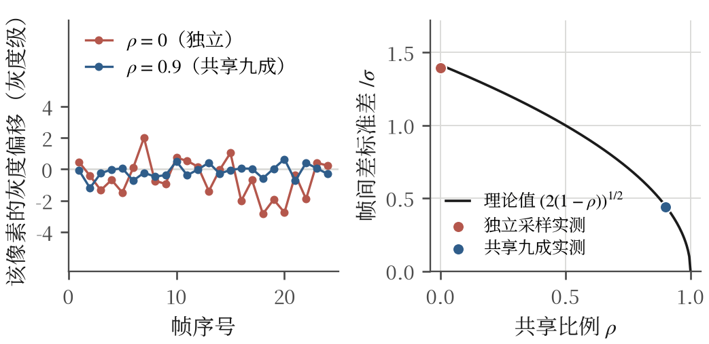
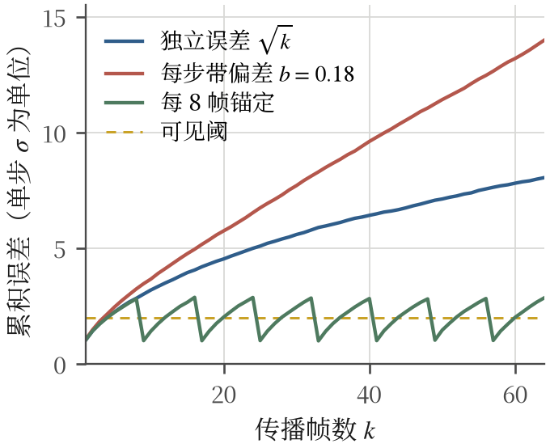

# 视频编辑的特殊困难

前面八章的方法都是针对单张图的。把它们逐帧套到视频上，会得到一段“每一帧都改对了，连起来却在闪”的片子。这一章说明为什么，以及视频编辑比图像编辑多出来的三个要求。

## 为什么逐帧编辑会闪

独立地对每一帧做编辑，等价于在每一帧上独立采样。采样有随机性，两帧的随机数不同，结果就有细微差别。

把这句话写成式子。编辑算子可以看成噪声到图像的映射 $x_t=f(\varepsilon_t,c)$，$c$ 是编辑条件。在某个参考点附近做一阶展开，把噪声偏移记作 $\delta\varepsilon_t$，则

$$x_t \approx \bar{x} + J\,\delta\varepsilon_t ,$$

$J=\partial f/\partial \varepsilon$ 是该点处的雅可比，形状是像素数乘噪声维数。相邻两帧的差

$$d_t = x_{t+1}-x_t = J\,(\delta\varepsilon_{t+1}-\delta\varepsilon_t).$$

两帧独立采样时，$\delta\varepsilon_{t+1}$ 与 $\delta\varepsilon_t$ 不相关，协方差都是 $\Sigma$，于是

$$\mathrm{Cov}(d_t) = J\,(2\Sigma)\,J^{\top},$$

标准差是单帧扰动的 $\sqrt{2}$ 倍。这个倍数与取哪两帧无关，只要它们独立，帧间抖动就比单帧本身的抖动大四成。

单帧看，差别看不出来；连续播放，画面会像老电影一样抖动。人眼对这种高频变化极其敏感，哪怕只有百分之一的亮度差。

百分之一这个量级有出处。人眼对亮度的分辨服从韦伯律，中间灰度附近能辨出的相对变化约百分之一到二；平坦区域没有纹理掩蔽，阈值更低。8 位量化的一级是 $1/255\approx0.4\%$，也就是说相邻帧相差两三个码值，静止看几乎无感，动起来就是可见的闪烁。时域上最刺眼的频率在几赫兹，恰好对应每秒二十几帧里“每隔一两帧跳一下”的节奏。

代入一组数：若单帧输出的逐像素标准差是 $1.5$ 个灰度级（扩散模型在无纹理区很容易达到这个量级），帧间差的标准差就是 $2.1$ 个。乘以 $2.5$（正态分布下约 $99\%$ 的样本落在两个半标准差内），个别像素可以跳到 5 个灰度级。单帧静止看是干净的，连起来就是沙沙的颗粒在动。

还有一类抖动不是颜色，是纹理。草、头发、水面这类高频细节，每帧被重绘一次，位置和形态都不同，即使平均亮度完全一致，观众也会觉得“在流”。这类问题光靠对齐平均颜色不管用，必须让高频细节也共享。

如果所有帧共享一部分噪声，情况会好转。取

$$\varepsilon_t = \sqrt{\rho}\,\varepsilon_0 + \sqrt{1-\rho}\,\delta_t,\qquad \varepsilon_0,\ \delta_t\sim\mathcal{N}(0,I)$$

三者互不相关，$\rho\in[0,1]$。$\varepsilon_t$ 的边缘分布仍是标准正态，单帧的统计性质一点没变；两帧的相关是 $\rho$。代进上面的差

$$\mathrm{Cov}(d_t) = J\big[2I-2\rho I\big]J^{\top} = 2(1-\rho)\,JJ^{\top},$$

帧间抖动降到 $\sqrt{2(1-\rho)}$ 倍。$\rho=0.9$ 时是 $0.45$ 倍，不到独立采样的一半。这条式子解释了后面一批免训练方法为什么把“共享初始噪声”当作核心机制：它不动单帧质量，只改帧间相关，改动的位置极省。

更麻烦的是语义层面：同一个物体在第三帧被改成了红色，到第八帧可能偏成了橙色。每一帧都“合理地”符合描述，合起来却不是一个东西。

这类偏差不是噪声，是每次去噪各自落到了一个不同的模式上。条件 $c$ 只约束了“红衣服”，没有约束“哪一种红”，采样就把剩下的自由度按自己的随机性填了。帧数越多，落点越分散，观众看到的是一件衣服在缓慢改色。

所以视频编辑的核心不是“改得对不对”，而是“改得一致不一致”。

### 抖与漂是两件事

上面两类毛病要分开看，它们的时域特征和治理手段都不同。

像素级抖动是高频的：帧间差大，但围绕一个均值上下摆，时域谱接近白噪声。它可以靠共享噪声、时域平滑、或者把多帧结果加权平均压下去。

语义级漂移是低频的：每一帧单独看都合理，但“合理地”落在不同模式上，颜色、形状缓慢地朝一个方向走，几十帧后回不到原样。平滑压不住它，因为它在局部本来就是连续的；只能选一帧当锚，强制其他帧向锚靠。

一个简单的判别办法：把结果沿时间做低通滤波。抖动会消失，漂移不会。反过来，减去时域均值，抖动没了，漂移还在。两个操作各消掉一种成分，正好把两类问题分开。

## 三个额外要求

**时间一致。** 相邻帧之间的改动要平滑，不能跳变。

要让这句话可计算，得借对应关系。设 $F_{t\to t+1}$ 是源视频第 $t$ 帧到第 $t+1$ 帧的光流，$\mathcal{W}$ 表示按流场做双线性采样，$x_t^{\text{out}}$ 是编辑后的第 $t$ 帧：

$$e_{\text{cons}} = \frac{1}{L-1}\sum_{t=1}^{L-1}\big\|\,\mathcal{W}(x_{t+1}^{\text{out}},F_{t\to t+1}) - x_t^{\text{out}}\big\|_1 .$$

这里用源视频的光流，不用编辑后的光流。编辑可能改了运动，而我们想衡量的是“沿原本的运动看，像素值有没有跳”，用源光流才把运动变化与颜色跳变这两件事解耦。遮挡区这个式子会失效——那里的像素在下一帧根本没有对应，warp 过来的是背景。加一个遮挡掩码 $O_t$ 把那些位置剔掉：

$$e_{\text{cons}} = \frac{\sum_t\sum_p (1-O_t(p))\,\big|\mathcal{W}(x_{t+1}^{\text{out}},F_{t\to t+1})(p)-x_t^{\text{out}}(p)\big|}{\sum_t\sum_p (1-O_t(p))}.$$

**运动保真。** 原来的运动要保留。把人的衣服换成红色，人还得继续走；如果把走路改成了站立，就不算保真。

运动保真的对象是流场本身。同一段视频编辑前后各估一次光流，比较端点误差：

$$e_{\text{mot}} = \frac{1}{L-1}\sum_t \frac{1}{|\Omega|}\sum_{p\in\Omega}\big\|F_{t\to t+1}^{\text{out}}(p)-F_{t\to t+1}^{\text{src}}(p)\big\|_2 .$$

两个坑。光流估计本身带噪声，同一段视频换一个光流网络，端点误差就可能差半个像素，所以这个数只能横向比，不能当绝对标准。物体颜色变了以后，光流网络提取的特征也跟着变，$F^{\text{out}}$ 与 $F^{\text{src}}$ 的差里有一部分不是运动变了，而是估计器对颜色的偏好变了。把输入转成灰度再估一次，能压掉一部分这种偏差。

**长度可控。** 短视频可以整段处理，长视频要分块，分块又带回一致性问题。

长度问题的核心是显存。隐空间里一帧 $64\times64\times4$ 的 latent，半精度约 32 KB，64 帧才 2 MB，看着不吓人。真正吃显存的是注意力：把 $L$ 帧的空间 token 摊平成一条序列，长度是 $L\cdot hw$。取 $h=w=64$、$L=16$，序列长 65536，注意力矩阵有 $4.3\times10^9$ 个元素，半精度就是 8.6 GB——单个头、单层。这就是视频方法要么把注意力拆成空间与时间两层、要么只让相邻帧互看的原因。

分块是另一条路，代价落在接缝上：相邻两块各自的噪声与上下文不同，衔接处会闪。常用做法是让相邻块重叠若干帧，在重叠区线性融合，权重从 0 渐增到 1；重叠越长越平滑，算力按重叠比例线性增加。24 帧的块重叠 4 帧，算力就多出约六分之一。

这三个要求与图像编辑的三个要求叠在一起，构成一个更紧的约束：既要改对、又要少改、还要在时间上连贯。约束之间是结构性冲突，不是调参能消掉的：

- 改动越贴近目标描述，破坏对应关系的概率越高。语义对齐与时间一致互相拉扯。
- 越严格地锁住运动，可改的自由度越小。运动保真与编辑强度互相拉扯。
- 视频越长越需要分块，越分块越难一致。长度与一致性互相拉扯。

实际系统都在这个三角形里挑一个点。挑之前要想清楚哪条边不能让——给电影做修复，运动保真不能让；给短视频换背景，语义对齐不能让。

## 对应关系是核心

要一致，就得知道“这一帧的这个像素，在下一帧是哪个像素”。这就是对应关系问题。

三种常见的表示。

光流：逐像素的位移向量。稠密、直接，但对遮挡与大位移不可靠。

点轨迹：跟踪若干个关键点在整段视频里的位置。稀疏、稳定，但覆盖不到所有像素。

特征对应：在深度网络的特征空间里找最近邻。不依赖像素级准确，对纹理变化更宽容。

点轨迹与光流其实是一家：光流在逐像素上做同样的事，只是它不维护“同一个点”的身份，下一帧重新算一遍。身份一旦维护起来，就有机会处理长时间的一致性——比如用一个点从第 1 帧跟到第 100 帧，颜色一直取自它第一次出现时的位置。代价是遮挡就断了身份，断了之后要么重新赋值，要么让附近的点猜。

三者不只是精度不同，代价的形状也不同。

光流的成本按帧对累加：$L$ 帧要估 $L-1$ 次，每次是一个编码器加若干次迭代，$512\times512$ 上通常在几十毫秒量级（单卡，中等规模网络，量级估计）。产出是 $H\times W\times2$ 的稠密场，前向、后向各一份，再加遮挡掩码。误差在亚像素到一像素之间，遮挡边界和大位移处最差。更隐蔽的是重采样损耗：每次 warp 都要插值一次，双线性插值把高频磨掉一点，warp 十次之后细节就糊了一层。

点轨迹的成本与点数成正比：$K$ 个点、$L$ 帧，代价 $O(KL)$，$K$ 取几百到几千，比光流便宜一个量级以上。稀疏既是优点也是缺点：几百个点撑不起逐像素的 warp，必须先稠密化，常用径向基插值或对最近邻点的位移做加权平均，稠密化本身又引入一层平滑误差。长时间跟踪还会漂，点慢慢偏离原来的物理位置，需要定期重新检测并重置参考。

特征对应的成本最高。取第 $l$ 层的特征 $\phi_t\in\mathbb{R}^{h\times w\times d}$，帧间最近邻的代价是 $O((hw)^2d)$。$h=w=64$、$d=256$ 时，一对帧是 $64^2\times64^2\times256\approx6.9\times10^{10}$ 次乘加，单帧对就要百毫秒量级，再乘 $L-1$ 对。所以实用实现都会做三件事之一：限制搜索窗口、把特征降到 32 维左右再算内积、只在少数几层建对应。

选择哪种表示，决定了后面方法的形态：用光流就做像素搬运，用轨迹就做形变，用特征就做注意力对齐。

三种表示在什么输入上会坏，提前记住：光流怕快速平移、镜头切换、大面积无纹理（白墙、天空）、细结构（发丝、栏杆），前向映射会把一条像素摊成一片，后向采样会出现空洞；轨迹怕遮挡后重现、出画再入画、非刚性形变（布料、水），跟踪器会跟丢或跟错；特征对应怕纹理重复（瓷砖、格子衫）、极端尺度变化、风格大幅改动，最近邻会匹配到错误的实例。

这也解释了为什么这类方法的表现强烈依赖素材。同一套代码，慢速平移的素材上很稳，换到手持晃动的素材上就散。选方法之前先看素材的运动幅度与纹理，比看方法名字有用。

## 误差会累积

视频编辑通常是“改一帧，再传播到其他帧”。传播的每一步都有误差，误差会沿时间累积。

把传播写成递推。第 $t$ 帧由上一帧 warp 过来再修补，$\varepsilon_t$ 是这一步的误差：

$$x_t^{\text{out}} = \mathcal{W}\big(x_{t-1}^{\text{out}},F_{t-1\to t}\big) + \varepsilon_t .$$

展开到第 $k$ 帧，误差是前面各步误差经后续 warp 传下来的和 $\sum_{j\le k}\varepsilon_j$。若各步误差独立、同分布、标准差 $\sigma$，且 warp 不放大误差，则

$$\mathrm{std}\Big(\sum_{j=1}^{k}\varepsilon_j\Big) = \sigma\sqrt{k}.$$

这是随机游走：误差随步数的平方根长。$\sigma$ 取 0.5 个灰度级（这是相当乐观的估计，实际在纹理区更大），走 30 帧，累积到 $0.5\sqrt{30}\approx2.7$ 个灰度级，越过了可见阈。走 300 帧是 8.7 个灰度级，背景会明显发灰或发绿。

系统偏差更糟。如果每一步都带着同一个方向的小偏差 $b$，$k$ 步之后是 $kb$，线性增长：$b=0.1$ 个灰度级，30 帧就 3 个，而且不会自我抵消。偏差的来源很多——warp 插值总偏向低频、模型对某个词的固定偏好、色彩空间转换的舍入——它们单独都很小，乘上帧数就不可忽略。

关键帧锚定把随机游走截断。每 $M$ 帧回到一个重新编辑的锚帧，段内误差上界从 $\sigma\sqrt{L}$ 降到 $\sigma\sqrt{M}$：$M=8$、$\sigma=0.5$，上界约 1.4 个灰度级。代价是锚帧本身要与前一段衔接，接缝处可能跳一下，得在重叠区做融合。

锚定对系统偏差没用。每一段都朝同一个方向偏，锚帧自己也在漂，只是漂得慢一点。这种情形只能不传播：每一帧都从源帧出发独立编辑，再用全局对齐把结果拉到一起——代价是每帧都要一次完整编辑，贵，但误差不叠乘。

短片看不出来，长片就会漂：背景慢慢变色，物体慢慢变形，最后与第一帧对不上。上图的尺度可以直接拿来判断——误差到 2 个单步标准差时人眼开始注意到，到 5 个以上就没法看了。

整体生成不受这个递推约束，原因很简单：它没有递推。所有帧在同一次采样里产生，第 100 帧不从第 99 帧继承误差，而是一起从噪声出发、在每一步互相看。误差不再沿时间传播，只在步与步之间升降。代价是必须一次性把整段放进显存，长度与显存直接挂钩。

这也是分块与整体生成的根本差别：分块仍然是递推（只是递推的步长变短），整体生成是并行。前者的误差随时间累积，后者的误差与长度无关，只与长度带来的显存压力有关。

## 评测更复杂

图像编辑看保真与对齐。视频还要看时间一致性与运动保真。

时间一致性常用光流扭曲后的像素误差衡量：把第 $t$ 帧按光流扭到第 $t+1$ 帧，与真实的第 $t+1$ 帧比较，差得越小越一致。

这个量精确地说有两个来源：帧间是否真的一致，以及光流是否准。所以报数时必须说明用的是哪套光流（RAFT、GMFlow、还是方法自带的），换一套光流，数字能差出百分之几十，不同论文的绝对值不可直接比。

还有一个变体更有用：比较编辑前后的扭曲误差。源视频自己就有非零的扭曲误差（光流不准、遮挡、运动模糊），这是基线。编辑后减去基线，剩下的才是“编辑引入的不一致”。很多看起来很高的数字，减完基线就只剩一点。

运动保真没有统一指标，通常靠人看，或者比较编辑前后光流场的相似度。

可量化的版本有两个：光流端点误差（上一节 $e_{\text{mot}}$），和轨迹端点误差——跟若干点，比较编辑前后轨迹的终点距离。两者都依赖一个可靠的光流或跟踪器，而编辑改变了外观，估计器本身就会给出不同的场，所以这类指标适合看相对排序，不宜当绝对值。

这两个指标与语义对齐经常冲突：改得越多，越容易破坏运动；改得越少，越不像目标描述。

指标可以被作弊，这一点得放在心里。把每一帧都输出成同一张静止画面，$e_{\text{cons}}$ 接近零，运动保真也完美，可它什么都没编辑。反过来，只把掩码外区域冻住、掩码内不动，也能拿到很好的保真分数。所以单独报任何一个数都没意义，至少要把“一致”“运动”“语义对齐”三项并列，再配几段人看的对比视频。

拿一个具体任务算一遍。把灰衣服改成红衣服：改动集中在衣服区域，颜色距离大，语义对齐分数高；但衣服区域颜色一变，光流网络在那里给出的场会轻微变化，$e_{\text{mot}}$ 上升；褶皱纹理被重绘，帧间细节不同，$e_{\text{cons}}$ 也上升。三个数同时想好，只能靠“改色但保留亮度结构”这类约束。这解释了为什么多数方法在换色、换风格上表现好，在换结构、换姿态上最容易崩：后者的改动必然重排像素，对应关系随之失效。

## 与图像编辑的关系

视频编辑用的仍然是图像编辑的那些手段：注意力、条件、反演、速度场。区别在于它们要作用在整段视频上，于是多了一个约束：改动必须沿时间对齐。

这个多出来的约束会改写前几章的一些结论。单帧编辑里的反演漂移，在视频里会变成外观漂移：每一帧反演得“差不多”，“差不多”的方向又一致，几百帧后整体偏色。单帧编辑里的注意力替换，在视频里要同时决定“换什么”与“换在哪帧”，而后者需要对应关系。单帧里可以只关心像素改对，视频里还得关心这个像素在两帧里是不是同一个东西。

理解了这一点，再看下一章的具体方法，就只是在看“它用什么方式保证对齐”。

把一致性机制排一排，会发现它们共享一个骨架：选一个参考帧，定义“这一帧的每个位置对应参考帧的哪个位置”，然后在生成过程中把参考帧的信息搬过去。区别只在搬运发生在哪一层——像素层（光流 warp）、特征层（最近邻替换）、参数层（共享噪声、同一份微调权重）、条件层（把源视频作为上下文送进模型）。层越深，越不依赖精确对应，也越难控制局部细节：像素层能精确指定“这个像素抄那个像素”，但错一个像素就错位；条件层不会错位，但你只能指望模型自己判断该抄哪里。

## 一个判断

如果视频单帧看都对，连起来闪，问题在一致性，优先考虑传播或整体生成。

如果单帧就改错了，先按图像编辑的办法解决；视频部分的方法帮不上忙。

如果运动丢了，说明方法把视频当成了帧的集合，需要引入运动表示或整体生成。

判断之前先测三个数，比对照方法名有用：素材的运动幅度有多大（快慢、有无遮挡）、要改的区域占画面多少比例、允许多长处理时间。三个数一定，可选的方法就剩一两个。运动小、改动局部、要求秒级响应，走传播；运动大、改动涉及结构，只能走整体生成；运动必须逐像素保留，只有形变场能承诺。
