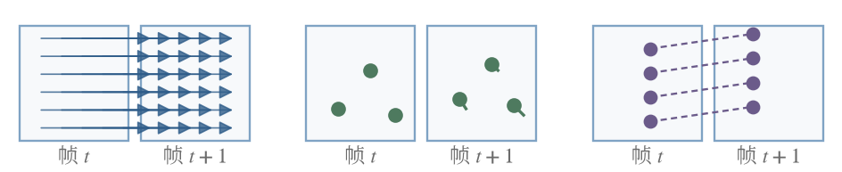

# 视频编辑的特殊困难

前面八章的方法都是针对单张图的。把它们逐帧套到视频上，会得到一段"每一帧都改对了，连起来却在闪"的片子。这一章说明为什么，以及视频编辑比图像编辑多出来的三个要求。

## 为什么逐帧编辑会闪

独立地对每一帧做编辑，等价于在每一帧上独立采样。采样有随机性，两帧的随机数不同，结果就有细微差别。

单帧看，差别看不出来；连续播放，画面会像老电影一样抖动。人眼对这种高频变化极其敏感，哪怕只有百分之一的亮度差。

更麻烦的是语义层面：同一个物体在第三帧被改成了红色，到第八帧可能偏成了橙色。每一帧都"合理地"符合描述，合起来却不是一个东西。

所以视频编辑的核心不是"改得对不对"，而是"改得一致不一致"。

## 三个额外要求

**时间一致。** 相邻帧之间的改动要平滑，不能跳变。

**运动保真。** 原来的运动要保留。把人的衣服换成红色，人还得继续走；如果把走路改成了站立，就不算保真。

**长度可控。** 短视频可以整段处理，长视频要分块，分块又带回一致性问题。

这三个要求与图像编辑的三个要求叠在一起，构成一个更紧的约束：既要改对、又要少改、还要在时间上连贯。

## 对应关系是核心

要一致，就得知道"这一帧的这个像素，在下一帧是哪个像素"。这就是对应关系问题。

三种常见的表示。

光流：逐像素的位移向量。稠密、直接，但对遮挡与大位移不可靠。

点轨迹：跟踪若干个关键点在整段视频里的位置。稀疏、稳定，但覆盖不到所有像素。

特征对应：在深度网络的特征空间里找最近邻。不依赖像素级准确，对纹理变化更宽容。

选择哪种表示，决定了后面方法的形态：用光流就做像素搬运，用轨迹就做形变，用特征就做注意力对齐。

## 误差会累积

视频编辑通常是"改一帧，再传播到其他帧"。传播的每一步都有误差，误差会沿时间累积。

短片看不出来，长片就会漂：背景慢慢变色，物体慢慢变形，最后与第一帧对不上。

缓解的办法有几种：定期回到关键帧重新对齐；用全局的形变场而不是逐帧传播；或者干脆让一个视频模型生成整段，不靠传播。

## 评测更复杂

图像编辑看保真与对齐。视频还要看时间一致性与运动保真。

时间一致性常用光流扭曲后的像素误差衡量：把第 $t$ 帧按光流扭到第 $t+1$ 帧，与真实的第 $t+1$ 帧比较，差得越小越一致。

运动保真没有统一指标，通常靠人看，或者比较编辑前后光流场的相似度。

这两个指标与语义对齐经常冲突：改得越多，越容易破坏运动；改得越少，越不像目标描述。

## 与图像编辑的关系

视频编辑用的仍然是图像编辑的那些手段：注意力、条件、反演、速度场。区别在于它们要作用在整段视频上，于是多了一个约束：改动必须沿时间对齐。

理解了这一点，再看下一章的具体方法，就只是在看"它用什么方式保证对齐"。

## 一个判断

如果视频单帧看都对，连起来闪，问题在一致性，优先考虑传播或整体生成。

如果单帧就改错了，先按图像编辑的办法解决；视频部分的方法帮不上忙。

如果运动丢了，说明方法把视频当成了帧的集合，需要引入运动表示或整体生成。
