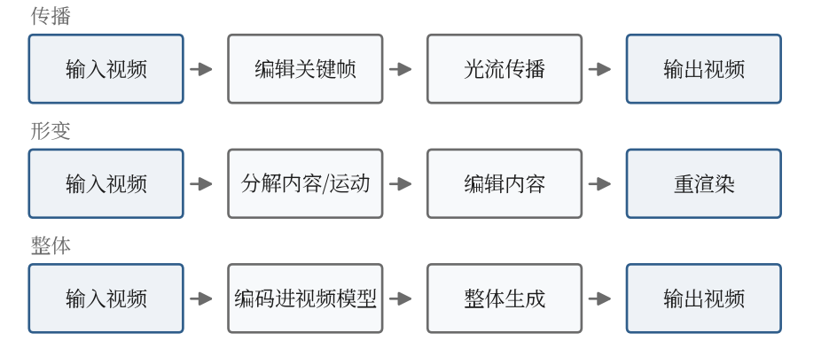
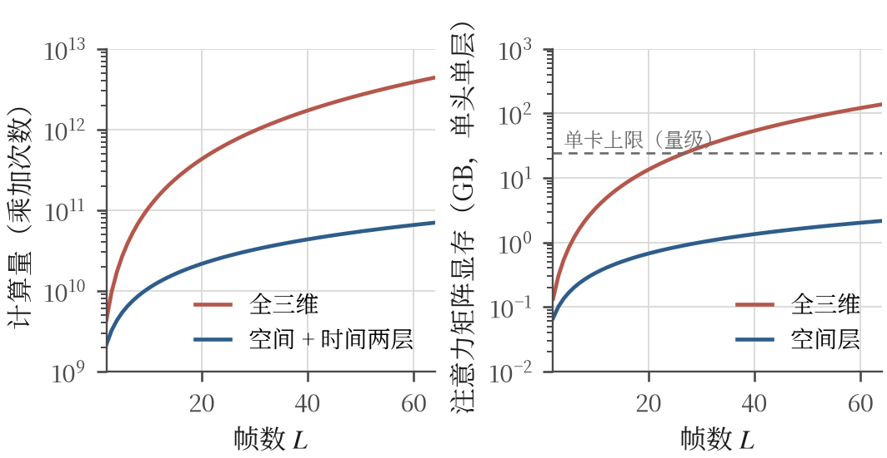
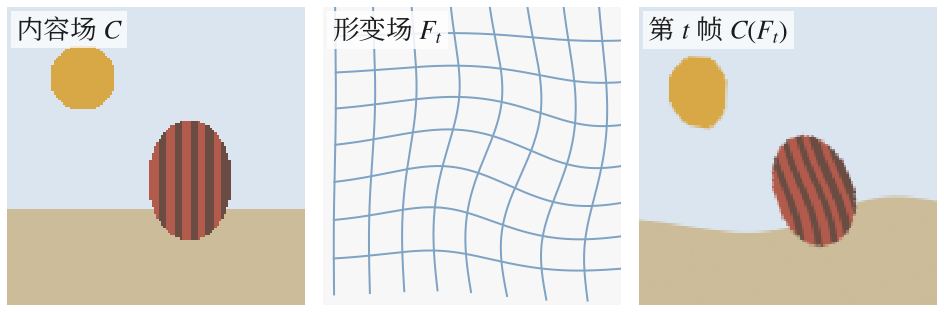

# 视频编辑的方法

上一章说明了视频编辑难在哪。这一章按“怎么保证时间一致”把现有方法分成三类，各挑几个代表讲清楚思路。

分类的依据还可以再具体一点：看它在帧间共享什么。共享像素，就得到传播类；共享几何（形变场），就得到分解类；共享一个已经学会运动的模型，就得到整体生成类。后面每个方法都能放进这张表，差别只在共享的信息落在哪一层、共享发生在采样的哪一步。

## 三类做法

**逐帧传播。** 先编辑关键帧，再把结果传播到其他帧，用光流或特征匹配找到对应位置。

**跟踪与变形。** 先估计视频的运动，把视频分解成“内容”与“运动”，编辑内容后按原运动重新渲染。

**整体生成。** 把视频当成一个时空张量，直接用一个视频模型生成整段。



### 逐帧传播的做法

```text
输入: 视频 V（L 帧），编辑指令 e，锚帧间隔 M
for k = 0 .. ceil(L/M)-1:
    t0 = k*M
    x[t0] = edit(V[t0], e)                    # 锚帧独立编辑
    for t = t0+1 .. min(t0+M-1, L-1):
        F   = flow(V[t-1], V[t])              # 源视频的光流
        x[t] = refine(warp(x[t-1], F), V[t], e)
在段边界的重叠区做线性融合
输出: x
```

成本是 $L-1$ 次光流估计加 $L$ 次轻量修补前向。$512\times512$、24 帧，单卡几秒到几十秒量级。误差按上一章的递推规则累积，$M$ 取小一点更稳也更贵。

修补器是这类方法里最不显眼也最影响成败的一环。它可以是简单的颜色匹配（把 warp 过来的结果按局部均值拉回源帧的统计），也可以是一个小型扩散修补（只跑前若干步去噪，以 warp 结果为初始化）。前者快，但只能修颜色漂移；后者能修结构错位，却会引入新的随机性——修得越多，闪烁回来越多。折中的做法是只让修补器在前景边缘这类 warp 必然出错的地方工作，其余位置直接保留 warp 结果。

自由度分布极不均匀：只在锚帧上高，其他帧只能微调。要改的东西如果比锚帧间隔“新”，传播就会把它抹掉——比如第 5 帧才出现的物体，在第 3 帧锚帧里根本没位置可改。

### 跟踪与变形的做法

```text
1. 估计每帧到规范帧的形变 F_t（光流，或跟踪 + 稠密化）
2. 优化内容场 C:  min Σ_t ||V_t - C(F_t)||² + 正则
3. 用任意 2D 图像编辑工具改 C -> C'
4. 渲染 x_t = C'(F_t)
```

成本集中在第 2 步的一次优化，量级从几分钟到一小时，取决于分辨率与帧数；渲染只是查表，很快。编辑自由度全在内容场，运动完全由 $F_t$ 决定，所以它能做到“运动一点不变”。

### 整体生成的做法

```text
1. 把 V 编码成 latent z（L × h × w × c）
2. 用图像编辑改首帧或若干关键帧 -> z_edit
3. 以 z_edit 与 e 为条件，让视频模型生成整段 z'
4. 解码 z' -> x
```

成本是一次完整的多步采样，token 数 $L\cdot hw$，步数几十。24 帧、$64\times64$ 隐空间、20 步，单卡几十秒到几分钟；显存随 $L$ 增长，长视频必须分块或换用注意力更便宜的底座。

三类方法的代价不同：传播便宜但会累积误差；跟踪准确但依赖光流质量；整体生成效果最好但最贵。

三类不是互斥的，工程上常见的是混着用：用传播做粗对齐，用整体生成补细节；或者用形变场管运动，用图像编辑改内容。混用时要清楚哪一层负责一致——两层都想管，就会互相拉扯。

### 三条路线各自隐含的假设

三类做法都暗含一组前提，前提不成立时方法会坏，而且坏得没有提示。

传播假设“相邻帧之间是同一个像素在移动”。快速平移、镜头切换、物体进出画时这个假设断了，warp 拿到的是错位的像素，错位又会被当成“需要修补”的差异，修着修着就改成了别的东西。

分解假设“整段视频可以被一张内容图加一个二维形变解释”。三维结构、遮挡、光照变化都不在这个模型里，超出部分会被记成内容场的纹理或形变的误差。看上去拟合得很好，实际上两个场在互相抵消。

整体生成假设“底座见过的运动足以覆盖这段素材”。素材是训练分布里的东西时它补得很好；一旦是特殊视角或特殊运动（俯拍、显微、体育快镜），它会把运动拉回熟悉的模式。

三条假设的检验办法很直接：看错误是“随机散布”还是“集中在某类位置”。集中在遮挡边界，说明传播的对应断了；集中在运动剧烈处，说明分解装不下；集中在全片的运动节奏上，说明底座改了运动。

## 微调与跨帧注意力

Tune-A-Video 是最早的一批文本驱动视频编辑方法。它给一段参考视频和一句新描述，在图像扩散模型上做少量微调。

结构上做了两处改造。一是把二维的注意力扩成“伪三维”：空间注意力照旧，再加一层时间注意力。二是让每一帧的查询都能看到第一帧的键值，从而保持主体一致。

两处改造写成式子。设第 $l$ 层在时刻 $t$ 的 token 为 $z_t\in\mathbb{R}^{hw\times d}$。空间注意力在帧内做，和图像模型里一样：

$$\mathrm{Attn}_s(z_t)=\mathrm{softmax}\!\Big(\frac{Q_tK_t^\top}{\sqrt d}\Big)V_t,\quad Q_t=z_tW_Q,\;K_t=z_tW_K,\;V_t=z_tW_V .$$

时间注意力把同一空间位置在各帧的 token 排成一列。记 $\tilde z_i\in\mathbb{R}^{L\times d}$ 为第 $i$ 个位置的帧序列：

$$\mathrm{Attn}_t(\tilde z_i)=\mathrm{softmax}\!\Big(\frac{\tilde Q_i\tilde K_i^\top}{\sqrt d}\Big)\tilde V_i .$$

两层串起来就是“先帧内、再帧间”。全三维注意力是 $O\big((Lhw)^2\big)$，分解后是 $O\big(L(hw)^2+(hw)L^2\big)$，两者的比约为 $Lhw/(hw+L)$，在 $hw\gg L$ 时近似等于帧数 $L$。取 $hw=4096$、单头 $d=64$：$L=16$ 时从 $2.7\times10^{11}$ 乘加降到 $1.7\times10^{10}$，差 16 倍；$L=64$ 时差 63 倍。省下来的不只是算力，更是显存：全三维的注意力矩阵在 $L=16$ 时就有 8.6 GB（半精度、单头单层），分解后最大的一块是 $L\cdot hw^2$，只有 0.5 GB 左右。



实际用的比这更省：查询来自第 $t$ 帧，键值只取第 $t-1$ 帧与第 $0$ 帧拼起来的两份，

$$\mathrm{Attn}(z_t)=\mathrm{softmax}\!\Big(\frac{Q_t[K_0;K_{t-1}]^\top}{\sqrt d}\Big)[V_0;V_{t-1}].$$

$K_0$ 是首帧锚，$K_{t-1}$ 是邻帧。前者管“外观不许漂”，后者管“别跳”。只保留这两份，$O(L^2)$ 的帧间项被压成常数。

首帧锚定是这套做法里最要紧的一步。它把第 $0$ 帧当成外观的坐标系：衣服的颜色、墙的纹理、脸的样子，只在第 $0$ 帧被写一次，其余帧只能读。读的人没法自己发明新外观，漂移就没有落脚点。

代价是外观也不会随时间演化。镜头转过去再转回来，光照变了，锚帧给的外观已经不对；首帧被遮挡，锚定本身就不可靠。所以这类方法对素材有个前置条件：首帧得干净且代表全片。

微调的对象通常只是时间注意力的那几份投影矩阵，空间分支冻结。可调参数少，几百步就收敛，一张卡上几分钟到十几分钟（量级估计）。每换一段视频就要重训一次，所以它适合“一次处理、结果留存”，不适合交互试错。

只调时间注意力就够，理由可以这么想。空间分支已经会画物体，缺的只是“同一个物体在相邻帧里该长什么样”。这个知识不需要重学，只需要把帧间读写的权重调对。参数越少，越不容易把空间能力改坏，也越不容易过拟合到某一段视频的外观上。反过来，如果素材的外观本身就不在底座的能力里（罕见材质、专业设备画面），只调时间注意力不够用，因为空间分支根本画不出来。这时要么扩大微调范围，要么换底座。

失效的输入很固定：大位移（相邻帧的 token 已经对不上位置，$K_{t-1}$ 帮不上）、长视频（漂移在段与段之间重新出现）、非刚性形变（首帧的外观在新姿态下不成立）。

## 免训练的做法

Text2Video-Zero 不改任何参数。它用两个技巧让图像模型生成一致的视频。

一是共享初始噪声：先抽一份噪声，让所有帧共享大部分，只留少量差异。这样去噪之后各帧构图接近。

二是跨帧注意力：每一帧的查询与第一帧的键值一起算，让内容对齐到第一帧。

共享噪声的形式上一章推过：

$$\varepsilon_t=\sqrt{\rho}\,\varepsilon_0+\sqrt{1-\rho}\,\delta_t ,$$

$\rho$ 越大帧间抖动越小，但完全共享（$\rho=1$）会让所有帧从同一个点出发，去噪结果几乎相同，运动就没了。这是一个必须留出口的地方：工程上 $\rho$ 取一个偏大的值，在“够一致”与“还能动”之间折中。

跨帧注意力把帧内注意力的键值换成首帧的：

$$\mathrm{Attn}_{\text{cross}}(z_t)=\mathrm{softmax}\!\Big(\frac{Q_tK_0^\top}{\sqrt d}\Big)V_0 .$$

查询来自当前帧，说明“我要找什么”；键值来自首帧，说明“库里有什么”。当前帧只能在首帧给定的外观集合里取用，不会自己造新的。

第三个机制常被忽略：运动从哪来。全片共享首帧的键值，会把所有帧拉向同一张图；为了让它动，它先按一个预设的位移把首帧 latent 平移或缩放成各帧的初值

$$z_t^{(T)}=\mathcal{W}\big(z_0^{(T)},\delta_t\big),$$

$\delta_t$ 是第 $t$ 帧的全局位移。这等于告诉模型“镜头这样动”，模型只需在此基础上补局部内容。位移是全局的、预设的，所以只能表达平移与缩放，表达不了物体各自运动。

三步串起来就是完整流程：按位移 warp 首帧得到初值，用共享噪声加噪到第 $T$ 步，然后在每一步的去噪里用跨帧注意力取首帧的键值。三步都不需要训练，也不需要先知道这个视频里有什么。

效果在简单场景上不错，复杂运动就不行了。它的价值在于说明了一件事：一致性的本质是“帧之间共享信息”，共享的方式可以很轻。

## 用特征对应

TokenFlow 的思路是：先逐帧独立编辑，得到一组“各自都对、彼此不一致”的结果；再在扩散特征空间里找对应关系，把同一物体的特征对齐，重新生成。

```text
第一遍（独立编辑）:
  for t in 0..L-1:
      z_t = DDIM_edit(z_init, e)        # 共用一份初始噪声，逐帧跑
      记录中间层特征 φ_t
第二遍（对应 + 重生成）:
  相邻帧之间找 φ_t 与 φ_{t±1} 的最近邻
  沿时间串联，得到映射 r(i,t)
  for t:  重跑 DDIM，把 φ_t(i) 替换为 φ_{r(i,t)}(i')
```

对应的定义是特征最近邻：

$$r(i,t)=\arg\min_{j}\ \big\|\phi_t(i)-\phi_{t'}(j)\big\|_2 .$$

只在相邻帧之间找，然后沿时间串联：第 $t$ 帧的第 $i$ 个位置先对到第 $t-1$ 帧，再对到第 $t-2$ 帧，最后落到某个参考帧。串联的好处是相邻帧的特征分布最接近，匹配错误少；坏处是错误也会串联，一步错，后面全跟着错。

第二遍重生成时，把第 $t$ 帧第 $i$ 个位置的特征换成它串到的参考帧位置的特征。这样每个像素的外观都来自一个统一来源，帧间自然对齐；而空间结构、运动仍由各自的 latent 决定，画面不会僵住。这一点与“全部用首帧”的差别很清楚：TokenFlow 不把全片拉到同一张图，而是把“同一个东西”找到并统一。

两遍 DDIM 让计算量翻倍，再加上每对相邻帧的全位置最近邻。$64\times64$ 特征、$d=128$、$L=24$，是 $23\times4096^2\times128\approx4.9\times10^{10}$ 次乘加，用 GPU 上的批量矩阵乘大约几秒（量级估计），但显存占用不小，通常要分块算。

它不需要训练，也不需要光流：特征空间的最近邻比像素级光流更稳健，能容忍纹理变化。代价是每个像素都要找对应，计算量大。

失效的输入很固定：相邻帧位移大到特征已经错位（最近邻找不到正确位置）、大面积遮挡（对到被遮的背景）、纹理重复（瓷砖、条纹，最近邻挑错实例）。这几种情形在结果里都表现为“某块区域突然换成了别处的纹理”。

用哪一层特征做对应，影响很大。浅层特征保留纹理与边缘，最近邻找得细，但受颜色变化影响大——衣服换了颜色，浅层特征全变；深层特征语义化，对颜色宽容，但空间分辨率低，两个相邻的手指可能被当成一个。实用做法是取中间几层，或者把几层拼起来再做最近邻。这个选择与编辑类型挂钩：换色类编辑适合用深层，换材质类适合用浅层，换风格两类都不稳，得看具体素材。

## 用形变场

CoDeF 走得更远。它把视频表示成两个场：内容场描述“画面里有什么”，形变场描述“它怎么动”。优化时把整段视频拟合到这两个场上。

内容场是二维函数 $C:\mathbb{R}^2\to\mathbb{R}^3$，形变场按帧给，$F_t(p)=p+\Delta_t(p)$。第 $t$ 帧由内容场在形变后的坐标处采样得到：

$$I_t(p)=C\big(F_t(p)\big).$$

拟合的目标是让渲染结果贴近原视频，同时让形变场光滑、别偏离光流太远：

$$\min_{C,\Delta}\ \sum_{t=1}^{L}\big\|I_t-C\circ F_t\big\|^2+\lambda_1\sum_t\|\nabla\Delta_t\|_1+\lambda_2\sum_t\big\|\Delta_t-\Delta_t^{\text{flow}}\big\|^2 .$$

三项各管一件事。第一项是重建，逼两个场把视频解释清楚。第二项是平滑，没有它形变场会退化成“每帧一个常数位移”，内容场则把每帧的差异都记成纹理，等于没分解。第三项是锚，把形变场拉到一条现成光流的附近，防止它在无纹理区乱跑。

第三项的权重在实践中常常逐步衰减，而不是始终如一。前期它是主要约束，把形变场带到一个合理的解附近；后期让重建项自己决定细节。从头到尾都不给锚，优化容易停在“所有位移都是零”或“位移全指向同一方向”这类退化解上。



编辑时只改内容场，形变场保持不动，于是运动被完整保留。改完之后按原来的形变场重新渲染，得到编辑后的视频。这一步很直接：$C$ 是一张二维图，任何图像编辑方法都能作用在它上面——扩散编辑、调色、手工修补。改完得到 $C'$，按原来的 $\Delta_t$ 渲染 $I_t'=C'(F_t)$。渲染只查表，不重新生成，所以运动逐像素保留。

这类方法的优点是结构保持好，而且可以用任意图像编辑工具改内容场。缺点是慢：优化是按视频单独做的，分钟到小时量级，分辨率越高越贵；渲染本身很快，一次查表就完。另一个缺点是光流不准的地方会出错。

失效的边界来自表示的容量。单层二维场表示不了遮挡后被挡住又出现的内容——被挡的部分在规范帧里没有位置；也表示不了新视角，因为形变只是二维的坐标搬移，没有三维结构。多个物体各自运动时，全局的 $\Delta_t$ 要同时满足所有物体，光流矛盾的地方就会扯出鬼影。

## 用视频模型整体生成

2024 年之后，视频生成模型变强了，编辑开始转向“整体生成”。

### Rerender A Video：分层，逐级锚定

Rerender A Video 的思路是层次化：先做关键帧编辑，再用视频模型补中间帧，最后用超分补细节。每一级都以关键帧为锚，漂移被控制住。

具体是三级。第一级在稀疏关键帧（首帧、若干等间隔帧）上做图像编辑，得到一批带噪的锚。第二级以锚为条件，用视频扩散模型把中间帧补出来；补的时候每一步都把上一帧的结果按光流 warp 过来当初始化，模型只负责修掉 warp 带来的错位。第三级用视频超分把分辨率提上去。

分层的用处是把“改什么”与“在哪里一致”拆开：第一级决定内容，后两级只负责在时间上抹平。每级都有自己的锚（关键帧、上一帧、低分辨率结果），漂移被限制在一级的范围内，不会跨级累积。

它的问题在依赖光流：第二级的初始化来自 warp，光流在遮挡与大位移处不准，那里就只能靠模型自己编，编出来的东西前后帧不一定接得上。

### AnyV2V：把图像编辑方法当插件

AnyV2V 观察到一个矛盾：图像编辑方法层出不穷，视频编辑的方法却要一个个重写。于是它把两者拆开：图像编辑负责首帧，视频模型负责把结果铺满全片。

流程是：用任意图像编辑方法改首帧，得到 $I_0'$；把 $I_0'$ 送进一个图生视频模型，生成整段；再把整段的风格与首帧对齐（一次传播或精修）。

两个工程上的关键。一是条件要“翻译”：图生视频模型要的是文本加首帧，而图像编辑方法只给了图。它用反演把 $I_0'$ 反推成一段 prompt（或直接用编辑指令），让视频模型知道该往哪个方向动。二是长视频要分段，段与段之间用上一段的尾帧当下一段的首帧，接缝处再做一次对齐。

它的价值在“通用”：换编辑方法不用换框架。局限也在“通用”：一致性完全由底座的图生视频模型决定，底座没见过的运动它也做不出来。更常见的是另一种失败：视频模型有自己的运动先验，容易把原来的运动改写成它熟悉的运动（原来的快走变成慢走），这时画面很干净，但不是同一段视频了。

### VACE：把任务写成条件

VACE 走的是另一条路：不去拼流程，而是把“生成、编辑、参考”都写进同一个模型的条件里。

输入被组织成一条序列：文本、参考图、源视频的 latent、以及一个掩码。源视频的 latent 与待生成的噪声 latent 在序列维上拼接，注意力允许噪声部分去看源视频部分；掩码指定哪一块该被重新生成、哪一块该保留。

$$z'=M_\theta\Big(\mathrm{concat}\big(z^{(T)},\,z^{\text{src}}\big),\ \text{mask},\ c\Big).$$

这样，编辑就是“给一段源视频、一个掩码、一段文本，让模型补掩码内”；生成是“不给源视频”；参考是“给参考图不给掩码”。同一套参数覆盖多种任务，任务差别只体现在条件上。

好处是编辑与生成共享同一份运动先验，模型知道“掩码里的东西应该怎么动”，不需要外部光流告诉它。代价是模型重：参数量大，推理要多步，显存按帧数线性涨，长视频必须分块。分块又回到接缝问题，只是这次接缝由模型自己补，不靠外部融合。

这条路线的好处是不用自己设计一致性机制，交给视频模型；代价是需要一个足够强的视频模型，推理成本高。

### 这条路线怎么判断成败

整体生成的结果好看，但不一定对。三个检查点。

运动是否还在：编辑前后各估一次光流，端点误差超过两三个像素，说明运动已经被改写。

时序是否平滑：看光流扭曲误差，并与源视频自己的基线对比。

主体是否还是同一个：取若干帧的物体嵌入，帧间距离应该小，与源视频对应帧的距离也应该小。只满足前者，可能是一段自洽但换了主体的视频。第三个检查最容易被忽略，因为整段生成的画面太干净，人眼很难判断它还是不是同一段素材。

## 一张对比

把上一节的每个方法压成一行。

| 方法 | 要训练吗 | 依赖 | 擅长 | 主要问题 |
| --- | --- | --- | --- | --- |
| Tune-A-Video | 每段微调 | 参考视频 | 主体一致 | 慢 |
| Text2Video-Zero | 不要 | 共享噪声 | 简单场景 | 复杂运动 |
| TokenFlow | 不要 | 特征对应 | 结构保持 | 计算量大 |
| CoDeF | 每段优化 | 形变场 | 运动保真 | 优化慢 |
| Rerender / AnyV2V | 不要 | 视频模型 | 通用编辑 | 依赖底座 |
| VACE | 预训练 | 统一条件 | 多任务 | 模型重 |

同一批方法换一个角度再看一次，用“帧间共享什么”排序，可以看出一件事：共享的东西越抽象，自由度越高，但对底座的依赖越强。

| 方法 | 帧间共享什么 | 编辑自由度 | 一致性来源 | 每段耗时（量级） |
| --- | --- | --- | --- | --- |
| Text2Video-Zero | 初始噪声 + 首帧键值 | 低 | 共享噪声 + 跨帧注意力 | 与逐帧编辑同阶 |
| Tune-A-Video | 首帧键值 + 一份权重 | 中 | 微调 + 首帧锚定 | 分钟 |
| TokenFlow | 特征对应 | 中高 | 先独立编辑、再对齐 | 分钟 |
| CoDeF | 形变场 | 高 | 分解，渲染查表 | 十分钟到小时 |
| Rerender / AnyV2V | 关键帧与首帧 | 高 | 视频模型 + 光流传播 | 分钟 |
| VACE | 源视频 latent | 高 | 视频模型的条件 | 分钟 |

表中的耗时都是量级估值，硬件、分辨率、帧数一变就换一个数量级，只能用来分档：秒级、分钟级、小时级。

两张表里没有“三项全能”的行，这不是遗漏，是结构使然。自由度与一致性本来就是一对反向旋钮：把外观锁得越死，改得越像；把运动交给形变场越彻底，就越不可能重新组织画面。选型实际上是在决定“哪一项可以由人兜底”——能用人工修一遍的，就让方法在那一项上偷懒。

## 怎么选

选型先问三个问题，它们把候选集砍到一两个。

第一个问题：运动要不要逐像素保留？如果要，只有形变场一类能承诺，别的都在不同程度上重画运动。这个问题在修复、老片处理、商品展示里答案都是“要”。

第二个问题：改动是换外观还是换结构？换颜色、换材质、换风格，外观层面就能完成，帧间对应关系仍然成立；换主体、换场景、换动作，像素会被重排，任何依赖对应的方法都会失准。

第三个问题：时间预算是秒、分钟、还是小时？这个数直接删掉一半方法：秒级只留逐帧编辑与传播，分钟级可以上 TokenFlow 与整体生成，小时级才能考虑每段视频单独优化。

三个问题的答案对应一个大致的路由：

```text
运动必须逐像素保留？
  是 -> 形变场（CoDeF 类），预算不够就退到光流传播 + 小步修补
  否 -> 继续
改动涉及结构（换主体/场景/动作）？
  是 -> 整体生成（VACE / AnyV2V / Rerender）
  否 -> 继续
预算秒级？
  是 -> 逐帧编辑 + 跨帧注意力（Text2Video-Zero 类）
  否 -> 特征对应（TokenFlow）或先编辑关键帧再补帧
```

具体到要求，可以这样对应。

要求快、可交互：先试免训练的方法，比如 Text2Video-Zero 或 TokenFlow。前者最便宜，代价是运动表达弱；后者贵一截，但能把局部纹理稳住。

要求结构保持：用形变场类的方法，或者先做关键帧编辑再用视频模型补帧。两者的差别在“结构”指什么：前者指像素级的运动，后者指画面布局。

要求语义改动大：用整体生成，把编辑交给视频模型。这时候不要再指望光流或特征对应，它们预设了“改前改后是同一个东西”，而大改动恰好打破这个前提。

要求运动完全不变：只有形变场类的方法能保证，其他方法多多少少会改到运动。

### 几种一用就错的搭配

免训练方法配大语义改动。外观被首帧锁死，改色可以，改成另一个物体不行——模型只能从首帧的“外观库”里取东西，库里没有的它造不出来。

整体生成配逐像素运动保真。底座有自己的运动先验，会把素材的运动改写成它熟悉的节奏。结果画面很干净，但与源视频对不上，做视频修复时这是致命的。

传播配长视频。误差按上一章的递推规则长，$M$ 取大一点就漂，取小一点就贵，两头不讨好。超过一百帧的素材，要么分块加锚定，要么换整体生成。

形变场配多物体独立运动。全局的 $\Delta_t$ 要同时满足所有物体，两个物体往相反方向走时，光流矛盾的地方就会扯出鬼影。这种素材得先把物体分开，每层一个形变场。

### 一个自检顺序

不要一上来就跑全片。按三关走，每关的帧数不同，暴露的问题也不同。

第一关，抽 3 帧（首、中、尾）做单帧编辑。看的是编辑本身对不对：主体有没有改到、背景有没有被误伤、掩码边界干不干净。这一关不过，后面都不用跑。

第二关，取连续的 24 帧。看的是闪烁：盯住一块平坦区域（墙、天空），看它有没有呼吸。有呼吸就是帧间相关不够，得加共享噪声或加锚定。

第三关，取 120 帧以上。看的是漂移：把首帧与尾帧并排，比颜色与结构。偏了就是误差累积，得加关键帧锚定或换方法。

三关的帧数是经验值，不是硬指标：24 帧刚好能让人眼看出几赫兹的抖动，120 帧（四到五秒）刚好能让累积误差越过可见阈。

### 混合使用的两种常见组合

一种是用形变场管运动、用扩散编辑管外观。这就是 CoDeF 的做法，也可以自己拼：先用光流把视频对齐到一个规范帧，在规范帧上做图像编辑，再按光流渲染回去。后者的优点是每一步都能单独调试，缺点是规范帧只能装下“一直可见”的内容，遮挡区在渲染时会露洞。

另一种是先传播、再用视频模型修。传播负责把改动铺到每一帧（便宜、快、有漂移），视频模型负责在滑动窗口里磨平接缝（贵、慢、但能修）。这种组合在工程上很实用：传播给出的初值已经把大结构定下，视频模型不需要自己发明运动，所以改写运动的毛病会轻很多。

两种组合的共同点是分工明确：一致性只由一层负责，另一层只负责内容。两层都想管一致，就会出现“修一处坏一处”的振荡。

## 与下一章的关系

下一章把这一册收一下，谈一步编辑的边界与工程实践。视频编辑的很多限制，其实来自“一步只有一次机会”这个事实；理解了那一点，就能判断哪些任务适合一步，哪些必须多步。

上一章的三个要求与这一章的三类做法可以对上：传播解决一致、形变解决运动保真、整体生成解决长度与语义。选型就是在三者之间找自己最不能让步的那条边。
