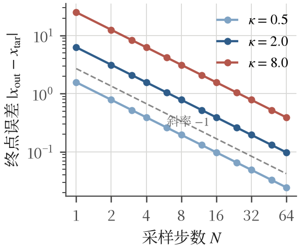
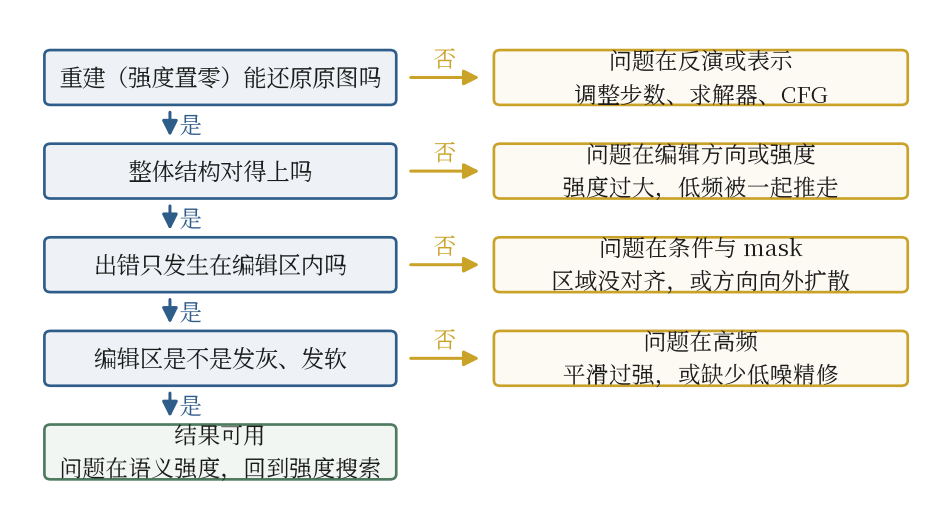

# 一步编辑的边界

第 8 章讲了一步编辑的做法，第 9、10 章讲了视频编辑的做法。这一章把两者放在一起，谈能力边界、评测口径，以及几种典型的失败。

把编辑压到一步之后，能得到什么、失去什么，值得单独说清楚。

一步编辑的吸引力在成本：一次前向，几十到几百毫秒，可以塞进交互式界面。代价是方法失去了“看结果再修正”的机会。多步采样每一步都在重新估计方向，走偏了还能拉回来；一步走完就结束了，误差原样留在画面里。所以能不能用一步，不取决于实现得多好，取决于任务允不允许这么大的误差。

先约定说法。这里的“一步”指网络只被调用一次的那类编辑（含蒸馏出来的少步模型，步数在一到四之间），不是把多步采样里的步长调大。“多步”指十步以上、真正沿路径积分的做法。两者的差别不在代码量，在有没有机会在中途改主意。

## 能做到什么

属性替换：颜色、材质、天气、季节。这类编辑改动局部、结构不变，一步模型完全够用。

为什么够用，可以算一下。属性在潜空间里对应一个近似全局的偏移：一片区域的通道统计整体往一个方向挪，空间上几乎没有梯度。这样的方向场能量小、变化慢，一步走完的误差落在小曲率那一档。换成直白的话，改颜色时“该往哪走”在整条路径上几乎是同一个答案，不需要中途改主意。

风格迁移：整体色调与笔触改变，结构保留。一步模型在这类任务上的表现接近多步，因为风格本来就是全局统计量，与像素位置的对应关系弱。代价通常落在纹理上：风格迁移要把细节重新组织成另一种质感，一步之后高频偏软，加一次低噪声精修能补回来。

简单对象替换：把狗换成猫，物体位置与大小不变。这类要求语义对齐与结构保持同时成立，一步方法可以做到，但需要合适的编辑强度。强度太小，新物体出不来；强度太大，轮廓先崩——方向场在物体边界上有尖峰，一步会把尖峰当成整体位移，边界就被推开。

### 一步与多步差在哪

把采样看成解一个常微分方程

$$\frac{dx}{dt}=u(x,t),\qquad x(1)=x_{\text{src}},\quad x(0)=x_{\text{tar}},$$

时间从噪声端 $1$ 走到数据端 $0$。显式 Euler 用步长 $h=1/N$ 走 $N$ 步，单步的局部截断误差是

$$\tau=\frac{h^2}{2}\Big(\partial_t u+J_u u\Big)+O(h^3),$$

$J_u$ 是 $u$ 对 $x$ 的雅可比。括号里那一项是速度场沿轨迹的物质导数，记作 $\kappa$，可以理解成路径的弯曲程度。$N$ 步累积起来，全局误差的量级是

$$e_N\simeq\frac{\kappa}{2N}.$$

$N$ 在分母上，$\kappa$ 在分子上。加大 $N$ 是线性地压误差，任务的 $\kappa$ 是给定的。一步（$N=1$）的误差就是 $\kappa/2$：任务本身弯得越厉害，一步越不可能对。式里的系数随路径形状变，图 11.1 那条路径上算出来的是 $\kappa\pi/N$，量级一致。

画出来更清楚。图 11.1 用一条人为构造的弯曲路径：速度场是一个常数项加一个正弦项，正弦项在整段上积分为零，所以终点不动，只有中途的走法在弯。

三条线平行，说明误差确实是 $1/N$；线的高度差由 $\kappa$ 决定，$\kappa$ 大四倍，误差也大四倍。图里没有“多走几步突然就好”的拐点，也没有“参数调对了自动变好”的平台。

这条曲线解释了本章的核心判断：一步编辑的上限不是工程问题。把蒸馏做得更好、把网络做得更大，改善的是 $\kappa$ 里属于模型的那部分；属于任务的那部分，也就是“从这张图到那张图，路径本身要拐几个弯”，换不掉。

| 编辑类型 | 路径曲率 | 一步可行性 |
| --- | --- | --- |
| 换颜色、换材质 | 小 | 高 |
| 换风格 | 小到中 | 中高，纹理偏软 |
| 换同类物体 | 中 | 中，强度要选 |
| 换姿态、改视角 | 大 | 低 |
| 增删物体并重建遮挡 | 大 | 很低 |

表里的曲率是定性的。真要估，看结构条件：编辑前后深度图、边缘图的差异越大，路径越弯。这个量在第 5 章的条件方法里可以直接算出来，比凭感觉判断可靠。

### 一步模型为什么输出偏软

一步模型把“从噪声到样本”压成一次回归。训练时的目标是

$$L(\theta)=E_{x_0,t,c}\big\|f_\theta(x_t,t,c)-x_0\big\|^2 .$$

固定 $x_t$ 与条件，对 $f$ 逐点求导令其为零，得到

$$f^\ast(x_t,t,c)=E\big[x_0\mid x_t,c\big],$$

代回损失，最小值等于条件方差 $E[\|x_0-f^\ast\|^2\mid x_t,c]$。也就是说，任何一次回归式的学习，学到的都是条件分布的均值；真正的最优值就是方差本身，它不为零。

均值化的后果集中在高频。低频结构（物体的位置、大块颜色）在给定条件下几乎确定，取均值损失很小；高频细节（笔画边缘、发丝、织物）在给定条件下有很多种可能，取均值就把它们混成一片中间值。这就是“偏软”的来源，不是网络容量不够，而是目标函数决定的。

多步采样避开了这件事：每一步只预测一个局部方向，最后一步在低噪声处才需要细节，而那里的条件方差已经很小。一步在 $t=1$ 附近做预测，那里的条件方差最大，均值也最糊。

### 一步省下的是什么

拿一个多步模型作对照。50 步、双条件（CFG 要把批大小翻倍），每次生成是 100 次网络前向；一步模型是 1 次。差两个数量级。

具体到时间：$512\times512$ 的潜扩散模型，单次前向在消费级显卡上是几十毫秒的量级（估计值，随模型大小与精度变化），50 步就是数秒；一步是几十毫秒。交互式编辑要求“拖动滑块就看到结果”，这个要求只有一步能满足。

省下的不只是时间，还有一整类工程复杂度：不用缓存注意力，不用做潜空间的逐步记录，不用为每一步设计掩码注入。换来的是一整套新的约束——强度只有一次选择机会，误差没有纠正余地。

## 做不到什么

大幅结构改变：换姿势、改变视角、增加一个与场景交互的新物体。多步方法靠中间步骤逐步调整，一步模型没有这个机会。

中间步骤的作用不只是“多算几次”。它让状态一直留在数据流形附近：每走一小步，输出都会被拉回“像一张照片”的区域。一步跨过去，中间那段路要自己穿，穿的过程中一旦离开流形，终点就落在流形外面。画面上表现为肢体粘连、物体悬浮、透视错乱——每一项都是“中点不在数据里”的后果。

文字渲染与精细纹理：一步模型的输出在高频细节上通常比多步弱，这是条件均值带来的模糊还没有完全被补上的地方。多步采样每一步都注入新的随机噪声，噪声在去噪过程中被整理成笔画、发丝、纹理；一步没有这个过程。补救要靠低噪声精修：把结果加噪到 $t\approx0.3$，再走两三步，等于把高频那一段交回给多步。这时候它已经不是严格的一步方法，而是“一步定大局、几步补细节”的两段式。

多轮编辑：连续改几次，每次都作用在上一次的结果上。一步方法的误差会累积，第二轮往往明显变差。原因有两层。一层是几何的：每次编辑都让状态离开流形一点，第二轮从一个已经偏离的点出发，修正量按偏离程度放大。另一层是语义的：第一轮改出来的东西在第二轮里被当成“原图的一部分”，模型没有理由保持它，颜色可能被改回去，也可能被推得更远。

用误差的语言写，若单轮引入的偏差是 $\delta$，两轮之后的有效偏差不是 $2\delta$，而是 $\delta+\delta'$，$\delta'$ 是在偏离点上的偏差，通常大于 $\delta$。做一次算术：假设单轮偏差占可察觉差异的 $5\%$，第二轮在偏离点上偏差放大到 $8\%$，两轮合计 $13\%$，已经接近肉眼可辨的门槛；到第四轮，画面会明显滑向模型自己的先验，与原始照片越来越远。这组百分比是示意性的，但放大机制是普遍的。

### 一条分界线

判断一个编辑能不能一步做，看三件事。

编辑前后的结构条件差多少。取深度图或 Canny 边缘，算编辑区内的平均差异。差异小的（换颜色，边缘位置几乎不动）可以一步；差异大的（换姿势，边缘整体重画）不行。

编辑区占整图的比例。占比小，出错的地方少，可以用局部方法绕开一步模型的弱点；占比大，等于重新生成，一步的误差没有地方藏。

目标描述里有没有引入新的空间关系。“把杯子放到桌上”引入了支撑与遮挡，“把杯子换成红色”没有。前者要重新安排布局，后者只是换材质。

三件事里有两件指向“大改”，就不要指望一步。这不是保守，是误差公式给出的界。

## 视频上的一步编辑

视频的一步编辑更难。内存放不下整段，往往要分块；分块之后，块与块之间的接缝又要处理。即使放得下，帧间的细小差异也会表现为抖动。

先把内存算清楚。设帧数 $T$、边长 $S$，VAE 的降采样倍率是 $8$、潜通道数是 $4$，潜张量的元素数是

$$T\times4\times\frac{S}{8}\times\frac{S}{8}.$$

$S=512$、$T=49$ 时是 $49\times4\times64\times64\approx8.0\times10^{5}$ 个元素，fp16 下约 1.6 MB。存特征的开销不大，真正的开销在注意力：每帧的潜特征展平成 $4096$ 个 token，整段就是 $T\times4096$ 个 token，$T=49$ 时约二十万，全注意力的配对数按平方增长，到 $4\times10^{10}$ 量级，单层就放不下。

现实的做法是分解：空间注意力逐帧算，时间注意力在同一空间位置上跨帧算。两层加起来的配对数降到

$$T\cdot\left(\frac{S}{8}\right)^4+\left(\frac{S}{8}\right)^2\cdot T^2,$$

$S=512$、$T=49$ 时约 $8.2\times10^{8}$ 加 $9.8\times10^{6}$，只有全注意力的五十分之一。代价是空间与时间的信息只能通过层与层之间间接交换，一致性比全注意力弱一档。

放不下整段就分块。块长取模型训练时的长度 $L$，块间留重叠 $O$，块数是

$$K=\left\lceil\frac{T-O}{L-O}\right\rceil,$$

计算量与整段一次处理相比的倍数是 $KL/T$。$L=16$、$O=4$、$T=49$ 时 $K=4$，倍数是 $1.31$；把重叠提到 $8$，$K=6$，倍数升到 $1.96$。重叠越大接缝越好处理，计算越贵，这是工程上第一个要做的取舍。

接缝之外还有抖动。一步编辑对输入噪声敏感：同一段视频的两帧内容几乎一样，随机数不同，输出就有细微差别。多步采样里后续步骤会把这种差别抹平一部分，一步没有后续步骤，差别原样留在画面上。1% 的亮度差在静态图上看不出来，每秒 24 次跳变就成了可见的闪烁。

目前的解法与前几章一致：把整段作为样本训练，而不是逐帧；推理时让相邻块共享一部分噪声或条件；必要时加一个轻量的后处理把帧间特征对齐。

共享噪声为什么有效，可以看它的极端：如果两条支路的初始噪声完全相同、条件也相同，那么确定性采样给出的结果逐帧一致，抖动为零，但画面也完全不动。噪声共享的比例就是在“一致”与“有变化”之间选一个点。分块时，把上一块的最后一帧作为下一块的第一帧锚，等价于在块边界上强制这个点重合，接缝处的跳变就被压住了。

一个现实的判断是：一步编辑适合短视频与局部改动，长视频与大幅结构改变仍然要多步。

## 评测口径

编辑的评测有两个常见问题。

第一，指标之间可以互相“作弊”。把背景改得很少，PSNR 很高；把整张图往目标条件推，CLIP 很高。所以必须两个一起看，并且最好报告编辑区域的指标，而不是整图。

第二，编辑强度不同，指标不可比。同一个方法，$t$ 取大一点，CLIP 上升、PSNR 下降。比较两个方法时，要么固定强度，要么画出完整的权衡曲线。

### 指标怎么算

PSNR 由均方误差换算，像素值归一化到 $[0,1]$：

$$\text{PSNR}=10\log_{10}\frac{1}{\text{MSE}},\qquad
\text{MSE}=\frac{1}{3HW}\sum_{c,h,w}\big(x_{\text{tar}}-x_{\text{src}}\big)^2 .$$

掩码版在编辑区外统计，$M_{hw}\in\{0,1\}$ 为 1 表示编辑区：

$$\text{MSE}_{\text{bg}}=\frac{\sum_{h,w}(1-M_{hw})\sum_c\big(x_{\text{tar}}-x_{\text{src}}\big)^2}{3\sum_{h,w}(1-M_{hw})}.$$

CLIP 相似度是两个编码器输出的余弦：编辑区裁剪后送进图像编码器，与目标文本编码器的输出做归一化点积，再乘 100 是常见写法。不同实现的常数不同，比较时要用同一套。

手算一遍能看清整图指标为什么不可比。一张 $512\times512$ 的图，编辑区占 6%，编辑区内归一化 MSE 是 $0.02$，背景完全没动：

$$\text{MSE}_{\text{all}}=0.06\times0.02=1.2\times10^{-3},\qquad
\text{PSNR}_{\text{all}}=10\log_{10}\frac{1}{1.2\times10^{-3}}\approx29.2\ \text{dB}.$$

同样的编辑质量，若编辑区占 40%，整图 MSE 变成 $8\times10^{-3}$，PSNR 掉到约 21 dB。两个数字差 8 dB，方法一样，差别只在 mask 面积。跨数据集比 PSNR 没有意义，只有同一套 mask 下的相对比较有意义。

LPIPS 在 VGG 或 AlexNet 的特征上逐层算归一化距离再加权，越小越像。它对结构性错误的惩罚比 PSNR 重，对整体色调偏移反而宽容，两者的排序常常相反。

### 互相作弊的几种方式

| 指标 | 想衡量 | 怎么被作弊 | 补什么 |
| --- | --- | --- | --- |
| 整图 PSNR | 保真 | 少改，或只改很小一块 | 编辑区外 PSNR、mask 面积 |
| 整图 CLIP | 对齐 | 把背景一起往目标推 | 编辑区裁剪后的 CLIP |
| LPIPS | 感知相似 | 什么都不改 | 与 CLIP 成对报告 |
| 人工评分 | 综合 | 挑图、挑评分员 | 固定题库、多人、报方差 |

表里第三行最容易被忽略。什么都不改时 LPIPS 接近零，看起来“感知质量完美”，实际任务没做。任何单一指标都能被“不动”或“乱动”这两个极端刷高，所以至少要一对方向相反的指标。

### 强度的可比性

同一个方法在 $t=0.6$ 与 $t=0.9$ 上是两个不同的方法。严谨的比较要固定强度，或者固定计算预算（同样的前向次数），再画曲线：横轴是编辑强度，一张图的纵轴是保真，另一张的纵轴是对齐。两条曲线的面积比单点更能说明问题——一个方法可能在某一点上更优，整体却被另一个方法支配。

省事的做法是把两个方法的强度都调到“背景 PSNR 相同”的水平，再比 CLIP。这样比的是同等保真代价下的对齐能力。

一篇报告里值得固定的几个数字：编辑区外的 PSNR 或 LPIPS、编辑区裁剪后的 CLIP、编辑区占整图的比例、前向次数、强度参数。少一项，读者就无法判断这个结果是在什么代价下取得的。

人工评价同样要算不确定性。100 份评分里 60 份选 A 更好，比例的估计标准误是 $\sqrt{0.6\times0.4/100}\approx0.049$，95% 区间宽度约 $\pm0.10$。两个方法差不到 10 个百分点时，这个规模的评分分不出高下；要分辨 5 个百分点的差异，样本量得翻到四倍。

### 视频的评测

视频多算两项。

时间一致性用光流扭曲误差：把第 $t$ 帧按前向光流 $F_{t\to t+1}$ 扭到 $t+1$ 的时刻，与真实的第 $t+1$ 帧比，

$$E_{\text{warp}}=\frac{1}{|\Omega|}\sum_{p\in\Omega}\Big\|x^{(t+1)}_p-\hat{x}^{(t)}\big[p+F_{t\to t+1}(p)\big]\Big\|_1,$$

$\Omega$ 是去掉遮挡与出界像素后的集合。它对光流质量敏感，光流估不准的地方误差天然大，所以只在同一段视频上比较才有意义。

语义稳定性沿时间算 CLIP 相似度的标准差：每帧与目标描述算一次，取标准差。标准差大，说明“改的东西在变”，也就是语义闪烁。这个指标对缓慢漂移不敏感（漂移的逐帧差异小），要配合“首尾帧 CLIP 差”一起看。

## 常见失败

**背景渗透。** 编辑对象的时候，周围的颜色、光照跟着变。原因是没有 mask 约束，编辑方向在空间上扩散开了。诊断很快：把差异图拿出来看，若改动越出 mask 边界十几个像素，就是渗透。处置是加 mask 内的潜空间混合，或者用带 mask 的条件注入。

**语义漂移。** 想改颜色，结果形状也变了。原因是编辑方向在高噪声阶段就被放大，低频结构跟着动。特征是编辑区降采样到 $1/16$ 后与源图明显不同，而放大后的高频差别不大。处置是降低强度、把编辑时刻往后挪，或者改用平滑后的方向场。

**结构碎裂。** 一步积分误差太大，物体边界断开。这是简单 drift 的典型症状，也是低能量平滑要解决的问题。看图时注意边界附近有没有错位的重影：同一个边缘出现两条，间隔几个像素，那是一次走过头又走回来的痕迹。

**过度平滑。** 平滑太强，编辑效果不明显，或者画面发灰。$\delta$ 取太大时会出现。定量特征是编辑区的高频能量（拉普拉斯响应的绝对值均值）比源图低一截，同时 CLIP 也没上去，两头不占。

四种失败都能在“重建—结构—局部”这条链上定位，顺序在下一节。

## 怎么定位问题

先看重建。如果连原图都还原不好，问题在表示或反演，不在编辑。做法是把编辑强度设成零（或把目标条件换成源条件）跑一遍，与源图比。这一步的 PSNR 是整套方法的上限，后面的编辑再好也超不过它。

再看单步输出的整体结构。如果结构对但细节模糊，说明方向对了，缺的是高频补全。如果结构就错了，方向或强度有问题，先把强度降下来。

最后看局部。错误蔓延到编辑区之外，问题在 mask 或条件：mask 太松，或者条件把改动引到了别处；错误只在编辑区内，问题在强度，或者条件根本没生效。

这个顺序能把问题缩小到一两处，比盲调参数有效。

### 三个开关

定位靠的不是眼力，是受控的干预。三个开关各拨一次，问题的位置基本就定下来了。

强度开关：把强度从当前值降到一半，再降到零。降低之后结果单调变好，说明原来的强度取大了，问题在参数；降到一半就突然崩，说明方向场本身有尖峰，参数救不了。

mask 开关：把 mask 扩到全图，再缩到只含编辑对象的核心。扩到全图后背景渗透明显加重，说明当前 mask 在起作用，问题不在它的松紧；缩到核心后反而变好，说明 mask 太松，背景参与了编辑；缩到核心后编辑效果也消失，说明真正起作用的只有核心那一小块，边界附近的条件没有生效。

种子开关：换随机种子跑三到五次。若结果的差异与“编辑没做到位”是同一量级，说明单次噪声实现的方差太大，结论不可靠。

三个开关各跑一次，成本是三五次推理，比反复调参便宜。

## 一个判断

一步编辑适合“改一点”的任务，不适合“重新构图”的任务。把它用在合适的场景里，效果与多步相差不大；用在结构改变上，怎么调都不对。

这不是方法的缺陷，是问题本身的性质：一步只有一次机会，而结构改变需要多次决策。
