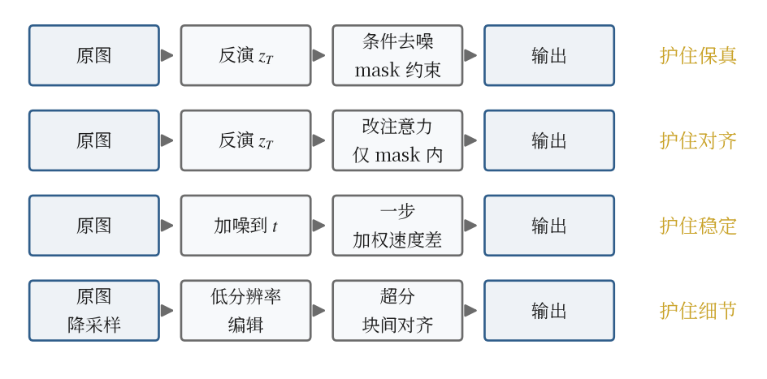
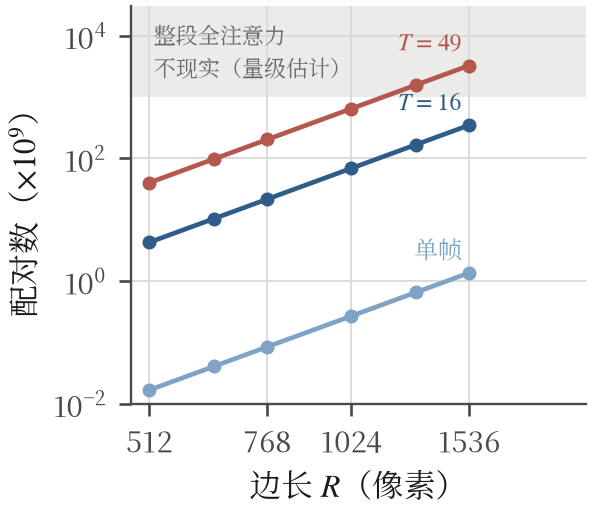
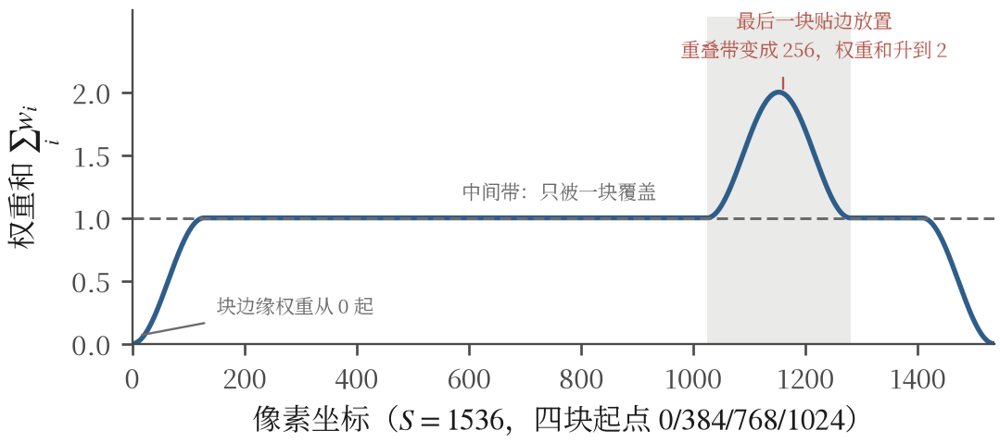

# 组合与工程实践

前面几章的方法不是互斥的。真实的应用往往要把两三种组合起来，还要处理分辨率、批次、评测这些工程问题。这一章讲这些。

组合的动机很实际：每种方法只在一个维度上给保证。反演管保真，mask 管范围，条件管布局，平滑管稳定，超分管细节。一件真实的编辑任务往往同时缺两三种保证，于是要把对应的手段拼起来。拼得好，各自的优点叠加；拼得不好，两个步骤抢同一件事，结果比单独用任何一个都差。

## 组合的几种方式

**反演加条件注入。** 先反演得到噪声，再用 ControlNet 或 mask 约束去噪。保真由反演保证，布局由条件保证。这是最稳的组合。

稳在哪里，可以说得具体。反演把起点固定在一个能重建原图的点上，这一步误差记作 $\varepsilon_{\text{inv}}$；条件注入在去噪的每一步把布局拉向给定的边缘或深度，这一步的误差记作 $\varepsilon_{\text{cond}}$。两者作用在不同对象上：前者作用于“从哪里出发”，后者作用于“往哪里去”，不像两个都改方向的步骤那样互相抵消。

**注意力操作加 mask。** 只在 mask 内替换注意力，mask 外强制保持源条件。适合局部改语义。mask 内外的注意力要分开算，实现上通常是把 mask 下采样到注意力图的分辨率（注意力的空间尺寸常常是 $1/8$ 甚至 $1/16$，边界会糊掉几个像素），再做加权替换。

**速度差加平滑。** 直接算两个条件的差，再对时间做加权平均，就是 ChordEdit 的思路。适合一步模型。它和其他三种组合的区别在于，它不引入新的模块，只是把同一批查询算了两次再做一次卷积式的平均，所以工程上最容易接。

**编辑加超分。** 低分辨率上编辑，再超分回高分辨率。编辑在低分辨率上更稳，超分补细节。超分模型会把编辑过的语义当作给定内容来处理，只要它是“内容保持”的超分，语义就不会变；用生成式的超分放大器（放大同时重绘细节）时，它可能顺手把颜色也改一点，需要检查。



组合时要明确每一步负责什么。如果两个步骤都在改结构，冲突几乎是必然的。

### 四种拼法

还有一层是拼的拓扑：认出拓扑，出了问题才知道往哪里找。

串联把前一段的输出当后一段的输入，反演接条件去噪再接超分就是三段。每段能单独调，但误差会被固化：后一段把前一段的错误当成“内容”守住，损失比单段高一截。

并联让两路从同一个 $z_T$ 出发，一路走文本条件，一路走结构条件，在潜空间按权重平均。两路错误不相关，平均能抵消一部分；两路语义不一致时（一路摘了帽子，一路还戴着），平均出来是一顶半透明的帽子。

分层把同一张图在不同尺度上分别处理，粗层定布局与色调，细层补纹理，层间只传低频。每层任务变简单，风险转到层间一致性。

迭代精修把同一段编辑重复几遍，每遍强度都不大，对付“一次改到位就崩”的编辑最有效，代价是累积与振荡：第二遍把第一遍改过的地方改回去。

### 失败时退回到哪一步

每种拼法都要备退路，原则是往下减：加模块会让接口更多、更难定位。

串联退到单段。先让第一段自己跑：强度置零仍还原不了原图，问题在第一段，回去修反演；第一段正常而第二段之后崩了，把第二段的条件权重从“主导”降到“建议”。

并联退到单路加 mask：融出糊块说明两路分歧超过平均能救的范围，选语义更可信的一路，用 mask 把另一路负责的区域圈掉。分层退到单层加 tiling：层间颜色对不上，通常是下层不认识上层的统计，直接在目标分辨率上分块编辑。

迭代精修退到单次中等强度。看第 $k$ 轮与第 $k-2$ 轮的差异图，差异集中在同一块、方向来回就是振荡，取两轮强度的中间值跑一次。

### 接口不匹配的四种情况

组合本身不难，难在两段代码的假设不一样。常见的四种。

一是坐标不同。一个模块吃像素空间 $[-1,1]$，另一个吃潜空间，中间差一个 $8$ 倍的分辨率。mask、bbox、光流场都是坐标相关的量，跨过这个边界必须同步缩放，否则 mask 的位置整体偏几像素到几十像素。

二是数值范围不同。潜空间的值大致在 $\pm4$ 之间，像素空间归一化到 $[0,1]$ 或 $[-1,1]$。把潜特征当成像素直接混合，再解码，会得到一片偏灰的图。

三是条件格式不同。cross-attention 吃文本嵌入，ControlNet 吃与潜特征同分辨率的图像，参考图方法吃 CLIP 嵌入。同一个“红色”在三种格式里是三个不同的东西，混用不会报错，只会静默失效。

四是时间约定不同。扩散模型的 $t$ 常从 1000 走到 0，流的 $t$ 常从 1 走到 0，还有的框架用 $\sigma$ 的对数。把一个模块的 $t$ 直接传给另一个，强度会错得很离谱——$t=0.9$ 在流的记号里几乎是纯噪声，在千步记号里只是 $900$，而 $900$ 对应的噪声水平约等于干净图。

### 混在哪个空间

这里值得单独说，因为它决定了输出的边缘质量。

理想的做法是在像素空间按 mask 合成：$x_{\text{out}}=(1-w)\odot x_{\text{src}}+w\odot x_{\text{edit}}$，$w\in[0,1]$ 是羽化后的权重。它保证 mask 外逐像素等于原图，保真指标可以做到无损。

问题在于编辑结果往往是从潜空间解码出来的，而 VAE 的编码—解码不是恒等映射。把原图与编辑结果在像素空间混合再送入下游，等于让下游看到一张“一半经过 VAE、一半没经过”的图，两半的色偏与纹理统计不同，边界上会出现一道细缝。

实际的做法是在潜空间混合：$z_{\text{out}}=(1-w)\odot z_{\text{src}}+w\odot z_{\text{edit}}$。它的代价是混合的结果不严格对应任何一张真实图像的编码，解码后颜色会轻微偏移；好处是两半的统计一致，没有细缝。羽化宽度取编辑区边长的百分之几，既能盖住潜空间的模糊，又不会把改动扩散得太远。

还有第三种做法：只在低噪声阶段做混合。噪声大时混合意义不大（信息还没成形），噪声小时混合几乎等价于像素混合。多数实现选择在最后几步开始逐步加大 $w$，从 $0$ 线性升到 $1$。

### 顺序

顺序错了，前面做的都白费。三条经验。

反演必须在所有条件之前。条件注入依赖“起点是对的”这个前提，起点不对，条件会把错误的结构也一起保留下来。

mask 的坐标必须在降采样之后确定。先在 $1024$ 上画好 mask，再整体缩到 $512$ 编辑，边缘会差一到两个像素；反过来，在 $512$ 上编辑完再放大，mask 的边界会被超分模型重绘，边界上容易出一圈亮边。

超分必须是最后一步。任何在超分之后做的编辑都要在 $4$ 倍坐标上重新来一遍，包括 mask 与强度参数，成本比一开始就在高分辨率上编辑低不了多少。

## 分辨率

大多数编辑方法在 512 到 1024 之间工作最好。分辨率太低，物体的边界不清，注意力图也没有足够的空间分辨率；太高，计算量与显存都不允许。

要处理更大的图，常见做法是分块。分块带来接缝问题，需要重叠区域与羽化。重叠太小，接缝明显；太大，计算量翻倍。

### 代价为什么涨得这么快

把潜空间的边长记作 $n=S/8$，attention 的代价按 token 数的平方增长：

$$\text{配对数}=T\cdot n^4=T\cdot\left(\frac{S}{8}\right)^{4}.$$

边长翻倍，配对数涨十六倍。显存也随之涨：注意力矩阵不一定要完整落地（有分块与流式实现），但中间激活、梯度检查点、以及为对齐缓存的多层特征都与 token 数成正比，实际占用大致是 $\propto T n^2$ 加一个可选的 $\propto n^4$ 的项。



一张具体的账：$1024\times1024$ 的图，潜空间是 $128\times128$，一万六千多个 token；配对数约 $2.7\times10^{8}$，是 $512$ 时的十六倍。同样一张图，如果在 $512$ 上编辑再超分到 $1024$，编辑那一步的代价只有前者的十六分之一，超分网络的代价与像素数成正比，比注意力的平方项便宜得多。

### 多尺度的尺寸换算

多尺度流程每缩一次要换算两次：像素到潜空间按压缩因子 $f$，潜空间到注意力图再按跳数 $s$。$f=8$ 时 $n=S/8$，注意力图边长是 $n/2^s$。

| 像素边长 $S$ | 潜边长 $n$ | 注意力 $n/2$ | $n/4$ | token 数 $n^2$ |
| --- | --- | --- | --- | --- |
| 512 | 64 | 32 | 16 | 4096 |
| 768 | 96 | 48 | 24 | 9216 |
| 1024 | 128 | 64 | 32 | 16384 |
| 2048 | 256 | 128 | 64 | 65536 |

mask 落在 $n$ 这一级一格 $8$ 像素，精度够用；落在 $n/4$ 这一级，$S=1024$ 时一格 $32$ 像素，只能粗定位。超分把 $S$ 放大两倍，两套 mask 要在各自的分辨率上重画，缩放误差与超分重绘会叠出几个像素。

### 为什么先定结构再补细节

图像的能量很不均匀：人像里绝大部分在低频（位置、明暗、背景），高频（睫毛、皮肤纹理）只占很少，却决定像不像真的；模型的去噪顺序也是从低频到高频。低分辨率编辑压进更窄的频带，天然只能改结构，而这正是想要的：结构定错，细节全白补。

限制在于细结构在低分辨率上根本不存在。$512$ 上一个 token 覆盖 $8\times8$ 像素，一条 $3$ 像素宽的缝线压进不到半个 token；同一条缝线在 $2048$ 上占 $12$ 像素，才刚到一个半 token，而那时单帧的配对数已经是 $1024$ 的十六倍。实用的办法是局部放大：在 $1024$ 的图上裁出 $256\times256$ 的手部区域，放大到 $512$ 编辑，token 覆盖的原始区域从 $8$ 像素降到 $4$ 像素，细节密度是原来的四倍，成本只有整图的四分之一。编辑完缩回贴回，边界羽化。

### 分块的重叠

块长 $L$、重叠 $O$ 时，沿一个方向的块数是 $\lceil(S-O)/(L-O)\rceil$，二维网格的块数是两个方向之积，计算量的倍数是

$$\frac{\text{块数}\times L^2}{S^2}.$$

$S=1536$、$L=512$、$O=128$ 时，每方向 $\lceil(1536-128)/384\rceil=4$ 块，共 $16$ 块，倍数 $16\times512^2/1536^2=1.78$。重叠从 $128$ 提到 $256$，每方向变成 $5$ 块，倍数升到 $2.78$，接缝更容易压住，代价是近六成的额外计算。

羽化权重取余弦窗或线性窗，宽度约等于重叠的一半。重叠区内的两次结果不应简单平均——如果两次结果的语义略有不同（比如一边把叶子改成了绿色，另一边还是黄色），平均会得到半绿半黄的糊块，比接缝更难看。处置办法是让块之间的条件完全一致（同一个提示词、同一个种子、同一个强度），差异就只剩数值噪声，平均才是安全的。

### 接缝从哪来

接缝有三类成因。边界上的像素缺了块外的邻居，结果与整图一次算完时不同，表现为沿边界的一条窄带（与感受野同量级，几十像素），纹理轻微变化而颜色不动，只能靠重叠把边界挪进别处内部；两块独立去噪的亮度、色彩有微小差别，拼起来是一条色阶，靠归一化权重解决；VAE 的编码不逐像素，边界上的潜变量缺上下文，解码后颜色偏移，这一类最顽固。

归一化常被省掉，后果可以算。两端各 $O$ 像素的升余弦窗在相邻两块之间恰好互补，内部重叠带的权重和是 $1$；但最后一块通常贴边放在 $S-L$，它与前一块的重叠变成 $S-L-\text{前一块起点}$，往往比 $O$ 宽。图 12.3 是 $S=1536$、$L=512$、$O=128$ 的剖面：最后一块起点挪到 $1024$，重叠涨到 $256$，权重和在 $1152$ 处升到 $2$。



$x=\sum_i w_i x_i\big/\sum_i w_i$ 逐像素做，代价可忽略，顺手也解决了画面最外圈：边缘只被一块覆盖，窗权重在端点趋近于零，不归一化会把四周压暗。

### 低分辨率的另一面

$512$ 的图上，一个潜 token 覆盖 $8\times8$ 个像素。手指、眼镜框、绳结这类细结构占不到一个 token，它们的信息在编码时就被平均掉了。这是“小物体编辑之后变糊”的根本原因，换更好的采样器也没用。

处置只有两条：在高分辨率上编辑（贵），或者编辑之后用超分把细结构补回来（便宜，但补出来的细节可能与原图不同）。第二条路的代价是保真指标会掉——补出来的纹理与原图不一样，背景 PSNR 可能掉 1 到 2 dB（量级估计）。

## 批次与可重复性

编辑任务通常一张图一个条件，批量处理时要把提示词、mask、随机种子对齐。种子不对齐，同一批次里不同图的噪声不同，编辑强度会有细微差别。

### 批处理的三个对齐

条件要成批。一个 batch 里放八张图、八句提示词，文本编码器要求它们等长（padding 到同一个长度），否则后面的 cross-attention 形状对不上。padding 的 token 在注意力里必须被 mask 掉，否则它会以“空”的形式参与竞争，占掉一部分注意力权重。

mask 要成批。不同图的 mask 大小不同，拼成一个张量时要么 pad 到最大尺寸，要么在采样器内部按索引取。前者的风险是 pad 区域被误当成“要编辑”，后者要改采样器。

强度要逐样本。一批图里有的只需要小改，有的大改，共用一个 $t$ 会让一半的图效果不对。少步采样器支持逐样本的时间向量，多步采样器要小心：时间表随 batch 里的最大 $t$ 展开，$t$ 小的样本在后期步骤里等于空转，浪费算力但不出错。

### 种子落到哪张图上

“同一个种子，同一张图”只在单张推理时成立。成批时种子先展开成一串随机数再切给每张图，切法取决于实现。

直观的写法是一次抽整个批，第 $i$ 张拿序列的第 $i$ 段，它与洗牌叠在一起就出问题：样本洗过之后，原来排第三的图排到第七，噪声换了一段。最后一批不满时形状变了，有的实现先抽一份再扩批，整批共用一份噪声。

稳妥的写法是按样本身份派生种子，一张图一个 generator：

```python
def noise_for(sid, base_seed, shape, device):
    h = zlib.crc32(f"{base_seed}:{sid}".encode())
    g = torch.Generator(device=device).manual_seed(h)
    return torch.randn(shape, generator=g, device=device)
```

种子只与样本身份有关，与批多大、排第几无关，代价是每张图多一次小规模采样。无分类器引导把批翻倍，条件与无条件的排列顺序（并排还是交错）也是逐位复现时要固定的一项。

### 为什么同一份配置复现不出同样的图

有五个来源，按影响从大到小。

批大小变了。GPU 上的矩阵乘与归约顺序依赖 batch 的形状，浮点加法不满足结合律，最后一位会不同；一位的差异在高噪声阶段被放大，几百步后可能变成肉眼可见的区别。

精度变了。fp16 与 bf16 的尾数位数不同，同一句提示词在两种精度下的结果不是“几乎一样”，是“构图相同、纹理不同”。

后端变了。cuDNN 的算法选择、不同型号显卡的算子实现、多卡时的拆分方式，都会带来这一级的差异。

采样器实现变了。同一个“DDIM 50 步”，不同框架对 $\sigma$ 表、对时间步取整、对最后一步是否跳过噪声的处理不同，结果差得比想象中大。

调度与随机数流变了。种子相同，但如果噪声是按 batch 一次性抽的，打乱样本顺序就等于换了种子。

所以“可重复”要分两个层次说。bit 级复现要求同一硬件、同一软件版本、同一批大小、同一精度，缺一不可；分布级复现只要求结果在统计上一致，换硬件也能接受。做实验记录时把两个层次分开写，读者才知道该期待什么。

### 该记录什么

| 项 | 例子 | 不记会怎样 |
| --- | --- | --- |
| 模型与权重版本 | 基座哈希、微调步数 | 换版本后风格整体偏移 |
| 采样器与步数 | DDIM 50，含最后一步 | 细节与锐度不同 |
| CFG 强度 | 7.5 | 对齐与饱和度的差别 |
| 强度参数 | 反演 0.5 起、$\delta=0.15$ | 改多改少说不清 |
| 随机种子与批大小 | 1234，batch 4 | 无法逐位复现 |
| 预处理 | 缩放方式、裁剪框 | 构图细微不同 |

表里最容易漏的是最后一行。把图缩放到 $512$ 时用双线性还是 Lanczos，边缘的锐度就不一样；先裁剪再缩放与先缩放再裁剪，构图会差一点。这些差别在单张图上不明显，在对比实验里会污染结论。

## 视频的工程细节

视频编辑多了三个必须处理的量：分辨率、帧率、时长。

分辨率决定显存。多数方法在 512 到 720 之间工作，再高就要分块或分阶段。

帧率决定时间采样。24 帧与 8 帧的运动表现完全不同，编辑方法在低帧率上往往更稳，因为帧间差异小。

时长决定分块。块长通常取模型训练时的长度，重叠取块长的四分之一到三分之一；重叠太少接缝明显，太多计算翻倍。算一下账：$81$ 帧的素材，块长 $16$，重叠 $4$，每 $12$ 帧起一块，共 $7$ 块，计算量是一个理想整段处理的 $7\times16/81\approx1.38$ 倍；重叠提到 $8$，块数变成 $10$，倍数升到 $1.98$。块数还决定了误差累积的次数：每一块的起点都带着上一块结尾的误差，块越多，漂移得越远。

### 帧率怎么换算成难度

设物体在画面上的移动速度是 $v$ 像素每秒，帧率 $f$，则相邻帧的位移是 $v/f$。一个人走路时画面上的位移大约每秒 $30$ 到 $60$ 像素（估计值，取决于景别），$24$ 帧时每帧一到三个像素，$8$ 帧时每帧四到八个像素。

三像素的位移，光流估得准，特征匹配也能找到对应；八像素的位移加上运动模糊，对应关系就开始出错。这就是“降到 8 帧更稳”的实际含义：它把对应问题变简单了，代价是运动变得一顿一顿。

24 帧降到 12 帧再补回 24 帧，是常见的一条路：在 12 帧上编辑（每帧位移翻倍，但帧数减半，分块变少），再用帧插值补回 24 帧。插值会引入自己的伪影（快速运动处的拖影），需要单独检查。抽帧要整段同相位，隔一帧取一帧时取偶数还是奇数决定了运动的起始相位，两段用了不同相位，接上去就是一次时间跳变。

### 帧数与时长怎么对齐

时空 VAE 在时间维上压缩，压缩率常取 $4$，于是要求的帧数往往是 $4k+1$，$17$、$49$、$81$ 都是这个形状。

素材帧数一般对不上。十秒 $24$ 帧每秒是 $240$ 帧，$240=4\times60$，不是 $4k+1$，直接送进模型会报形状错。做法是分段，每段 $81$ 帧、段间留重叠，尾巴不足 $81$ 帧复制末帧补齐，编辑完按原时长裁掉，补齐的几帧要与前段结尾融一下。

时长最后落在时间戳上。视频按帧计数、音频按采样计数，不整除：一帧对应 $44100/24=1837.5$ 个采样，音画对齐只能靠容器里的时间戳。编辑若改变了帧数，要么拉伸音频，要么让总时长不变，两头只能动一头。

### 重叠帧在做什么

重叠的几帧不只用来融接缝，它们还是下一块的上下文：若下一块的第一帧是上一块的原图帧，模型就知道运动从哪来；每块都冷启动，块间运动会重启一次，像节奏上顿了一下。

漂移可以估。设一块之内颜色偏 $\delta$（像素值上通常是个位数，估计值），$K$ 块最坏累积 $K\delta$，$K=7$ 时到几十；实际有重叠区牵着，远到不了最坏值，但方向单调的偏移会累积。检查办法：取首块与末块里同一片静态背景比平均颜色；偏得明显时，把该块的首帧换回原始素材的对应帧。

### 音频与其它收尾

还有一个容易忽略的点：音频。编辑视频时音频通常保持不变，如果画面里的人说话，口型与声音对不上会非常明显。解决它需要专门的唇形同步模型，不在这一册的范围内。

音频能不碰就不碰：把音频流解出来放着，视频编辑完原样封回去，中间不解码重编码，重编码一次量化噪声就多一层。音画偏移靠瞬态检查：关门、拍手的尖峰与画面动作对齐看，一帧（约 $40$ ms）以内基本看不出。要保住口型，把下半张脸排除在 mask 外最省事，代价是不能改表情。

编码也会改结果。视频编码器大多用 $4{:}2{:}0$ 的色度采样，色度分辨率只有亮度的一半，细小的红色边缘在编码后会被抹平；帧间预测（GOP）又会把前一帧的误差带到后一帧，一段闪烁可能被编码器放大成条带。检查时不要只看解码出来的帧，要看编码后的成片。

色彩空间要对齐。BT.709 与 BT.601 的转换矩阵不同，标错一次，整段视频会偏色，而且偏得很均匀，容易被误判成“编辑方法把色调改了”。

## 一个实用的流程

拿到一张图和一句修改要求，可以按下面的顺序处理。

先判断编辑类型。如果是属性或风格，直接用一步或几步的编辑；如果是结构改变，先用结构条件，再考虑编辑。

再决定要不要 mask。有明确区域就用 mask，没有就靠注意力或条件隐式定位。

然后选强度。从较小的强度开始，逐步加大，找到“改到位但不崩”的位置。

最后检查重建。把编辑强度设成零，看方法能否还原原图。还原不好，说明前面的步骤有问题。

把这几步落成可执行的顺序，是这样：

```text
输入: 源图 x, 源描述 cs, 目标描述 ct, 可选 mask M
1  判断类型 → 选方法与预算
2  预处理: 缩放到 S=512 或 768, 记录缩放与裁剪
3  画 mask (若有): 膨胀 3~5 像素, 羽化半径取 8~16 像素
4  重建自检: 强度置零跑一遍, 记 PSNR_rec
   若 PSNR_rec 比干净重编码低 1 dB 以上 → 修反演或换步数
5  强度扫描: t 或 δ 取 3~5 个值, 各出一张
6  选点: 编辑区 CLIP 达标且背景 PSNR 掉幅可接受
7  局部检查: 差异图看是否越出 mask, 边界是否有重影
8  收尾: 需要时低噪精修一次, 再超分
```

第 4 步是最省时间的一步，也是最常被跳过的一步。它把“表示是否够用”和“编辑是否够好”两个问题分开，后面的调参才有意义。

第 5 步的取点不要等距。强度的影响通常不是线性的：$t$ 在 $0.4$ 到 $0.6$ 之间变化剧烈，在 $0.8$ 以上几乎饱和。取 $0.4$、$0.5$、$0.6$、$0.75$ 四点，前三点挤在敏感区，最后一点拉开看饱和，比在整条区间上等距更能抓住拐点。

调的时候是反过来的：先看现象，再决定动哪个旋钮。重建还原不了，先查反演步数与精度；编辑区没改到位，提 $t$ 或把词换具体；背景也变，收 mask、降强度；边界一圈亮边，改到潜空间混合并加宽羽化；语义跑偏，降 CFG；编辑区发糊，局部放大后重编。

预算上也有一条分界：同一任务要反复调十次以上（交互式拖动），把反演结果缓存成文件，每次只跑编辑段；只跑一两次就没必要，写盘比省下的还慢。

### 一次完整的算例

$512\times512$ 的照片，把橘猫改成绿色，一段简短的源描述与目标描述，mask 是猫的轮廓。

预算：$512$ 上的潜扩散，单次前向几十毫秒（估计值），反演 50 步加双条件共 100 次前向，八秒左右；编辑 20 步，三秒多；低噪精修 3 步，半秒。总时间十余秒，可以接受；如果要交互式拖动，就把反演结果缓存下来，只重跑编辑那一段，每次一到两秒。

参数：反演步数 50（步数太少，重建就糊，后面全错）；编辑从 $t=0.5$ 开始（改颜色不需要从很晚的时刻进入）；CFG 取 $7$ 到 $9$；mask 膨胀 $4$ 像素，羽化 $12$ 像素。

检查：先看重建，PSNR 应与干净重编码相差不到 1 dB（量级参考）。再看编辑结果，差异图应集中在猫的轮廓内；若肚子上的阴影也变了，说明 $t$ 太大，往回调到 $0.4$。最后看边界，轮廓外侧两三个像素内允许有过渡，再往外就说明 mask 太松。

## 还没有解决的问题

一是可控性依赖模型。换一个架构，注意力操作要重写，反演参数要重调，速度差的方向也变了。没有一种编辑方法是模型无关的。原因在于每种方法都建立在某个具体假设上：注意力操作假设文本与图像在同一层对齐，反演假设 ODE 可逆，速度差假设场在条件间线性可分。这些假设随架构变化，代码可以抽象，假设不能。

二是评测与人类感知有差距。PSNR 与 CLIP 都是代理指标，它们与“这张图好不好看”的相关性有限。一张 PSNR 很高的图可能只是没改，一张 CLIP 很高的图可能已经崩了。更麻烦的是基准本身：常用的编辑基准只有几百张图、十来类编辑，类别分布偏室内物体，评出来的名次在开放场景里不一定成立。

三是多轮编辑的误差累积。连续编辑几次之后，画面会逐渐偏离真实图像的统计特性。这个问题在多步方法上存在，在一步方法上更明显。现在能做的只有把每一轮的结果与原始图比对（而不是与上一轮比），发现偏离就回到原图重做——这实际上是把多轮编辑退化成“从原图出发的多次单轮编辑”，牺牲了语义上的累积。

四是速度与保真的取舍没有理论指导。多走一步能换来多少保真，现在只能靠实验测。前面给过误差量级 $e_N\simeq\kappa/(2N)$，但 $\kappa$ 对具体图像与条件是多少，没有便宜的办法估计；有了它，就能在给定时限下算出该走几步。

## 收束

把这一册压缩成一句话：编辑的难点不在改，而在不改。

保真的手段有四类：把原图送回模型坐标（反演），把改动限制在区域里（mask 与条件），把编辑方向做平滑（低能量传输），以及减少中间环节（免反演、一步）。

四条路各有代价：反演有误差，mask 要人工，平滑会削弱语义，一步会损失细节。选哪条，取决于任务更怕哪一种失败。
